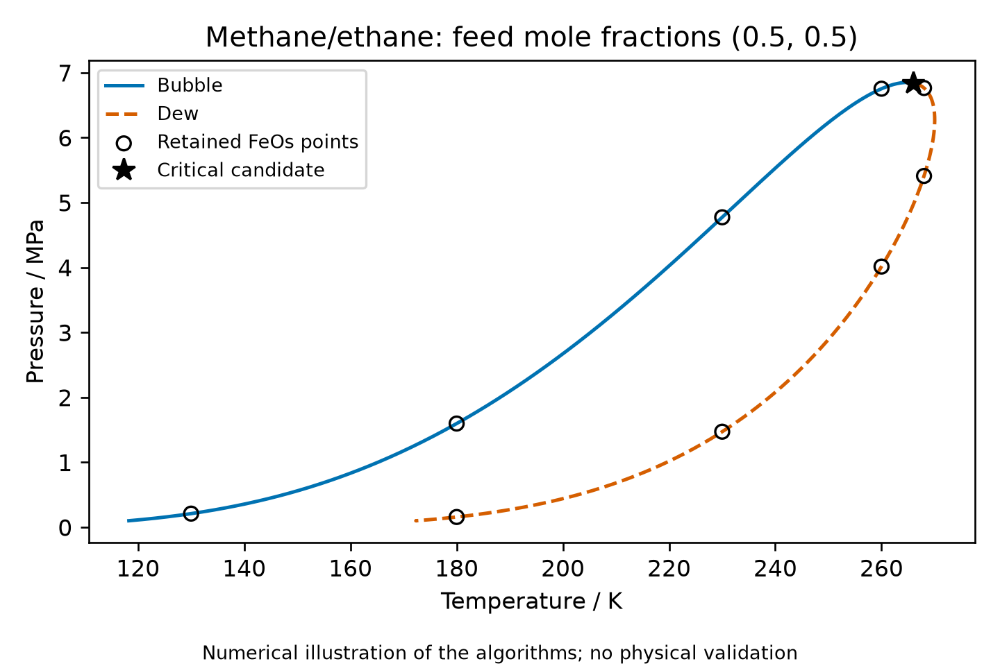
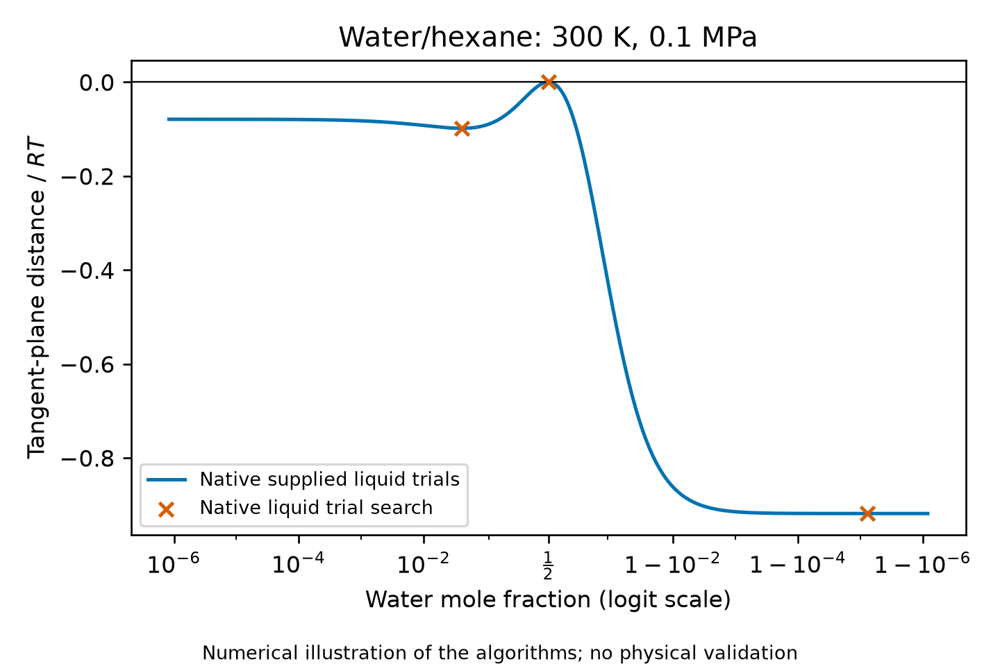

The native Engine traces the bubble and dew branches of an equal-composition
methane/ethane envelope and evaluates the liquid tangent-plane distance along
a declared water/hexane composition path.
These are numerical illustrations of the algorithms, with comparisons against
retained numerical references. They provide no physical validation.

## Phase envelope and critical candidate (F4)

The feed contains 0.5 mol methane and 0.5 mol ethane.
The [input declaration](inputs/study.json) selects the Gross methane/ethane
parameter packet used by the [open-source equilibrium comparison](../2026-open-source-equilibrium-comparison/notebook.qmd).
That comparison's equal-composition C3 critical candidate and E2 incipient
points supply the references; the pure-propane C1 case is outside this scope.
The packet supplies neutral PC-SAFT with its own mixing conventions; there
are no ions, reactions or caloric targets.
The [critical and envelope equations](../../engine/docs/equations.md#critical_equations)
and [native equilibrium algorithm](../../engine/docs/science/algorithms.md#alg-equilibrium)
own the mathematical definitions and tracing method.

The native controller begins at bubble pressure 0.1 MPa, with a temperature
initial guess of 120 K, crosses the critical region and closes on the dew
branch at the starting pressure.
Its maximum logarithmic step is 0.02 and its critical straddle is 0.01.
The [retained trace](results/envelope.csv) contains 515 accepted states:
285 bubble points and 230 dew points.
Every state meets the requested defining-row tolerance.
The [terminal record](results/trace.json) retains 514 attempts, zero retries,
and one critical candidate at approximately 266 K, 6.84 MPa and
8.67 kmol per cubic metre.
Its full-precision temperature, pressure, molar density, eigenvalues, cubic
condition and achieved residual are retained in that record.
The candidate agrees with the equal-composition FeOs critical reference within
the relative tolerance declared in the input file.
A critical-equation root alone does not establish global stability.

The [cross-checks](results/crosschecks.csv) compare all nine retained FeOs
incipient points with linear interpolation between adjacent native trace
states on the same bubble or dew branch, at the reference temperature.
When a temperature crosses the dew branch twice, the comparison selects the
segment with the smallest maximum relative discrepancy across pressure,
feed density, incipient density and incipient methane mole fraction.
Thus the two distinct dew points at 268 K remain distinct comparisons.
The illustration tolerance is 0.1% relative for each quantity; it measures
curve sampling and interpolation agreement, not experimental uncertainty or
nonlinear solve accuracy.
The largest relative discrepancy is 0.0296%, in feed density at the
lower-pressure dew point at 268 K.
Each reference lies within the declared tolerance.
The separate defining-row residuals and critical spectrum remain numerical
solution diagnostics; they do not measure model discrepancy.

## Tangent-plane distance path (F3)

The [retained discovery case](../2026-tpd-phase-discovery/results/main-8298c602/feos.csv)
is the single-liquid, equal-feed water/hexane case at 300 K and 0.1 MPa.
The source's water identifier is `water_np`.
The parameter conversion in the [original producer](../2026-tpd-phase-discovery/scripts/feos_compare.py)
supplies its two association sites, segment parameters and zero binary
interaction coefficient unchanged.
The [tangent-plane algorithm](../../engine/docs/science/algorithms.md#alg-stability)
freezes the tangent plane of that single-liquid central result.
For each trial composition the native supplied-trial evaluator resolves the
liquid density and returns dimensionless tangent-plane distance, $\mathrm{TPD}/RT$.

The declared path is $x_\mathrm{water}(v)=1/(1+\exp(-v))$ and
$x_\mathrm{hexane}=1-x_\mathrm{water}$, with 401 uniformly spaced values
of $v$ between $-14$ and $14$, augmented by the three native liquid search
compositions. The [404 retained evaluations](results/tpd.csv) include all
returned numerical diagnostics.
The [liquid search points](results/search.csv) coincide with those of the
retained discovery case; the crosses mark these search results, not
optimizer iterates.

The smallest retained distance is approximately $-0.918\,RT$, at the
water-rich search point. The other descending liquid search point has distance
approximately $-0.0984\,RT$; the central equal-composition trial lies at zero
within numerical rounding.
Full-precision locations, distances, pressure rows and association error
estimates are retained alongside the values.
Negative distances and the native finite donor-split witnesses show that the
single-liquid feed can lower its Gibbs energy by splitting under this model.
The supplied path is a fixed composition sweep, not the optimizer trajectory.
Its sampled minimum is not a global minimum certificate, and the finite native
trial search does not prove global phase stability or physical accuracy.
Local arithmetic and association estimates are numerical diagnostics, not
rigorous uncertainty bounds or source-parameter uncertainties.

## Reproduction and claim limit

[Input and extension hashes](results/provenance.json) identify the calculation.
[The README](README.md) gives the separate calculation and rendering commands.
The figures draw lines only through retained model evaluations; the envelope
references and native search results are points.
No Engine source or manuscript text changed.
These results have not received independent scientific review or investigator
promotion for the manuscript.
