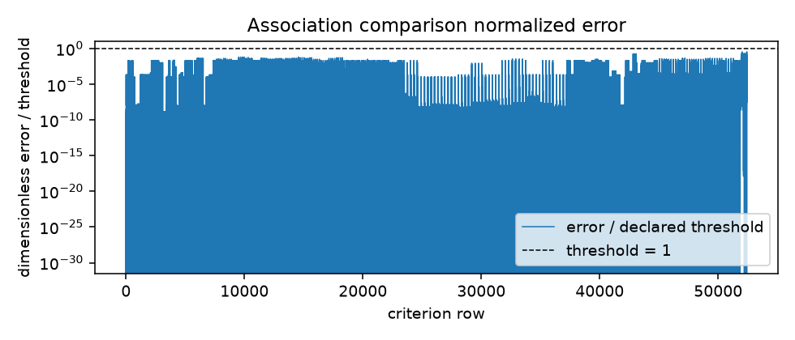

## Question

Does the fixed-depth (8, 16, 24, and 32 correction) log-Newton association
candidate agree with the implicit mass-action reference for site fractions,
Helmholtz values, and first/second derivatives on the retained synthetic states?

## Retained evidence

- [`association-comparison.csv.gz`](association-comparison.csv.gz) — one homogeneous table of recorded values and comparison rows.
- [`inputs.csv`](inputs.csv) — one keyed row per declared native input case.
- [`campaign-manifest.json`](campaign-manifest.json) — selector and per-case/depth status, including unattempted states.
- [`summary.json`](summary.json) — compact run identity, wheel SHA-256, counts, outcome, and claim limits.

The candidate keeps state-dependent association strengths and AD-valued
temperature, volume, amounts, and active association coordinates on its graph.
The reference is the independent implicit mass-action reconstruction. The
exact-zero production weighted-Hessian probe is retained as a known limitation;
the regular unweighted reference remains available for that state.
The reported energies are extensive dimensionless quantities: Φ_assoc = N a_assoc
and Φ_res = N a_res = A_res/(R T), not molar or dimensional A values.

## Retained-data summary

The following cell reads only the retained CSV and summary. It performs no
Engine import, solve, or model rerun.

```{python}
import csv
import hashlib
import gzip
import json
import math
import os
import matplotlib.pyplot as plt
from collections import Counter
from pathlib import Path

root = Path(os.environ.get("QUARTO_PROJECT_DIR", ".")) / "analyses/2026-association-native-comparison"
if not (root / "results/summary.json").is_file(): root = Path.cwd()
summary = json.loads((root / "results/summary.json").read_text())
manifest = json.loads((root / "results/campaign-manifest.json").read_text())
inputs = list(csv.DictReader((root / "results/inputs.csv").open()))
rows = list(csv.DictReader(gzip.open(root / "results/association-comparison.csv.gz", "rt", newline="")))
criterion = [row for row in rows if row.get("verdict") in {"True", "False"}]
for path, key in (("association-comparison.csv.gz", "retained_csv_sha256"), ("inputs.csv", "inputs_csv_sha256"),
                  ("campaign-manifest.json", "campaign_manifest_sha256"), ("association-comparison.png", "plot_sha256")):
    data = (root / "results" / path).read_bytes()
    actual = hashlib.sha256(gzip.decompress(data) if path.endswith(".gz") else data).hexdigest()
    if actual != summary.get(key):
        raise ValueError(f"Stale or unverified retained artifact: {path}")
if summary.get("counts", {}).get("native_validation", {}).get("complete") is not True:
    raise ValueError("Cached interpretation lacks complete native validation")
conditioning = []
for row in rows:
    if row.get("quantity") != "reference_condition":
        continue
    try:
        value = float(row["model"])
    except (KeyError, TypeError, ValueError):
        continue
    if math.isfinite(value):
        conditioning.append(value)
interp = summary["interpretation"]
group_maxima = summary["error_to_threshold_by_group"]
full_observed = summary["resource_limits"].get("observed", {})
pilot_observed = summary["pilot"].get("observed", {})
depth_labels = sorted(interp["depth_outcomes"], key=int)
depth_counts = {label: interp["depth_outcomes"][label] for label in depth_labels}
domain_counts = interp["partition_outcomes"]
unavailable_cases = sorted(case["case_id"] for case in manifest["cases"] if case["selected"] and "criterion_or_reference_unavailable" in case["depth_status"].values())
print(f"ALL input cases: {len(inputs)}/{interp['all_states']['input_cases']} | states: {manifest['coverage']['attempted_states']}/{interp['all_states']['state_slots']} | partitions: {Counter(row.get('partition', '') for row in inputs)} / {interp['partition_denominators']} | strata: {Counter(row.get('stratum', '') for row in inputs)} / {interp['stratum_denominators']}")
print(f"Rows: {len(rows)} ({len(criterion)} criterion) | failed: {summary['counts']['failed']} | unavailable: {summary['counts']['unavailable']} | value-qualified: {interp['value_qualified_states']} | derivative-qualified: {interp['derivative_qualified_states']} | value-only: {interp['value_only_states']} | pilot: {summary['pilot'].get('run_id', 'unavailable')} ({pilot_observed.get('wall_seconds', 'unavailable')} s; RSS {pilot_observed.get('peak_rss_bytes', 'unavailable')} B) | full: ({full_observed.get('wall_seconds', 'unavailable')} s; RSS {full_observed.get('peak_rss_bytes', 'unavailable')} B)")
print(f"Depth comparison: {depth_counts} | smallest qualified depth: {interp['smallest_depth_for_qualified_case']} | oracle cases: {[(case['case_id'], interp['smallest_depth_by_case'][case['case_id']]) for case in manifest['cases'] if case['case_id'] in unavailable_cases]} | oracle failures: {interp['oracle_failure_cases']}")
depth_claim = "improve qualification" if any(depth_counts[label]["passed"] > depth_counts[depth_labels[0]]["passed"] for label in depth_labels[1:]) else "add no qualification gain"
print(f"Conclusion (data-derived): depth {depth_labels[0]} passes {depth_counts[depth_labels[0]]['passed']} states; greater depths {depth_claim}; unknown cases={unavailable_cases}")
print(f"Worst normalized error/threshold: {max(group_maxima.values(), default=0.0):.3e}")
print("Normalized maxima by comparison group:", group_maxima)
if conditioning:
    print(f"Reference condition range: {min(conditioning):.3e}–{max(conditioning):.3e}")
else:
    print("Reference conditioning diagnostics unavailable")
print("Rows by comparison group:", dict(Counter(row["comparison_group_id"] for row in rows)))
for stratum, outcome in interp["stratum_outcomes"].items():
    print(f"{stratum}: {outcome['input_cases']}/{outcome['expected_input_cases']} cases; passed {outcome['passed_states']}, reference unavailable {outcome['reference_unavailable_states']}, unattempted {outcome['unattempted_states']}")
figure, axes = plt.subplots(1, 2, figsize=(9, 3))
labels = depth_labels
passed = [depth_counts[label]["passed"] for label in labels]
unavailable = [depth_counts[label]["criterion_or_reference_unavailable"] for label in labels]
axes[0].bar(labels, passed, label="passed")
axes[0].bar(labels, unavailable, bottom=passed, label="reference unavailable")
labels = list(domain_counts)
passed = [domain_counts[label]["passed_states"] for label in labels]
unavailable = [domain_counts[label]["reference_unavailable_states"] for label in labels]
axes[1].bar(labels, passed, label="passed")
axes[1].bar(labels, unavailable, bottom=passed, label="reference unavailable")
axes[0].set(title="Depth comparison", xlabel="corrections", ylabel="state slots")
axes[1].set(title="Partition/domain coverage", xlabel="partition", ylabel="state slots")
axes[1].tick_params(axis="x", rotation=25)
for axis in axes:
    axis.legend(fontsize="small")
figure.tight_layout()
plt.show()
```

The declared numerical criteria, read from the retained rows: `reference_scale`
admits error ≤ atol + rtol·|reference|, `strict_reference_or_one` admits
rtol·max(1, |reference|) and `strict_absolute` admits atol. Derivative errors
are coordinate-scaled; the centered groups are finite-difference controls.

```{python}
criteria = Counter((row["comparison_group_id"], row["rule"], row["atol"], row["rtol"]) for row in criterion)
print("\n".join(f"{group}: {rule}, atol {atol}, rtol {rtol} ({count} rows)"
                 for (group, rule, atol, rtol), count in sorted(criteria.items())))
```

The association volume parameter κ is dimensionless; the state-dependent
association strength Δ carries ų. Independent coordinates are temperature
(K), volume (m³), component amounts (mol), and active association energy-over-K
(K) or κ (dimensionless), scaled from the base state values T, V, and N; the active-coordinate scales
are declared in `scale_for` in `engine/tests/native/association_comparison_checks.cpp`.

{fig-alt="Dimensionless comparison error divided by declared threshold by retained criterion row; the dashed threshold is one."}

## Claim boundary

The result supports only the retained synthetic neutral fixed-volume states and
the recorded value/derivative identities. It does not qualify all mixtures,
pressure-closed density derivatives, equilibrium, third-order derivatives, or
replacement of the production association solver.
