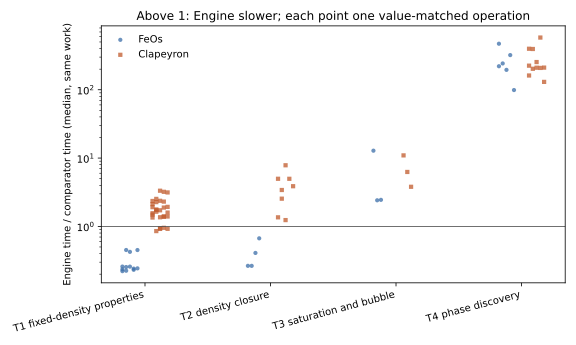

```{python}
import csv, gzip, json, re, statistics as st
from collections import Counter
from pathlib import Path
R, I = Path('results'), Path('inputs')
def rows(name):
    path = R / name
    return list(csv.DictReader(gzip.open(path, 'rt') if name.endswith('.gz') else path.open())) if path.exists() else []
S, C, V, A, T, W = (rows(n) for n in ('statistics.csv', 'checks.csv', 'verification.csv', 'answers.csv', 'timings.csv.gz', 'work.csv.gz'))
IMG = json.loads((R / 'image.json').read_text())
PRIOR = json.loads((I / 'prior.json').read_text())
INPUTS = json.loads((I / 'inputs.json').read_text())
STAT = {(r['section'], r['operation'], r['tool']): r for r in S}
def med(sec, op, tool='Engine'):
    r = STAT.get((sec, op, tool))
    return None if r is None else float(r['median_s'])
def us(x):
    return '—' if x is None else f'{x * 1e6:.3g}'
def ms(x):
    return '—' if x is None else f'{x * 1e3:.3g}'
def g(x, d=3):
    return '—' if x in (None, '') else f'{float(x):.{d}g}'
def table(headers, body):
    print('\n| ' + ' | '.join(headers) + ' |\n|' + '|'.join('---' for _ in headers) + '|')
    for b in body:
        print('| ' + ' | '.join(str(v) for v in b) + ' |')
    print()
timed = [t for t in T if t.get('sample') not in (None, '') and t['section'] != 'T7-disturbed-amine-fit']
loads = [float(t['load1_before']) for t in timed]
hosts = Counter(t['host'] for t in timed)
status = Counter(re.sub(r' \(#\d+\)| #\d+', '', a['status']) for a in A)
questions = {a['audit_id'].split(' (')[0] for a in A} - {'—'}
```

## Outcome

Every kept speed question was measured on main `{python} IMG['commit'][:8]`, the Engine's frozen editable image,
against FeOs and Clapeyron at identical parameters where the same work exists. The status table has `{python} len(A)` rows:
`{python} len(questions)` audit questions, with F-S10 split into its NaCl and reacting parts, plus `{python} status['new']`
finding the campaign itself made. Rows by status: `{python} '; '.join(f'{k} {v}' for k, v in status.most_common())`.

No timed block met the strict quiet-host gate: the one-minute load before the `{python} len(timed)` timed samples ranged
from `{python} g(min(loads))` to `{python} g(max(loads))`, from the desktop and from other projects' agents. Samples are
`{python} hosts['loaded']` loaded and `{python} hosts.get('disturbed', 0)` disturbed (an outside fit or compiler process
at a block boundary); `{python} hosts.get('quiet', 0)` are quiet. Every number below is therefore a shared-host measurement. The owner accepted these loaded-host results
for relative comparisons only; no time below is an absolute speed claim.
Ratios count only for value-matched equal work and are ties when inside the Engine's own A=A spread.
This is numerical verification and software timing, not physical validation.



## Status of each audit question

```{python}
#| output: asis
table(['T', 'Audit ID', 'Finding', 'Status at current main', 'Measured answer'],
      [(a['T'], a['audit_id'], a['finding'], a['status'], a['answer']) for a in A])
```

## Conditions

```{python}
#| output: asis
ident = []
for path in sorted((R / 'raw').glob('*.jsonl.gz')):
    try:
        for line in gzip.open(path, 'rt'):
            r = json.loads(line)
            if r['kind'] == 'identities':
                ident.append((path.name, r))
    except EOFError:
        pass
first = ident[0][1]['identities'] if ident else {}
feos = next((r['identities']['FeOs'] for _, r in ident if 'FeOs' in r['identities']), {})
clap = next((r['identities']['Clapeyron'] for _, r in ident if 'Clapeyron' in r['identities']), {})
table(['Item', 'Record'], [
    ('Engine commit', IMG['commit']),
    ('Engine images (SHA-256, first 12)', ', '.join(f'{k}: {v[:12]}' for k, v in IMG['libraries_sha256'].items())),
    ('Engine loading', 'install-plan mapping through scripts/guard.py; rebuilds and process launches refused'),
    ('FeOs', f"{feos.get('version', '—')}, {feos.get('python', '—')}"),
    ('Clapeyron', f"{clap.get('version', '—')} on Julia {clap.get('julia', '—')}, one process ({clap.get('unit', '—')}, PID {clap.get('pid', '—')})"),
    ('Per-call CPU', f"logical CPU {ident[0][1]['cpu'] if ident else '—'}, one numerical thread, nice 10"),
])
sections = sorted({t['section'] for t in timed})
table(['Section', 'Samples', 'Load before, min', 'Load before, max', 'Loaded', 'Disturbed', 'Quiet'],
      [(s, sum(1 for t in timed if t['section'] == s), g(min(float(t['load1_before']) for t in timed if t['section'] == s)),
        g(max(float(t['load1_before']) for t in timed if t['section'] == s)),
        sum(1 for t in timed if t['section'] == s and t['host'] == 'loaded'),
        sum(1 for t in timed if t['section'] == s and t['host'] == 'disturbed'),
        sum(1 for t in timed if t['section'] == s and t['host'] == 'quiet')) for s in sections])
```

The first T7 attempt overlapped an outside 28-worker fit and was stopped; its blocks are kept as
`results/raw/T7-disturbed-amine-fit.jsonl.gz` and excluded. The owner then paused that agent for this campaign.

## T7 — key application solves

```{python}
#| output: asis
k = PRIOR['key_517a3450']
work = {}
for w in W:
    if w['section'] == 'T7' and w['arm'] == 'Engine-A':
        work.setdefault(w['operation'], {c[5:]: w[c] for c in w if c.startswith('work_') and w[c] != ''})
body = []
for case in INPUTS['t7']:
    r = STAT.get(('T7', case, 'Engine'))
    unit = 1 if case.startswith('mea-') else 1e3
    fmt = (lambda x: g(x)) if unit == 1 else (lambda x: g(x * 1e3))
    prior = k.get(case, {})
    now = work.get(case, {})
    body.append((case, fmt(float(r['median_s'])), f"{fmt(float(r['min_block_s']))}–{fmt(float(r['max_block_s']))}",
                 fmt(prior['seconds']) if prior else '—', ' / '.join(str(int(float(v))) for v in now.values()),
                 ' / '.join(map(str, prior.get('work', {}).values())) or '—', 's' if unit == 1 else 'ms'))
table(['Operation', 'Now, median', 'A=A block range', '517a3450', 'Work now', 'Work at 517a3450', 'Unit'], body)
```

Ionic LLE, MEA flash, the Khudaida sequence and unloaded MEA do identical native work to `517a3450`
(iterations / evaluations / Hessian calls). The F1 work order is reference computations / reference columns /
density solves / equilibrium iterations. Times are absolute loaded-host medians over A and control blocks.

## T3 — represented saturation and bubble calls

```{python}
#| output: asis
h, c533 = PRIOR['history_549'], PRIOR['issue_533']
body = []
for op in INPUTS['t3']:
    e, f, c = med('T3', op), med('T3', op, 'FeOs'), med('T3', op, 'Clapeyron')
    aa = STAT[('T3', op, 'Engine')]['spread_factor']
    body.append((op, us(e), g(aa), us(f), us(c), g(e / f), g(e / c), us(h.get(op, {}).get('seconds')),
                 us(c533.get(op, {}).get('Clapeyron_seconds')), us(c533.get(op, {}).get('FeOs_seconds'))))
table(['Operation', 'Engine µs', 'Engine A=A factor', 'FeOs µs', 'Clapeyron µs', 'Engine/FeOs', 'Engine/Clapeyron',
       'Engine at cf26a17b µs', 'Clapeyron #533 µs', 'FeOs #533 µs'], body)
t3c = [c for c in C if c['section'] == 'T3' and c['comparison'] != 'same image']
```

All `{python} len(t3c)` cross-tool pressure, density and composition checks pass the equilibrium criteria
(`{python} sum(c['passed'] == 'True' for c in t3c)` passed).

## T1 — fixed-density properties and requested actions

```{python}
#| output: asis
def order_median(sid, n):
    xs = [float(r['median_s']) for r in S if r['section'] == 'T1' and r['tool'] == 'Engine'
          and r['operation'].startswith(sid + '/action-') and r['operation'].count('+') == n - 1]
    return st.median(xs) if xs else None
verdicts = {}
for v in V:
    if v['section'] == 'T1-verify':
        verdicts.setdefault(v['state'], Counter())[v['verdict']] += 1
body = []
for s in INPUTS['t1']:
    sid = s['id']
    b = f'{sid}/bundle'
    fm = STAT.get(('T1', b, 'FeOs'))
    cm = STAT.get(('T1', b, 'Clapeyron'))
    vc = verdicts.get(sid, Counter())
    body.append((sid, us(med('T1', b)), us(med('T1', b, 'FeOs')) + ('' if not fm or fm['value_matched'] == 'True' else ' (values differ)'),
                 us(med('T1', b, 'Clapeyron')) + ('' if not cm or cm['value_matched'] == 'True' else ' (values differ)'),
                 us(order_median(sid, 1)), us(order_median(sid, 2)), us(order_median(sid, 3)),
                 f"{vc['verified']} / {vc['unresolved verification']} / {vc['inadmissible chart']}"))
table(['State', 'Bundle, Engine µs', 'FeOs µs', 'Clapeyron µs', 'Order-1 action µs', 'Order-2 µs', 'Order-3 µs',
       'Verified / unresolved / inadmissible'], body)
```

The bundle is a fresh fixed-density state with pressure, residual enthalpy, residual isochoric heat capacity,
component ln φ and reduced residual Helmholtz energy. Actions are ResidualEnthalpy directional derivatives along
T, ρ and $e_i-e_\mathrm{last}$, one mixed derivative per request; the medians are over all requests of that order.

```{python}
#| output: asis
body = []
for s in INPUTS['t1']:
    if not s['neutral_property']:
        continue
    for o in ('Value', 'Gradient', 'Hessian'):
        op = f"{s['id']}/helmholtz-{o}"
        e, c = med('T1', op), med('T1', op, 'Clapeyron')
        body.append((s['id'], o, us(e), g(STAT[('T1', op, 'Engine')]['spread_factor']), us(c),
                     g(e / c) + (' (tie)' if STAT[('T1', op, 'Clapeyron')]['tie'] == 'True' else '')))
table(['Pure state', 'Order of a_res/(RT) in (T, ρ)', 'Engine µs', 'Engine A=A factor', 'Clapeyron µs (ForwardDiff)', 'Engine/Clapeyron'], body)
fail = [c for c in C if c['section'] == 'T1' and c['passed'] != 'True']
```

`{python} len(fail)` of `{python} sum(1 for c in C if c['section'] == 'T1' and c['comparison'] != 'same image')`
cross-tool T1 value checks fail; all are FeOs rows for the polar acetone state, the three P07 brine states and one
liquid-propane pressure, where FeOs's constants differ (audit P07 and the Sol comparison). Those FeOs times are not ranked.

```{python}
#| output: asis
un = [v for v in V if v['section'] == 'T1-verify' and v['verdict'] == 'unresolved verification']
table(['State', 'Order', 'Directions', 'Coarse error', 'Fine error', 'Allowed', 'Halving ratio', 'Diagnosis'],
      [(v['state'], v['order'], v['directions'], g(v['coarse_error']), g(v['fine_error']), g(v['allowed']), g(v['halving_ratio']), v.get('diagnosis', ''))
       for v in un])
```

Unresolved rows are verification outcomes, not unavailable derivatives: where the error falls about fourfold on
halving, the frozen coarse step's truncation error exceeds the criterion while the difference converges toward the
exact action; elsewhere trace fractions or the dilute density leave the difference at round-off. Charge-changing
composition directions are refused by native admission and recorded as inadmissible charts.

## T2 — density closure

```{python}
#| output: asis
body = []
for c in INPUTS['t2']['ordinary'] + INPUTS['t2']['ethane_loop']:
    i = c['id']
    body.append((i, us(med('T2', f'{i}/pressure-cold')), us(med('T2', f'{i}/pressure-anchored')), us(med('T2', f'{i}/fixed-density')),
                 us(med('T2', f'{i}/pressure-cold', 'FeOs')) + ('' if STAT.get(('T2', f'{i}/pressure-cold', 'FeOs'), {}).get('value_matched', 'True') == 'True' else ' (roots differ)'),
                 us(med('T2', f'{i}/pressure-cold', 'Clapeyron'))))
table(['Declared branch', 'Engine cold µs', 'Engine anchored µs', 'Engine fixed density µs', 'FeOs µs', 'Clapeyron µs'], body)
body = [(c['id'], *(us(med('T2', f"{c['id']}/pressure-action-{k}")) for k in ('[0]', '[1]', '[0, 0]', '[0, 1]', '[1, 1]')))
        for c in INPUTS['t2']['ethane_loop']]
table(['Ethane loop state', 'd/dT µs', 'd/dP µs', 'd²/dT² µs', 'd²/dTdP µs', 'd²/dP² µs'], body)
o = [c for c in C if c['section'] == 'T2' and 'oracle' in c['comparison']]
```

Per call over the declared pressure sequence. `{python} sum(c['passed'] == 'True' for c in o)` of `{python} len(o)`
roots match the retained density oracle within its relative criterion. Pressure-chart actions are ResidualEnthalpy
derivatives along T (1 K) and P (1 Pa) at the central pressure.

## T4 — unknown phase count

```{python}
#| output: asis
def raw_blocks(name):
    out = []
    try:
        for line in gzip.open(R / 'raw' / f'{name}.jsonl.gz', 'rt'):
            r = json.loads(line)
            if r['kind'] == 'block':
                out.append(r)
    except (EOFError, FileNotFoundError):
        pass
    return out
disc = {r['operation']: r['reply']['samples'][0]['value'][0] for r in raw_blocks('T4')
        if r['arm'] == 'Engine-A' and r['repetition'] == 0 and r['operation'].endswith('/discover') and 'sequence' not in r['operation']}
fail = {c['operation'] for c in C if c['section'] == 'T4' and c['passed'] != 'True'}
body = []
for op, row in disc.items():
    w = row.get('discovery', {}).get('work', {})
    body.append((op.rsplit('/', 1)[0], row.get('phases'), g(w.get('driver_invocations')), g(w.get('evaluations')), ms(med('T4', op)),
                 ms(med('T4', op, 'FeOs')) + (' (FeOs failed)' if op in fail else ''), ms(med('T4', op, 'Clapeyron')),
                 ms(med('T4', op.replace('/discover', '/michelsen'), 'Clapeyron'))))
table(['System / T-P', 'Phases', 'Driver invocations', 'Evaluations', 'Engine Discover ms', 'FeOs tp_flash ms', 'Clapeyron default ms', 'Clapeyron Michelsen ms'], body)
table(['Sequence', 'Discover, whole sequence ms', 'Discovered topology, started at the discovered state ms', 'Same topology, previous result as start ms'],
      [(sys, *(ms(med('T4', f'{sys}/sequence/{m}')) for m in ('discover', 'declared-cold', 'declared-sequence'))) for sys in ('methane_ethane', 'methanol_hexane')])
```

Discovery work comes from the native discovery record (driver invocations include stability trials and rejected
declarations). The discovered declaration carries the accepted discovered state as its start
(`phase_stability.cpp`, `finish`), so the middle column re-solves from the answer rather than from a cold guess.
Clapeyron returns the same phase count and states at every point.

## T6 — NaCl activity curve

```{python}
#| output: asis
t6 = {r['operation']: [s for b in raw_blocks('T6') if b['operation'] == r['operation'] for s in b['reply']['samples']] for r in S if r['section'] == 'T6'}
re_ = t6.get('nacl/reused', [])
table(['Curve of 30 molalities', 'Median ms', 'Reference part ms', 'Activity part ms'],
      [('Engine: one reference, 30 activity calls', ms(med('T6', 'nacl/reused')), ms(st.median(s['reference_seconds'] for s in re_)), ms(st.median(s['curve_seconds'] for s in re_))),
       ('Engine: fresh reference at every point', ms(med('T6', 'nacl/fresh')), '—', '—'),
       ('Clapeyron mean_ionic_activity_coefficient (values differ)', ms(med('T6', 'nacl/clapeyron-curve', 'Clapeyron')), '—', '—')])
```

## T8 — solved-state actions after one central solve

```{python}
#| output: asis
body = []
for case in ('isomerisation', 'bubble-C2', 'ionic-lle'):
    o2 = [float(r['median_s']) for r in S if r['section'] == 'T8' and r['operation'].startswith(f'{case}/order-2')]
    o3 = [float(r['median_s']) for r in S if r['section'] == 'T8' and r['operation'].startswith(f'{case}/order-3')]
    body.append((case, us(med('T8', f'{case}/first-batch-1')), us(med('T8', f'{case}/first-batch-2')), us(med('T8', f'{case}/first-batch-all')),
                 us(med('T8', f'{case}/first-separate-all')), us(st.median(o2)), us(st.median(o3))))
table(['Case', 'Batched first, 1 direction µs', '2 directions µs', 'All directions µs', 'Separate requests, all µs', 'Order 2 median µs', 'Order 3 median µs'], body)
tv = Counter(v['verdict'] for v in V if v['section'] == 'T8-verify')
```

Verification outside timing: `{python} tv['passed']` batch/separate and analytic checks pass,
`{python} tv['verified']` re-solve differences verify, `{python} tv['unresolved verification']` is unresolved and
`{python} tv['no independent replay (parameter directions only)']` parameter-only combinations have no independent replay.

## T9 — fitting throughput

```{python}
#| output: asis
fits = raw_blocks('T9-fits')
body = []
for r in fits:
    s = r['reply']['samples'][0]
    v = s['value']
    body.append((r['operation'], r['arm'], g(s['seconds']), g(max(0.0, s.get('child_cpu_seconds') or 0)), v['status'], v['iterations'], v['jacobian_evaluations'],
                 g(v['final_cost']), g(r['before']['load'][0]), g(r['after']['load'][0]), ', '.join(sorted({b[1] for b in r['before'].get('busy_outside', []) + r['after'].get('busy_outside', [])}))))
table(['Fit', 'Arm', 'Wall s', 'Worker CPU s', 'Status', 'Iterations', 'Jacobians', 'Final cost', 'Load before', 'Load after', 'Outside CPU consumers'], body)
table(['Family', 'Serial residual + Jacobian at start', 'At nearby point', 'Engine A=A factor'],
      [(f, us(med('T9-serial', f'{f}/evaluate-shift-0.0')), us(med('T9-serial', f'{f}/evaluate-shift-0.0001')),
        g(STAT[('T9-serial', f'{f}/evaluate-shift-0.0', 'Engine')]['spread_factor'])) for f in ('propane', 'electrolyte', 'F1')])
```

Bounded fits stop after one iteration with identical iterates and costs across worker counts, so their walls compare
scheduling only. Worker CPU is child-process CPU; zero means the work stayed in the parent.

## T10 — process callbacks

```{python}
#| output: asis
body = []
for f in ('property', 'equilibrium'):
    for k in (0, 1, 2):
        body.append((f, k, us(med('T10', f'{f}/fgh{k}/alternating')), us(med('T10', f'{f}/fgh{k}/alternating/native')), us(med('T10', f'{f}/fgh{k}/same'))))
table(['Record', 'fgh', 'ASL node, changed controls µs', 'Native same node µs', 'ASL node, repeated controls µs'], body)
coh = {}
for r in raw_blocks('T10-cohorts'):
    coh.setdefault(r['operation'], []).append(r['reply']['samples'][0]['nodes_per_second'])
table(['Cohort (record / threads-records)', 'Nodes per second, each arm and repetition'], [(k, ', '.join(g(x) for x in v)) for k, v in sorted(coh.items())])
par = [c for c in C if c['section'] == 'T10' and c['comparison'] == 'ASL vs native']
```

ASL and native nodes agree to a worst scaled difference of `{python} g(max(float(c['scaled_error']) for c in par), 2)` over
`{python} len(par)` node comparisons. For the property record the native column chains Python-level pressure actions and is an
equal-output reference, not a faster path. For the equilibrium record the native direct solve is faster at changed controls:
the ASL callback walks from its starting point to every other control by continuation each time (`asl_adapter.cpp`,
`select_feed`); the answers table gives the per-node split.

## T11 — thermal signatures

```{python}
#| output: asis
body = []
for r in raw_blocks('T11'):
    if r['arm'] == 'Engine-A' and r['repetition'] == 0:
        s = r['reply']['samples'][0]
        body.append((r['operation'], s['per_call'], us(med('T11', r['operation'])), s['counters']['recordings']))
table(['Sequence on one reusable model', 'Calls', 'Median per call µs', 'Tape recordings'], body)
chk = [b for b in raw_blocks('T11-check')][0]['reply']['samples'][0]['value']
```

The three-interval record is a manufactured NASA9 function with constant heat capacity; fresh-model ideal enthalpy matches
its analytic line (`engine/tests/native_inputs.py:p3_forms`) to within `{python} g(max(abs(r['ideal_enthalpy'] - r['analytic_ideal']) for r in chk), 2)` J/mol at all three states.

## T14 — PH round trip replay

```{python}
#| output: asis
rep = raw_blocks('T14-replay')[0]['reply']['samples'][0]['value']
table(['Audit declaration', 'Success', 'Iterations', 'T relative error'],
      [(r['case'], r['success'], r.get('iterations', '—'), g(r.get('T_rel_error'), 2)) for r in rep])
```

The audit recorded 66 iterations for the benzene/toluene PH round trip; #579's fix is in current main.


## Limits

- No block was quiet: rankings are shared-host observations on one pinned CPU. The A=A spread for every Engine time is in
  `results/statistics.csv`; the T1 Helmholtz, T3, T7 and T9 serial tables show it beside the time, and ratios inside it are ties.
- Comparator ratios exclude every row whose returned values differ beyond the stated criteria.
- T5, T12 and T13 were not timed (design). The #565 and #571 fixes are cited from their delivered records and not re-timed;
  #579's fix is confirmed by the T14 replay above.
- Times include each tool's own call interface; FeOs is called through Python, Clapeyron natively inside Julia.
