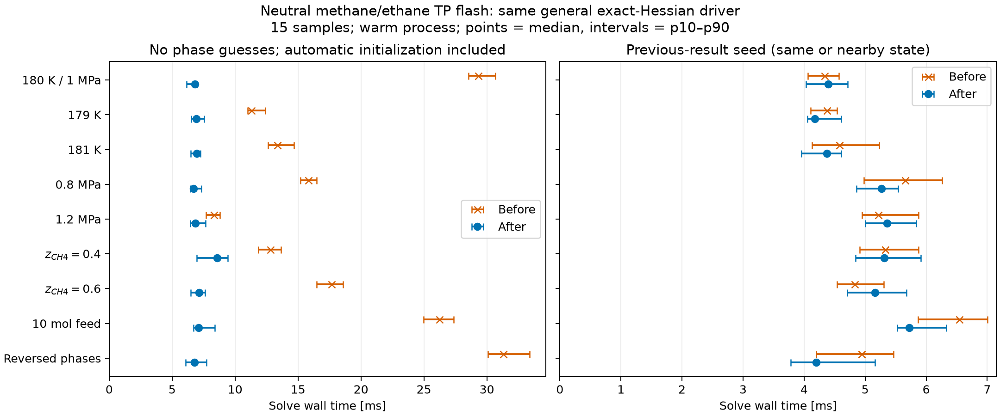

## Integration with repaired admission

The integrated source `5fb4ab5343babf92b6def99025f8f14689df2e32` preserves the
current declared-density-branch admission and returned-point ionic multipliers.
Against repaired baseline `7b70ddca45b9b142e083e94c84173c0d3c6ba273`, the same
270-result protocol gives the following canonical-case medians. Both processes
used CPU 0, nice 19, one BLAS/OpenMP thread, two warmups and 15 measured calls.

| Canonical case | Repaired baseline [ms] | Integrated [ms] |
|---|---:|---:|
| Cold nonlinear, wall | 41.093 | 14.301 |
| Cold nonlinear, CPU | 41.097 | 14.305 |
| Previous result, wall | 21.424 | 6.624 |
| Previous result, CPU | 21.429 | 6.626 |

Cold iterations fall from 50 to 7; previous-result iterations remain 7.
The measured wall-time ratios are 2.87 and 3.23 respectively. Across the nine
controls, integrated cold medians span 11.50–14.30 ms, and previous-result medians
6.02–8.14 ms. The 5 ms cold target is still unmet. The compact table is used
instead of a new plot because it contains only two timing comparisons.

All 270 results succeed. Maximum classified residual is `7.44e-15` against
the unchanged `1e-10` criterion. Maximum changes from the repaired baseline are
`2.94e-15` in phase/composition fractions and `1.52e-15` relative density, below
the frozen `1e-8` and `1e-7` bounds. Separately resolving each returned phase's
declared density root differs by at most `7.42e-14` relatively. External package
values remain unchanged; external packages were not rerun.

The installed-wheel affected gate passes all 53 public tests and six native
fast suites. Separate full equilibrium and boundary suites pass. Re-recording
all 444 native transport rows changes 100 E5-1 neutral-ternary action rows:
the largest absolute change is `1.66e-9 Pa` on an approximately `2000 Pa` A1;
for previous magnitudes above `1e-9`, the largest relative change is `9.53e-13`.
Near-zero rows move by at most `3.08e-11 Pa`. All native numerical criteria
pass unchanged; the remaining 344 retained rows are byte-identical.

The implementation adds 124 gross native lines (96 net) and 21 numerical-test
lines; Properties is 3487/3490 and total runtime 15982/17450. It reuses the
existing no-site Hessian loop and preserves all nonempty-site arithmetic.
Timing evidence remains limited to this neutral interior-flash neighborhood.

The [integration baseline samples](results/performance-integration-before.csv)
and [integrated samples](results/performance-integrated.csv) retain every result;
their matching JSON files retain wheel hashes and resource settings.
Baseline wheel: `7a9a133a8f6744b43c6d35a126663d647071aa79d8a9229a149b69dc374287b0`.
Integrated wheel: `598c37ed62a914f886d746687aec80a42945d66fcdb564d9994e23a92f0ea20f`.
Reproduce with the integrated wheel installed, a fresh output label, and the
current baseline explicitly selected:

```bash
taskset -c 0 nice -n 19 env OMP_NUM_THREADS=1 OPENBLAS_NUM_THREADS=1 MKL_NUM_THREADS=1 \
  .venv/bin/python analyses/2026-binary-methane-ethane-tp-flash/scripts/performance.py integration-replay \
  --baseline analyses/2026-binary-methane-ethane-tp-flash/results/performance-integration-before.csv
```

## Original local performance study

This section and its original before/after tables describe the local #94
candidate at `cd8144fb`, before integration with the later density-branch and
ionic-multiplier repairs. They are retained historical evidence.

The general ePC-SAFT equilibrium driver on that wheel solves the methane/ethane flash
in **6.80 ms rather than 29.32 ms** without supplied phase guesses, a **4.31-fold**
improvement in the measured median.
Its Ipopt iteration count falls from 50 to 7.
The 5 ms cold-solve target and the 1 ms target are not achieved by this qualified candidate.
The same-state previous-result solve remains about 4.4 ms, with no meaningful
improvement established for that mode.

## Conditions and meaning of cold

The case uses the [Gross–Sadowski methane/ethane parameter packet](../../data/packets/gross-2001-methane-ethane/2/parameters/parameters.json),
neutral PC-SAFT with no association, $k_{ij}=0$, $T=180$ K, $P=1$ MPa,
and a 1 mol feed with $z=(0.5,0.5)$.
Both phase amounts and compositions are free; this is an interior TP flash, not a bubble or dew calculation.
The independent package values remain in [values.csv](results/values.csv) and
their source identities in [provenance.json](results/provenance.json).
External packages were not rerun during this performance study.

“Cold” in the sample table means a fresh nonlinear solve without supplied phase
guesses or a previous solution, in an already running process with a reused model.
Timing starts before problem construction and includes automatic initialization,
the general solve, polishing, residual certification and stability checks.
Two warmups precede 15 samples per case and mode.
Each process uses CPU 0, nice 19, and one BLAS/OpenMP thread.
CPU time is retained beside wall time; intervals in the figure are observed
p10–p90 timing spread, not statistical confidence intervals.

| Main case measurement | Before [ms] | After [ms] |
|---|---:|---:|
| Cold nonlinear solve, median wall | 29.323 | 6.800 |
| Cold nonlinear solve, median CPU | 29.327 | 6.805 |
| Previous identical result, median wall | 4.336 | 4.392 |
| First solve on a fresh model, one observation | 30.085 | 7.569 |
| Model construction, one observation | 0.381 | 0.409 |
| Package import, one observation | 12.836 | 15.377 |

The first-solve measurement comes from a fresh Python process after imports and
model construction; it is not total process-startup latency.
Changing temperature, pressure, feed composition, phase order and total feed
amount gives nine controls, whose cold medians are 6.68–8.57 ms after optimization.
Previous-result controls use the main-case result at changed physical inputs;
the main and phase-reversed controls use their own identical-state result.
Small differences in previous-result timing are mixed and do not establish a
general warm-start speedup.



## Retained implementation and numerical evidence

The initializer obtains $K_i$ from the existing feed-state EOS fugacities, then
solves the bracketed Rachford–Rice material balance for a consistent phase split.
It applies only to non-associating, uncharged, nonreactive, full-support,
two-phase fixed-TP requests with free phase amounts and positive inputs.
Caller composition guesses retain priority.
Noneligible or nonbracketed cases retain the original initialization.
The per-phase density solver still selects the requested branch at each
actual initial phase composition.

No-site Hessian evaluation takes the gradient from its first second-order reverse
sweep and avoids a redundant value/gradient pass and empty association machinery.
The fresh final equilibrium evaluation also supplies diagnostic residuals and
the reduced-Hessian certificate, avoiding three repeated phase preparations.
One exact-curvature Ipopt driver, its tolerances, polishing policy and final
acceptance conditions remain unchanged.

All 270 final timed results were successful.
Their maximum classified residual was $5.95\times10^{-15}$, below the unchanged
$10^{-10}$ caller criterion.
The canonical state agrees with the retained independent implementations within
$10^{-8}$ absolute phase/composition fraction and $10^{-7}$ relative density.
Every control agrees with its before-state under those same comparison bounds.
Separately resolving each returned composition's declared density branch gives
a maximum relative density difference of $8.89\times10^{-16}$.
This is numerical verification for the stated inputs, not new experimental validation.

The final installed wheel passed `bash tools/check-affected.sh HEAD`:
47 Python tests, six default native suites, architecture and code-budget checks.
The properties suite includes the M3 gradient, M4 tensor-reference and M5
Hessian/pressure-slope checks.
A separate serialized run passed all 26 equilibrium and 13 boundary cases,
including exact weighted curvature, active parameters, reactive and electrolyte
states, pure-fluid boundaries and continuation.
The new seed check verifies component material balance and normalization before
optimization, reversed phase order, nonunit feed and a nonbracketed fallback.
No existing numerical tolerance or reference was changed.
Ordinary independent code review accepted the retained replacements;
this report is a working numerical record, not a manuscript validation claim.

## Rejected changes and limits

- Global adaptive-barrier/small-bound-multiplier settings reduced iteration counts
  but failed several existing equilibrium controls. A smaller initial barrier
  parameter also changed a continuation failure case. Neither change is retained.
- Reusing feed densities directly as phase packing seeds reached about 5.4 ms
  locally, but removed branch-specific root selection at the new compositions.
  Independent review rejected it, and the original root selection was restored.
- Applying the new initializer to an associating example changed a thermal action
  by $3.93\times10^{-12}$ relatively and a near-zero normalization multiplier.
  The original initializer reproduced both retained references exactly.
  Association therefore retains its original start; its checks were not relaxed.

This work is based on `e384411e` plus the pre-existing packing/previous-result
seed changes, now restricted to the qualified physical domain.
Separate density-branch and multiplier repairs on other local branches
(`54d4e63a`, `d823061e`) were inspected but not silently rebased into this study.
Timing and qualification do not establish behavior after integrating those repairs,
or general performance for association, electrolytes, reactions, LLE or phase discovery.
The derivative-reuse changes retain their existing broader numerical checks.

The benchmark's peak RSS was 31.4 MiB.
Builds were serialized, CPU-pinned and low priority, with a 1,200,000 KiB
per-process virtual-memory limit; the largest observed compiler/build RSS was
about 1,122 MiB. No Julia or external-package build ran.

## Reproduction

The [before](results/performance-before.csv) and [after](results/performance-after.csv)
tables retain individual samples and physical outputs.
Their [before](results/performance-before.json) and [after](results/performance-after.json)
metadata retain wheel and parameter SHA-256 identifiers, first-call/setup timings
and resource settings.
The before wheel SHA-256 is
`07c8fb12ed45e93fded1348aef7e4a1e0da77ce56f5667058453b535142d13e2`;
the after wheel SHA-256 is
`123645f8518f44a3c1470d7bdae9f5dcefe453f9e80e12725ea07e4a5d3230e9`.
The baseline requires that baseline installed wheel, not merely the old Git commit,
because the prior seed changes were uncommitted.

Build/install the intended non-editable Engine wheel, then run from the repository
root with a new label to avoid overwriting retained results:

```bash
taskset -c 0 nice -n 19 env OMP_NUM_THREADS=1 OPENBLAS_NUM_THREADS=1 MKL_NUM_THREADS=1 \
  .venv/bin/python analyses/2026-binary-methane-ethane-tp-flash/scripts/performance.py replay
```

The plot command only reads retained samples; this notebook never runs the model:

```bash
.venv/bin/python analyses/2026-binary-methane-ethane-tp-flash/scripts/render_figures.py --performance
```
