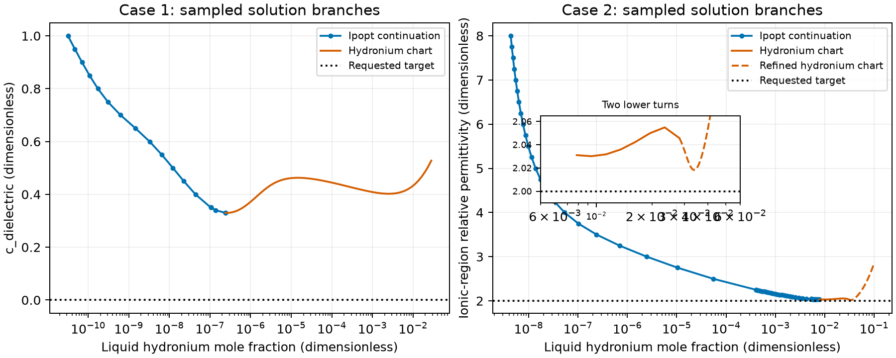
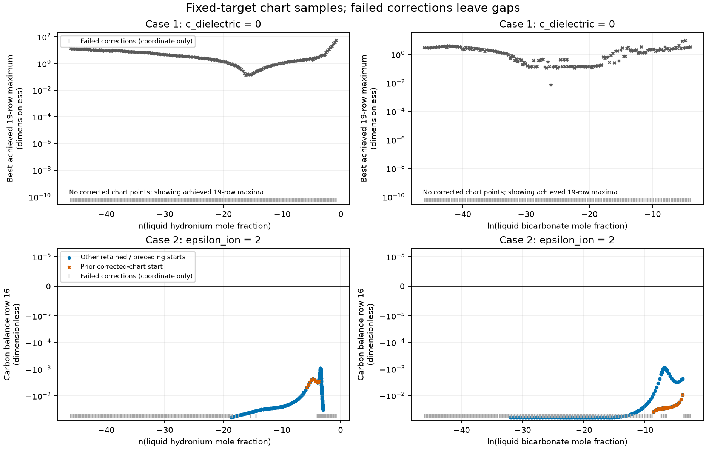

# Two locally infeasible reactive bubble states

The retained Python held-composition charts, carbon-response bisection and
Newton/turning probes are pre-rule history (#234, 2026-10-01). Their solve code
was retired; the current scripts do not reproduce those methods. Inventory
bounds now use the native conserved-inventory calculation. Alternate starts
use `solve_equilibrium_starts`; straight physical-parameter paths use
`continue_equilibrium(..., parameter_targets=...)`. Their separately identified
native evidence does not overwrite the historical result files. The
[notebook](notebook.qmd) compares the retained Python and native paths.

**Historical replay outcome (#762):** `probe.py` and `verify_global_scan.py`
retain fixed-coordinate checks of the old rows. Neither is a current-main chart
producer. No accepted native request reproduces the omitted-carbon,
held-composition correction. The [diagnosis](results/current-main/diagnosis.md)
identifies the missing declaration, the #385 reference correction, the original
`026b3031`/`e9b1aed5` wheel comparisons and the current rerun evidence. The
chart-row criterion remains `1e-10`; the stored rows and coordinates are
unchanged. The fixed-coordinate comparisons, chart figures and the notebook's
“Retained historical diagnostics” section are historical records from before
that reference correction. Current corrected turning roots are recorded
separately in `results/current-main/turning/`.

Both target states have **undetermined global existence** in the declared phase
set after the bounded fixed-target scan. No target root was found. Case 1's
hydronium and bicarbonate chart correctors produced no criterion-meeting chart
state. Case 2 produced 1,233 corrected chart states, all with negative carbon
balance residuals; the closest retained residual is `-0.0009191540410914927`,
equivalent to a carbon deficit of `0.008780731282009182 mol`. These are trial
states with the carbon equation omitted, not physical predictions. Numerical
nonconvergence in case 1 and incomplete enumeration in both cases prevent a
global nonexistence conclusion. Neither target is yet proved to be a solver
failure at an existing solution. The fix-before-negative question remains open.

This is numerical verification and model diagnosis at fixed inputs, not physical
validation. No Engine runtime, MEA input, reaction, interaction parameter,
reference convention, or tolerance was changed.

## Native ordered-start replay

The installed wheel SHA-256
`84dbd5d062ccff3e6b539c4fe1e6498f54002c67823dc8cc15baadf253233bbe`
replayed the literal requests, retained anchors and ordered water-reaction
extents `(0.005,0.02,0.05,0.1,0.2,0.3)` at 313.15 K. Each declaration retains
its original pressure and both packing guesses. All twelve attempts remain
unaccepted at the original-row criterion 1e-10; no failure equality was forced.
The smallest achieved residuals are 0.01687982540531214 in case 1 and
0.0023398302849809726 in case 2. Case 1 used 735 optimizer iterations, including
one `MAXITER_EXCEEDED` at 200; case 2 used 906, with six
`LOCAL_INFEASIBILITY` returns. The finite start lists, not an aggregate work
budget, were exhausted. Native termination, rows and per-attempt iteration
traces are retained in [case 1](results/starts/native/case1-summary.json) and
[case 2](results/starts/native/case2-summary.json), with their attempt tables
alongside them. Iteration events belong to each attempt, not the enclosing
controller span. This demonstrates measured finite-search failures, **not**
nonexistence or a completed fix-before-negative diagnosis.

`starts.py` records the SHA-256 of the wheel in `build/environment-wheel/`, so install the
checkout's wheel first; rerunning `bash tools/setup.sh` restores the editable install.

```bash
bash tools/build-engine.sh --install-wheel
timeout 1200 nice -n 10 env OMP_NUM_THREADS=1 OPENBLAS_NUM_THREADS=1 .venv/bin/python analyses/2026-born-unavailable-states/scripts/starts.py --case 1
timeout 1200 nice -n 10 env OMP_NUM_THREADS=1 OPENBLAS_NUM_THREADS=1 .venv/bin/python analyses/2026-born-unavailable-states/scripts/starts.py --case 2
```

## Per-case findings

| Case | Verdict | Decisive retained evidence | Limit |
|---|---|---|---|
| 1: shell only, `vle_obs_0119`, `c_shell=1`, `c_dielectric=0`, `epsilon_ion=8` | Undetermined | Original carbon and MEA defects reproduced. Full inventory-range grids at the exact target were attempted in hydronium and bicarbonate; neither produced a corrected chart state. | Numerical nonconvergence leaves the carbon response undetermined. No coordinate interval is excluded in its entirety. |
| 2: `vle_obs_0193`, `c_shell=c_dielectric=1`, `epsilon_ion=2` | Undetermined | Historical full inventory-range grids and two fine windows produced the [retained corrected chart states](results/global-scan/verification-summary.json). All have carbon deficits, with no sign bracket or 20-row witness. Native re-evaluation confirmed their rows before #385. | Finite starts, failed corrections, unsampled intervals and additional roots at the same held fractions remain unexcluded. |



The blue curve uses accepted installed-Engine solutions. Orange curves use the
same 20 Engine rows with hydronium as an additional continuation coordinate and
the Born coefficient free. Only points with a chart residual at most `1e-10`
appear. Selected orange points have historical original-Born checks in
[turning-verification.csv](results/turning-verification.csv). Current
`verify_turning.py` uses retained points as guesses for native corrected roots
and checks their rows and pressure-closed states.
Failed-iterate density and term diagnostics are retired; their old files remain
historical. `probe.py` is a historical row/Jacobian replay and reads native
density outputs only for its historical accepted roots. `verify_global_scan.py`
is also historical and never selects a restart. A line
connects ordered continuation points, not experiments. The displayed intervals
are finite samples and do not enumerate the full phase set. Exact plotted
values are in [plotted-values.csv](results/plotted-values.csv).

## Physical problem and exact reconstruction

Both requests are at **313.15 K**. The finite phase is a free-amount liquid with
nine declared species. The vapor contains CO2, MEA and water and is pinned to
zero amount as an incipient phase. Pressure is free. The CO2 partial-pressure
observation is an output of the bubble calculation; it is not an additional
constraint in the equilibrium problem.

The feed basis is moles. Total feeds are `9.064057365207347 mol` and
`9.553057365207348 mol`; their conserved CO2-derived carbon inventories are
`0.153 mol` and `0.642 mol`, and both carry `1 mol` of total MEA. The same five
reaction rows, source-reference bases, source pressures and corrected `ln K(T)`
correlations are reconstructed from `reaction_corrected_request`. Neutral
reference dilution ratios reproduce the MEA mapping exactly, including its
factor of `0.125`. The liquid composition and pressure guesses come from the
copied accepted anchor; the vapor composition guess comes from the copied
request. No application module is imported or executed.

The application request's pressure interval `[1, 1e7] Pa` checks its initial
pressure in the original helper; it is not encoded as an Engine solver box by
that helper. The same is true of the request's phase packing intervals. This
reproducer preserves that mapping rather than adding constraints. The Engine's
own packing and composition policies govern the actual solve. Reported accepted
continuation pressures lie inside the request's pressure interval.

[reproduce.py](scripts/reproduce.py) constructs `equilibrium.Problem`, `Phase`,
`Reaction`, `ReactionReference` and `NeutralReference` directly through the
public installed Engine interface. MEA owns the supplied chemistry and fitted
parameters; this analysis diagnoses their Engine solves.

## Exact failures and row meaning

The copied wheel has SHA-256
`28181e72e429c6e87fc6361082af1a7b21c8747e76bda65a1c30abb4a97402f2`.
Every installed `epcsaft/` package file matched its wheel member at the initial
inspection. Source inspection used Engine commit
`ca8be1f28f9a499fbd5ae023f3d5acdf60e2e32d`.

| Quantity | Case 1 | Case 2 |
|---|---:|---:|
| Ipopt return | `LOCAL_INFEASIBILITY` | `LOCAL_INFEASIBILITY` |
| Iterations reported by Engine | 92 | 65 |
| Maximum classified row residual | 0.016879756646484393 | 0.0023393078163695975 |
| Row 16, carbon balance | −0.016879756646484393 | −0.0023393078163695975 |
| Row 17, MEA balance | −0.004739559742072048 | −6.4732598274603805e-15 |
| Reported evaluation floor | 1.807971431801421e-10 | 1.8258018276531272e-10 |
| Amplification | 0 | 0 |

The status, message, iteration count and residual match the handoff values,
including all digits of both failure maxima. Case 1's other rows are at most
`4.27e-13`; case 2's other rows are at most `1.14e-13`. Full vectors are retained
in [case1-direct-rows.csv](results/case1-direct-rows.csv) and
[case2-direct-rows.csv](results/case2-direct-rows.csv).

Rows 0–8 are liquid component chemical-potential stationarity, in the declared
species order. Row 9 is liquid pressure equality. Rows 10–12 are vapor
stationarity for CO2, MEA and water; row 13 is vapor pressure equality. Reaction
affinities follow by contraction with stoichiometry, and neutral phase
potential equalities follow by subtracting the corresponding stationarity
rows. Rows 14–17 are conserved-moiety balances; rows 18–19 normalize the two
phase compositions. There is no separately imposed liquid charge row: the
conserved moieties already span charge.

The Engine's echelon basis is retained once in
[balance-basis.csv](results/balance-basis.csv). In particular, **zero-based row
16** is

`(n_CO2 + n_carbamate + n_bicarbonate + n_carbonate - b_carbon) / N_feed`.

It is a carbon-inventory equation, not a reaction affinity or vapor equality.
Row 17 is

`(n_MEA + n_MEAH+ + n_carbamate - b_MEA) / N_feed`.

Case 1 loses `0.15299908255447453 mol` of the requested carbon and
`0.04295964138796838 mol` of MEA at its rejected point. Case 2 loses
`0.0223475417646567 mol` of carbon. Because charge is a difference of the
hydronium-pivot and carbon-pivot moieties, these carbon defects also leave
positive net liquid charge: approximately `0.153 mol` and `0.02235 mol` of
charge equivalents. These rejected candidates are not physical predictions.

## Bound and Jacobian checks

Neither direct failed point is at an active variable bound. The liquid amounts
are `8.715198641265948 mol` and `8.889063531172484 mol`; both are positive. The
zero vapor amount is prescribed incipience, not phase disappearance. Packing
fractions are approximately `0.447274` and `0.446153` in the liquids, away from
the admitted packing limits.

A pinned square calculation uses the structural composition cutoff `1e-20`,
not the all-free `1e-8` composition box or its inventory-dependent reduction.
No species inventory upper cap is imposed in these solves. The smallest
supported fraction at the case 1 rejected point is liquid CO2,
`3.1732051023052893e-19`, about 31.7 times the cutoff. In case 2 the nearest
lower composition bound is still `26.4166` log-coordinate units away. Vapor
water is close to one, but neither vapor normalization is bound limited. Exact
coordinates and distances are retained in the two `direct-bounds.csv` tables.

The published rank 20 and nullity zero are compile-time generic-point
quantities. The failure's reduced-Hessian minimum `0.0` is an unevaluated
initial value: the driver clears the rejected state before computing that
certificate. It is not evidence of a flat free-energy surface or of an active
bound. A pinned equality-root calculation also does not assert a Gibbs minimum.

[probe.py](scripts/probe.py), retained as a historical replay, re-evaluates the
saved final Ipopt coordinates through public compiled Engine rows and Jacobians. The actual failed-point
Jacobians also have rank 20. Their 2-norm condition numbers are about `9.20e9`
and `7.07e10` before row/column equilibration, and `4.51e5` and `3.13e5`
afterward. These finite, poorly conditioned Jacobians do not certify existence
or nonexistence. The bounded, equilibrated Newton attempts below did not reach
the target roots.

## Continuation and correction probes

| Case | Parameter step | Last accepted point | Next attempted point and achieved maximum |
|---|---|---|---|
| 1 | `0.05` | `c_dielectric=0.35`, rows `5.68e-14` | `0.30`, 200-iteration budget, `0.00244835` |
| 1 | `0.01` | `0.33`, rows `1.14e-13` | `0.32`, locally infeasible, `0.000832371` |
| 1 | `0.001` | `0.33`, rows `9.95e-14` | `0.329`, 200-iteration budget, `0.0152421` |
| 2 | `0.25` | `epsilon_ion=2.25`, rows `5.68e-14` | `2.0`, locally infeasible, `0.00233931` |
| 2 | `0.01` | `2.04`, rows `8.53e-14` | `2.03`, locally infeasible, `5.21838e-6` |
| 2 | `0.001` | `2.031`, rows `7.11e-14` | `2.030`, locally infeasible, `5.21157e-6` |

Each stage warm-starts from its preceding accepted Engine result. Restarted
fine stages first reconstruct and solve their retained start. Failed steps are
kept and do not count as continued equilibrium states.

At fixed state, the Born charging equation is affine in `c_dielectric` for case
1 and in `q = 1 - 1/epsilon_ion` for case 2. The Debye–Hückel term does not use
`epsilon_ion`. The retired `turning_point.py` used that equation
identity to free the Born coefficient while holding `ln(x_hydronium)` as the
continuation coordinate. It retains all original 20 equations. Its independent
coordinate is a numerical chart, not a new physical constraint on the target.
The two endpoint Engine systems supply the exact affine row and Jacobian
combination; the identity is checked against a directly compiled intermediate
system before tracing. The endpoint-combination discrepancy is below `1e-10`.
The traced points include both sides of turns and additional returning segments.
They establish that merely decreasing a parameter until a corrector fails
would miss roots at other values. They do not establish a complete branch map.

[verify_turning.py](scripts/verify_turning.py) checks selected roots directly in
the original parameterization and their native pressure-closed mechanical
slopes. These pressure-state readouts do not provide exact state evaluation
at arbitrary failed coordinates. The retained historical table separately
records its former density-branch comparison.
The hydronium chart is a diagnostic calculation, not an implemented Engine
continuation feature.

The retired Newton probes used native exact rows/Jacobians, row/column
equilibration and bounded damping inside the existing physical cutoffs. From
the closest accepted parameter states, final target-row maxima were `11.2867`
(case 1) and `0.218698` (case 2). A second case 2 attempt from the returning
segment ended at `0.593094`. Modified-carbon-row probes with prescribed
hydronium are recorded separately; they are not target solutions. In particular,
one such case 2 probe satisfies its modified equations while leaving a carbon
residual `-0.0111896`.

[Alternate starts](scripts/starts.py) perturb the liquid guess along the declared
water reaction, `2 water -> hydronium + hydroxide`. The perturbation is
`delta_x = (delta_xi/N_liquid) * nu`; its scalar is dimensionless. It preserves
normalization and all moieties of the original guess at a fixed amount, and
changes no feed or physical parameter. Scalars `0.005`, `0.02`, `0.05`, `0.1`,
`0.2` and `0.3` yielded locally infeasible points, work-budget stops, or unavailable
initial references/density seeds. These starts do not cover every admissible
composition. Failed density seeds and reference evaluation failures establish
no physical nonexistence.

The correction probes attempt the conditioning/initialization explanations
required by [ALG-TERMINATION](../../engine/docs/science/algorithms.md#alg-termination).
They have not shown those explanations impossible globally. The accepted
Ipopt rule is preserved: a `LOCAL_INFEASIBILITY` stop, fatal return or failed
initialization never publishes an accepted state merely because a later
calculation has small rows.

## Fixed-target chart scan

The scan holds the original Born parameter at each exact target and uses two
liquid coordinates: `ln(x_hydronium)` and `ln(x_bicarbonate)`. For each held
fraction, the retired chart calculation in `global_scan.py` corrected the other 19 native
equations using the public exact Jacobian. It retains **all original 20 rows**;
only row 16, the conserved CO2-derived carbon balance, is omitted from the
inner correction. A corrected chart point requires all other rows at most
`1e-10`. It becomes a target-root witness only if the original carbon row also
meets that criterion. No physical constraint or tolerance is changed in the
target problem. Correctors use the Engine packing box `[1e-12, 0.74]`,
positive liquid amount and pressure, and supported log fractions between the
structural cutoff and zero. They do not search beyond that packing box.
Holding a species while enforcing all 20 equations would
overdetermine the inner correction and would not define a carbon-response chart.

The lower log fraction is `ln(1e-20) = -46.051701859880914`, from the structural
cutoff. Upper fractions come from the same conserved-moiety matrix as the
Engine: maximize `y_i` subject to `B y = b t`, `sum(y)=1`, `y_i >= x_cut`,
`t >= 0`, where `y=n/N` and `t=1/N`. These linear programs supply outer
inventory ranges before thermodynamic admission, not stability certificates.
Their achieved balance residuals are at most `2.220446049250313e-16`. The returned upper
fractions and residuals are retained once in
[inventory-limits.csv](results/global-scan/inventory-limits.csv).

| Case and chart | Attempted full log-fraction range | Upper mole fraction | Distinct full-grid targets | Largest full-grid log gap |
|---|---|---:|---:|---:|
| 1, hydronium | `[-46.051701859880914, -0.7930220830187789]` | 0.4524753090262427 | 183 | 0.248674064708041 |
| 1, bicarbonate | `[-46.051701859880914, -4.0646214857217835]` | 0.017169486939751732 | 169 | 0.2499230974652349 |
| 2, hydronium | `[-46.051701859880914, -0.7341508114309597]` | 0.47991282246917943 | 183 | 0.24899753323324347 |
| 2, bicarbonate | `[-46.051701859880914, -2.6304711034242576]` | 0.07204451382562489 | 175 | 0.2495473031980282 |

Each grid fraction was attempted. Full-range attempt coverage does **not** mean
all fractions were successfully corrected or all solutions at a fraction were
found. Starts use the retained direct failures, nearest retained continuation
or turning-point coordinates, and preceding corrected chart states. Case 2
also uses the earlier corrected carbon-omitted hydronium point at `x=0.001`.
Its signed carbon residual was negative, `-0.011189634471973756`.
These are finitely many starting basins, not an exhaustive search.

The corrector tries equilibrated, damped Newton steps and then a bounded
trust-region least-squares correction. Neither optimizer termination nor a
small scaled residual establishes a corrected point; the raw native row
criterion governs. Correctors retain their last evaluated point on a CPU cap.
The main passes cap a corrector at 1.2 CPU seconds. Case 1's short full-range
bicarbonate completion uses 0.6 seconds; the fine case 2 windows use 0.8
seconds. Caps restrict coverage and never relax the row criterion.

Case 1's hydronium grid completed ascending and descending passes. Its main
bicarbonate pass stopped at the case budget after reaching log fraction
`-18.060314943774824`; a separate ascending pass completed the full 169-point
grid. No chart correction met `1e-10`. The best achieved 19-row maxima were
`0.13257845605109964` for hydronium and `0.007215746367535303` for bicarbonate.
Thus the scan establishes no corrected carbon-response curve for case 1.
These failures cannot distinguish physical nonexistence from a missed root.

Case 2's hydronium passes both completed. Its bicarbonate ascending pass
completed; the descending pass stopped at the case CPU budget. The main grids
returned 264 corrected hydronium points at 64 distinct fractions and 470
corrected bicarbonate points at 114 distinct fractions. All returned carbon
residuals were negative, so no sign bracket was found.

To resolve the sampled regions closest to zero, two 101-point ascending grids
use nominal log spacing `0.01`: hydronium over
`[-3.9731236769966145, -2.9731236769966145]`, and bicarbonate over
`[-7.372775257790707, -6.372775257790707]`. They returned 205 and 294 corrected
points, respectively. Across main and fine sweeps, case 2 has 469 corrected
hydronium states at 164 distinct fractions and 764 corrected bicarbonate
states at 214 distinct fractions. Multiple starts can return multiple states
at the same held fraction. These counts exclude the preliminary pilot.

The largest retained carbon residual is `-0.0009191540410914927` in the fine
bicarbonate chart, at fraction `0.0011218510241011875`. Its other 19 rows are
at most `1.71e-13`. The fine hydronium chart's closest carbon residual is
`-0.0009193821924471954`, at fraction `0.032938151368030424`. The carbon deficit
is far above `1e-10`; neither is a target equilibrium. A carbon deficit also
leaves net positive liquid charge under this conserved-moiety basis. These
trial states therefore support no bubble-pressure or ionic-population
prediction at the exact target.



Case 1 panels show the smallest achieved 19-row maximum at each sampled
fraction, with the unchanged `1e-10` criterion as a horizontal line. They show
numerical correction failure, not a carbon curve. Case 2 panels show the
normalized carbon balance of corrected trial states. Blue points use other
retained or preceding starts; orange crosses use the earlier corrected-chart
start. Grey marks locate failed corrections without assigning a carbon
response. Points are finite calculations; no line or interpolation asserts
continuity or excludes roots between them. Exact plotted values and their
source rows are in [plotted-values.csv](results/global-scan/plotted-values.csv).

[verify_global_scan.py](scripts/verify_global_scan.py) directly re-evaluates
all 1,233 corrected chart points with the original fixed Born parameterization
and the same copied problem. The raw vectors agree with their retained rows
within `1e-10`; [row-verification.csv](results/global-scan/row-verification.csv)
records each check. No point meets all original 20 rows, so there is no target
root on which to run native pressure-state mechanical checks. The retired
normal-solve restart selection is removed. No admitted target root or solver initialization defect has
been demonstrated.

**What is excluded:** the returned corrected states are not target roots,
because their carbon row fails. **What is not excluded:** no coordinate
interval is excluded in its entirety. Other solutions at the same held
fractions, failed corrections, intervals between samples, other starting
basins, other coordinate charts and other phase sets remain unexcluded.
The declared liquid plus neutral incipient-vapor phase set is unchanged.
The strongest supported conclusion is a bounded search without a target
witness; global existence remains undetermined for both cases.

The searches, including the preliminary pilot and interrupted initial dense
case 1 probe, used `3365.07 CPU s` (56.08 minutes). Direct row verification
used another `13.62 CPU s`. The full numerical work remains below one CPU hour.
Each heavy step used the requested shared lock, timeout, niceness and one-thread
environment. [coverage.csv](results/global-scan/coverage.csv) owns the exact
ranges, counts and gaps. Per-scan `attempts.csv`, `rows.csv`, `coordinates.csv`
and compact `summary.json` retain successful corrections, failures and budgets.
The preliminary and interrupted records do not count as completed full grids.

## Born and ion terms: meaning and limits

The mathematical owners are
[Born shell charging](../../engine/docs/equations.md#born_radial_charging_work),
[Born Helmholtz energy](../../engine/docs/equations.md#born_residual_helmholtz),
and [Debye screening](../../engine/docs/equations.md#debye_screening_parameter).
At fixed composition, lowering either continuation parameter reduces the
second radial Born charging coefficient. The continued compositions change
substantially, so the mixture Born contribution cannot be interpreted from that
coefficient alone.

| Accepted liquid | `A_m,Born / (RT)` | `A_m,DH / (RT)` | Bulk relative permittivity |
|---|---:|---:|---:|
| Case 1, `c_dielectric=1` | −5.04439 | −0.0183000 | 63.6911 |
| Case 1, `c_dielectric=0.33` | −17.1600 | −0.101512 | 64.5186 |
| Case 2, `epsilon_ion=8` | −22.3741 | −0.101187 | 72.9532 |
| Case 2, `epsilon_ion=2.031` | −51.8656 | −0.299464 | 73.1600 |

These are molar residual Helmholtz contributions divided by RT, equal to the
dimensionless `a_Born` and `a_DH` in the canonical equations; the columns use
the public `State.born` and `State.debye_huckel` meanings. The increasing
magnitude follows composition changes along the solved branch and does not
quantify a reaction-affinity decomposition. Near the original continued limits,
case 1 liquid hydroxide rises to approximately `0.01044`, and case 2 hydronium
rises to approximately `0.007845` in mole fraction. The additional turns show
strong nonlinear composition dependence of this chosen model. No data
comparison establishes that these ionic populations are physically correct.

For a uniform dielectric, `l_B = e^2/(4 pi epsilon_0 epsilon_r k_B T)` gives
`280.23 angstrom` at 298.15 K and `epsilon_r=2`, or `266.81 angstrom` at the
actual 313.15 K. Such a low **bulk** dielectric would make ion pairing or phase
separation physically plausible. In this model, however, `epsilon_ion=2`
changes the local Born charging region, while Debye–Hückel screening uses the
resolved bulk dielectric, approximately 73 on the accepted case 2 branch. Its
bulk Bjerrum length is therefore about `7.29 angstrom`, not 267 angstrom.
Generic ion-pair species and additional liquid phases are absent from these
requests. This analysis cannot claim their presence, absence or global phase
stability. The source-fit parameters' physical uncertainty and model discrepancy
were not propagated.

## Delivery, budgets and remaining question

There is no justified solver fix design yet: an admitted criterion-meeting
target solution has not been exhibited, and global physical nonexistence has not
been proved. No runtime repair is implemented or proposed for acceptance in
this PR. The analysis adds **zero runtime lines**. `python3 tools/diffstat.py
--budgets` reports `18554 / 18556` total physical runtime lines in the follow-up source snapshot;
Properties and Bindings are at their hard ceilings. A future
repair must price its actual changed owner and obtain an amendment or justified
removal before exceeding those ceilings.

The remaining scientific question is whether other disconnected equilibria
exist at either exact target within the same declared phase types and supports.
The retained branch turns narrow that question; they do not answer it globally.
An unavailable result must not be closed as physical nonexistence on this
record. Any later target-root witness must meet the unchanged `1e-10` row
criterion and the existing topology and density-branch checks before motivating
a solver repair. Additional phase discovery, parameter refitting, changing the
Born form, loosening tolerances and MEA execution remain outside this task.

## Reproduction and retained files

[Input hashes](inputs/manifest.json) record the raw-byte SHA-256 of all five
handoff files and both required anchor records. The requested prefixes match:
`094958b9`, `b5a03864`, `dcfc2325`, `c400ada5`, `69a1ca2c`. The copied export
script was provenance only and never executed; #341 removed it (record commit
`21d7a112`), and its hash stays in `inputs/manifest.json`. [Runtime provenance](results/provenance.json)
identifies the frozen wheel and source inspection commit.

From this worktree, use the sole installed Engine Python:

```bash
engine_python="$(git rev-parse --show-toplevel)/.venv/bin/python"
"$engine_python" analyses/2026-born-unavailable-states/scripts/reproduce.py --case 1 --out build/born-replay
"$engine_python" analyses/2026-born-unavailable-states/scripts/reproduce.py --case 2 --out build/born-replay
"$engine_python" analyses/2026-born-unavailable-states/scripts/reproduce.py --case 1 --continuation --out build/born-replay
"$engine_python" analyses/2026-born-unavailable-states/scripts/reproduce.py --case 2 --continuation --out build/born-replay
```

Fine continuation uses `--from-value 0.35 --step 0.01`, then `--from-value
0.33 --step 0.001` for case 1; case 2 uses `--from-value 2.25 --step 0.01`, then
`--from-value 2.04 --step 0.001`. The `fine/` and `refined/` sequences, the hydronium-coordinate probes in
`turning/`, `turning-refined/` (case 2 point 7, factor `1.02`), the `newton/`
correction attempts and the flat `case*-continuation-*` files are retained once,
byte-exact, in `results/retired-charts.tar.gz` (#341 collapsed their 656 files);
`reproduce.py`, `probe.py`, `verify_turning.py`, `starts.py` and
`verify_parameter_continuation.py` read them from there by exact member name.
A `--from-value` seed is the state from the coarsest stage holding that value:
the top-level `0.35`/`2.25` states start `fine/`, and the `fine/` `0.33`/`2.04`
states start `refined/`. `probe.py --points` takes archive member names.
`results/starts/` retains the start corrections.

The fixed-target chart scan commands were retired. `scripts/global_scan.py` declares the already converted native inventory-bound calculation. Historical `scripts/verify_global_scan.py` directly re-evaluates retained coordinates; its old-row comparison fails on current main after #385.

CPU caps can change the number of converged corrections on another machine;
the retained coordinate vectors and direct row re-evaluation own the reported
values. The preliminary case 2 pilot used 25 points per chart above log fraction
`-12`, before adding per-corrector CPU caps. The interrupted initial case 1
probe covered only its retained partial range. Neither is a full-range result.

CSV files own numerical vectors and state quantities. Compact JSON files own
termination causes, achieved maxima, timing and claim limits. Failed-point
coordinates were extracted from Ipopt file diagnostics and checked with native
public rows; the temporary full logs are removed. Iteration tables from the
initial runs include nested seed solves; their iteration numbers are local to
each Ipopt run. Engine summary counts refer to the final reported solve.
The notebook includes this README as its single prose source and does not run
the model. The independent review of the initial diagnosis is retained in
[the original review record](results/review.md). The independent review of the
fixed-target scan supports both bounded **Undetermined** verdicts; its
[review record](results/global-scan/review.md) identifies the inspected commit
and two required prose corrections. The author checked and applied those
corrections after review; the numerical rows and verdicts did not change.
This record is not promoted for manuscript use.

Historical [diagnostic comparisons](results/diagnostics/native/before-after.csv)
retain 3,516 entries for 1,233 chart points, 22 converged-root phase states and
69 previously retained point Jacobians. Original-row and conditioning values
are unchanged. Native pressure closure changes density by at most
1.5701516531407833e-8 mol/m³ and the mechanical slope by at most
1.6650301404297352e-7 Pa·m³/mol. Historical failed-iterate density and term
files retain their original identity and are not regenerated. The notebook
states the numerical-verification and root-existence limits.

## Current producer diagnosis (#750)

[The current diagnosis](results/current-main/diagnosis.md) records the unchanged failure,
the responsible Engine changes, retained comparisons, repaired reruns and remaining
limits. New results are separate from the original retained results.
