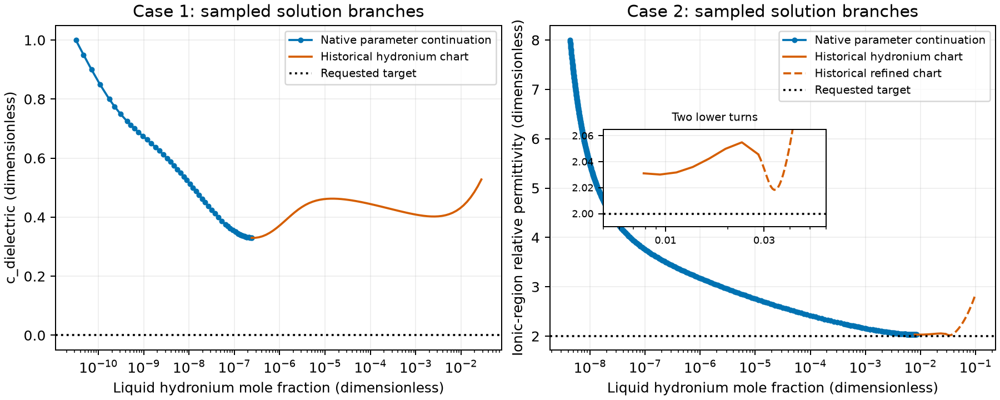



## Native physical-parameter continuation after the main refresh

The wheel built from merged source `4d6118b0` (main `8f5f5685`) reproduces the
approved finite prefixes at `34d5cbf4`. The copied b7 batch-11 declarations keep
313.15 K, free pressure, feeds, supports and reaction references from
[the input inventory](inputs/manifest.json). This is numerical verification of
these declarations. Parameter uncertainty and physical validation are not
established.

All 30 path CSVs are byte-for-byte identical to the approved replay, covering
490 accepted states and the six final failed attempts. All 144,540 compared
path entries are unchanged. The maximum accepted
original and classified row residual is 2.8421709430404007e-13 against 1e-10.
All 4,500 historical-point comparisons pass, with maximum comparison error
3.33574570376877e-13. The Born-column comparisons retain maximum relative error
1.8285305571792776e-16 against 1e-12. Six identical ethane components at 200 K
and 5 MPa, with dispersion energy divided by Boltzmann's constant changing
from 191.42 to 201.42 K, retain phase amount error 8.881784197001252e-16 mol,
mole-fraction error 4.440892098500626e-16 and phase-amount tangent
error 4.246255451592755e-17 mol per unit path fraction. Amount and composition
tangents meet the absolute 1e-9 criterion in their respective units per unit
path fraction.

| Declared path | Last accepted dimensionless parameter | Final attempted parameter | Final failed residual |
|---|---:|---:|---:|
| c, coarse | 0.33125000000000016 | 0.32968750000000013 | 1.1587108378730394e-5 |
| c, fine | 0.32999999999999996 | 0.329375 | 3.8470112274289755e-5 |
| c, refined | 0.33 | 0.329 | 7.069347330361002e-5 |
| epsilon, coarse | 2.030273437500033 | 2.0300292968750338 | 2.9269744332035496e-6 |
| epsilon, fine | 2.030625 | 2.03 | 5.211561860462618e-6 |
| epsilon, refined | 2.0305 | 2.0300000000000002 | 5.211393233055198e-6 |

Every final attempt returns native infeasibility. Neither c=0 nor epsilon=2 is
reached; root existence, disconnected branches and a fold remain undetermined.
The unchanged prefixes can be consumed with their declared tolerance and failure
status. No endpoint capability is added by this refresh.

First-action comparisons at c=0.5 and epsilon=3 are also identical to the
approved replay. At physical step 1e-5, maximum scaled errors are
4.699449189377818e-9 and 3.7074989180272127e-9 against the required 1e-5.
The additional c step 1e-6 gives 2.0228871722321025e-8; the smallest-step error
increase retains the observed numerical plateau. The [action-error table](results/native-parameter/current-main-action-errors.csv)
and [failure-boundary table](results/native-parameter/current-main-boundaries.csv)
retain the measured values. The [refresh record](results/native-parameter/current-main-refresh.json)
owns source/wheel identity, replay hashes, comparison counts and gate results.
The full installed-wheel gate passes 121 Python cases and six native programs.
The affine parameter-column and parameter-recovery checks pass 101 and 10
comparisons; their maximum error/tolerance ratios are 0.27755575615628914 and
0.0020954757928848267. Global Born scalars use index `[0]` targets with a
coefficient, preserving the same physical chart. Model admission occurs once
through the bounds-checked affine start.

The Khudaida slice retains eight accepted local two-liquid points and 64 formula
comparisons. Maximum raw row residual is 5.573319583618286e-14; the formula
composition average absolute deviation is 0.011054929498369245 against the paper
criterion 0.0161. This is agreement at the stated paper-correlation scale; it
does not establish agreement within experimental uncertainty. The ordinary
ionic liquid-liquid and reacting MEA flash solves retain, in each of three
samples, 16/49/17 and 43/57/44 iterations/evaluations/Hessian calls. Their
maximum raw rows are 7.549516567451064e-14 and 1.1368683772161603e-13.

The affine map, Born work and parameter-path equations and algorithms are
revalidated without changing their mathematics or tolerances. The original
delivery was independently reviewed at `34d5cbf4`; this refresh has no separate
independent delivered review. The refresh introduces no numerical change to
these acceptance cases.

## Native ordered starts and finite Born paths at 313.15 K

The native continuation replay retains 490 accepted state records across six
paths, including their initial states and overlapping restart points. It keeps
the two copied feeds (9.064057365207347 and 9.553057365207348 mol), free total
bubble pressure, the nine-species reacting liquid, the incipient three-neutral
vapor and the five original reaction/reference declarations. The input
[hashes and conditions](inputs/manifest.json) are unchanged. The maximum
accepted original-row residual is 2.8421709430404007e-13 against 1e-10.
This is numerical verification of the declared equilibrium equations; neither
physical validation nor parameter uncertainty is established.

The historical Python loop stepped a physical Born parameter and warm-started
each `solve_equilibrium` call. The current calculation declares both physical
endpoints to `continue_equilibrium(..., parameter_targets=...)`; its native
controller owns prediction, correction, step reduction and branch admission.
The before/after comparison changes the retained sampling claim: the native
adaptive paths reach longer finite prefixes than the fixed-step Python paths.
All parameter values below are dimensionless. Pressures are total bubble
pressures at the native last accepted point, not the historical last point.

| Case and path | Python last accepted | Native last accepted | Native next attempted | Native pressure (kPa) |
|---|---:|---:|---:|---:|
| 1, coarse | 0.35 | 0.33125 | 0.3296875 | 8.58180245171 |
| 2, coarse | 2.25 | 2.0302734375 | 2.03002929688 | 15.9873226575 |
| 1, fine | 0.33 | 0.33 | 0.329375 | 8.67270651131 |
| 2, fine | 2.04 | 2.030625 | 2.03 | 15.8626140761 |
| 1, refined | 0.33 | 0.33 | 0.329 | 8.67270651131 |
| 2, refined | 2.031 | 2.0305 | 2.03 | 15.8999679931 |

Case 1 moves $c_\mathrm{dielectric}$ from 1 toward 0; case 2 moves
$\epsilon_\mathrm{ion}$ from 8 toward 2. At the coarse last accepted points,
the liquid densities are 48089.086441831336 and 55900.29231884245 mol/m³,
respectively. Each final attempted state fails the unchanged 1e-10 original-row
criterion. The exact endpoint, failed residual, pressure and density values
are retained in [boundaries.csv](results/native-parameter/issue-234/boundaries.csv).
No requested endpoint is reached. Root existence, disconnected branches and
turning points remain undetermined; these finite paths do not close the
fix-before-negative diagnosis.

Blue curves read only the native accepted state and row tables. Orange curves
remain the separately identified, retired historical hydronium charts. Lines
connect ordered calculation points and do not represent measurements or
exclude roots between samples. The [plotted values](results/native-parameter/issue-234/plotted-values.csv)
retain the exact displayed coordinates.

All 144,540 numerical entries in the state, row, coordinate and contribution
tables equal the previous native replay. Eighteen of its 30 CSV files are
byte-for-byte equal; the other files differ in zero's sign in vapor Born
energies or in trace span identifiers. These encodings do not change the
physical quantities. The 4,500 comparisons at common historical Python points
also pass: maximum error is 3.33574570376877e-13 against 1e-7, using relative
pressure/density errors and absolute mole-fraction errors. The
[comparison record](results/native-parameter/issue-234/comparison-summary.json)
and [per-quantity comparisons](results/native-parameter/issue-234/parameter-path-comparison.csv)
retain these measurements. Original Python and earlier native files keep
their existing identities. Identical replay tables reuse those original files;
the comparison record maps each removed copy to its retained file and hash.

Centered native re-solves verify the exact first actions at
$c_\mathrm{dielectric}=0.5$ and $\epsilon_\mathrm{ion}=3$. At physical step
1e-5, maximum scaled errors are 4.699449189377818e-9 and
3.7074989180272127e-9 against 1e-5. The
[action table](results/native-parameter/issue-234/parameter-actions.csv)
and [rank/conditioning diagnostics](results/native-parameter/parameter-action-diagnostics.csv)
retain the full step ladders. Finite differences supply verification only.

The historical `efad5d3c` Python start loop constructed the six balanced
water-reaction extent seeds and used the ordinary initializer. The current
script declares the same six extents to `solve_equilibrium_starts`, which owns
attempt order and selection, and supplies both explicit anchor packing fractions
(`starts.py:36`). The max-original-row residual measure is unchanged, but the
complete initial coordinates and initialization procedure differ.
Case 2’s 0.000919 → 0.00234 residual change therefore does not demonstrate
worse native-start performance. It is not caused by this change: every residual
equals the previous native replay. Both lists accept zero target roots. Their failed
iterates differ, so their residuals are reported explicitly rather than treated
as equivalent physical states.

| Case | Smallest recorded Python row residual | Smallest native row residual | Accepted roots, Python/native |
|---|---:|---:|---:|
| 1 | 0.01687981302844962 | 0.01687982540531214 | 0 / 0 |
| 2 | 0.0009191391100026755 | 0.002339830284980973 | 0 / 0 |

Four historical attempts recorded no finite row residual. The native replay
records a finite failed residual for all twelve attempts and reproduces every
previous native residual exactly, using 735 and 906 optimizer iterations.
The [before/after start table](results/starts/issue-234/before-after.csv)
keeps unrecorded historical values empty and retains termination causes in the
adjacent attempt tables and JSON files. The unchanged root availability supports
only a finite-search limitation, not target nonexistence.

The replay uses source `95988731bd35af522b5d4e986b8697545ad5fd98` and wheel
SHA-256 `33ef17f578714f55c65223e6b3d8b28e09344ac65cb317dfe9007bcfffc8db94`.
The mathematics and algorithms in [ALG-EQUILIBRIUM](../../engine/docs/science/algorithms.md#alg-equilibrium)
are revalidated for this finite slice without changing their equations,
inputs, tolerances or work limits. This replay and its revised display have
not been independently reviewed or promoted for manuscript use.

## Retained historical diagnostics

The held-composition, turning and Newton probes are retired under #254.
Their retained results keep their original identity. Failed-iterate density
and term diagnostics are retired: the Engine exposes no exact state readout
at arbitrary compiled coordinates, and re-solving at pressure would change
the iterate. Current diagnostic commands re-evaluate retained rows and exact
Jacobians; converged historical roots also receive native pressure-state checks.
They neither choose restarts nor resume retired probes.

The current replay rechecks 1,233 historical chart points, 22 phase states at
11 converged turning roots and 69 previously retained point Jacobians. All
3,516 before/after entries are retained in
[before-after.csv](results/diagnostics/native/before-after.csv). Original row
maxima, carbon residuals, Jacobian condition measures, Born contributions and
bulk relative permittivities are unchanged. Native pressure closure changes
55 floating-point values: the largest density difference is
$1.5701516531407833\times10^{-8}$ mol/m³, the largest mechanical-slope
difference is $1.6650301404297352\times10^{-7}$ Pa·m³/mol and the largest
Debye–Hückel contribution difference is $2.0372592501871623\times10^{-14}$ in
$RT$ units. These are differences between pressure-state evaluation and the
historical derivative reconstruction, not new failed-iterate state evidence.

| Quantity at 313.15 K, case 2, refined turning point 9, liquid; $\epsilon_\mathrm{ion}=2.0182714881414214$ | Historical reconstruction | Native pressure state |
|---|---:|---:|
| Density (mol/m³) | 56490.10699555458 | 56490.106995570284 |
| Mechanical slope $\partial P/\partial\rho$ (Pa·m³/mol) | 75316.6770148785 | 75316.677015045 |
| Born contribution in $RT$ units | −73.29457034133537 | −73.29457034133537 |
| Original-row maximum (dimensionless) | 1.5688783605583012e-11 | 1.5688783605583012e-11 |

The [diagnostic summary](results/diagnostics/native/comparison-summary.json)
identifies the source and wheel. The original $10^{-10}$ turning-row criterion,
$10^{-10}$ chart-row comparison and $2\times10^{-10}$ retained-point row
comparison are unchanged. No fixed-target chart point satisfies all original
rows, so no target phase state or restart is admitted. Before/after rows are
comparison evidence only; numerical verification does not establish physical
validation, global root existence or a Gibbs minimum. The current diagnostic
replay and revised notebook have not been independently reviewed or promoted
for manuscript use.

Byte-identical diagnostic replay files reuse their original retained values.
The comparison summary maps each replay path to its retained path and SHA-256;
those verified values are not stored a second time.
