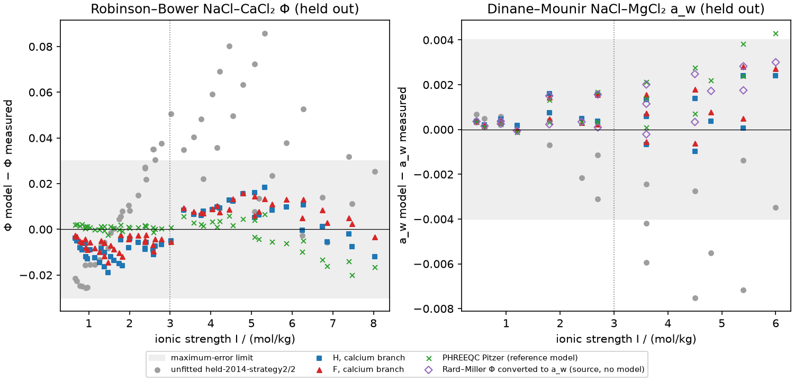

The Figiel-form refit trained with the Saad 1980 mixtures,
`figiel-2025-chloride-mixture-refit/1`, is qualified by owner decision
(2026-10-16) for NaCl–MgCl₂–CaCl₂ chloride brines at 25 °C, with one recorded
exception: it fails the held-out criterion in a single printed-rounding
realization.
The Held-form refit stays unqualified.
No declaration meets the rule as frozen, even under the owner's
source-agreement limit for Dinane–Mounir (2026-10-16).
Adding a calcium-bearing mixture source to training fixes the calcium
composition transfer: the Figiel-form refit then passes both Robinson–Bower
buckets under every frozen realization.
Judged against the Rard–Miller/Dinane–Mounir source disagreement, every
optimum now passes the Dinane–Mounir I > 3 water activity under every
realization.
What still fails, for every optimum, is the Dinane–Mounir I ≤ 3 bucket in a
single realization: the source's joint printed-rounding case that lowers every
printed value by half a unit.
The Figiel-form refit with the Saad 1980 mixtures misses that realization's
amended limit narrowly and passes every other realization of every bucket.
The owner accepted that narrow miss as the qualification limit rather than
refitting or changing the limit.
The evidence is native prediction against retained held-out measurements.
It is prediction against held-out measurements, not physical validation of the
fitted ion parameters.

## Question and settled conventions

[Engine issue 575](https://github.com/tannerpolley/ePC-SAFT/issues/575) asks
whether Na⁺, Mg²⁺ and Ca²⁺ parameters trained jointly on binary osmotic data and
mixture data predict the independent mixed-brine water properties within the
frozen limits of the [mixed-chloride study](../2026-mixed-chloride-water-activity/notebook.qmd)
at 25 °C and 1 bar.

The Held 2014 conventions are settled from the paper's own figures before any
fit: the Debye–Hückel closest approach is the Eq. (21) diameter 0.88σ, which
reproduces the authors' Figs. 1–2 (1:1 salts; the
[reproduction](../reproduction/2014-held/)), and k(Na⁺–water) is the Table 2
footnote law at 25 °C.
[held-2014-strategy2/2](../../data/packets/held-2014-strategy2/2/packet.toml)
records that convention; `/1` stays the transcription of the text.
Unfitted, `/2` fails every held-out bucket (the *Unfitted /2 RMS* column below).

## Method

Two complete declarations are fitted and judged separately:
the Held 2014 form (H; no Born term, solvent-only permittivity) and the
Figiel 2025 form (F; Born term and ion-fraction permittivity suppression).
Per cation, σ (packing diameter tied at 0.88σ), the Debye–Hückel diameter,
for F the Born diameter, and k with water and with Cl⁻ are free.
Water, Cl⁻, K⁺, Li⁺ and every ion dispersion energy stay at the base packet; the
dispersion energy enters only through the two cross energies, an exact
degeneracy.
Diameters are bounded below by the Marcus 1991 crystal diameters and k above by
1; no other physical bound exists.

The [frozen declaration](inputs/fit-declaration.json) fixed bounds, the 17
starts, equal total weight per training source, controls, the optimum-selection
rule (lowest training cost; every optimum within 10 % reported) and the
held-out code before any fit. Its three dated fit amendments are recorded in
the file: an omitted shared iteration budget, the per-start wall guard raised
from 60 s to 900 s after host load made it bind (lead decision; the 60 s run is
retained in `results/stage-a/run-60s/`), and the calcium branch below.
A fourth, the owner's held-out amendment after both runs, changes only the
Dinane–Mounir limit (below); the fits, optima and selection are unchanged.
Every fit and prediction runs natively in the Engine (Ceres Levenberg–Marquardt
with exact columns); the mixture rows use the new
`MixtureOsmoticCoefficient` observation, Φ = −ln a_w / (M_w Σ m_j), routed
through the same solvent-activity owner as the #556 comparison.
Held-out evaluation runs the frozen #556 `compare.py` by path and hash, with
its frozen source-sensitivity realization set and failure rules unchanged.

Training sources: Hamer–Wu NaCl, Goldberg–Nuttall MgCl₂ and CaCl₂ to
3.3 mol/kg, and the Rard–Miller NaCl–MgCl₂ mixtures.
The calcium branch adds Saad, Padova and Marcus 1980 NaCl–KCl–CaCl₂ isopiestic
mixtures ([packet](../../data/packets/saad-padova-marcus-1980-nacl-kcl-cacl2-observations/1/packet.toml)),
whose K⁺ stays at its settled values.
Three of its rows fail the printed isopiestic balance (printed
inconsistencies recorded in the packet) and are not trained.
Robinson–Bower NaCl–CaCl₂ and Dinane–Mounir NaCl–MgCl₂ stay held out.

## Fitted parameters

The qualifying optimum of each form after the calcium branch.
Uncertainties are local conditional standard errors with the residual variance
factor; F's optimum has all three Born diameters at their crystal floors, so
its covariance is withheld.



The fitted Debye–Hückel diameters exceed the Marcus hydrated diameters, and the
cation–Cl⁻ k values are strongly negative (strong cation–anion attraction);
these fitted values carry no physical-size claim.
F's Born diameters at the crystal floor mean the data push toward the largest
Born contribution the bounds allow.





## Training errors



## Amended Dinane–Mounir criterion

The training Rard–Miller isopiestic Φ, converted to water activity at each
Dinane–Mounir composition by source arithmetic alone (linear interpolation in
ionic strength along each Rard–Miller series, then in the NaCl ionic-strength
fraction, and a_w = exp(−M_w Σ m_j Φ)), differs from the Dinane–Mounir
hygrometric measurements:



At I > 3 that disagreement exceeds the frozen RMS limit, so no model trained on
Rard–Miller can meet it.
The owner therefore judges Dinane–Mounir by source agreement (2026-10-16): for
each bucket and each frozen realization, the RMS limit is the larger of the
frozen limit and the RMS source disagreement, and the maximum-error limit the
larger of the frozen limit and the largest source disagreement, on the same
rows and the same realization.
A realization perturbs only its own source, the other stays nominal, as in the
frozen #556 comparison.
The disagreement sets the I > 3 limit in all but one realization; at I ≤ 3 it
sets the limit only in the joint printed-rounding realization that lowers every
Dinane–Mounir value (`r1408`):



The Robinson–Bower limits and every other criterion stay frozen.
Per-realization limits are in `results/source-agreement-limits.csv`.

## Held-out result



The *Limit* column gives the nominal-realization limit; *Verdict* applies the
amended Dinane–Mounir limit in every realization and *Frozen-limit verdict*
the original #556 limits.





**Calcium transfer.** Trained on binaries and Rard–Miller only, Ca²⁺ is pinned
by its own binary, and the NaCl–CaCl₂ error grows with ionic strength at every
composition while the pure-CaCl₂ endpoints stay fitted: H fails Robinson–Bower
I > 3 with a positive bias, F fails I ≤ 3.
With the Saad mixtures in training, F passes both Robinson–Bower buckets under
every realization; of the Robinson–Bower buckets, H now fails only I ≤ 3, by a small margin.

**Dinane–Mounir.** Under the frozen limits every optimum fails the I > 3
water activity narrowly; judged by source agreement, every optimum passes it in
all realizations, and the refits lie close to the converted Rard–Miller points
in the figure.
The I ≤ 3 bucket passes nominally for every optimum but fails the joint
printed-rounding realization `r1408`, in which the source disagreement also
grows; each optimum's RMS there exceeds even the amended limit, while its
maximum error stays within it:



The calcium-branch Figiel refit is the closest; it passes every bucket in every
other realization.
PHREEQC `pitzer.dat` (reference model, not data) also misses Dinane–Mounir
I > 3.
The Rard–Miller I > 3 training bucket also exceeds the maximum-error limit at
its MgCl₂-rich, highest-ionic-strength rows.

## Qualification

The owner qualified the calcium-branch Figiel-form refit on 2026-10-16
(`held_out.owner_qualification` in the [declaration](inputs/fit-declaration.json)),
although it fails the frozen qualification rule in one realization.
That realization and its numbers are the qualification limit, stated in the
packet description of
[figiel-2025-chloride-mixture-refit/1](../../data/packets/figiel-2025-chloride-mixture-refit/1/packet.toml):



- **Scope:** aqueous NaCl–MgCl₂–CaCl₂ chloride brines at 25 °C and 1 bar,
  over the ionic strengths of the training and held-out data above.
- **Criterion:** the frozen #556 limits, with Dinane–Mounir judged by source
  agreement; the fits, the selection, the realization set and the computed
  verdicts (*Qualified (amended)* above) are unchanged.
- **Limit:** the qualification holds in every realization but `r1408`, where
  the Dinane–Mounir I ≤ 3 RMS exceeds its amended limit and the maximum error
  stays within its limit.
- **Not covered:**
  - K⁺- or Li⁺-bearing mixtures, other temperatures, and physical validation
    of the fitted ion parameters.
  - **Composition:** every held-out row is a two-salt mixture, NaCl–CaCl₂
    (Robinson–Bower) or NaCl–MgCl₂ (Dinane–Mounir), and no training or
    held-out state holds Na⁺, Mg²⁺ and Ca²⁺ together, so ternary Na–Mg–Ca
    brines are a composition extrapolation.
  - **Ionic strength:** the held-out mixtures reach I = 0.45–8.03 mol/kg and
    training I = 0.001–9.87 mol/kg (table above). Above 8.03 mol/kg only
    training residuals and the Rard–Miller Table III MgCl₂ reference check
    exist, and for MgCl₂-rich brines they exceed the frozen Φ limits (RMS 0.01,
    maximum 0.03; the *Limit* column of the held-out table): the Rard–Miller
    training maximum |ΔΦ| is 0.0388, at its MgCl₂-rich, highest-ionic-strength
    rows (training table), and the Table III MgCl₂ check gives Φ RMS 0.0289 and
    maximum 0.0376 (reference checks below).

`held-2014-chloride-mixture-refit/1` stays unqualified: it fails Robinson–Bower
NaCl–CaCl₂ I ≤ 3 in every realization and Dinane–Mounir I ≤ 3 in `r1408`.

## Reference checks



## Limits

- 25 °C and 1 bar only; k values are constants at that temperature.
- The isopiestic sources share NaCl and CaCl₂ reference lineage with the
  evaluated binary tables; Saad's balance check uses Hamer–Wu NaCl.
- Saad trains K⁺-bearing states at K⁺'s settled values; K⁺ and Li⁺ are not
  refit and no K⁺ or Li⁺ mixture is qualified.
- [figiel-2025-chloride-mixture-refit/1](../../data/packets/figiel-2025-chloride-mixture-refit/1/packet.toml)
  is qualified by owner decision with the `r1408` exception;
  [held-2014-chloride-mixture-refit/1](../../data/packets/held-2014-chloride-mixture-refit/1/packet.toml)
  is retained unqualified.
- Stage B (freeing Cl⁻) was not run: the remaining failure is a source
  conflict in one system, not a shared-anion signature.

## Reproduce

From the repository root (fits and evaluation run natively; the Pitzer check
uses Lithium_Extraction's read-only Reaktoro environment):

```bash
OMP_NUM_THREADS=1 nice -n 10 .venv/bin/python analyses/2026-chloride-brine-refit/scripts/fit.py
OMP_NUM_THREADS=1 nice -n 10 .venv/bin/python analyses/2026-chloride-brine-refit/scripts/evaluate.py
OMP_NUM_THREADS=1 nice -n 10 .venv/bin/python analyses/2026-chloride-brine-refit/scripts/evaluate.py --run stage-a
~/.local/share/mamba/envs/lithium-extraction-reaktoro/bin/python analyses/2026-chloride-brine-refit/scripts/pitzer.py
.venv/bin/python analyses/2026-chloride-brine-refit/scripts/consistency.py
.venv/bin/python analyses/2026-chloride-brine-refit/scripts/present.py
```

`packets.py` writes `held-2014-strategy2/2` (`held`) and the candidate packets
(`candidates`).
The first-run stage-A results (binaries and Rard–Miller only) are in
`results/stage-a/` with their declaration snapshot; the 60 s run and its
diagnostic continuation were produced at commit `ebc7b582`.
This notebook has not yet been independently reviewed.
