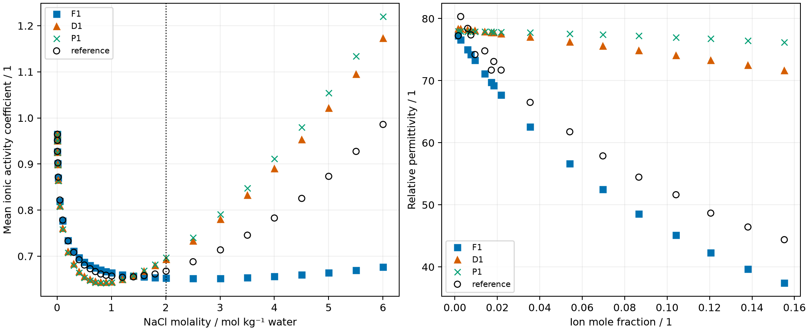

The retained comparisons do not establish either density-dependent permittivity
form as a validated replacement for Figiel ion-fraction suppression. Refitting
one shared water–ion interaction changes the activity ranking, while dielectric
decrement remains poorly described by the alternatives. Solution-density shifts
are model differences without retained solution-density observations.

**Claim class:** calibration plus conditional prediction in a hybrid-parameter
sensitivity comparison. The admission and derivative checks described in the
[README](README.md#admission-public-input--native) are separate numerical
verification evidence. Physical validation of a replacement model is not established.

## Question, model selections and data roles

The retained `results/summary.json:question` fixes the single NaCl–water
temperature/pressure condition:



No other temperature or solvent is assessed.
F denotes Figiel ion-fraction suppression, D the Schreckenberg
density–temperature form and P Rueben dipolar perturbation. The zero variants
exchange only the permittivity form at published Figiel parameters. The one
variants refit the shared water–sodium and water–chloride interaction to the
low-molality Hamer–Wu mean ionic activity coefficients. The method and input
hashes are retained in that summary and the three `inputs/selections/` documents.

The high-molality Hamer–Wu rows are held out from the new interaction fits.
They are not wholly independent of inherited parameters: F0's published
interaction used all Hamer–Wu rows, and Figiel suppression and Born parameters
overlap the permittivity and solvation references. Rueben's ion records also
have their own fitted-data history. “Unfitted” in the retained row labels means
unfitted for the stated coordinate or variant, rather than never used anywhere
in the parameter ancestry.

## Activity and dielectric comparison



The high-molality F0 result is now rounded from the retained operands to one
decimal in the generated table. It replaces the stale README display. Counts
refer to variant/property records; repeating a reference under several variants
does not create additional independent observations.





D1 has a smaller high-molality activity deviation than F1 after the same type
of refit, but it has larger low-molality and permittivity deviations. This does
not justify selecting it as a general replacement. P1's high-molality advantage
over F1 is unresolved by the retained interaction-only propagation. Solvation
is not a strong discriminator under the source spread described in the README.
The solution-density comparison is to the same-fit F model, not measured density.

## Sources, uncertainty and limitations

Hamer–Wu supplies the activity references. The dielectric samples are the
source-derived Figiel ledger digitizations retained in the sibling study and
copied into this comparison. The exact primary experimental table and pointwise
uncertainty remain unverified. The panel is bounded to that source-derived
comparison. The README's parameter/source section identifies the Yang,
Schreckenberg, Rueben and secondary FeOs water records.

Hamer–Wu uncertainties are not retained. The fit's conditional covariance and
the propagated metric uncertainty cover the interaction coordinate only.
They omit inherited-parameter, measurement and model-form uncertainty.
No calibrated density prediction interval follows. Dielectric digitizations
have no pointwise uncertainty and may include kinetic depolarization. The
hybrid D/P parameter sets are not reproductions of the complete source models.
There is no mixed-solvent, multivalent or temperature-transfer claim.

`results/batch4-summary.json` and the before/after tables retain the exact-gradient
native-conversion evidence, including strict comparison misses at the new optima.
Those records do not isolate every historical-wheel difference. The current
comparison and refit CSVs own the displayed numbers; no model was rerun here.

## Presentation and review boundary

`nice -n 10 .venv/bin/python tools/present-paper-evidence.py` generates these
tables and figure from `results/comparison.csv` and `results/refit.csv`.
The readiness finding is batch B of the issue-501 promotion review. This notebook
presentation has not been independently reviewed or promoted for manuscript use.
