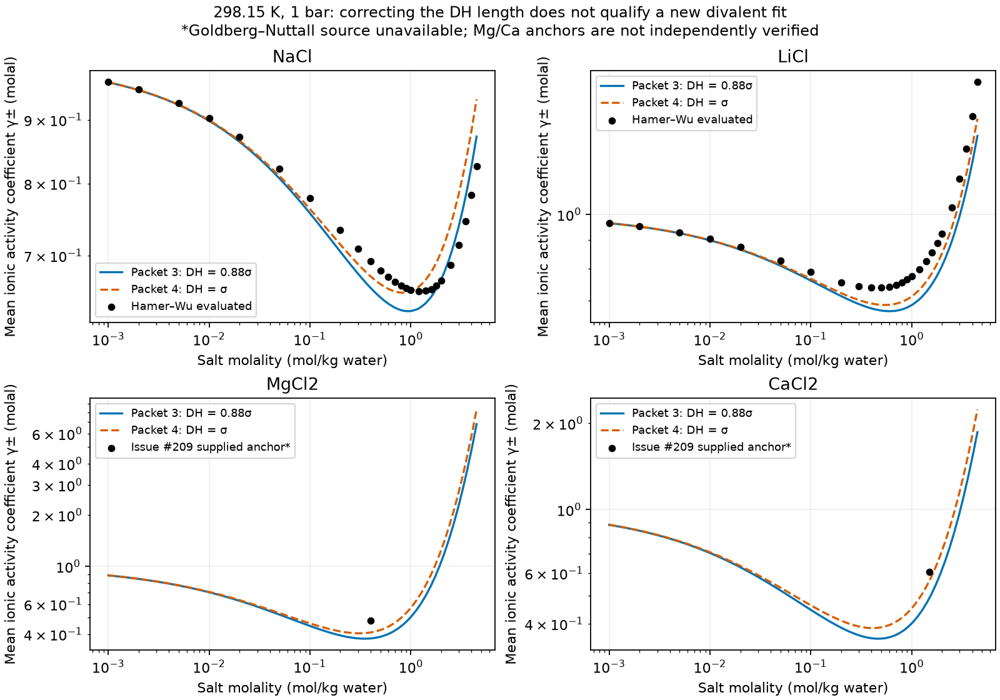

# Divalent chloride activity diagnosis

There is a source-equation encoding defect **and** a published model-accuracy
limitation. Held 2008 specifies the Debye–Hückel closest-approach length as
the fitted ion diameter `sigma_i` (p. 88, after Eq. (2)). Packets 2 and 3
instead store `0.88 sigma_i` for screening as well as hard-chain packing.
Packet 4 corrects screening only. The correction raises the two reported
divalent activities, but does not meet the requested 0.02-decade target.
It also raises NaCl activity and worsens the 3 mol/kg NaCl comparison.

The published model is less accurate for these divalent salts than the issue
suggests: Held Table 4 reports MgCl2 activity ARD 11.08%, AAD 0.19, and CaCl2
ARD 26.11%, AAD 0.80. ARD means average absolute relative deviation; AAD means
average absolute deviation of dimensionless activity coefficients. An average
error is not a bound on any individual concentration. These published errors
show that Held 2008 does not supply the desired precision, but do not establish
that the authors' executable produced the particular values in issue #209.

This diagnosis does **not** exactly reproduce Held's MgCl2/CaCl2 Table 4 AAD.
The original Lobo input rows are unavailable; the paper provides aggregate
errors and no MgCl2/CaCl2 activity curve or tabulated model values. A replacement
grid cannot establish exact AAD reproduction. The corrected packet follows
the printed screening equation, rather than claiming identity with the
authors' uninspected executable. No refit was performed.

## Paper and packet comparison

| Quantity | Paper | Packets 1–3 | Packet 4 |
|---|---|---|---|
| All 29 ion σ, u/k and segment numbers | Table 2; one segment per ion | Match every printed row | Same values |
| Screening length | `a_i = sigma_i`, p. 88 and Eq. (3) | Version 1 does not store separate lengths; versions 2/3 set `0.88 sigma_i` | `sigma_i` |
| Hard-chain packing length | `0.88 sigma_i`, confirmed for Held 2008 by Held 2014 Eq. (21) | Implicit in version 1; explicit in versions 2/3 | `0.88 sigma_i` |
| Same-sign ion dispersion | Neglected | Versions 1/2 explicit `k_ij=1` for unlike ions; version 3 excludes same signs | Same exclusion |
| Opposite-sign ion dispersion | Neglected, including Mg–Cl and Ca–Cl | `k_ij=1` | `k_ij=1` |
| Water–ion and salt-specific coefficients | Geometric mean, no binary adjustment | Water–ion `k_ij=0`; no fitted salt-specific coefficient | Same |
| Relative permittivity | Concentration independent; numeric value not printed in Held 2008 | 78.09, explicitly supplemented from Figiel 2025 | Same supplement |
| Debye–Hückel form and Born | Finite-size ion sum, Eqs. (2)–(4); no Born in Eq. (1) | Same form; Born off | Same form; corrected length |
| Water | 2B; Table 1 and σ(T), Eq. (7) | All coefficients match | Same |
| Mean ionic activity and molality | Stoichiometric geometric mean of infinite-dilution-referenced fugacities, then Eq. (10) | Native calculation matches; formula-unit molality per kg water | Same |

`results/paper-packet-comparison.csv` includes the water coefficients and every
model convention. `results/ion-parameters.csv` contains 580 comparisons
(29 ions × five quantities × four versions). `results/pair-dispersion.csv`
contains every unlike pair for all four versions (1,740 comparisons).
Historical version 1 is a CSV-format input, not a directly runnable input to
the current wheel; version 2 retains same-sign records rejected by the current
input rules. Their source coefficients are audited, while numerical replay
uses the physically equivalent version 3 representation. No historical
packet is rewritten or represented as directly executed.

## Retained numerical comparisons

All calculations below use fully dissociated chlorides in pure water at
298.15 K and 100,000 Pa on the liquid density branch. γ± is dimensionless
on the formula-unit molal basis; error is `log10(Engine/evaluated)`.

| Salt | mol/kg water | Evaluated γ± | Packet 3 γ± | Error, decade | Packet 4 γ± | Error, decade |
|---|---:|---:|---:|---:|---:|---:|
| NaCl | 3.0 | 0.7140 | 0.739496 | +0.015238 | 0.785026 | +0.041186 |
| LiCl | 0.02 | 0.8740 | 0.864721 | −0.004635 | 0.866310 | −0.003838 |
| MgCl2 | 0.4 | 0.4796* | 0.377609 | −0.103837 | 0.409454 | −0.068674 |
| CaCl2 | 1.5 | 0.6070* | 0.491147 | −0.091977 | 0.564192 | −0.031761 |

NaCl/LiCl values are independently read from Hamer–Wu Tables 16/9. Asterisks
identify values supplied by issue #209 and attributed there to Goldberg–Nuttall
Tables 17/20. They were checked on 2026-10-01 against the rendered pages of
Goldberg and Nuttall (1978), *J. Phys. Chem. Ref. Data* 7(1), 263–310, DOI 10.1063/1.555569,
Zotero `IJ9ZIG4H` (PDF `UVGIXEPB`): Table 17 (MgCl2, 298.15 K, printed p. 288,
PDF p. 27) lists γ± = 0.4796 at 0.400 mol/kg, and Table 20 (CaCl2, printed
p. 291, PDF p. 30) lists γ± = 0.6070 at 1.500 mol/kg. Both match the supplied
values. These are evaluated values recommended by the 1978 review, not
independent measurements. The retained Goldberg 1985 GAMPHI report
(`EBB7WNKR/WQGY9PR4`) describes a computer database and does not supply the
required MgCl2/CaCl2 numerical grid. The retained `inputs/evaluated.csv`
still carries the issue-time note "original source absent" for these two rows;
the inputs were not rewritten, so the values and results are unchanged.
The cited Lobo compilation was also absent. No library writes were made. Hamer–Wu values retain their printed rounding
(three decimals in the selected γ± rows); no invented measurement uncertainty
is attached to them.

`results/model-curves.csv` retains 748 evaluations, including continuous
0.001–4.5 mol/kg sweeps for all four salts and both packet versions.
These are model predictions, not divalent physical validation over that range:
only two divalent reference anchors are available. `results/evaluated-comparison.csv`
retains all 108 comparisons with the 54 selected reference rows.

| Salt and evaluated grid | Held Table 4 N / upper molality | Held ARD / AAD | Engine packet 3 ARD / AAD | Engine packet 4 ARD / AAD |
|---|---|---|---|---|
| NaCl, Hamer–Wu through 3.2 (23 rows, final row 3.0) | 16 / 3.2 | 3.43% / 0.02 | 2.6008% / 0.01812 | 2.4299% / 0.01697 |
| LiCl, Hamer–Wu through 4.5 (26 rows) | 20 / 4.5 | 9.79% / 0.10 | 8.8854% / 0.08899 | 6.1639% / 0.06110 |
| MgCl2 | 20 / 4.5 | 11.08% / 0.19 | Exact published-grid comparison unavailable | Exact published-grid comparison unavailable |
| CaCl2 | 19 / 5.5 | 26.11% / 0.80 | Exact published-grid comparison unavailable | Exact published-grid comparison unavailable |

The different source grids and numbers of points preclude identifying these
Engine averages with Held's averages. `inputs/held-table4.csv` also retains
Held's density fit statistics: NaCl 18 points, upper 5.82 mol/kg, ARD 0.74%,
AAD 8.31 kg/m³; LiCl 18, 15.73, 1.83%, 21.46; MgCl2 18, 5.66, 1.69%, 20.77;
CaCl2 19, 7.37, 2.79%, 35.38. Density fitting covered 20–30 °C. The present
298.15 K predictions do not reproduce those density statistics.



## Numerical diagnosis and limits

All 748 finite-concentration states have positive pressure slopes and pressure
residual magnitude below 0.01 Pa. Charge balance, independent contraction of
the two log fugacities, Eq. (10) conversion, and solvent-activity reconstruction
are retained per state. The activity identity discrepancy is below `1e-12`
in natural-log units. This verifies computation of the stated equations;
it does not validate their physical accuracy. The reference ladder's largest
terminal log-fugacity change is about `7.4e-5`, far below the observed
0.07–0.10 decade disagreement. That change is a convergence diagnostic,
not a rigorous error bound. Reference molalities are retained in the rows.

Rejected probes are retained in `results/rejected-probes.csv`. Setting the
opposite-sign dispersion coefficient to zero, while retaining same-sign
exclusion, gives MgCl2 γ± 0.314574 at 0.4 and CaCl2 0.317470 at 1.5 mol/kg.
This worsens the mismatch and contradicts Held 2008. Changing packing to σ
is also rejected: Held 2014 explicitly confirms 0.88σ for packing.

A separate trace-dilution conditioning defect affects the native osmotic
coefficient outside this study's 0.001–4.5 mol/kg domain. At NaCl `1e-8`
mol/kg, the native coefficient is 1.05035. A bounded root-cause probe using
the equal-pressure difference of residual chemical potentials plus
`ln(rho_solution/rho_water)` gives 0.999920. Independent density termination
leaves pressure errors of order `3.5e-5 Pa`; subtracting the two log fugacity
coefficients amplifies their unequal pressure errors by `1/m`. The probe
removes that dominant amplification but remains limited by cancellation
at still lower molalities. `results/solvent-activity-conditioning.csv` retains
the attempted remedy; `results/dilution-limits.csv` retains the failing values.
These trace osmotic values are diagnostics, not physical predictions.
No Engine code fix is built; issue #209 records the proposed numerical fix.
This trace failure does not explain the concentrated γ± discrepancies.

## Reproduction and scope

The sole installed non-editable wheel has SHA-256
`093638fa8c8e1987792e0facaeb5c00d121c6965c69a3298754ee146f8610318`,
from Engine source baseline `95ba231e0aa04d10f1ec650db2865ade8e05d178`.
`results/run-identity.json` binds the calculation script to that wheel.
`inputs/source-identities.csv` retains Zotero parent/child identities and
inspected source hashes. `scripts/run.py` reads packet versions 3 and 4 from
`data/packets/held-cameretti-sadowski-2008/`; #341 removed the byte-identical
leaf copies. Packet 4 is a printed-equation correction, not an adopted
application model. No downstream repository was inspected.

```bash
env EPCSAFT_BUILD_JOBS=2 .venv/bin/python analyses/2026-divalent-chloride-activity/scripts/run.py
env EPCSAFT_BUILD_JOBS=2 .venv/bin/python analyses/2026-divalent-chloride-activity/scripts/plot.py
```

The evidence supports the printed-equation correction, exact replay of the
issue's Engine numbers, and the paper's admitted divalent accuracy limitation.
It does not establish exact reproduction of the authors' executable, evaluated
divalent agreement across 0.001–4.5 mol/kg, mixed-salt accuracy, or the requested
new ion capability. Those source and fitting decisions remain in #209.
Independent GPT-6.1 Sol high review (Codex provider, task
`f090608f-56d2-4fc1-8ae7-f9241c75f627`) returned **Supported** for the
printed-equation correction and bounded numerical diagnosis. The reviewer
independently replayed all eight anchors and the trace osmotic probe. Its sole
required correction, the Held Markdown companion hash in
`inputs/source-identities.csv`, now matches both the exact Zotero attachment
and the inspected Companion file. The review does not establish exact Held
reproduction, full-range evaluated divalent agreement, mixed-brine accuracy
or a qualified new fit. The proposed osmotic correction remains design only.
The review used the frozen tree relative to the baseline named above; the
numerical records did not change. This notebook is not promoted for manuscript
use.

`bash tools/check-all.sh` passed: 108 Python tests and six native checks, plus
packet, equation-index, analysis-layout and architecture checks. The final
affected checks, source-copy/hash verification and prose check also passed.
These checks establish numerical/record consistency within their stated
scope; they do not fill the missing evaluated divalent source grid.

## Current producer diagnosis (#750)

[The current diagnosis](results/current-main/diagnosis.md) records the unchanged failure,
the responsible Engine changes, retained comparisons, repaired reruns and remaining
limits. New results are separate from the original retained results.
