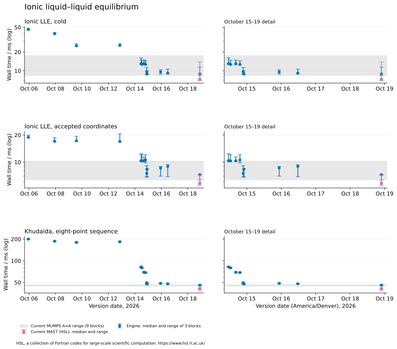
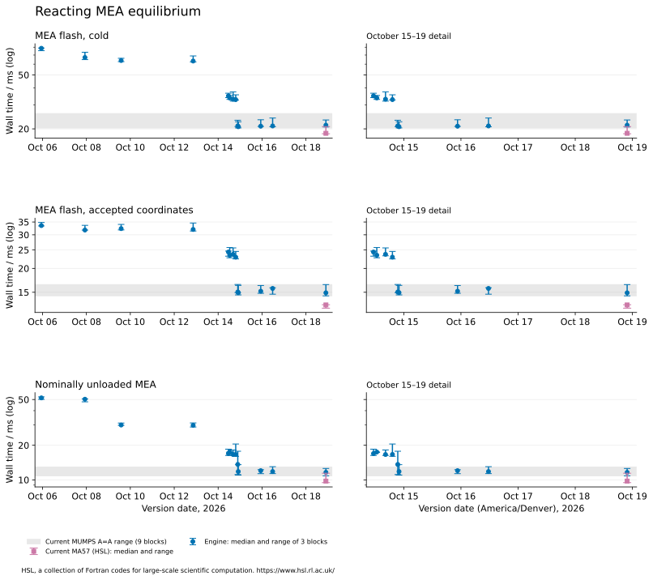
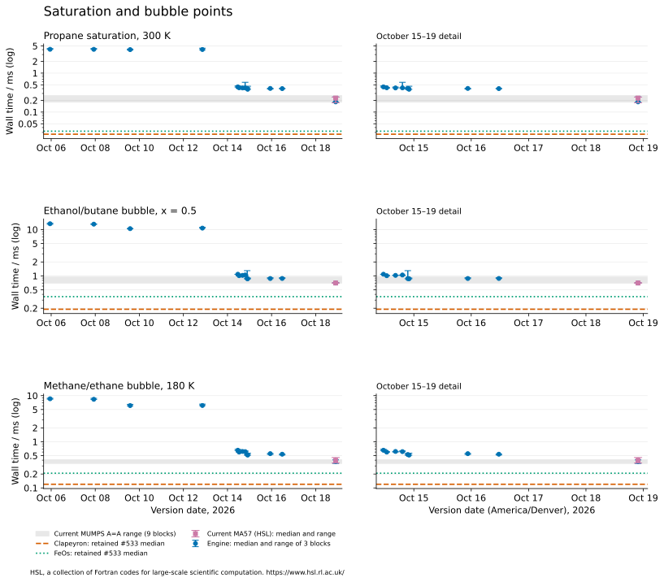
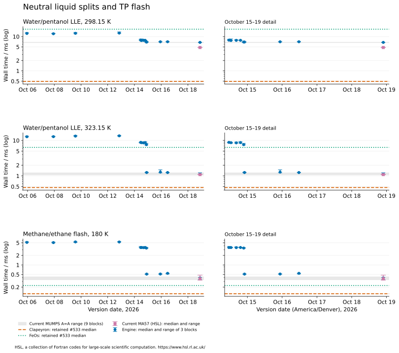
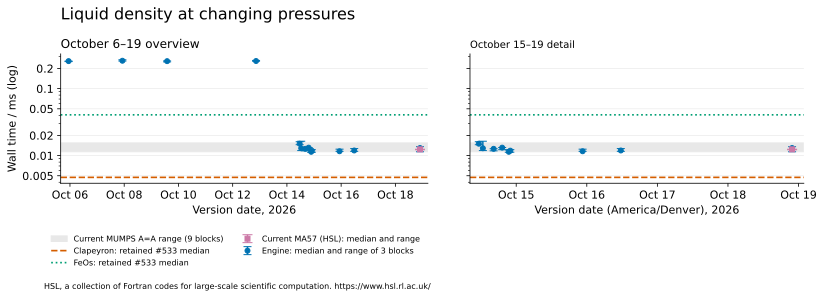
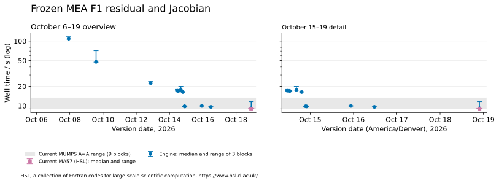
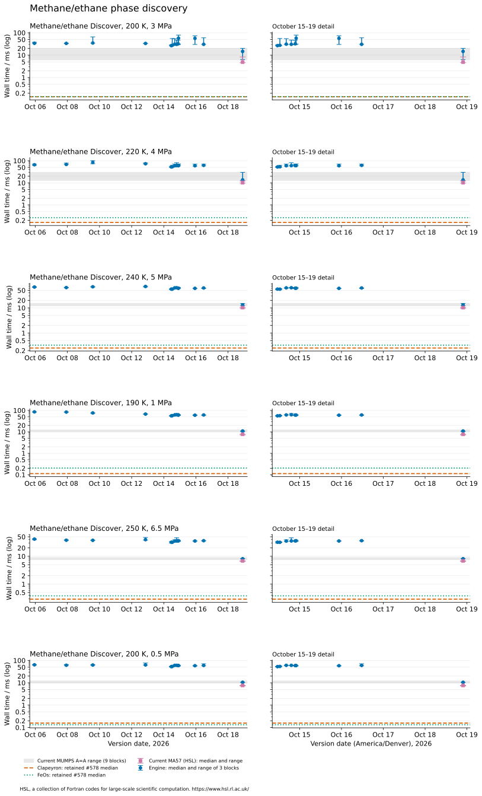
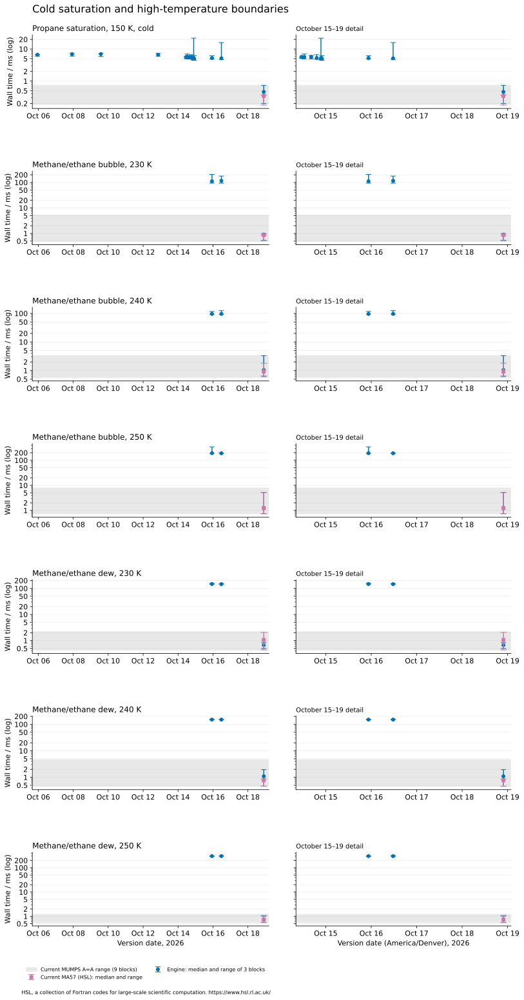

```{python}
import csv, json, statistics
from pathlib import Path
R = Path('results')
def rows(name):
    return list(csv.DictReader((R / name).open()))
def num(x):
    return None if x in ('', None) else float(x)
def fmt(x, digits=3):
    return '—' if num(x) is None else f'{float(x):.{digits}g}'
def ms(x):
    return 'unavailable' if num(x) is None else f'{float(x)*1000:.3g}'
def duration(row, field):
    if num(row[field]) is None:
        return 'unavailable'
    return f"{float(row[field]):.3g} s" if row['operation'].startswith('mea-f1/') else ms(row[field])
def table(headers, body):
    print()
    print('| ' + ' | '.join(headers) + ' |')
    print('|' + '|'.join('---' for _ in headers) + '|')
    for row in body:
        print('| ' + ' | '.join(map(str, row)) + ' |')
    print()
H = rows('headline.csv')
T = rows('timing-comparisons.csv')
W = rows('work-count-checks.csv')
COMP578 = rows('competitors-578.csv')
def hsl(value):
    return value + '[^hsl]' if value != 'unavailable' else value
S = rows('statistics.csv')
V = json.loads((R / 'verification.json').read_text())
C = json.loads((R / 'campaign.json').read_text())
U = rows('unavailable.csv')
COMP = json.loads((R / 'competitor-identities.json').read_text())
Q = rows('return-summary.csv')
D = rows('state-changes.csv')
I = {r['operation']: r for r in H}
discovery_ratios = [float(r['oct17_seconds'])/float(r['today_seconds']) for r in H if r['operation'].startswith('methane-discover/')]
boundary_ratios = [float(r['oct17_seconds'])/float(r['today_seconds']) for r in H if r['operation'].startswith(('methane-bubble/', 'methane-dew/'))]
worst_repeat = max(Q, key=lambda r: float(r['repeat_maximum_scaled_difference']))
material = [r for r in Q if int(r['differing_fields'])]
changed = [r for r in D if float(r['maximum_scaled_difference_to_today']) > 1e-10]
version_order = [v['version'] for v in C['environments']]
first_f1 = min((r for r in S if r['operation'] == 'mea-f1/residual-jacobian' and r['version'] in version_order),
               key=lambda r: version_order.index(r['version']))
```

## The current position

The current Engine is `1cd3ab15` (October 19), measured with MUMPS and MA57 on the same wheel. The headline uses the MUMPS arm.

Since the last retained October 15 wheel, this campaign resolves no timing improvement for the ionic LLE and reacting MEA point solves or the frozen serial F1 evaluation: their changes remain within the current MUMPS A=A range. The new discovery points are `{python} fmt(min(discovery_ratios))`–`{python} fmt(max(discovery_ratios))` times faster with current MUMPS than on October 17; the added high-temperature bubble/dew rows are `{python} fmt(min(boundary_ratios))`–`{python} fmt(max(boundary_ratios))` times faster. Each of those interval differences exceeds its operation's current MUMPS A=A range. These intervals contain several merged changes, so they establish their combined effect.

The cold ionic liquid–liquid solve is `{python} fmt(I['case-6/figure-2-point-7/cold']['earliest_over_today'])` times faster than the earliest retained wheel; the cold reacting MEA flash is `{python} fmt(I['case-7/flash-5918.5286-Pa/cold']['earliest_over_today'])` times faster. The propane density call is `{python} fmt(I['A-propane-liquid']['earliest_over_today'])` times faster. The frozen serial F1 residual and Jacobian is `{python} fmt(I['mea-f1/residual-jacobian']['morning_over_today'])` times faster than the morning wheel. These are measured complete-call cost ratios on this host. A ratio supports a timing claim only when the absolute difference exceeds the corresponding A=A range in [timing-comparisons.csv](results/timing-comparisons.csv).

This is **numerical verification and timing**, with no physical validation or new thermodynamic predictions. The phase equilibria, physical inputs and native calculation methods belong to the reused analyses; this study asks how long their declared operations take at retained versions.

### Headline table

Times are milliseconds, except serial F1 times explicitly marked in seconds. Each Engine value is the median of three block medians. Speedup is earlier time divided by today's time; above one means faster today. Competitor ratios are today's Engine time divided by the retained competitor time; below one means faster Engine execution. An em dash means no comparable reference is retained.

```{python}
#| output: asis
table(['Operation', 'Oct 6<br>1218dc78', 'Oct 15 morning<br>5ad73fb9', 'Oct 19 MUMPS<br>1cd3ab15',
       'Oct 6 / today', 'Morning / today', 'Today / Clapeyron', 'Today / FeOs'],
      [[r['label'], duration(r, 'earliest_seconds'), duration(r, 'morning_seconds'), duration(r, 'today_seconds'),
        fmt(r['earliest_over_today']), fmt(r['morning_over_today']), fmt(r['today_over_clapeyron']),
        fmt(r['today_over_feos'])] for r in H[:14]])
```

The two liquid–liquid temperatures have separate rows because they follow different numerical paths. The Khudaida row covers the whole ordered eight-point sequence. Accepted-start rows reuse accepted coordinates through the key-solve harness; the sequence passes the previous solved state and can use the later primal/dual warm-start support. The density row is time per call across the retained changing-pressure sequence, rather than repeated cache hits at one pressure.

The density block divides its total call time by its retained sequence length; its comparator references are the earlier study's pooled call medians. The aggregation difference limits fine comparisons of that row.

The F1 declaration contains `{python} V['f1_observations']` observations and `{python} V['f1_coordinates']` fitted coordinates. The earliest measured F1 evaluation is version `{python} first_f1['version']`, at `{python} fmt(first_f1['median_seconds'])` s, giving `{python} fmt(float(first_f1['median_seconds'])/float(I['mea-f1/residual-jacobian']['today_seconds']))` times the current time. It is separate from the unavailable earliest-wheel cell in the headline table.

Clapeyron `{python} COMP['Clapeyron']['version']` (Julia `{python} COMP['Clapeyron']['julia']`) and FeOs `{python} COMP['FeOs']['identity']['version']` references come from the same host's [#533 measurements](https://github.com/tannerpolley/ePC-SAFT/issues/533), retained in [competitors.csv](results/competitors.csv). They were measured earlier and are not interleaved with this campaign. No matching reference is retained for the key solves or the frozen F1 declaration. Ratios compare the complete declared operation and include differences between solver methods; they do not measure individual equation-of-state kernels.


## Changes since October 15

The table adds the last retained October 15 wheel, the October 16 and 17 wheels, and both arms of the October 19 wheel. Times are milliseconds except F1, which is in seconds. Every value is the median of three block medians. Discovery uses the six separate equimolar methane/ethane T4 points from [#578](https://github.com/tannerpolley/ePC-SAFT/issues/578); the new saturation and boundary rows leave the existing rows' declarations unchanged. The new boundary temperatures and input sources are retained in [extension.json](inputs/extension.json).

```{python}
#| output: asis
table(['Operation', 'Oct 15<br>cf26a17b', 'Oct 16<br>21e761c3', 'Oct 17<br>cc63a135',
       'Oct 19 MUMPS<br>1cd3ab15', 'Oct 19 MA57 (HSL)'],
      [[r['label'], duration(r, 'last_seconds'), duration(r, 'oct16_seconds'), duration(r, 'oct17_seconds'),
        duration(r, 'today_seconds'), hsl(duration(r, 'ma57_seconds'))] for r in H])
```

[^hsl]: HSL, a collection of Fortran codes for large-scale scientific computation. https://www.hsl.rl.ac.uk/

**MA57, [#605](https://github.com/tannerpolley/ePC-SAFT/issues/605).** The two current arms isolate the linear-solver selection on one wheel. `EPCSAFT_HSL_LIBRARY` is unset in MUMPS processes and points to the owner's private HSL library in MA57 processes. Each timed return records the process selection and each equilibrium row records the solver actually used; an empty equilibrium solver field means that the Newton path did not call Ipopt. Earlier wheels without the diagnostic retain “not exposed by this wheel”. HSL files are never copied or bundled. A row with no Ipopt call does not measure an MA57 factorization benefit, regardless of its timing comparison.

```{python}
#| output: asis
solver_comparisons = [r for r in T if r['comparison'] == 'current MUMPS to MA57']
table(['Operation', 'MUMPS / MA57 time ratio (HSL)', 'Absolute difference exceeds both A=A ranges'],
      [[I[r['operation']]['label'], hsl(fmt(float(r['earlier_seconds'])/float(r['later_seconds']))),
        r['beyond_aa_range']] for r in solver_comparisons if r['earlier_seconds'] and r['later_seconds']])
```

**Overhead, [#646](https://github.com/tannerpolley/ePC-SAFT/issues/646); Michelsen discovery, [#647](https://github.com/tannerpolley/ePC-SAFT/issues/647); phase-boundary starts, [#648](https://github.com/tannerpolley/ePC-SAFT/issues/648); trace-species start cap, [#652](https://github.com/tannerpolley/ePC-SAFT/issues/652).** These changes all lie between `cc63a135` and `1cd3ab15`, together with the charged-molecule admission change in [#641](https://github.com/tannerpolley/ePC-SAFT/issues/641). No retained milestone in this campaign lies between their merges. The MUMPS interval therefore measures their combined effect and cannot allocate a separate gain to any one of them. The new Discover rows exercise the discovery path, the cold saturation and bubble/dew rows exercise the changed starts, and none of these new declarations isolates the trace-species cap. An association with the affected operation is not an isolated causal measurement.

```{python}
#| output: asis
interval = [r for r in T if r['comparison'] == 'cc63a135 to current MUMPS']
table(['Operation', 'Oct 17 / Oct 19 MUMPS', 'Absolute difference exceeds current MUMPS A=A range'],
      [[I[r['operation']]['label'], fmt(float(r['earlier_seconds'])/float(r['later_seconds'])),
        r['beyond_aa_range']] for r in interval if r['earlier_seconds'] and r['later_seconds']])
```

The A=A test concerns observed timing spread on this shared host, not statistical confidence or portable performance. Entries marked false support a measured ratio but no resolved timing change. [timing-comparisons.csv](results/timing-comparisons.csv) retains differences and the exact comparison ranges.

### Work-count falsifiers

```{python}
#| output: asis
table(['Comparison', 'Point/operation checks', 'Different counts'],
      [[name, len(group), sum(r['equal'] != 'True' for r in group)]
       for name, group in [(left + ' → ' + right, [r for r in W if r['left'] == left and r['right'] == right])
                           for left, right in [('cc63a135', '1cd3ab15'), ('1cd3ab15', '1cd3ab15-ma57')]]])
unequal = [r for r in W if r['equal'] != 'True']
if unequal:
    table(['Earlier arm', 'Later arm', 'Operation / point', 'Earlier work', 'Later work'],
          [[r['left'], r['right'], r['point'], r['left_counts'], r['right_counts']] for r in unequal])
```

The key-solve counters are iterations, evaluations and Hessian calls. F1 additionally compares reference computations, reference columns, density solves and equilibrium iterations. The comparisons retain all repetitions and both A=A workers; variation within an arm also fails equality. [work-count-checks.csv](results/work-count-checks.csv) owns these checks. A difference falsifies the unchanged-work criterion in #644 even when states repeat within tolerance; it prevents interpreting the arm comparison as the same computational work.

Across the current MUMPS and MA57 arms, the largest scaled returned-value difference is `{python} fmt(V['maximum_solver_arm_difference'])`[^hsl], with numerical agreement `{python} 'within tolerance' if V['solver_arms_within_tolerance'] else 'outside tolerance'` at the same repeat-comparison limit.

### Matching competitor references from #578

```{python}
#| output: asis
table(['Operation', 'Library', 'Retained #578 median / ms', 'Samples', 'Recorded load range'],
      [[I[r['operation']]['label'], r['library'], ms(r['seconds']), r['samples'],
        r['load_min'] + '–' + r['load_max']] for r in COMP578])
```

These references match the three original saturation/bubble declarations and the six T4 points. They supplement the earlier #533 references; they were measured before this campaign, under their own recorded load and call boundaries, and provide no A=A timing claim about a competitor change. No matching comparator is retained for cold propane at the added temperature or the new high-temperature bubble/dew points.

## Timing against version date

Points are milestone block medians; vertical intervals show the minimum and maximum of the three repetitions. Points are not connected because unmeasured releases can contain intervening changes. The vertical axis is logarithmic. The gray band is today's unchanged-version A=A range across the current worker and its independent control worker. Horizontal dashed and dotted lines show the retained competitor medians from #533 for the original rows and #578 for discovery. Each chart pairs the full date range with an enlarged October 15–19 view. Current MA57 points use square markers and name HSL in each figure; the gray band uses the current MUMPS A=A controls.

















## Which changes align with the earlier steps

These labels identify changes present between measured milestones. Wider intervals contain several changes, so the history alone does not isolate a causal contribution from every commit.

- **Before the morning wheel:** density scan work and pressure derivatives were reduced; neutral saturation and bubble points gained a guarded exact Newton attempt. The intervening work also changed free-phase starting amounts and reused reaction-reference derivatives. See [density evaluation](https://github.com/tannerpolley/ePC-SAFT/pull/514), [neutral Newton](https://github.com/tannerpolley/ePC-SAFT/pull/492), [phase starting amounts](https://github.com/tannerpolley/ePC-SAFT/pull/421) and [central reference derivatives](https://github.com/tannerpolley/ePC-SAFT/pull/479).
- **Between the October 8 and October 10 milestones:** the neutral reaction reference changed from a terminal finite-dilution value to a square-root-molality extrapolation toward infinite dilution. This is a numerical reference correction, so earlier F1 results need a separate numerical comparison ([accepted correction](https://github.com/tannerpolley/ePC-SAFT/pull/385)).
- **Morning, `5ad73fb9`:** uncaptured state calls omit unread composition Hessian columns ([change](https://github.com/tannerpolley/ePC-SAFT/pull/530)). Captured F1 evaluations retain those columns, so this row cannot establish the uncaptured F1 benefit.
- **`ffda2bc0`, warm starts:** repeated equilibrium solves can reuse accepted primal coordinates and dual multipliers. The ordered Khudaida sequence exercises previous-state reuse ([change](https://github.com/tannerpolley/ePC-SAFT/pull/534)).
- **`0bec2bdf`, identical-input reuse:** identical inputs reuse the zeroth-order coefficients on a CppAD tape; positive-order derivatives are still recomputed ([change](https://github.com/tannerpolley/ePC-SAFT/pull/542)).
- **`9853bb6d`, tape optimization:** CppAD removes redundant tape operations while retaining the declared derivative requests. This coincides with a large reduction in the key-solve and serial F1 costs ([change](https://github.com/tannerpolley/ePC-SAFT/pull/546)).
- **`cf26a17b`, neutral liquid splits and flash:** eligible two-phase fixed-temperature, fixed-pressure problems first try the shared exact-Jacobian Newton path, then retain the existing fallback when needed. The differing LLE rows show why one speedup should not stand for all neutral solves ([change](https://github.com/tannerpolley/ePC-SAFT/pull/548)).

## Returned values and measurement spread

Every timed return is retained in [returns.jsonl.gz](results/returns.jsonl.gz). The study checked `{python} V['prior_value_checks']` scalar fields against prior retained returns. It also checked composition normalization and the density sequence's independent reference values: maximum composition-sum error `{python} fmt(V['maximum_composition_sum_error'])`; maximum relative density difference `{python} fmt(V['maximum_density_relative_error'])`. Within-version repeated returns differ by at most `{python} fmt(V['maximum_repeat_difference'])` on the quantity-scaled metric, against the required `{python} fmt(V['repeat_tolerance'])` limit. The repeat falsifier is `{python} 'satisfied' if V['repeats_within_tolerance'] else 'FALSIFIED'`. MUMPS and MA57 repeats are checked separately, including their own controls.

```{python}
#| output: asis
table(['Operation', 'MUMPS A=A range (same units as headline)', 'Range / median', 'MA57 A=A range (HSL)'],
      [[r['label'], f"{duration(r, 'aa_min_seconds')}–{duration(r, 'aa_max_seconds')}",
        f"{100*float(r['aa_range_over_median']):.1f}%",
        hsl(duration(r, 'ma57_aa_min_seconds')) + '–' + hsl(duration(r, 'ma57_aa_max_seconds'))] for r in H])
```

The A=A range is an observed same-version spread, not a confidence interval. Small changes within that spread are unresolved here. The prior-return check uses the key-solve harness's quantity scales and tolerance for key solves and F1, the cross-check's solved-state comparison tolerance for neutral rows, and the density study's relative tolerance for density. [retained-values.csv.gz](results/retained-values.csv.gz) preserves each reference, source and tolerance; [return-checks.csv.gz](results/return-checks.csv.gz) preserves each comparison.

```{python}
#| output: asis
if material:
    print('Prior-return differences beyond the corresponding tolerance:')
    table(['Version', 'Operation', 'Differing fields', 'Largest scaled difference'],
          [[r['version'], I[r['operation']]['label'], r['differing_fields'], fmt(r['maximum_scaled_difference'])] for r in material])
else:
    print('Every matched prior-return field is within its retained comparison tolerance.')
```

```{python}
#| output: asis
if changed:
    print('Versions with a returned-value difference from today larger than the key-solve scaled comparison level:')
    table(['Version', 'Operation', 'Largest scaled difference to today'],
          [[r['version'], I[r['operation']]['label'], fmt(r['maximum_scaled_difference_to_today'])] for r in changed])
else:
    print('No measured milestone differs from today beyond the key-solve scaled comparison level on the retained physical and F1 arrays.')
```

The earliest wheel predates the automatic key-solve archive. Its ionic point is compared to the earlier return retained in that checkout; its other key rows have repeat checks and numerical stopping evidence but no matching archived return. Later key rows use their own revision's retained returns where available. Neutral rows use the prior return retained in each source checkout; these can predate the wheel. The F1 references distinguish same-revision key-solve returns from the earlier capture on `49aac619` with the same frozen declaration.

The `026b3031` F1 predictions and Jacobians differ from the later retained return, while the next measured milestone, `a36a20a5`, agrees within the retained comparison tolerance. The interval includes the accepted [neutral-reference correction](https://github.com/tannerpolley/ePC-SAFT/pull/385), which removes the remaining square-root-molality tail from both the reference value and its derivatives. That source change is a reason to expect a numerical shift. Its attribution to this F1 difference is an inference from the version interval and the affected quantities; an isolated replay of that correction was not performed. The older F1 timing remains a measured historical cost, with no claim of numerical equivalence to today's F1 result.

## Conditions and unavailable measurements

The host is `{python} C['host']['node']`, `{python} C['cpu_model']`, with `{python} C['cpu_count']` logical CPUs and shared memory. Each measurement process was pinned to CPU `{python} C['cpu']` at niceness `{python} C['identities']['control']['nice']`; OpenBLAS, OpenMP, MKL and the other recorded numerical pools each used one thread. The campaign ran from `{python} C['started']` to `{python} C['ended']`. One-minute load ranged from `{python} fmt(V['load_min'])` to `{python} fmt(V['load_max'])` at measured block endpoints, using the `{python} ', '.join(V['gates'])` gate. Admission required load below the recorded relaxed ceiling and no active compilers; blocks waited when those conditions were unavailable. The gate controls admission; host load can rise during a block, and both endpoint loads remain in the retained record. [returns.jsonl.gz](results/returns.jsonl.gz) retains each block's load, gate and wait.

The campaign interleaves all versions separately for each operation, rotates and reverses their order across `{python} C['repetitions']` repetitions, and brackets each version sequence with independent MUMPS and MA57 controls. Each process warms each operation once. Fast neutral operations retain several calls per block; key operations and serial F1 retain one measured call per block. Imports, declaration construction, and accepted-start preparation are outside the timed solve boundary. F1 uses the key-solve harness's capture boundary, which includes capture work. Full parallel F1 fits were omitted; this study does not establish fit wall time or scaling.

All milestone wheels were present; no neighbor substitution or wheel build was needed. Unavailable operation/version pairs are listed below, with no interpolated timing.

```{python}
#| output: asis
unavailable = {}
for r in U:
    reason = r['reason'].split('; residuals=')[0].replace('|', '/')
    unavailable.setdefault((r['operation'], reason), set()).add(r['version'])
table(['Versions', 'Operation', 'Reason (full diagnostic in unavailable.csv)'],
      [[', '.join(sorted(versions)), I[op]['label'], reason]
       for (op, reason), versions in sorted(unavailable.items())])
```

Older wheels that reject a new declaration or return an unaccepted boundary state remain unavailable for that operation. The exact exception and stopping diagnostic are retained; no changed seed, relaxed tolerance or Engine repair is applied to a historical wheel. These cells do not establish physical nonexistence.

Missing F1 work-count events are recorded separately in [f1-work-diagnostics.csv](results/f1-work-diagnostics.csv); they do not reject complete, finite predictions and Jacobians. The adapter removes only the commit-matched harness's assertion that all later work-count events exist. It retains the native evaluation, availability, dimensionality and finite-value checks. An older wheel that cannot decode the scientific declaration remains unavailable.

The notebook and HTML have not yet been independently reviewed by the lead or promoted for manuscript use. The evidence supports these declared operations, wheels and host conditions. It does not establish a portable machine speedup, global phase stability, near-critical accuracy, physical validation, or full-fit performance.

## Reproduction and retained evidence

The [README](README.md) gives preparation, measurement, reduction and rendering commands. The current wheel matches [release main-1cd3ab150d19bc25a82bed81e04b8cfaf1d068b2](https://github.com/tannerpolley/ePC-SAFT/releases/tag/main-1cd3ab150d19bc25a82bed81e04b8cfaf1d068b2); its checksum was checked against the retained release metadata. [statistics.csv](results/statistics.csv) owns chart points and ranges; [headline.csv](results/headline.csv) owns the headline table; [timings.csv](results/timings.csv) owns individual samples. Wheel paths, hashes, installed extension identities and commit dates are in [campaign.json](results/campaign.json); [prior-source-hashes.json](results/prior-source-hashes.json) identifies the reused numerical records. Rendering reads these files and figures in a presentation environment without the Engine installed.
