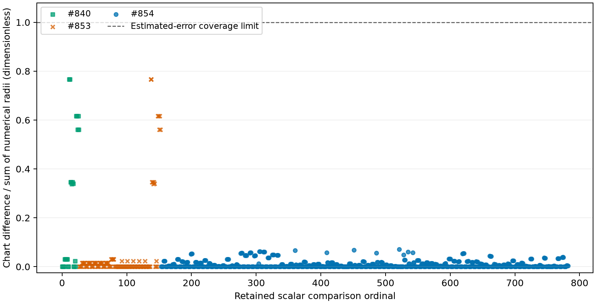

## Question and basis

Do independently computed local numerical-error estimates cover the retained
pure-fluid and neutral-mixture endpoint differences while preserving the
original equations, admission and solve work? The [original accepted issue](https://github.com/tannerpolley/ePC-SAFT/issues/861)
and its lead amendments define this comparison. The fixed model inputs,
original residual criteria and endpoint values are retained in
[the input table](inputs/endpoints.txt), [the original criteria](inputs/original-criteria.csv)
and [the estimate table](results/estimates.csv).

The pure-fluid declarations use propane with fixed temperature and free
pressure, a liquid feed phase and a zero-pinned vapor phase. The mixture
uses equimolar methane and ethane with the original declarations and starts.
Temperatures are in K, pressures in Pa, densities in mol/m³ and amounts in
mol; compositions and log-density radii are dimensionless. Model parameters
and the feed basis remain fixed. These are numerical verification and
consistency comparisons, with independent pure-fluid density verification.
They provide no physical validation, parameter uncertainty or rigorous
nonlinear enclosure. Independent delivered review and investigator promotion
for manuscript use remain outstanding.

## Method and comparison meaning

The shared native calculation evaluates the canonical defining rows and exact
Jacobian at each frozen endpoint. Its row-aligned inner errors and arithmetic
floors precede numerical equilibration; the compensated linear defect and
exact output derivatives propagate them to pressure, densities, packing,
compositions and amounts. The estimate table retains total absolute and chart
radii only; separate correction, floor, defect and export components were not
measured and are omitted. The complete-row estimates and the separately
qualified reduced pure-fluid estimates retain their distinct row bases.
The [equilibrium formulation](../../engine/docs/equilibrium/formulation.md)
and [algorithm owner](../../engine/docs/science/algorithms.md#alg-equilibrium)
retain the physical equations and solve criteria. The local linear-error
interpretation follows [LAPACK's error measures](https://www.netlib.org/lapack/lug/node75.html).

The native comparator first applies the original ordinary allowance. Outside
it, the approved conditional comparison requires available and resolved
estimates at both endpoints, at least one radius above the ordinary allowance,
unchanged original admission and residual criteria, and coverage by the sum
of the two independent radii. Positive density and packing comparisons use
their log chart. Pressure in the pure-fluid comparison and every key-solve
fixture stay strict. Ordinary equality does not consult diagnostics.

The frozen physical-only endpoints use the existing native multiplier lift.
Its recomputed residual is retained separately from each original residual
criterion. The lift changes neither the physical endpoint nor the original
admission outcome. Fresh corpus comparisons retain full coordinates and use
the native frozen-snapshot reader, avoiding that lift. Python supplies and
retains operands; the native comparator owns every judgment.

## Coverage and independent density reference



All displayed ratios come from the [native comparison rows](results/comparisons.csv).
The [domain checks](results/domain-resolution.csv) retain phase separation and
composition, amount and packing domains. Coverage supports numerical
consistency under this local error model; the magnitude of a radius still
limits the number of supported digits in its physical output.

The pure-fluid reference subtraction runs in binary128 against the retained
independent roots before conversion to displayed values. Each radius is its
own endpoint's estimate, independent of the paired difference.



The mixture comparisons have no independent wider root reference. They
therefore do not establish mixture-root accuracy; that question belongs to
[#864](https://github.com/tannerpolley/ePC-SAFT/issues/864).

## Original installed/development mixture rows

This table preserves the original row numbering in the installed/development
corpus. Each row includes pressure, both phase densities, all phase
compositions and both amounts. [The complete judgment table](results/853-judgments.csv)
also retains the judgment for each quantity and component.



The production corpus reader reproduces the installed/development comparison
with the same native judgments and the original admission outcomes. This subset
contains the pressure, density and composition quantities; amounts are retained
in the larger judgment table above.



## Source-reference chemical and caloric rows

The source-reference rows use local higher-precision re-evaluation plus
first-order pressure/site propagation, as specified by
[#869](https://github.com/tannerpolley/ePC-SAFT/issues/869) and
[ALG-REFERENCE](../../engine/docs/science/algorithms.md#alg-reference).
Named retained machine constants, supplied parameters and captured path/site
coefficients are fixed inputs. Derived reciprocals, products and sums remain
inside the common scalar expressions. The reference replay uses `long double`;
its precision is identified separately in the returned method annotation.
The endpoint and Jacobian keep their original double precision.

The shared association-error calculation supplies the fixed-site contribution.
The raw source-pressure partials transport achieved pressure residuals,
arithmetic floors and the retained density floor to the chemical contraction
and its first thermal derivative. Fixed source pressure retains these raw
sensitivities even though its public system-pressure derivative is zero.
The existing minimum-norm and record-anchored maps then supply chemical,
Gibbs, enthalpy and entropy error contributions. Higher caloric-error columns
remain uncomputed. Charged or source-referenced pressure–enthalpy/entropy
admission is unchanged.

The retained ethane stencil checks the pressure coefficients and actual
returned chemical/first-thermal centers against independent nested automatic
differentiation in binary128. The consumer cases use the original reacting
ethane and aqueous electrolyte declarations, raw mole fractions, system and
fixed source pressures, and frozen solved coordinates. Known signed chemical
and thermal perturbations pass through the actual maps and row consumers.
They test error transport at a fixed point, rather than a nonlinear movement
of an equilibrium endpoint.





[The per-species consumer errors](results/source-consumer-errors.csv) retain
chemical and first-thermal standard-state errors and the corresponding
caloric errors. Gibbs and enthalpy errors use J/mol; Gibbs-temperature and
entropy errors use J/(mol K). The [native consumer rows](results/source-consumers.csv)
retain every signed perturbation and comparison.

The supplied pressure-floor falsifier uses an independently fixed quantizer.
Its reported closure corrections vanish while its cell width supplies a known
pressure error at each endpoint. Deleting every pressure-floor contribution,
while retaining fixed-path arithmetic, loses the intended chemical and thermal
comparisons. The normalized temperature coefficient and external normalization
are retained in [the pressure-floor rows](results/source-floor.csv).



The reciprocal falsifier passes through the corrected common temperature-law
expression. The consumed aqueous case activates both that law and Born
charging. Turning off the reciprocal coefficient or changing the Born diameter
changes the returned chemical contraction; these changes identify activation,
not a fitted error scale. Chemical discrepancies are dimensionless and thermal
discrepancies have units of inverse kelvin.



The association checks perturb retained site coefficients on degree-three and
degree-five paths with fixed regular inputs. The table distinguishes the path
order from the perturbed site coefficient. Binary128 measures the site-induced
energy change independently; the complete double comparison also retains its
fixed-site arithmetic estimate. Removing the site contribution loses every
comparison. These are dimensionless extensive-energy Taylor coefficients,
with the same dimensionless path variable as the reference calculation.



The local model can underestimate shared errors and internal cancellation.
A final extraction scale and operation count do not bound arbitrary internal
amplification. Fixed-input arithmetic excludes supplied operand uncertainty:
the retained scalar quotient is exact at both precisions, while a separately
supplied denominator uncertainty changes its value beyond that arithmetic-only
estimate. Pressure/site uncertainty therefore retains its separate producer.
These scalar limit examples are retained from the accepted design probes;
they are separate from the delivered EOS qualification stencil.



The dedicated ethane endpoint now has finite row-specific inner errors and a
finite full-system condition estimate. Explicit diagnostics and detailed
capture return the same annotation and estimates. Original values and solve
work stay bitwise unchanged across diagnostics off, ordinary and detailed
capture, including a solve after diagnostics and cache reuse.



[Mixed pure/dilute references and present halite](results/source-consumer-cases.json)
also return finite row errors without changing captured physical values.
The shared `estimated_error` comparison judgment and eligibility are unchanged;
unavailable or unresolved estimates still cannot grant a conditional pass.
The source-reference additions are numerical verification on the stated
regular branches, with fixed inputs. They provide no physical validation,
parameter uncertainty, root uniqueness or nonlinear enclosure. They have not
been independently reviewed or promoted for manuscript use.

## Falsifiers and delivery checks

The manufactured perturbations isolate linear propagation, including a zero
reported residual, independent row error, singularity, nonnormal sensitivity
and exact rescaling. The association and row-transport checks retain controlled
site perturbations; they verify the named numerical contractions and do not
claim physical validation.



For both ideal mole-fraction and molarity activity bases, the compiled snapshot
now reproduces the detailed-capture and post-hoc estimates for the same
two-coordinate reaction state, including its structurally absent species.

The comparison readers retain diagnostic operands and native judgments. The
pure-fluid reader uses the reduced estimates and independently checks domain
resolution with the complete endpoint calculation; the neutral corpus reader
uses complete-row estimates. Diagnostics-off preservation is judged from
stored values and work counts, with paired timing as supporting evidence.



The fixed-input fit evaluations retain identical reference computations,
columns, density solves and equilibrium iterations. Serial CPU and full-fit
wall measurements are from the same-host paired gate, with the retained A=A
control range in [the performance table](results/key-performance.csv).



The source-reference implementation retains its own frozen-baseline A=A
control and A/B campaign, including full fits. [Byte comparisons of retained state scalars and fit rows](results/source-key-preservation.json)
and work rows are identical across arms; serial evaluations use no reference Taylor replay
when diagnostics are off.





The native pull-request check still requires a pull-request number. Its absence
is a delivery gate, separate from the numerical coverage above. The original command
logs remain in the main checkout's `build/issue-861/build-r5/`; source-reference
implementation, qualification and delivery logs are in `build/issue-869/build-r1/`.
The [original provenance](results/provenance.json) describes the endpoint study;
[source-reference provenance](results/source-reference-provenance.json) retains
the new input, source and loaded-library identities and accepted design files.
The [presentation command](scripts/present.py) reads retained tables only.

## Numerical refusals through recovery and publication

The selected controls distinguish a rejected intermediate calculation from final
convergence under the accepted [reporting correction](https://github.com/tannerpolley/ePC-SAFT/issues/862).
They check first-cause retention at the preparation, driver, continuation,
density and trial boundaries listed in the returned comparison table.
The records include stopping meaning and backward error, with unavailable
residuals where no residual was measured. Named ranks retain their matrix
basis and cutoff. Full-rank pivot rejection and failure of positive definiteness
retain their actual decision text without asserting singularity.

The [retained comparison table](results/solve-observations.csv) places native
and returned causes beside their operands, later outcome, unchanged values/work,
exact evidence files and limits. The [numerical records](results/solve-observations.json)
retain the first/final site records, callback tuples, failed optimizer arrays,
direct comparisons of originating declarations, every defining row and selected
constraint rows after enclosing-result replacement, plus public/baseline comparisons.
These are discrete reporting comparisons at fixed inputs, so a table clarifies
the claim; plotting the categorical refusals would add no numerical information.



The association input is a manufactured site-conditioning stress case. Its
negative pressure is not an admitted stable-fluid result. Later-phase and
standard-term exceptions test the lifetime of shared preparation output;
they do not establish a new equilibrium trajectory. The manually supplied
callback coordinates test first-cause ordering, while the separate constrained
reaction interval reproduces an actual optimizer callback refusal. The warm
case enters the existing internal predictor with an admitted optimizer endpoint.
Its enclosing observation transport does not establish a new successful physical
source-recovery path. The density partition/anchor and native trial controls
transport the same recovered association producer with explicitly supplied
intermediate inputs; they establish those consumer boundaries, without a new
admitted physical recovery trajectory. The tangent controls exercise the
existing straight predictor and the envelope tangent consumer after rejection.
They use the all-pinned rank-refusal declaration and bypass generic admission
only in the retained probe to reach the straight tangent consumer. The
reference-completion control inserts inconsistent dependent reaction rows after
compilation to inspect the existing consistency calculation; it establishes no
admitted reacting equilibrium.

The exceptional driver control retains an invoked initialization attempt when
the named options file is missing. A separate preparation-budget control keeps
the earlier site refusal and current rank. Ordinary exception transfers copy
the first record, preserving the source that the anchor partition catch and
association property-action consumers subsequently read. The controls exercise
those consumers without injected allocation failure. Allocation failure during
diagnostic construction or retention propagates normally; no incomplete-record
fallback or allocation-failure control is included. These controls establish
the inspected boundaries, without completeness for every exceptional exit or
finite budget.

The final Ipopt callback and its raw final point retain different bases.
Callback quantities use Ipopt's internal optimization/scaling basis; failed
point arrays retain the original TNLP coordinate scale, lower/upper bound
multipliers, constraint-row selection and their originating declaration/rows.
They describe the point before polish and cannot populate an unavailable
physical state or serve as an admitted returned-state accuracy estimate.
The two bounded optimizer summaries mean the last actually invoked attempt and
the earliest superseded restoration-bearing attempt. Initialization-only
attempts have no fabricated callback or point.

Original-path `ipopt_log` output belongs to the existing capture and opens only
when Ipopt is invoked. Off/on/off comparisons retain identical physical values,
callback tuples and solve work; every iteration row in the sequential warm/cold
log matches its callback. Invalid destinations remain nonfatal. With the
guaranteed-invalid `/dev/null/r4-ipopt.log` destination, ordinary and detailed
captures around equimolar methane/ethane discovery at 220 K and 5 MPa both
return `incomplete=True` and `Ipopt log could not be opened`. At 300 K and
0.1 MPa, both requesting parents and explicit children retain the same error
and incompleteness in either detail mode. Packed physical values and work
are identical to each unlogged solve. The exact inputs and comparisons are
retained in `results/solve-observations.json` under `logging.invalid_nested`.
Independent destinations at 300 K and 0.1 MPa leave the parent complete with
an empty log error, whether it requested no log or its own valid log. The child
returns `incomplete=True` and the opening error for its separate invalid log.
All four parent/child detail combinations preserve the same packed values and
6/8/7 iterations/evaluations/Hessian calls for the before, child and after
solves. Each parent's valid log contains both seven-row solves and stops
growing when its capture closes. The eight independent controls are retained
under `logging.independent_destinations`.
The native `capture-forward-probe` checks all parent/child detail combinations,
three log-request relationships, and destruction alone or `take()` followed by
destruction: only the shared failed request marks the parent incomplete.
Spans and events forward exactly once only when both captures enable detail. Inherited nested captures retain
the same file lifetime without later leakage. The
[sole diagnosis procedure](../../engine/docs/science/algorithms.md#diagnose-an-observed-refusal)
keeps the options-file variable unset for this original calculation. Detailed
capture and file output can affect finite deadlines; this evidence provides no
timing identity or universal finite-budget equivalence.



The [key-solve measurements](results/solve-key-performance.json) retain the
same-host control, CPU ceilings, full-fit wall and critical-path CPU, loaded
library identities and unchanged work. The
[formatted runtime accounting](results/solve-runtime-lines.json) and
[source/build identities](results/solve-provenance.json) identify the checked
implementation. Full logs, exact probe source and commands, consumer checks
and final native lint/sanitizer output are retained in the main checkout
at `build/issue-862/build-r9/`. This is numerical verification of reporting and
unchanged calculations on the retained inputs. It supplies no physical
validation, parameter uncertainty, nonlinear enclosure or global stability
certificate. Independent delivered review and investigator promotion remain
outstanding.

## Parameter-fit and external-function determination

The [accepted parameter-fit design](https://github.com/tannerpolley/ePC-SAFT/issues/863)
extends the same records to the existing SVD decision, measurement whitening,
dependent Born-diameter hold, fitting observations and actual worker replies,
minimax callbacks and the remaining ASL conversions. The
[retained rows](results/parameter-fit-determination.csv) and
[producer/consumer records](results/parameter-fit-determination.json) identify
the fixed inputs and numerical outcomes. The SVD cutoff comes from the
existing singular spectrum and reciprocal-condition policy. Statistical
covariance availability remains a separate decision.



The worker controls change only the action anchor at the specified regular
ethane states. Central predictions remain available. The real producer then
refuses the bad anchor, or recovers through its existing cold retry; the
same library and shim run in the actual exec-started child. These checks
verify record transport and eligible serial row order. They do not establish
that ethane derivatives are physically unavailable at those states. The
separate shared-solve replay compares the actual association refusal with
prediction, trial and fit records.

The finite-addition check uses pure ethane with declared initial, final and
liquid-feed amounts, pressures and thermochemistry. Its ordinary value and
dispersion-energy derivative appear in the retained table. A bad feed-action
anchor retains the producer's complete `left_domain` record and the named
`DENSITY_ROOT_RESIDUAL` criterion in the gradient, trial and fit. Initial,
final and feed records retain that order through available and refused returns.

The grouped control uses phase density and phase fraction at one pure-ethane
state with two parameter directions. A cause on the later row in the first
direction cannot displace the earlier row's cause in the second direction.
The original all-item scan fails this comparison. The corrected controlled
and ordinary runs have equal predictions, Jacobians and work. A separate
refused-first-direction control excludes causes from unconsumed rows and
directions. Shared matrix diagnostics retain their existing owner.

The four changed exception conversions first rethrow `std::bad_alloc`, then
retain the existing conversion of `std::exception` descendants. This includes
numerical `std::domain_error` failures. The real reaction-property producer
returns a recorded failed fit and one `InadmissibleTrial` with the original
`nonfinite reaction properties` cause for the extreme finite correlation
coefficient in the retained handler case. The ordinary coefficient preserves
its log equilibrium constant, exact derivative and work, as shown in the table.
The existing logic and runtime exception controls retain their numerical
conversion. Inspection of the four catch sequences and compiled type relations
establish the allocation exclusion. No allocation failure is injected and no
containment is added. This deliberately overflowing reaction correlation checks
numerical-failure transport and supports no physical claim.

The ASL action controls call the registered external function with a successful
central preparation, then replace the existing action return in the test link.
A rank refusal has no condition estimate or Taylor-solve residual. The supplied
full-rank operands are a transport control, rather than a measurement of the
physical two-liquid Jacobian. Their basis is the power-of-two column-then-row
equilibrated defining Jacobian. The density-refusal callback uses the real
producer and preserves its first record. Both conversions preserve real
controls and derivative-order error prefixes and invalidate unavailable
values and derivatives.

Successful native-versus-ASL comparisons use the same temperature, pressure
and unnormalized weight coordinates, including the normalization chain rule.
Their nonunit weight sum distinguishes that basis from raw composition
actions. Unchanged-path baseline/candidate comparisons instead require
identical numeric bytes. The actual minimax iteration-limit request retains
the final point and multipliers; its callback tuple agrees exactly with the shared
event and uses the same iteration as the original-path log. The callback
primal infeasibility uses Ipopt's internal problem, while the default log
prints the original problem's primal infeasibility; these values keep their
distinct bases. A synthetic regular/restoration/regular sequence
checks restoration bookkeeping without asserting an observed restoration
trajectory for that fit.



The [key-solve record](results/parameter-fit-key-performance.json) keeps
measured work separate from the frozen fixture limits. The baseline control
and candidate comparison use the unchanged performance command, CPU ceilings
and full-fit wall limit. No fixture was refrozen. Timing differences on this
shared host support the work and ceiling gate, rather than a speedup claim.
The table retains the frozen correction run before this presentation refresh;
the final-head repeats and complete check logs are retained with the build report.

These results are numerical verification of reporting and unchanged
calculations at fixed inputs. They supply no physical validation, parameter
uncertainty, exact opaque optimizer conditioning or global optimality claim.
Capture and logging can consume elapsed time; this evidence uses nonbinding
budgets and makes no universal deadline-equivalence claim. Independent
delivered review and investigator promotion remain outstanding. Exact test
sources, image identities and full gate logs are retained in the main
checkout at `build/issue-863/build-r3/`.
