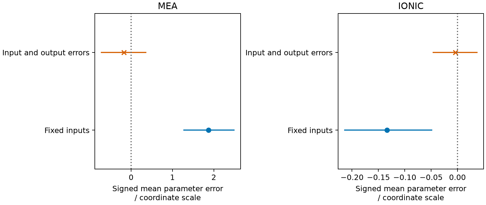

The frozen decision passes for MEA and is inconclusive for the ionic case.
Accounting for input errors reduces the observed absolute signed-mean parameter
error in both synthetic cases. The ionic numerical allowance, dominated by its
terminal-reference value contribution, is larger than the improvement supported
by the signed-mean confidence set. The campaign therefore does **not** establish
the required claim of bias reduction in both cases under the frozen rule.

These results are the requalification on the current Engine
([issue #624](https://github.com/tannerpolley/ePC-SAFT/issues/624)): the
regenerated experiment that the Engine's changed ion reference requires, run
with the retained normal draws and seeds under the unchanged frozen rules.
Every compared signed error, signed mean,
interval end, $U_\Delta$, Monte Carlo standard error, numerical allowance and
decision met its preregistered comparison with the 2026-10-14 round. One
preregistered check did not: C7 `pressure`: NOT MET. That ionic density-root
component lies outside its frozen ratio band, for an established cause that
cannot affect either verdict
([Requalification on the current Engine](#requalification-on-the-current-engine)).
The requalification therefore does not pass every frozen check.

These are predictions and numerical verification for declared synthetic truths.
They are not physical validation of the MEA chemistry or the salt parameters.
This notebook and its results have not been independently reviewed or promoted
for manuscript use.

## Question and basis

[Issue #510](https://github.com/tannerpolley/ePC-SAFT/issues/510) asks whether
augmenting the existing Ceres least-squares objective with independently
declared input and output standard deviations reduces parameter bias relative
to treating the measured inputs as exact. The [frozen experiment and allowance
rules](inputs/campaign-freeze.md) own all parameter truths, domains, noise,
starts, seeds, budgets, replays and statistical criteria. The
[freeze identity](inputs/campaign-freeze.json) records their hashes before the
campaign and preserves the preceding freeze identity after the declaration fix.
For the requalification it also records the regenerated input hashes and, in a
separate field written after the run, the C7 outcome; the frozen rule text is
unchanged.

For MEA, the native driver uses the first stored symmetric water/carbamate
interaction coordinate and the first retained states from the
[existing MEA declarations](../2026-fitting-state-reuse/inputs/mea-initial.json).
It fits native-generated carbon-dioxide partial pressures, in Pa. Temperature
and the carbon-dioxide/water feed exchange are noisy inputs; pressure remains a
free equilibrium output. All other supplied parameters, phase supports,
reaction references, feed totals, guesses and solve criteria remain declared.
The [input provenance](inputs/provenance.json) identifies the source bytes,
component order and state identities.

For the ionic case, the native driver uses the declared water/cation/anion
fixture and its tied cation length coordinate. Mean ionic activity and osmotic
coefficients are dimensionless outputs sharing one temperature, pressure and
molality measurement per state. Inputs are in K, Pa and mol/kg; the MEA feed
coordinate is in mol/mol. The coordinate scales in the frozen rules define all
reported dimensionless parameter errors.

The complete objective is

$$
\frac12\sum_i\left[\frac{f_i(\theta,q)-y_{M,i}}{\sigma_{y,i}}\right]^2
 +\frac12\sum_j\left[\frac{q_j-q_{M,j}}{\sigma_{q,j}}\right]^2.
$$

The existing native fit owns both terms, exact columns, bounds and covariance.
Each input penalty is counted once per declared measurement group. Correlated
declarations are refused. Python transports declarations and presents retained
results; C++ owns EOS calculations, equilibrium, noise generation, fits,
bootstrap resampling and numerical propagation. Differences verify derivatives
only. [ALG-FIT](../../engine/docs/science/algorithms.md#alg-fit) and the
[fitting formulation](../../engine/docs/regression/science/pure-saturation-regression.md)
own the implementation equations and admitted inventory.

## Bias and the frozen decision

The signed parameter error is
$e_{A,r}=(\hat\theta_{A,r}-\theta_{true})/s_\theta$.
Absolute bias is the absolute value of its mean, not the mean absolute error.
The tables below read the native [MEA summary](results/mea/summary.csv) and
[ionic summary](results/ionic/summary.csv). They include Monte Carlo standard
errors, parameter root-mean-square error, signed-mean intervals, numerical
allowances and failed-fit counts.

{#fig-signed-means}

### MEA





### Ionic





The bootstrap acts on paired replicate indices and signed means before taking
absolute values. Its simultaneous confidence set is the Cartesian product of
the four signed-mean percentile intervals. The frozen empirical quantiles and
index streams are retained in the [MEA inputs](inputs/mea/bootstrap-indices.csv)
and [ionic inputs](inputs/ionic/bootstrap-indices.csv). Both methods use the same
indices within each resample.

For each case the upper bound on the absolute-bias difference is

$$
U_\Delta=\max(|L_E|,|H_E|)-d_F,\qquad
d_F=\begin{cases}0,&L_F\le0\le H_F,\\
\min(|L_F|,|H_F|),&\text{otherwise}.\end{cases}
$$

Acceptance requires $U_\Delta<-\epsilon_{num}$ in each case. MEA satisfies that
condition. Ionic does not. Its negative statistical upper bound alone is
insufficient once the frozen numerical allowance is included. Neither the
noise, replicate count, percentile rule, reference definition nor stopping
controls were tuned to change that outcome.

The confidence interpretation is approximate. The union-bound allocation
requires the marginal bootstrap intervals to attain their nominal coverage.
Finite samples, tail quantiles, skewness and the finite resample count can affect
coverage; this study does not measure coverage or power.

### Requalification on the current Engine

Since the 2026-10-14 round, the Engine returns the ion reference as the $\sqrt m$
limit $(10f(m_2)-f(m_1))/9$ of its two finest rungs instead of the raw finest
rung ([issue #594](https://github.com/tannerpolley/ePC-SAFT/issues/594)). The
ionic $\gamma_\pm$ truth therefore falls by about one part per million, by the
same relative amount at every molality; the osmotic coefficients and the MEA
pressures move only at rounding level. The exact change and the two superseded
frozen clauses are recorded in the
[requalification freeze record](inputs/campaign-freeze.md#requalification-on-main-624-lead-2026-10-17).
The truth, output standard deviations, noisy outputs, verification and $\rho$
files were regenerated with the retained standard-normal draws, admission flags
and bootstrap index streams, which reproduced bit for bit. Both estimators were
then refitted under the unchanged rules, with the comparison rule C1–C7 frozen
before any fit. The table reads the
[requalification comparison](results/requalification.csv); `old` is the
2026-10-14 result and `new` the result of this requalification run.



C1–C6 hold. The largest per-replicate signed-error change is more than seven
times smaller than the tolerance τ, every main fit in both cases is regular,
and the decisions are unchanged: MEA accepted, ionic inconclusive.

C7 `pressure`: NOT MET. The ionic density-root pressure contribution rose by a
ratio of 2.33 for fixed inputs and 2.38 for input and output errors, against the
frozen band [0.5, 2]. The cause is established. The $\gamma_\pm$ reference now
charges the root at the finest rung with weight 10/9. At the ionic reference
temperature and pressure, that root's Newton iteration stops about 24 times
further from the target pressure than the next rung's root, still inside the
Engine's density-root residual tolerance, so the $\gamma_\pm$ reference pressure
term rose about 27-fold. The driver builds that rung's composition exactly as
the Engine does. Both root residuals are in the true-state records of the
[raw record archive](README.md#raw-record-archive). The band was a prediction
for a term the design had not measured. The contribution is less than one
ten-thousandth of the ionic numerical allowance, so it cannot change either
decision. The band is not revised after the fact: the miss is recorded, not
waived.

## Numerical allowance and its limits

The native driver evaluates a cold point at every main and replay endpoint and
at every true-data state. It retains prediction and action errors separately:
density-root pressure residuals, terminal-reference changes, observed fit-own
versus cold discrepancies, checked linear solves, rounding and the frozen
derivative-verification estimates. The tables contain their contributions to
the mean scaled-parameter estimate $n_A$.

### MEA error contributions



### Ionic error contributions



The complete augmented Jacobian, including exact input-prior rows, defines
$H=J^TJ$. The retained fit SVD supplies the parameter row of the solve; no second
covariance factorization is introduced. Prediction errors enter through
$|J|^T\eta$ and action errors through $E^T|r|$. Prior-row errors are zero. The
verification estimate uses the complete column norm at the endpoint, with the
observed-family estimate applied where an inner action diagnostic is absent.
Exposed ionic input-action association diagnostics supply their linear terms
directly. The pressure-chain scalar division is covered by its rounding floor.

The replay contribution $t_A$ is the largest scaled parameter change over the
prescribed tighter replays, with unchanged starts and budgets. It remains
separate from the endpoint estimate. The declared allowance is

$$
\epsilon_{num}=2(n_E+n_F+t_E+t_F).
$$

MEA consumes laddered neutral reaction references. Existing reaction-intercept
first actions propagate their terminal-limit changes to partial pressure.
Reference-trace root residuals are represented through those changes and
observed discrepancies, without a separate density estimate. The cross term
involving the derivative of the output/reference sensitivity is not estimated;
the declared planning multiplier covers it only nominally. The complete
allowance is a local first-order estimate, not a nonlinear or global bound.

## Ionic reference allowance

Gamma rows supply the dominant mean reference-value contribution to the ionic
parameter allowance; osmotic rows contribute zero to this term.
The Engine now returns the $\sqrt m$ limit of its two finest rungs. The frozen
allowance still charges the raw change between the preceding and the
2026-10-14 terminal rungs listed below, which dominates the ionic
$\epsilon_{num}$. No allowance has been defined or measured for the
$\sqrt m$-limit reference. Any such allowance would be a new comparison defined
after the 2026-10-14 results were seen, outside this requalification. The
diagnosis tables in this section describe that freeze-era raw reference.
The frozen term compares the preceding and freeze-era terminal molalities listed
below, with approximately equal changes in each ion's dimensionless $\ln\phi$.
The complete augmented parameter/input sensitivity propagates those changes
into the mean contribution in scaled parameter-coordinate units.
The [numerical components](results/ionic/numerical-components.csv) retain that
mean separately from pressure-root, action and rounding contributions.



The [reference-ladder values](scripts/diagnosis/truth-ladder.csv) follow the
Debye–Hückel dependence

$$
\ln\phi_i(m)=\ln\phi_i(0)-A_i\sqrt m+O(m).
$$

Here $m$ is salt molality in mol/kg and $A_i$ has the corresponding inverse
square-root molality units.
A hundredfold decrease in molality reduces the adjacent-rung change by
approximately tenfold for this synthetic aqueous salt.
At the 2026-10-14 freeze, the
[reference definition](../../engine/docs/equations.md#reference_molality_sequence)
fixed the returned terminal composition, and the convergence tolerance
controlled whether an additional witness was checked.
The witness did not replace the terminal value.

This rung change measures finite-molality reference variation.
It is not an evaluation error of the declared terminal model.
The [binary128 comparison](scripts/diagnosis/truth-wide.csv) agrees with binary64
gamma within the precision discrepancy reported above at all 16 frozen truth
states, at fixed temperature, pressure and parameters.
The [binary128 reference values](scripts/diagnosis/wide-reference-tail.csv) also
resolve the original rung variation, so higher precision does not remove it.
These comparisons verify numerical evaluation for the stated synthetic case;
they do not validate the salt parameters against physical observations.

Moving the preceding rung closer to the unchanged terminal narrows the
reference perturbation and reduces its raw difference.
It leaves the terminal value and its finite-dilution tail unchanged.
The conditional allowance below scales the retained reference-value terms
with the observed rung-change ratio while holding fitted sensitivities,
statistical intervals and all other allowance terms fixed.
It therefore does not establish improved terminal accuracy or a new verdict.



Lowering the terminal reduces the finite-dilution tail but changes the
synthetic truth outputs.
Their declared output standard deviations, proportional to those outputs,
and the resulting noisy output measurements change as well.
That calculation would require new truth data and both estimators to be
refitted with the retained normal draws; it is a different experiment.
The requalification is that experiment: the Engine's reference changed in
issue #594, and the experiment was rerun under the unchanged frozen rules with
the comparison rule frozen before fitting.
Neither conditional allowance decides the frozen comparison.

Under the frozen simultaneous signed-mean rule and numerical allowance
(R1/R3), the ionic case remains inconclusive.
The first-order allowance is not a global error bound, and the percentile
intervals retain their approximate finite-sample coverage.
No bias-reduction claim beyond this synthetic comparison follows.

## Verification, retained failures and provenance

The native verification includes the exact-answer linear regression, raw and mixed
input columns, pressure and equilibrium heat-capacity columns, same-point
promotion, changed-input reuse against cold states, independent same-state
groups with different sigmas, and cause-specific refusals. The campaign-fixture
checks and observed family estimates are retained in
[MEA verification](inputs/mea/verification.csv),
[ionic verification](inputs/ionic/verification.csv) and their adjacent
`rho.csv` files. Ionic cancellation at the smallest molality was resolved with
the existing binary128 contribution-kernel verification facility at unchanged
steps and criteria. On the current Engine, the ionic difference source is the
binary128 oracle evaluated on the same $\sqrt m$-limit reference
([issue #623](https://github.com/tannerpolley/ePC-SAFT/issues/623)).
Production calculations remain native binary64.

The partial first round of 2026-10-14 is retained in that round's
[raw record archive](README.md#raw-record-archive). It exposed a
roundoff refusal at an affine feed-box face; the implementation now uses the
existing composition criterion for that admission. The same measurements and
controls were reused, with no clipping or redraw. Its data are distinct from
the completed campaign used in the tables.

Two numerical-reporting defects were corrected without refitting: the
verification component initially used only output rows for its column norm,
and fixed-input cold columns initially lacked the fit's relative-weight
scaling. The first defect was identified before inspecting a bias summary; the
second was diagnosed after inspecting the first summary. Both corrections
restore the already frozen rule. The earlier files are retained in local
commits and the raw record archive. Fitted coordinates,
residuals, exact fit Jacobians, SVDs and bootstrap signed means are unchanged.
Calculation identifiers distinguish independently retained records that happen
to contain equal values.

The first requalification run fitted nothing. After
[issue #486](https://github.com/tannerpolley/ePC-SAFT/issues/486) changed the
layout of the fit controls, the driver's positional control assignment left the
iteration and elapsed-time limits at zero, so every fit was refused before its
first iteration. The driver now assigns the frozen controls by name; the inputs
were regenerated with it, with output-only changes at rounding level, and the
freeze record was refreshed before any fit. The refused records are kept
outside Git, and none was read as a result.

The raw record archive preserves each completed endpoint directory's exact fit columns, covariance,
singular vectors, work, timing, every typed trial refusal, numerical components
and any reconciliation. The [analysis README](README.md) describes the file
columns and native calculation/presentation entries. The native
[paired MEA errors](results/mea/paired-errors.csv) and
[paired ionic errors](results/ionic/paired-errors.csv) retain every replicate;
no failed fit or selective subset replaces the declared population.

For the 2026-10-14 round, the matched-main comparison used a clean archive
export and its own editable environment. The upstream refresh changed only the corpus work-history
inventory, so the already built main Engine remained matched. Detailed
falsifiers, build identities and final gate logs are archived in the main
checkout's `build/archive/issue-510-builder.tar.zst`.
