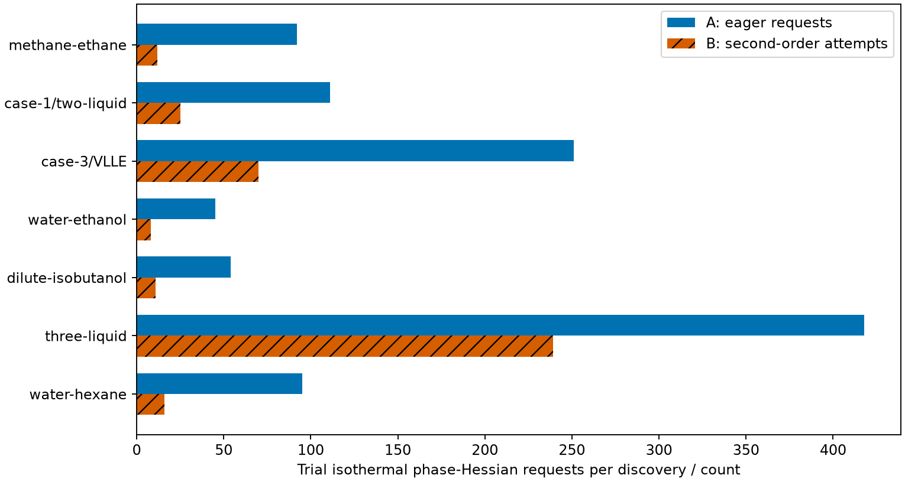

## Question and thermodynamic basis

For the matched integrated images, ordinary equimolar methane/ethane discovery
at 190 K and 1 MPa uses **24.2% less wall time**, with an observed paired saving
range of **23.7–25.7%**. Preparing the native request outside timing gives a
**24.1% median saving**, with a **19.4–24.5%** range. Both boundaries satisfy
the accepted median saving of at least 20%, and their worst B/A ratios remain
below their respective A=A lower edges. The prepared range includes a pair
below 20% saving; the criterion applies to the median, not every pair.
The integrated numerical refresh and the complete paired cost measurements
use the same frozen A and B libraries. Earlier measurements remain evidence
for their original pre-integration images in the separate sections below.
No ratio compares images from different generations.

These are numerical cost measurements on the stated host and finite searches;
the ranges describe observed pairs, not confidence intervals.

Can explicit fixed-temperature, fixed-pressure phase discovery avoid unused
derivatives and repeated roots while preserving every enumerated trial and its
physical admission? The retained comparisons support numerical equivalence for
the frozen finite searches. They establish no new physical validation, complete
phase enumeration or global stability guarantee.

The unchanged equations and search rules belong to
[ALG-STABILITY](../../engine/docs/science/algorithms.md#alg-stability) and
[the accepted phase-discovery decision](../../docs/scientific/decisions/0012-native-tangent-plane-phase-discovery.md).
B changes only the scheduling of shared Helmholtz derivative requests,
reuse of a seed density at an exactly identical first objective composition,
and the repeated initial Liquid compilation. Every later trial point retains
its unanchored branch-root solve. Substitutions, exact second-order proposals,
fallback initialization, stopping criteria, supports and seed populations retain
their original owners. Fast discovery is outside this comparison.

The cost request is the release worker's equimolar methane/ethane discovery at
190 K and 1 MPa, on its original one-mol feed basis. Parameters come from the
[Gross–Sadowski packet](../../data/packets/gross-2001-methane-ethane/3/parameters/parameters.json).
The broader numerical comparison preserves the ionic, reacting, neutral,
permittivity, supplied-point, unavailable and incomplete-search declarations
in the frozen inventory. Input hashes, selected images and evidence
locations are retained in [provenance](inputs/provenance.json).

## Numerical refresh after integration

The matched integrated images use A at
`e8444c99789e3593ad41352f1419e7254f0f36c2` and B at
`e4174b7d16b60aa460d609d25b021ded46f9293f`.
Their build options are identical. The [integrated image and result records](results/integrated-refresh.json)
identify the exported A source, both native library hashes and retained evidence.
The full frozen declaration and trial comparison uses the original relative
allowance and absolute floor from the existing corpus comparison, preserving each
quantity's stricter existing owner. All comparisons pass with zero difference;
no numerical-error exception is needed.



The numerical refresh also reproduces the standard equilibrium corpora and
original neutral, ionic, reacting, permittivity, amount-scaling and refined-FeOs
qualification checks. The original discovery invariants and all 19 explicit native checks per image
pass. Eight key-solve
and derivative cases retain identical values and work counts; the native
parameter-fit endpoint also has zero relative difference. These numerical
checks accompany the integrated-image cost comparison below.
[Key-solve values and work](results/integrated-key-summary.json) retain
the existing quantity-scale comparisons.



This numerical agreement preserves the finite searches on the integrated base.
It supplies numerical verification of those calculations, without new physical
validation. The cost measurements below use exactly these integrated images.

## Ordinary and prepared cost after integration

The ordinary timer surrounds Python Problem construction and a complete fresh
discovery solve. Prepared timing maps the native request once outside the timer,
then performs a complete fresh solve for every sample. Neither boundary carries
a solved state, compiled discovered topology or density root between calls.
Process CPU includes result extraction; Clapeyron reports wall time only.

The campaign uses the existing release persistent workers and interleaving loop,
with two workers per Engine image, FeOs without a supplied flash start and
Clapeyron's default flash. Each boundary has three complete paired repetitions,
five warmups and 25 timed samples per arm per repetition. All timing processes
use niceness ten; Engine and FeOs workers are pinned to CPU 31 with one numerical
thread, and Clapeyron uses the same CPU with one Julia and one BLAS thread.
The host is an AMD Ryzen 9 5900XT. Admission requires one-minute load below four
and no compilers before and after every block. A disturbed operation would be
excluded and repeated in full, without combining its blocks with another attempt.

The accepted test requires median paired B/A at most $0.80$ separately for each
boundary, and the worst paired B/A below the lower edge of that boundary's A=A
control range. Each B/A distribution contains six paired block-median ratios;
each same-image control contains three ratios. These are observed full ranges,
without a confidence-interval interpretation. Medians of separate arm times
need not divide to the median paired ratio.









The [paired operands](results/integrated-cost/methane/paired-ratios.csv),
[selection table](results/integrated-cost/methane/selection.csv) and
[image and measurement identities](results/integrated-cost/disposition.json)
retain the complete comparison. All six libraries match their frozen hashes
before and after the campaign; all four Engine workers pass their image rechecks.
The comparator searches enumerate different trial populations, so their ratios
describe calculation cost without establishing identical search coverage.

## Cost of the other finite searches after integration

The six neutral searches have median wall savings of about 10–14%. The ionic
case has median B/A slightly above one, with a range crossing one and variation
comparable to its same-image controls. These are reported costs; the 20% target
applies only to methane/ethane. The inputs retain their original component
order, temperature, pressure and one-mol feed basis. The three-liquid case is
a manufactured numerical reference, and water/hexane uses `water_np`.



For these cases, the existing constructors prepare the model and declaration
outside timing. Each sample copies the declaration and performs a complete
fresh discovery solve, including native request mapping. CPU time additionally
includes result extraction. The same interleaving method uses three repetitions,
five warmups and 25 samples per block, with two workers per image, CPU 31,
one numerical thread and niceness ten.



A and B durations are medians of six block medians per image. Each paired B/A
entry reports the median and full range of six block-median ratios; A=A and B=B
each span three ratios. Wall and CPU ratios are reduced separately from
[their operands](results/integrated-cost/other/other-paired-ratios.csv).
These scalar case comparisons fit in tables that display every paired bound;
curves would imply an unevaluated relationship between cases.



Every case retains its frozen returned phase set and numerical criteria. Full
preflight and postflight states, timed samples and image rechecks are retained
with the [raw records](results/integrated-cost/other/other-identity.json).
The [selection table](results/integrated-cost/other/other-selection.csv)
retains every complete case; none was excluded or repeated.

## State and trial equivalence before integration

For the original pre-integration images, ordinary methane/ethane discovery at
190 K and 1 MPa uses **24.9% less wall time**, with an observed paired saving
range of **23.0–26.4%**. Prepared calls have a **23.6% saving**, with a
**22.1–24.1%** range. Both satisfy their original target and control comparison.
These measurements and the following associated value comparisons concern A at
`761f14f432b562c61ab1c5aa332f891d64431336` and B at
`ba3f5461235bea550500fb70dcb45db7a615ac69`. They are not pooled with the integrated
campaign.

The following tables and value comparisons concern the original pre-integration
images. The inventories were frozen before source changes. A is the baseline calculation;
B removes the redundant work. The reconstructed A libraries reproduce the
baseline library hashes exactly. Both images reproduce the exact frozen declaration and
operation keys. Trial matching uses seed identity, support, kind and multiplicity;
state matching uses physical composition and any returned support/kind declaration.
No phase reordering was needed in these records.

The ordinary transported-scalar relative allowance and absolute floor are the
existing [corpus comparison](../../tools/check-equilibrium-corpora) values,
applied in the quantity's declared units. Native checks
retain their original independent references and criteria. All ordinary
comparisons pass; no conditioning exception or new tolerance is used.
The observed zero differences are evidence for these images and inputs,
without a universal bitwise identity claim.



[Scalar operands](results/comparison-values.csv) retain both values, the allowance
and their error divided by that allowance. Full trial causes and raw coordinates
remain in the frozen operation records. Successful iteration counts,
raw optimizer charts and work counts are diagnostics; failure meanings,
availability, stopping classification and numerical admission operands are
compared. The native ideal-gas check's original numerical CSV lines are retained
alongside the other native numerical comparison records.

B's shared Gradient and IsothermalPhaseHessian requests were also
compared at the transported A and B terminal neutral trial states, including
associating models. These are supported amount-gradient entries on the same
temperature, volume and composition, evaluated by B's native owner.



## Removed work and measured stages

The categorical counts below come from the original detailed captures and the
B captures. Every trial point remains represented. The charged case
retains its shared-driver algorithm; its single removed Helmholtz evaluation
comes from the repeated compilation. Gradient requests still occur at every
neutral objective point; an attempted second-order step additionally requests
the exact phase Hessian at the stored point without another root solve.





The stage table subtracts child durations before assigning each native span
to compilation, declaration solves, seed/topology roots, trials or other work.
It includes reconstruction, donor qualification and finite descent within the
trial stage. These are instrumented, loaded-host diagnostic durations, in
microseconds. A and B were captured at different loads; their differences do
not establish the quiet-host speed target. Independently computed stage medians
need not sum to a median whole-call time.



## Ordinary and prepared cost before integration

Ordinary timing preserves the release worker's timer around Python Problem
construction and the complete fresh discovery solve; result extraction follows
that timer. Prepared timing maps the native request once outside measurement,
then performs a complete fresh discovery solve at every sample. Neither
boundary reuses a previous solution, compiled discovered topology or root across
calls. Process CPU retains the release worker's wider closure boundary, including
result extraction. Preparation has a separate retained duration.
Clapeyron's worker reports wall time only.

The campaign reuses the release persistent workers and interleaving loop, with
two workers for each Engine image, FeOs without a supplied flash start, and
Clapeyron's default flash. Each boundary has three complete paired repetitions,
five warmups and 25 samples per arm in each repetition.
All arms use CPU 31 of an AMD Ryzen 9 5900XT, one numerical thread and niceness
zero. Non-timing helpers use niceness ten. Ordinary and prepared calls each
have 18 selected blocks, giving 36 blocks and 900 checked timed samples.
Admission requires one-minute load below four and no compiler before or after
an arm. Disturbed operations are retained and repeated in full.





The [selection table](results/selection.csv) excludes all 11 blocks in
[the earlier partial campaign](results/raw/measurement-0.jsonl.gz), whose image
record predates the reconstructed A environment. The source revision and
library hashes agree, but those blocks are not pooled with the new campaign.
One new ordinary block ended at load 4.03; all 18 ordinary blocks from that
attempt were excluded, and the complete ordinary operation was repeated.
Two new admissions waited about 30 seconds each at loads 4.78 and 4.03, with no
compiler present. Prepared blocks come from
[the first fresh attempt](results/raw/measurement-1.jsonl.gz); ordinary blocks
come from [the repeated operation](results/raw/measurement-2.jsonl.gz).
The [retained disposition](results/cost-disposition.json) records the counts,
load bounds, exclusions and complete paired statistics.

The target is median B/A at most $0.80$ separately for each boundary, with the
worst paired ratio below the lower edge of its A=A control interval. B=B controls
and fresh B/comparator ratios describe the observed spread. Both boundaries
pass: their median ratios are below $0.80$, and their maximum ratios are below
their respective A=A minima. Fresh B/FeOs ratios are about 11.5 ordinary and
11.2 prepared; B/Clapeyron ratios are about 26.3 and 26.2. The comparators use
different finite searches, so these ratios do not compare identical trial
populations. No historical comparator ratio is substituted for a fresh
measurement. The tables contain a small set of
scalar boundary comparisons; plotting those same ratios would add no information.

## Cost of the other finite searches before integration

The six neutral cases use about 11–16% less wall time with the retained searches.
The ionic case has a wall ratio near one, with an observed range crossing one;
its small median difference is comparable to the same-image variation. These
are reported calculation costs. The 20% criterion applies only to the
methane/ethane comparison.

The cases below preserve the original component order, temperature, pressure,
one-mol feed basis and discovered states. The three-liquid mixture is a
manufactured numerical reference, and water/hexane retains the `water_np`
parameterization. Full returned states and trial records before and after
timing are retained in [the numerical records](results/other-states.json.gz).
All seven cases returned their frozen phase sets; no failed or unavailable
case was removed.



The existing case constructors prepare the model and declaration outside timing.
Each wall timer copies that declaration and performs a complete fresh discovery
solve, including native request mapping. Process CPU covers the same closure
plus result extraction. No solved state or density root passes between calls.
The release workers and interleaving loop use three repetitions, five warmups
and 25 samples per block, with two workers per image. These blocks run on CPU 31
with one numerical thread and niceness ten; the methane/ethane blocks above
use niceness zero. Ratios compare images within the same measurement conditions.



A and B times are medians of six block medians per image. Each B/A entry reports
the median and full range of six paired block-median ratios; each A=A and B=B
interval spans three same-image ratios. The intervals are observed ranges,
without a confidence-interval interpretation. Wall and CPU ratios are reduced
separately from their retained operands in [the paired table](results/other-paired-ratios.csv).



All six library hashes match before and after the complete campaign.
Admission requires load below four and no compilers at both block boundaries.
The [selection table](results/other-selection.csv)
preserves 96 excluded blocks: seven full ionic-case attempts and one full
three-liquid attempt. Every affected case was repeated in full. These exclusions
are separate from the earlier methane/ethane exclusions. No compilation ran
during the campaign. The [measurement identities](results/other-identity.json)
retain the selected images, raw-file hashes and block-boundary image rechecks.
The cost evidence verifies these finite numerical calculations; it supplies no
new physical validation or stability guarantee.

## Qualification and limits

The integrated-image numerical refresh and complete quiet measurements support
the accepted ordinary and prepared median saving target on those same images.
The pre-integration savings, cost-stage tables and associated value comparisons
remain limited to their original images; no ratio spans generations.
The standard corpus,
original qualification functions, explicit native cases and key-solve controls
retain their original criteria. Ionic liquid-liquid
equilibrium and the monoethanolamine flash retain identical work counts;
parameter-fit work and numerical values satisfy their existing comparisons.
Fresh preflight agrees with the retained physical values for both boundaries
and all six arms. Every selected timed sample satisfies its numerical
comparison, and the four Engine workers pass image rechecks after each complete
attempt. These checks constrain numerical equivalence for the measured
inputs; the timing spread does not quantify parameter or model uncertainty.

The refreshed integrated-image result and notebook have not been independently
reviewed or promoted for manuscript use. Delivered review remains required.

All equation-of-state evaluations, root solves, minimizations, equilibrium
calculations and fits run in the native Engine. Python declares inputs, reads
results and formats retained values. The scientific consequence is limited to
the stated finite searches and calculation cost: these comparisons do not
validate parameters, predict new experimental observations or certify stability.

Presentation reads retained outputs only:

```bash
nice -n 10 <prepared-python> analyses/2026-explicit-discovery-cost/scripts/present.py
quarto render analyses/2026-explicit-discovery-cost/notebook.qmd --no-execute
```
