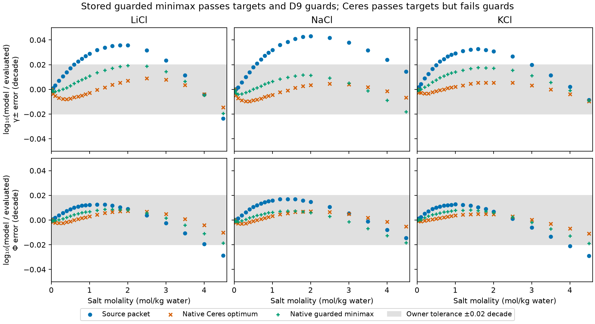

# Figiel chloride activity fits with exact derivatives (#209)

The #755 stored-point comparison follows the
[diagnosis](https://github.com/tannerpolley/ePC-SAFT/issues/755#issuecomment-6328905027)
(`build/issue-755/diagnosis.md` in the main checkout; SHA-256
`c05f7935095723d0a4c80dd765e641a890cd257f22220d5c9b9b4ccbf2a1cc1b`)
and the [owner's 2026-10-21 decision](https://github.com/tannerpolley/ePC-SAFT/issues/755#issuecomment-6328916449):
"Common cold start, keep 1e-12". The producer evaluates the returned physical
parameters with held Born diameters frozen and the stored replay from a common
cold density initialization. `results/current-main/stage1-minimax-stored-comparisons.csv`
retains the unchanged preservation relation; `native` now denotes the cold
evaluation of the fitted physical point. The fit's warm-seeded predictions
minus the cold stored replay remain in
`results/current-main/stage1-minimax-fitted-minus-cold.csv` as signed diagnostics
without an equality assertion. The diagnosis attributes that difference to
density rounding amplified by dilute osmotic cancellation. Targets, guards,
holds, stationarity checks and immutable packets are unchanged. This compares
storage of the physical parameter point; it establishes no absolute osmotic
accuracy or physical validation. The historical packet results below retain
their original calculation conditions.

**The native guarded minimax passes every stage-1 D9 check.** All 156
LiCl/NaCl/KCl γ± and Φ target rows lie within 0.02 decade, and G1, G2 and G5
water meet their D6 source-baseline rules. Acceptance was recomputed from
stored packet `figiel-2025-chloride-activity-refit/1` with fixed stored Born
diameters. Its maximum target error is 0.0193700734 decade,
leaving 0.0006299266 decade to the target limit.
The Ceres least-squares optimum passes the targets but fails eight guard
groups; the constrained estimation formulation supplies the passing point.
A **provisional stage-2 packet `/2`** now retains the best native Mg/Ca fit
under the owner's 2026-10-06 relaxation of the original every-row target.
The [current research notebook](notebook.qmd#stage-2) computes the measured
maximum and mean errors, preservation results and checks from retained data.
[Current-wheel evidence](results/provisional-stage2/summary.json) records the
binary aqueous domain and boundary optimum limits. The unchanged `/1` packet
uses a [new current-wheel preservation reference](results/stage1-rebaseline/rebaseline.json)
following the diagnosed density correction in PR #273; the original reference
and diagnosis remain. Delivered independent review and owner acceptance are
outstanding.

This is numerical fitting against the Hamer–Wu evaluated binary data, not
physical validation. Conditions are 298.15 K, 100000 Pa, the declared liquid
branch and 0.001–4.5 mol/kg water, with fully dissociated formula-unit molality.
The unchanged formulation and fixed inputs are
`figiel-2025-reference-electrolytes/4`: Figiel–Yu–Held 2025 Tables 1–5,
corrected Born Eq. 7 and Eq. 11 permittivity. The
[#209 design and D1–D9 decisions](https://github.com/tannerpolley/ePC-SAFT/issues/209)
and [#219 native fitting handoffs](https://github.com/tannerpolley/ePC-SAFT/issues/219)
own the inputs and acceptance rules. The refit packet is qualified for these
aqueous rows only; alcohol mixtures retain the source packet /4.

Source audit of the published fitting method (#432; the full note is in Git at
`9b39db7f`, `engine/docs/regression/research/figiel-table-4-5-fitting-method.md`).
Figiel–Yu–Held 2025 state the parameter roles and order: Born diameters adjusted
to infinite-dilution water solvation Gibbs energies, one solvent-specific `f_k`
to NaBr MIAC data, then ion–water and ion–ion `k_ij` to MIAC data for each salt,
iterated with minimal parameter change (main paper lines 275–283). They do not
state the MIAC objective, row weights, row subset, optimizer, starts, bounds or
tolerances. Any reconstruction, such as an equal-weight relative residual
`1 − γ±,calc/γ±,exp` mirroring Held et al. 2014 Eq. 20, is a repository inference,
not Figiel's reported method.

## Stored-packet target and guard results

Hamer–Wu Tables 9, 16 and 28 supply 26 molalities for each chloride. Every
stored-packet target passes; maxima of absolute log₁₀(model/evaluated), in
decades, are:

| Salt | Source γ± | Refit γ± | Source Φ | Refit Φ |
|---|---:|---:|---:|---:|
| LiCl | 0.035762 | 0.019370 | 0.028738 | 0.018582 |
| NaCl | 0.042975 | 0.018223 | 0.017030 | 0.018430 |
| KCl | 0.032626 | 0.017670 | 0.029033 | 0.018931 |



G1 checks each bromide salt × observable with max ≤ max(source max, 0.02
decade). Both G2 transfer groups and G5 water require max and mean no worse
than their own source values. G5 water contains 25 rows with ion mole
fraction ≤ 0.14. The four higher-fraction water rows are report-only.
Native stored-packet maxima and means:

| Guard group | Unit | Source max / mean | Refit max / mean | D6 result |
|---|---|---:|---:|---|
| G1 LiBr gamma | decade | 0.050991 / 0.021701 | 0.050991 / 0.021343 | pass |
| G1 LiBr osmotic | decade | 0.042387 / 0.011049 | 0.019923 / 0.009646 | pass |
| G1 NaBr gamma | decade | 0.066567 / 0.032291 | 0.025043 / 0.007007 | pass |
| G1 NaBr osmotic | decade | 0.024254 / 0.011775 | 0.023069 / 0.005303 | pass |
| G1 KBr gamma | decade | 0.026148 / 0.012781 | 0.024876 / 0.006163 | pass |
| G1 KBr osmotic | decade | 0.035119 / 0.007791 | 0.025464 / 0.004811 | pass |
| G2 Na+ water-ethanol | kJ/mol | 4.993836 / 3.170001 | 4.443342 / 2.662645 | pass |
| G2 K+ water-methanol | kJ/mol | 1.803191 / 1.034487 | 1.657576 / 0.469748 | pass |
| G5 water | 1 | 6.757714 / 2.922471 | 6.757714 / 1.828865 | pass |

G1 LiBr γ± at 2.0 mol/kg and G5 water at ion mole fraction 0.0866580 bind
the local optimum. Their positive physical guard multipliers are 0.01628425
(decade per decade) and 0.001680807 (decade per unit relative permittivity),
respectively. These are local sensitivities of the minimized maximum target
error to guard thresholds, not parameter uncertainties. Neither G2 group
binds. All 811 epigraph/guard inequality values and multipliers are retained
in `results/stage1-minimax-constraints.csv`.

## Native method and solution checks

C++ owns Ceres/Ipopt optimization, exact CppAD derivatives, safeguarded Born
roots and implicit held-diameter derivatives. Python declares observations,
coordinates, holds, checks and starts and reads native values; no SciPy
optimizer, finite-difference Jacobian or Python model loop drives a fit.
Ceres receives the original 20 starts together: the source point, source k
with C = 6/5/4, and 16 Latin-hypercube starts with seed 209. All 18 usable
solutions form one distinct basin: maximum pairwise normalized coordinate spread is
2.97×10⁻⁵, below the design's 0.01 distinct-minimum criterion. Starts 9 and
13 have negative initial KCl Φ and are retained as unavailable LogRatio
starts, not zero-cost optima or clipped rows.

Native Ipopt starts from that distinct Ceres minimum. It minimizes t with
|log₁₀ error| ≤ t on all 156 targets and enforces only G1, G2 and G5 water.
The target scale is 0.02 decade; guard scales are 0.02 decade, 1000 J/mol
or 1 unit relative permittivity. T, E, I, G3/G4 and alcohol permittivity are
final/report checks in the minimax declaration. E is enforced through the
three eliminated Born holds; final acceptance still requires T, E and I.
The declared limits are 600 iterations and 900 seconds, with tolerance
10⁻¹⁰, activity distance 10⁻⁶ and initial margin 0.1; no bound or acceptance
tolerance is widened. The solve takes 92.37 seconds and 29 iterations.

The local returned t is 0.019370073427 decade. Native primal violation and
dual-sign residual are zero; stationarity is 3.23e-14 and
complementarity is 1.05e-11. The epigraph gap is
2.87e-13 decade. These norms meet the native 10⁻¹⁰ tolerance.
This is a feasible, stationary local estimate; global optimality is unresolved.

All 948 returned predictions agree exactly with independent native values
from the stored packet. Final acceptance reads that packet with no holds,
so it cannot repair a wrong stored Born diameter. Maximum hydration error
is 3.09141×10⁻⁷ J/mol, below E's 10 J/mol and the hold's 10⁻⁶ J/mol inner
limit; maximum inner diameter correction is 1.90×10⁻¹² Å ≤ 10⁻¹⁰ Å.
The alkali targets remain Li⁺ −487.02, Na⁺ −381.93 and K⁺ −308.89 kJ/mol
(Figiel SI Table S5 model calibration).

All 773 stored-state, pure-solvent invariance and qualitative Debye checks
pass. Maximum |P − 100000 Pa| is 4.08×10⁻⁵ Pa < 0.01 Pa; minimum pressure
slope is 25236.90 Pa/(mol/m³); charge residuals are zero. Pure-solvent density,
ln φ and permittivity remain unchanged at the recorded precision. Anion
hydration/transfer invariants remain within 3.17×10⁻⁹ J/mol ≤ 10⁻⁶ J/mol.
The Debye check at 0.001 mol/kg is a sign/finite-remainder check, not a
universal infinite-dilution error bound or phase-stability proof.

The combined native model admits both G2 solvent groups through a fixed
**in-memory methanol–ethanol k_ij = 0**. No declared state or reference state
contains both alcohols. Native value and exact seven-column derivative
comparisons at the source, Ceres and minimax points change that pair to 0.5:
all 22752 comparisons pass, with maximum absolute change **0** over all 948
rows. This is inert input completion, not a fitted or adopted parameter;
it is absent from packet /1. The complete operands are in
`stage1-minimax-inert-comparisons.csv`.

## Stored feasible values and identifiability limits

The six k_ij bounds remain [−1, 1] and C remains in [3, 9]. Stored values:

| Coordinate | Value | Bound activity |
|---|---:|---|
| k Li-water | -0.6599959436 | interior |
| k Na-water | -0.2758741109 | interior |
| k K-water | -0.1647847561 | interior |
| k Li-Cl | 0.7034856485 | interior |
| k Na-Cl | 0.9955856997 | interior |
| k K-Cl | 0.0181404089 | interior |
| C | 4.8486922308 | interior |
| d_Born Li⁺ (Å) | 2.8453868829 | dependent hold |
| d_Born Na⁺ (Å) | 3.4383822767 | dependent hold |
| d_Born K⁺ (Å) | 4.1813120348 | dependent hold |

No independent coordinate is active at its bound. Na–Cl lies 0.0044143 below
its upper bound. Dependent diameters stay inside the [1, 8] Å root bracket.
The alkali–Cl⁻ k_ij are **not qualified as identified physical parameters**.
The minimax does not determine **four independent Na⁺/K⁺ coordinates**:
k Na–water, k K–water, k Na–Cl and k K–Cl. Its four active constraints are
LiCl γ± at 2.0 and 4.5 mol/kg, G1 LiBr γ± at 2.0 mol/kg and G5 water at
ion mole fraction 0.086658031. The exact native columns for all four Na⁺/K⁺
coordinates are zero in every one of these rows (16 zero derivatives,
maximum absolute derivative 0); all 28 active-row columns are retained in
`results/stage1-minimax-active-columns.csv`. The largest Na⁺/K⁺ target error
is KCl Φ at 4.5 mol/kg, with 0.0004394494 decade of slack to t, and their
other guard inequalities have slack. With Li–water, Li–Cl and C fixed, small
changes to those four coordinates leave t constant in a four-dimensional
feasible neighbourhood while the Born holds follow.

The stored Na⁺/K⁺ k_ij and their dependent Born diameters are one feasible
point selected by this solver run from the Ceres minimum, **not determined
estimates of the minimax objective**. They support the recorded aqueous
predictions as a complete packet; they do not support parameter inference.
No claim that the remaining coordinates are physically identified follows.
Full numerical rank at the different Ceres optimum does not establish useful
precision or uniqueness for the minimax point.

The 18 Ceres minima retain native weighted-Jacobian singular values and
right vectors. At the lowest-cost Ceres point these are 82.9177, 63.6955,
53.3986, 2.12895, 0.381741, 0.200571 and 0.0780078 (rank 7, condition about
1063). Ceres covariance is withheld (`active_bound`), because Li–water and
K–Cl are at their lower bounds there. Native minimax reports covariance
`minimax_unavailable`; it supplies exact constraint columns, KKT norms and
multipliers, not a minimax covariance or SVD. Native profiles remain deferred
by #219 D8. The finite-difference profiles retained below are interim history
and are not exact-derivative identifiability evidence. No confidence interval
is claimed. The independent-error approximation also omits the Gibbs–Duhem
relation between γ± and Φ and uncertainty in the fixed hydration targets.

## Report-only alcohol results and domain limits

Under D9, G3/G4 activity and alcohol permittivity rows are reported without a
no-worse rule. Most alcohol activity groups worsen. Native maximum absolute
log₁₀ activity errors, in decades:

| Report-only group | Source max | Refit max |
|---|---:|---:|
| G3 NaBr methanol Figure 7 gamma | 0.069278 | 0.210729 |
| G3 LiBr methanol Figure 8 gamma | 4.190770 | 4.719439 |
| G3 LiBr ethanol Figure 8 gamma | 0.996303 | 1.522595 |
| G3 NaBr methanol Figure 8 gamma | 0.069278 | 0.210729 |
| G3 NaBr ethanol Figure 8 gamma | 0.053410 | 0.023135 |
| G4 NaCl water-methanol gamma | 0.159374 | 0.235383 |
| G4 NaBr water-methanol gamma | 0.187120 | 0.307354 |
| G4 NaCl water-ethanol gamma | 0.083055 | 0.070758 |
| G4 NaBr water-ethanol gamma | 0.472393 | 0.590504 |

NaBr–ethanol Figure 8 and NaCl water–ethanol improve; the other groups in this
table worsen. LiBr–methanol already has a source discrepancy of 4.19077 decades
at 5.7759 mol/kg, outside the aqueous target interval, and rises to 4.71944.
Alcohol permittivity ratio errors (mean / max) worsen from 0.117288 / 0.156136
to 0.169189 / 0.234719 in methanol and from 0.121645 / 0.268048 to
0.156356 / 0.316846 in ethanol.

G1 uses Hamer–Wu Tables 10, 17 and 29. G2 uses digitized Figiel Figure 6;
G3/G4 use retained Figure 7–9 rows without primary verification; G5 uses
digitized Figures 2–3. Guard success supports only a same-data comparison
with the source packet. The inherited /4 source-domain metadata (including its 0.38 ion-fraction
limit) describes the source, not a tested refit range. No alcohol, mixed-brine,
ternary, density, caloric or temperature-range qualification follows. Stage 2 requires its separate
Marcus 1991 hydration input and a fresh analysis-code estimate before building.

## Evidence, budget and review

`results/stage1-minimax-fit.json` retains the native estimate, controls, holds,
feasibility/KKT norms, bound distances, multiplier diagnostics and wheel hash.
`stage1-minimax-rows.csv`, `stage1-minimax-stored-groups.csv`,
`stage1-minimax-stored-comparisons.csv` and `stage1-minimax-states.csv` retain
the final stored-packet acceptance. Packet /1 retains the ten changed
coefficients and source/fit provenance. All other source parameters are fixed.
The notebook and residual figure read retained rows without executing a model.
The `maximum_root_error` in `stage1-minimax-fit.json` (1.3e-11) and the `root_error` column of the stage-1 and stage-2 `*-minimax-constraints.csv` files (largest 9.1e-11, including `provisional-stage2/`) were written before `7af627a5` (#341 S1) and count the hold uncertainty twice, so they are conservative by a factor of 2 where the Newton step was narrower than the bracket; every acceptance (≤ 1e-9) still holds. The study was not rerun.

Ceres used installed non-editable wheel `ceb6ab8a…` on main `96e9ecde` merged
locally as `5c4d77c2`; its evidence is in `stage1-native-*`. The 300.07-second
batch reached costs 3.80717265334–3.80717554283 and passed all targets but failed
eight of nine D9 guards. Native band and initial-failure diagnostics retain the
exact failure rows. The Ipopt redo uses main `7ecf0fb8` (#232) merged locally as
`de7fe6ee`, with installed wheel SHA-256
`7e44fadae95055db943a787a4d2c624d24c8c60bd4c75c0b6db5308d2fe26890`. An initial reporting comparison of small residuals
stopped after the same converged solve; the corrected replay verifies native
predictions directly and completes stored-packet checks, without changing the
fitting problem or numerical controls.

The owner approved **650 gross added analysis-code lines** for this stage-1
redo, measured against task base `6bee939c` (analysis-equivalent to merge base
`5c4d77c2`) and excluding merged #219 code. **583 gross added / 538 removed / +45 net executable analysis lines**
are measured in the final tree. Engine runtime additions remain **zero**. Stage 2 re-estimates
its own analysis code.

Independent Claude Opus 5.5 high delivered review returned **Not supported
as delivered at ce0f5411** for two record defects: overwritten source-domain
descriptions and incomplete Na⁺/K⁺ nondetermination limits. The reviewer
independently reproduced all 156 targets, G1/G2/G5 water, 948 predictions,
hydration and stored checks. Its initially stated count of 46 enforced groups
was withdrawn; the retained table has 57 groups, of which 45 are enforced.
Both required record corrections are applied. The same reviewer returned
**Supported for corrected commit 062ccd92**, confirming `packet.toml`, exact
active columns and interpretation, with numerical results unchanged. The full initial/focused verdicts, count correction and
investigator disposition are retained in `results/stage1-native-review.json`.
No manuscript promotion is claimed.

## Retained design evidence and interim records

Conditions: 298.15 K, 100000 Pa, fully dissociated formula-unit molality per kg
water. Errors are `log10(Engine/evaluated)` in decades. Parameters:
`figiel-yu-held-2025/4` (Tables 1–5, corrected Born term, Eq. 11 permittivity).

## 1:1 chloride baselines

| Salt | Rows | Max γ± error (m) | Max Φ error (m) | γ± rows > 0.02 | Φ rows > 0.02 |
|---|---:|---:|---:|---:|---:|
| LiCl | 26 | 0.0358 (1.8) | 0.0287 (4.5) | 13 | 1 |
| NaCl | 26 | 0.0430 (2.0) | 0.0170 (1.4) | 14 | 0 |
| KCl | 26 | 0.0326 (1.6) | 0.0290 (4.5) | 11 | 2 |

Evaluated rows: Hamer–Wu 1972 Tables 9, 16 and 28 (`28NPJ5H6/5RS9QAMK`),
0.001–4.5 mol/kg. LiCl/NaCl rows are read from
`../2026-held-2014-chlorides/inputs/evaluated.csv`; the KCl rows
(`inputs/kcl-hamer-wu.csv`, printed p. 1073) were transcribed here and their γ±
column matches the independent `hamer-wu-1972-aqueous-alkali-halides/1`
transcription in all 26 rows. All three salts share one residual shape: within
0.001 decade through 0.02 mol/kg, rising to +0.033 to +0.043 decade in γ±
near 1.6–2.0 mol/kg, then falling to between −0.024 and +0.014 at 4.5. The
shared shape points to the common water, Cl⁻, Born and permittivity terms, not
to one cation.

The Engine reproduces the digitized Figiel Figure 5 LiBr model curve (27 points,
2.16–5.85 mol/kg) within 0.0025 decade (`results/libr-curve-comparison.csv`):
24 points lie within one digitization uncertainty in γ± (0.0078–0.0122) and
three at 1.03–1.10 uncertainty units. This supports reading the chloride errors
as the published model's own performance. One LiBr curve does not by itself
exclude a chloride-specific encoding difference.

## Born term

`results/born-form-discrimination.csv`. With the packet's corrected Eq. 7
(`c_shell = c_dielectric = 1`), `RT ln φ_i^∞` reproduces Figiel SI Table S5
modelled x-process hydration Gibbs energies for Li⁺, Na⁺, K⁺, Cl⁻ and Br⁻
within 0.028 kJ/mol, and the LiBr curve within 0.0025 decade. The shell-only form
misses by 146 kJ/mol and 4.8 decades; the direct Born form at `d_Born`, to which
the printed Eq. 7 reduces, misses by 18.7 kJ/mol and 1.2 decades. The correction
(DOI 10.1021/acs.iecr.6c01415, PDF SHA-256
`969cd85d05a0f79add87f36d14c6abdffbc620284edbcf3aa89ab4603b5a54b8`) prints
the Engine's form: bulk permittivity outside `d_Born + Δd_i`, `ε_r,ion` between.

## Divalent probes (Held 2014 σ and u/k, k_ij = 0, DH = packing = 0.88σ)

- `results/born-diameter-sensitivity.csv`: raising `d_Born` from 3.0 to 4.0 Å
  lowers log10 γ± at 4.5 mol/kg by 0.545 (MgCl2) and 0.545 (CaCl2) decade, and
  at 0.001 mol/kg by 0.0002 decade. `d_Born` must be fixed before fitting.
- `results/finite-difference-steps.csv`: central differences in each water–ion
  k_ij, Cl⁻–ion k_ij and σ, with steps 1e-3 and 1e-4, agree to at most 6.5e-5
  relative at 0.01, 1.0 and 4.5 mol/kg. These columns hold d_Born fixed at
  3.5 Å; they are not the hydration-constrained columns the refit will use.

## Stage-1 coordinates (historical pre-rule probe)

The former `scripts/stage1_probe.py` is retained in Git at `6b2db2ca` only.
Its analysis-side linear minimax and hydration root solves are retired under
the native calculation rule. All probe tables below remain unchanged historical
evidence, not current-script reproducibility. The delivered native stage-1 fit
and stored-packet acceptance below supersede this design probe.

Central-difference columns of all 156 LiCl/NaCl/KCl γ±/Φ rows at
`figiel-2025-reference-electrolytes/4`, then the smallest maximum row error a
**linear** step can reach within declared limits (k_ij kept inside [−1, 1]).
This is a local projection, not a fit; no parameter value is retained.

- Every k_ij, Cl⁻ σ, Cl⁻ Debye–Hückel diameter and Cl⁻ d_Born column grows
  almost in proportion to m (`results/stage1-column-shapes.csv`; for NaCl γ±,
  ∂/∂k(Na–water) = −0.011, −0.107, −0.209, −0.445 at 0.1, 1, 2, 4.5 mol/kg).
  Locally these columns tilt the residual and do not remove its maximum near
  2 mol/kg. The projections move several k_ij by 0.6–1.5 to their bounds, and
  no nonlinear evaluation of those combined steps was made, so this does not
  prove that a nonlinear fit with these coordinates must fail.
- Linear floors (`results/stage1-linear-projection.csv`): alkali–water k
  0.0321; alkali–Cl⁻ k 0.0321; both 0.0299; plus water–Cl⁻ k 0.0299; plus Cl⁻ σ
  (hydration held) 0.0288; plus water solvation factor 0.0279. Adding Figiel's
  ion-fraction suppression coefficient C (Eq. 11, 7.01) to all six alkali k:
  0.0189 for |ΔC| ≤ 2 and 0.0104 for |ΔC| ≤ 4, with alkali d_Born held to their
  hydration energies. Of the tested columns, only C changes the curvature
  enough to bring the local floor below 0.02. The C direction alone is close
  to linear: a −2 step changes rows by up to 0.097 decade with a 0.0029-decade
  departure from the column, which exceeds the 0.0011-decade margin of the
  0.0189 projection. Neither feasibility nor minimality is demonstrated.
  Alkali–Cl⁻ k plus C alone stalls at 0.0257 because Li–Cl reaches k = 1.
- Per-ion suppression (Zuber form) adds nothing over one C (floor 0.0104), and
  in 1:1 binaries only each cation-plus-chloride sum is identified (one
  singular value 7e-9). The source-fixed Zuber 2014 water coefficients start at
  0.064 (KCl, 4.5 mol/kg) and reach only 0.028 with the k_ij.
- Conditioning of the recommended set (six alkali k, C): singular values
  1.69, 1.26, 1.06, 0.045, 0.0055, 0.0036, 0.0016; the weak directions
  trade each alkali's water and Cl⁻ k_ij.
- Physical cost of a smaller C (`results/stage1-dielectric-cost.csv`, Figiel
  Eq. 11 against the digitized Figures 2–3 data). Water, 25 rows with
  x_ion ≤ 0.14: mean |Δε_r| 2.92 at C = 7.01, 2.11 at 6.01, 1.70 at 5.01, 3.09
  at 4.01; max 6.76, 3.76, 6.22, 9.72. Alcohols, ratio ε_r/ε_r,solvent: methanol
  mean 0.117 at 7.01 and 0.165 at 5.01 (7 rows, every row worse for any
  C < 7.01); ethanol mean 0.122 and 0.154 (11 rows). One solvent-independent C
  cannot improve water and keep the alcohol rows no worse.
- Hydration slopes (`results/stage1-hydration-slopes.csv`): RT ln φ^∞ changes by
  30–39 kJ/mol per unit alkali–water k and is independent of the alkali–Cl⁻ k
  and of C.
- Hydration targets (`results/stage1-note-e-hydration-targets.csv`): moving the
  shared ions from the Table S5 averages Figiel calibrated to onto the note-e
  (Marcus 1991) entries shifts d_Born by +0.19 (Li⁺), +0.34 (Na⁺), +0.46 (K⁺)
  and −0.09 Å (Cl⁻) and changes the 1:1 maxima to 0.0440 (LiCl), 0.0317 (NaCl),
  0.0406 (KCl).
- Guard baseline G1 (`results/stage1-bromide-guard-baseline.csv`; Hamer–Wu
  Tables 10, 17, 29 transcribed complete to 4.5 mol/kg in
  `inputs/bromide-hamer-wu.csv`, γ± matching the alkali-halide packet in its 70
  shared rows, NaBr continuation rows 0.2–0.5 and 1.6–2.5 mol/kg added from
  printed p. 1068): max γ±/Φ errors LiBr 0.0510/0.0424, NaBr 0.0666/0.0243,
  KBr 0.0261/0.0351 decade.

## Stage-1 refit under D9 (interim; superseded; no packet accepted)

**Status: interim.** These results were steered by analysis-side
finite-difference Jacobians. The owner decided on 2026-10-01 that fits must use
exact derivatives. Stage 1 is redone with the Engine’s native exact-derivative fitter in the current result above. **No packet is
accepted, and none is written.**

Under D9 the guards are G1, G2 and G5 water; G3 and G4 become report-only. The
minimax was run from the single distinct least-squares minimum, reusing the
stored least squares. It converged (SLSQP success, elastic slack 0) to:

| Coordinate | Value |
|---|---:|
| C | 4.8487 |
| k(Li⁺–water) | −0.6600 |
| k(Na⁺–water) | −0.2999 |
| k(K⁺–water) | −0.1688 |
| k(Li⁺–Cl⁻) | 0.7035 |
| k(Na⁺–Cl⁻) | 0.9466 |
| k(K⁺–Cl⁻) | 0.0033 |

- The maximum T-row error is 0.01937 decade, with G1, G2 and G5 water
  satisfied as recomputed at that point (`results/stage1-minima.csv`,
  `stage1-fit.json`).
- The binding guards are G5 water (multiplier 0.568) and G1 LiBr γ± (0.042).
- Singular values: 1.709, 1.269, 1.091, 0.0439, 0.0065, 0.0039, 0.0017.
- Profiles (`results/stage1-profiles.csv`, `figures/stage1-profiles.png`):
  - All 77 unguarded points converged.
  - Of the 77 guarded points, 41 converged, 39 satisfy the guards and 35 do both.

No acceptance recomputation (E, I, state, Debye) stands for this point. The
G3/G4 and alcohol-permittivity deterioration recorded below for the same point
applies here too.

## Stage-1 stop under the original guards G1–G5 (interim record)

Finite-difference steering; superseded like the D9 section above.
The original finite-difference executable is retired; its retained rows preserve this record.

**Outcome: the specified search found no point that meets all 156
LiCl/NaCl/KCl γ±/Φ rows within 0.02 decade with every guard G1–G5
satisfied.** The best guard-satisfying point keeps the source packet's 0.043
decade maximum, and it is first-order stationary under the original guard
inequalities. This is local evidence, not a proof that no such point exists.
The issue's stop rule applies; the owner decides before any packet or stage 2.

Basis: `figiel-2025-reference-electrolytes/4` with seven coordinates
(alkali–water and alkali–Cl⁻ k_ij in [−1, 1], Eq. 11 suppression coefficient C
in [3, 9]). Every alkali d_Born is re-solved at each evaluation, including
perturbed points, to RT ln φ^∞ = −487.02 (Li⁺), −381.93 (Na⁺), −308.89 (K⁺)
kJ/mol. Residuals r = log10(model/evaluated)/0.02. Wheel and hashes:
`results/stage1-original-guards-acceptance.json`.

Method checks.
- Step-0 guard baselines (`results/stage1-original-guards-guard-baselines.csv`) reproduce the
  design record.
- Constrained central-difference columns at steps 1e-3 and 1e-4 agree within
  7.1e-6 relative (`results/stage1-original-guards-fd-steps.csv`; required ≤ 1e-3). Within one
  step of a bound, the difference is one-sided and anchored at the evaluated
  point.
- Least squares from all 20 starts (Figiel; C = 6, 5, 4; 16 Latin-hypercube
  points, seed 209) reaches one minimum (`results/stage1-original-guards-minima.csv`).
- The minimax step uses SLSQP with the guards in elastic form (slack s ≥ 0,
  penalty 10³ s), imposed 1e-6 relative inside their limits. Every reported
  result is judged by the D6 rules recomputed at the returned point, not by
  the slack or the solver message.
- At the guarded minimum the slack stays at 2.9e-7. The SLSQP multipliers
  there therefore sum to the penalty and are not used as guard sensitivities.
  A linear minimax on the original inequalities supplies those instead (below).
- Far from any fit, at k(K⁺–water) ≥ 0.75, the model's KCl/KBr Φ at 4.5 mol/kg
  falls to ≤ 0. Such a value is floored at 1e-6 (a −6 decade error) so the
  optimizer sees a finite penalty. No retained point is affected: its smallest
  γ± or Φ is 0.096.

Rows recomputed from stored parameter documents (`results/stage1-original-guards-rows.csv`,
`stage1-original-guards-checks.csv`; maxima in decades):

| Point | LiCl γ±/Φ | NaCl γ±/Φ | KCl γ±/Φ | Guards | C, k(Li–w), k(Na–w), k(K–w), k(Li–Cl), k(Na–Cl), k(K–Cl) |
|---|---|---|---|---|---|
| Source packet | 0.0358/0.0287 | 0.0430/0.0170 | 0.0326/0.0290 | baseline | 7.01, −0.4, −0.3, −0.1, 0.8, 0.8, 0 |
| Minimax with G1–G5 | 0.0406/0.0345 | 0.0430/0.0170 | 0.0311/0.0407 | all hold | 7.0100, −0.400, −0.300, −0.108, 0.735, 0.800, −0.115 |
| Least squares, no guards | 0.0146/0.0102 | 0.0096/0.0070 | 0.0096/0.0110 | 16 of 18 guard groups fail | 3.244, −1 (bound), −0.721, −0.592, 0.356, 0.367, −1 (bound) |
| Minimax, G3/G4 relaxed | 0.0194/0.0186 | 0.0177/0.0182 | 0.0173/0.0194 | G1, G2, G5 water hold | 4.849, −0.660, −0.300, −0.169, 0.703, 0.947, 0.003 |

Checks at every stored point:
- The alkali hydration energies hold within 3.4e-11 kJ/mol.
- Cl⁻ and Br⁻ hydration and transfer energies, and the salt-free solvent density
  and ln φ, are unchanged within 9.0e-11 (absolute kJ/mol or relative).
- Every activity state has |P − 10⁵ Pa| ≤ 4.1e-5 Pa and dP/dρ ≥ 2.8e4 Pa m³/mol.
- At 0.001 mol/kg, ln γ± exceeds the Debye limiting law by 0.0013–0.0018,
  about 4% of |ln γ±,DL| = 0.037; this is the expected finite-size sign.

Dependent d_Born at the G3/G4-relaxed point: Li⁺ 2.8454, Na⁺ 3.4450, K⁺ 4.1833 Å.

Diagnosis (`results/stage1-original-guards-diagnosis.csv`, `stage1-original-guards-first-order.csv`,
`stage1-original-guards-profiles.csv`; `figures/stage1-original-guards-chloride-residuals.png`,
`figures/stage1-original-guards-profiles.png`):

- **Failing band.** At the source and guarded points the T rows fail in two
  bands. γ± is too high over 0.6–4.0 mol/kg (peak +0.043 for NaCl at 2.0), and
  γ±/Φ is too low at 3.5–4.5 mol/kg (to −0.041). The Na⁺ coordinates do not
  move under the guards, so NaCl γ± keeps its 0.043 maximum.
- **Binding guards (first-order check).** A linear minimax at the guarded
  minimum, on the original D6 inequalities with no margin or slack, lowers the
  T maximum only from 0.042974 to 0.042970 decade, in step boxes of 0.01 and
  0.05 in k (four times that in C). Its duals, as the decrease in T maximum
  per decade of guard-limit relaxation, are:

  | Guard group | Dual |
  |---|---:|
  | G3 NaBr–ethanol | 11.2 |
  | G4 NaCl water–methanol | 1.14 |
  | G3 LiBr–methanol | 1.02 |
  | G1 LiBr γ± | 0.43 |

  Every guard group sits at its own maximum at the source point. The worst G3
  LiBr–methanol row is γ± = 47 970 at 5.78 mol/kg, with the model 4.19 decade
  below it.
- **Profiles.** Each coordinate was fixed at 11 points; the D6 rules are
  recomputed at each returned point.
  - The guard-satisfying points (23 of 77) all have the three alkali–water k_ij
    and C at their source values. Their T maximum is ≥ 0.0430 everywhere.
  - Only k(Li⁺–Cl⁻) and k(K⁺–Cl⁻) can move under the guards.
  - SLSQP reports convergence at 24 of the 77 guarded profile points; the
    figure shows the others hollow. All 77 unguarded profile points converge.
- **Guard knockouts** (one set or group relaxed, recomputed at the returned
  point):
  - Relaxing G1, G3, LiBr–methanol or NaBr–ethanol leaves 0.0430 (converged,
    remaining guards satisfied). A mean-only rule on every group also leaves
    0.0430.
  - Relaxing G2 or G5 leaves 0.0430 but unconverged, with a remaining guard
    violated.
  - Relaxing G4 gives 0.0321, but unconverged, with G2 Na⁺ water–ethanol
    violated, so it is not a valid guarded point.
  - **Relaxing G3 and G4 together gives 0.01937, converged**, with G1, G2 and G5
    water satisfied.

  At that point G1 improves (NaBr γ± 0.0666 → 0.0203, LiBr Φ 0.0424 → 0.0199,
  KBr Φ 0.0351 → 0.0240), and the G5 water mean |Δε_r| falls from 2.92 to 1.83.
  The relaxed guards change as follows (max |error|, decade):

  | Group | Source | G3/G4-relaxed |
  |---|---:|---:|
  | G3 NaBr–methanol (Figures 7, 8) | 0.069 | 0.212 |
  | G3 LiBr–methanol | 4.191 | 4.719 |
  | G3 LiBr–ethanol | 0.996 | 1.523 |
  | G3 NaBr–ethanol | 0.053 | 0.023 |
  | G4 NaCl water–methanol | 0.159 | 0.238 |
  | G4 NaBr water–methanol | 0.187 | 0.306 |
  | G4 NaCl water–ethanol | 0.083 | 0.071 |
  | G4 NaBr water–ethanol | 0.472 | 0.591 |

  G3 and G4 are the alcohol and water–alcohol activity rows; their provenance
  class is retained lab rows without primary verification.
- **Fallback coordinates.** Each is added as an eighth coordinate. Cl⁻ and Br⁻
  d_Born are held to their source hydration energies, except when Cl⁻ d_Born is
  itself the coordinate. The boxes are the design probe's step boxes.
  - Without guards, every set reaches 0.0087–0.0100, no gain over the seven
    coordinates (0.0100).
  - With all guards, Cl⁻ σ, Cl⁻ d_Born and f_water stay at 0.0430; the f_water
    solve is unconverged, but its returned point satisfies the guards.
  - The water–Cl⁻ k solve is unconverged and violates G4 NaCl water–methanol.
  - The ion-region permittivity (8 → 8.22) reaches 0.0316, converged with the
    guards satisfied.
  - Per-ion suppression was not rerun: the design probe found it identical to
    one C in 1:1 binaries.
- **Identifiability** (T-row Jacobian, decade per unit coordinate,
  `results/stage1-original-guards-fit.json`).

  | Singular values | At the least-squares minimum | At the guarded minimum |
  |---|---|---|
  | each alkali–water k with its Cl⁻ partner | 1.66, 1.27, 1.07 | 1.69, 1.26, 1.06 |
  | C | 0.043 | 0.045 |
  | combinations of the alkali–Cl⁻ k_ij | 0.0076, 0.0040, 0.0016 | 0.0054, 0.0035, 0.0015 |

  The guarded minimum is the only one with no coordinate on a bound. There, a
  0.02-decade residual corresponds to 2.5–9.8 in the k_ij and 1.1 in C (local
  sensitivity only). The binary chloride data therefore do not determine the
  alkali–Cl⁻ k_ij individually.

Limits:
- 298.15 K, 1 bar, binary aqueous chlorides.
- This is numerical fitting against evaluated data, not physical validation.
- G2–G5 data are digitized or retained lab rows; they support only "no worse
  than the source packet".
- The G3/G4-relaxed point's T margin is 0.0006 decade, and the target data do
  not identify its alkali–Cl⁻ k_ij.

## Replay

The current stage-1 command uses only native Ceres fitting and exact Engine
columns. Python declares the observations, held diameters, checks and the complete
multistart list. The file `inputs/stage1-starts.csv` preserves the original Figiel
start, the three starts with C = 6, 5 and 4, and the 16 Latin-hypercube starts
(seed 209) from the interim record, in the stated coordinate order.

Build and install the current checkout wheel first. Agent execution follows
the shared-environment lease and `agent-heavy` rules in [AGENTS.md](../../AGENTS.md)
and the current owner instructions: environment lock first, heavy job inside,
reference-wheel restoration before release. These are the analysis programs
to run inside that lease.

```bash
env OMP_NUM_THREADS=1 OPENBLAS_NUM_THREADS=1 MKL_NUM_THREADS=1 \
  .venv/bin/python analyses/2026-figiel-divalent-chlorides/scripts/stage1_fit.py
.venv/bin/python analyses/2026-figiel-divalent-chlorides/scripts/stage1_plot.py
```

Each start has a 200-iteration and 120-second budget; the native batch has
4000 iterations and 2400 seconds. The only positive-weight rows are the 156
chloride targets, using `LogRatio` with weight `1/(0.02 ln 10)^2`.
Ceres does not enforce the guard inequalities. Every stored optimum is checked
natively under D6/D9, including mixed-solvent checks on separate selections of
the unchanged source species. There is no methanol–ethanol pair parameter in the
source packet, and no such parameter is invented to combine those selections.
Final checks do not re-solve a Born hold.

The previous SciPy fitting and minimax executables are retired. Their results
and figures remain labeled interim history; they supply no acceptance for the
native redo. The finite-difference design probes remain as their original
local projections, not a fitting method. Native profiles were deferred by #219
slice A, so the interim profiles supply no exact-derivative qualification.

Source authority, input tables, conditions and model limits are described above.
The current wheel, input hashes, starts, numerical controls, solver diagnostics,
SVD and conditional covariance are retained in `results/stage1-native-fit.json`.


The stage-2 program `scripts/stage2_fit.py` owns the native `preflight`,
`ceres`, `minimax` and `qualify` declarations. The original study remains in
`results/stage2-*`; it did not meet the original every-row target. Its `finish`
phase still represents that original target and is not the provisional packet
writer. The current replay directs those same fit and qualification calls to
`results/provisional-stage2/`, retaining the original evidence. No fit start,
coordinate, hydration hold, optimizer control or numerical criterion changed.
The original target remains unmet and is explicitly owner-relaxed in `/2`.

The local declaration reader `build/issue-209-provisional/rebaseline_fit.py`
records the current-wheel reference and calls the existing native declarations;
`packet.py` writes the owner-authorized provisional packet after comparing the
new fit with the retained fit. `qualification.py` assembles the CSV operands and
runs the packet validator. `present.py` reads the retained data and prepares
notebook tables and figures without calling the Engine. These local commands
remain untracked. The delivered record identifies their hashes, the source
commit and the exact wheel. The standard affected and full fast checks qualify
this worktree; no delivered review or downstream adoption follows from them.

## Current producer diagnosis (#750)

[The current diagnosis](results/current-main/diagnosis.md) records the unchanged failure,
the responsible Engine changes, retained comparisons, repaired reruns and remaining
limits. New results are separate from the original retained results.
