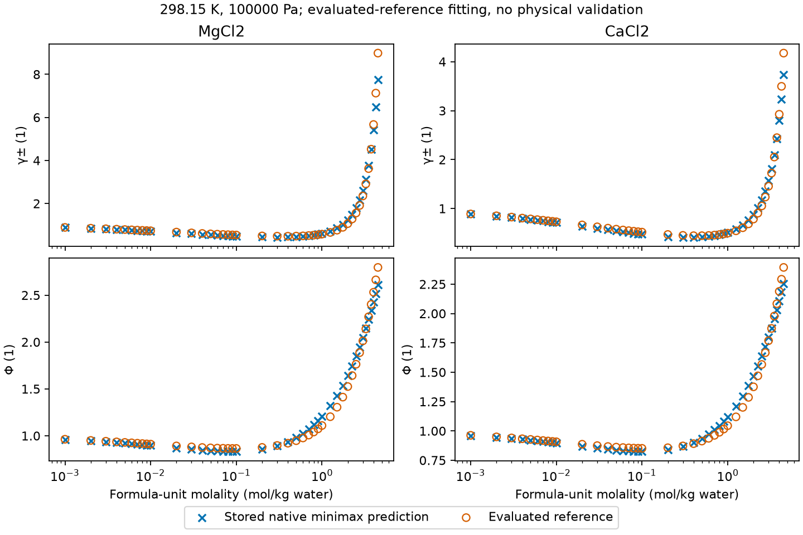
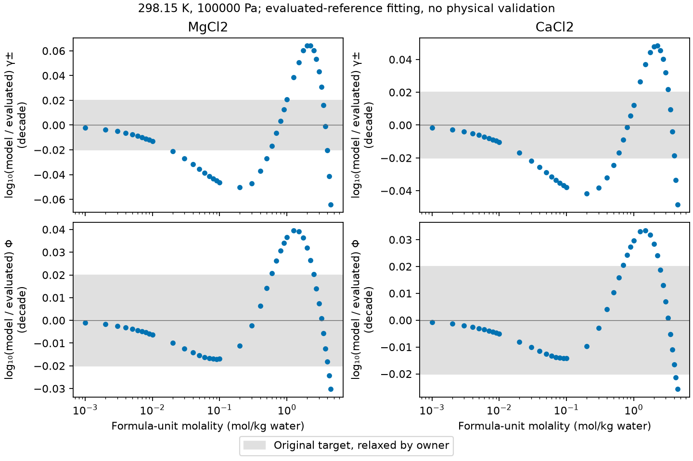

The provisional packet uses the best native stage-2 fit on the accepted aqueous
LiCl/NaCl/KCl basis. The owner relaxed the original every-row activity and
osmotic target on 2026-10-06; measured maximum and mean absolute errors remain
explicit limits. This is **numerical fitting against evaluated reference data**
and numerical verification, with delivered independent review and owner
acceptance pending. It establishes no physical validation.

## Conditions, method and measured errors {#stage-2}

Goldberg–Nuttall Tables 17 and 20 supply the MgCl₂ and CaCl₂ rows, respectively,
as [retained in the source analysis](../2026-held-2014-chlorides/README.md).
The selected liquid branch uses formula-unit molality per kilogram of water.
The [accepted design and owner amendments](https://github.com/tannerpolley/ePC-SAFT/issues/209)
fix the Figiel permittivity and corrected Born term, coupled segment/packing/
Debye–Hückel diameters, bounded interaction coordinates and Marcus hydration
calibration. [Canonical equations](../../engine/docs/equations.md) and
[ALG-FIT](../../engine/docs/science/algorithms.md#alg-fit) own the calculation.

Native Ceres runs every declared start, followed by native minimax from each
distinct usable minimum. Python declares inputs and reads returned results.
Final values are evaluated with the stored Born diameters; finite differences
only verify exact held sigma columns. Both interactions reach their declared
bounds: this is a **boundary optimum**, and the coefficients are **not
identified**. The finite search supplies no global-optimum or parameter-
uncertainty claim. The retained Ca Ceres failure remains visible rather than
being counted as a converged start.

The following tables are generated from retained CSV and JSON; rendering
performs no Engine calculation.



## Stage-1 prediction re-baseline

The density closure correction in [PR #273](https://github.com/tannerpolley/ePC-SAFT/pull/273)
retains the pressure-closest endpoint. The isolated old/new comparison improves
pressure closure in every moved row; the individual osmotic-coefficient errors
relative to the integrated Gibbs–Duhem identity improve or worsen as recorded
in the diagnosis. The accountable lead authorized a current-wheel preservation
reference while retaining the original reference and unchanged stage-1 packet.

The [new reference and its reason](results/stage1-rebaseline/rebaseline.json),
[all reference values](results/stage1-rebaseline/stage1-reference.csv),
[diagnosis](results/stage1-rebaseline/diagnosis.json),
[bisection results](results/stage1-rebaseline/bisect-results.csv) and
[old/new identity comparisons](results/stage1-rebaseline/old-new-identities.csv)
retain the evidence. Preservation against this reference qualifies the effect
of adding the divalent parameters on the current wheel; it does not establish
absolute osmotic-coefficient accuracy at the preservation tolerance.

## Evidence, qualification and limits

The [qualification table](results/provisional-stage2/qualification.csv) combines
the target errors, re-baselined preservation operands, hydration holds, pressure,
slope and charge checks, exact-column verification, guard results and packet
validation. [The summary](results/provisional-stage2/summary.json) identifies
the source commit and wheel. [The packet identity](results/provisional-stage2/delivery.json)
binds the packet bytes and records the executed checks. The packet's source
provenance hashes its inputs and numerical evidence. The unchanged stage-1
packet keeps its original identity.

The measured errors show the limit of these binary predictions on the declared
basis. There is no mixed-salt, ternary, temperature-range, density, caloric or
alcohol qualification. Source uncertainty is not estimated by the fitted
residuals. The inherited alkali-ion feasible-point and identification limits
remain. Downstream adoption and manuscript promotion need their own decisions.

## Retained earlier work

[Stage-1 source inputs, results and Supported review](README.md) remain the
accepted basis. The [original stage-2 fit](results/stage2-summary.json),
[original preservation reference](results/stage2-combined-stage1-preservation.csv)
and [first current-wheel preservation stop](results/current-wheel/stage2-preservation-stop.json)
remain historical evidence. [Affine-map preservation](results/affine-preservation.json)
and [hydration root-start operands](results/affine-hydration-starts.json) retain
their own inputs and wheel identities; this provisional packet does not
redefine those earlier comparisons.

## Current producer diagnosis (#750)

The [current diagnosis](results/current-main/diagnosis.md) names the responsible
Engine changes, retained comparisons, rerun outcomes and remaining limitations.
Its numerical outputs are separate from the original results interpreted above.
The minimax cold-replay failure, where applicable, remains an open Engine
investigation; a completed fit or preflight does not establish physical validation.
