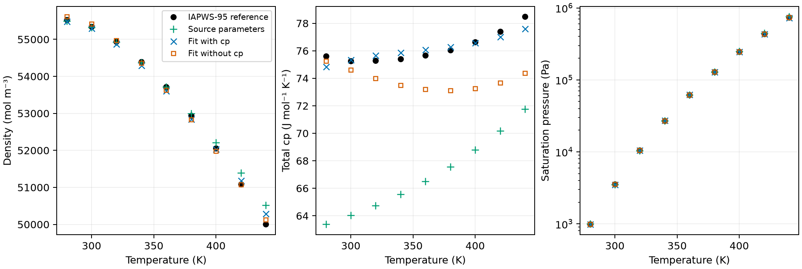

## Question, quantities and conditions

Can residual-EOS parameters be fitted jointly to total molar isobaric heat
capacity, density and saturation pressure with exact first derivatives? The
pressure-closed observations specify temperature, pressure, normalized
composition and density branch. The fixed ideal-gas thermochemistry contributes
to the value but has no residual-parameter derivative. The existing Properties
pressure-chart action carries the implicit density and association-site chains;
EqID `fixed_pressure_heat_capacity_parameter_derivative` composes the governing
equations. A batch containing several directions defines one mixed action, so
parameter columns use separate single-direction calls.

The numerical comparisons use non-associating ethane at 200 K, associating 2B
water at 298.15 and 400 K, and the associating binary at 313.15 K, with the exact
states, native coordinate steps and reciprocal site pairs in [#205](https://github.com/tannerpolley/ePC-SAFT/issues/205).
The ideal heat capacity for these checks is the known constant $4R$ for every
component. This is numerical verification on fixed smooth branches, not physical
validation or a claim about reacting-equilibrium heat capacities.

## Independent reference and ideal thermochemistry

The water targets come from installed `chemicals` 1.5.2. Its values pass 59
comparisons against IAPWS R6-95(2018): the Table 3 heat-capacity expression with
Table 6's printed derivatives, every Table 7 single-phase row for pressure,
isochoric heat capacity, sound speed and entropy, Table 8 saturation pressure
and liquid density at 275 and 450 K, and ten retained NIST SRD 69 density rows
at 0.1 MPa. [The release](https://iapws.org/technical-guidance/release/IAPWS-95)
is retained in Zotero as report `Y3FU9CXJ`.

The independent heat-capacity value at 500 K and 838.025 kg m⁻³ is
4602.224490 J kg⁻¹ K⁻¹. Propagating the printed derivative intervals gives
2.10357×10⁻⁵ J kg⁻¹ K⁻¹ tolerance (4.57076×10⁻⁹ relative). Table 7 warns of
pressure-rounding sensitivity in low-pressure liquid water; the present values
pass their printed half-digit criteria. These criteria verify the reference
implementation and source transcription; they are not IAPWS physical uncertainty.
`results/reference-verification.csv` retains the values, tolerances and errors.

The centered degree-six polynomial for IAPWS ideal-gas $c_p$ over 270–450 K has
maximum sampled error 4.83596×10⁻⁶ J mol⁻¹ K⁻¹ on the 0.1 K verification grid,
below the 10⁻³ criterion. `inputs/ideal-gas-polynomial.json` owns its coefficients
and anchors. The mass-to-molar conversion uses 18.015268 g mol⁻¹, while the
parameter source retains its recorded molar mass. No ideal coefficient is fitted.

## Derivative comparisons and manufactured recovery

All 105 retained native comparisons pass, including the 17 parameter columns,
value identities, failures and recovery comparisons. The maximum fraction of
the allowed error is 0.0452 for the fine rung, 0.0464 for the coarse rung and
0.00289 for Richardson. The known ideal contribution is 33.2578504726 J mol⁻¹ K⁻¹.
The density-lift discrimination ratios are 1.871×10⁷ (ethane), 2.701×10⁷
(water at 298.15 K), 1.717×10⁷ (water at 400 K) and 5.234×10⁵ (binary),
all exceeding the required 10³. Total and residual parameter actions agree to
the stated 10⁻¹² relative criterion. The maximum recovered parameter relative
error is 3.220×10⁻⁹.

The physical derivative ladders, total-value identities and density-lift
comparisons are retained in `results/derivatives.csv` and `results/identities.csv`.
The native-step coarse and fine central differences and their Richardson
extrapolation provide the independent derivative estimates.

Two specified physical sensitivities lie below the original 10⁻² native-unit
signal floor: water dispersion energy at 298.15 K is −4.979953×10⁻⁴ J mol⁻¹ K⁻²,
and binary cross-site association energy at 313.15 K is −4.259956×10⁻³ in the same
units. The owner approved keeping both states with the stricter relative ladder
for these two columns only: fine and Richardson agreement within $5\times10^{-6}|FD|$,
coarse within four times that, and finite nonzero FD. The other columns retain
the original floor and absolute-or-relative ladder. The refinement estimates
must resolve the criterion. `results/weak-signals.csv` retains $|FD|$,
fine-minus-coarse, the Richardson correction and exact-versus-Richardson error
next to the criterion. No numerical value or parameter unit was changed to force
a signal.

| Weak column | Signal magnitude | Fine minus coarse | Richardson correction | Exact versus Richardson error | Fine criterion |
|---|---:|---:|---:|---:|---:|
| Water ε/k, 298.15 K | 4.979953×10⁻⁴ | −5.371703×10⁻¹¹ | −1.790568×10⁻¹¹ | 7.183029×10⁻¹² | 2.489977×10⁻⁹ |
| Binary cross-site εAB/k | 4.259957×10⁻³ | 2.989118×10⁻⁹ | 9.963728×10⁻¹⁰ | 3.484476×10⁻¹¹ | 2.129979×10⁻⁸ |

Every entry has units J mol⁻¹ K⁻². The fine-versus-coarse refinement
magnitude is 0.0216 and 0.1403 times the fine criterion respectively; the
Richardson corrections are 0.00719 and 0.0468 times it. Thus these refinement
estimates resolve the agreement threshold. They estimate combined step and
numerical effects and do not separately certify a rigorous roundoff bound.

The manufactured fit uses 12 equally weighted LogRatio observations: density
and total $c_p$ at 1 MPa plus saturation pressure, at 300, 340, 380 and 420 K.
Five physical coordinates are displaced from the known source values by 2%,
except association volume by 5%, with the origins, scales, bounds and default
controls specified in #205. Recovery converges with zero trial failures, cost
1.49460×10⁻²⁰ and rank five with conditional covariance available. Singular
values are 0.942757, 0.176182, 0.0644194, 0.0166408 and 0.00287333. Each physical
value meets the 10⁻⁶ relative criterion; `results/recovery.csv` retains every
recovered value and its error. This verifies local numerical recovery from that
start, not global identifiability.

## Water model demonstration

The model is Held, Cameretti and Sadowski (2008), Table 1 and Eq. (7), 2B water
with temperature-dependent sigma, from packet v3. The same five-coordinate chart
fits 27 equally weighted LogRatio observations at 280–440 K in 20 K steps:
liquid density and total $c_p$ at 1 MPa and saturation pressure at each temperature.
The exponential sigma terms remain fixed. All states are compressed liquid,
since even the 450 K IAPWS saturation pressure is below 1 MPa. Both fits start
from the source parameters. The companion fit removes the nine $c_p$ rows and
otherwise uses identical settings.

Mean absolute deviations and maximum absolute deviations are percentages
relative to the evaluated reference, over the same nine temperatures. The
companion's $c_p$ deviations are evaluated after fitting; its objective does
not include them.

| Quantity | Before AAD / maximum (%) | Joint fit AAD / maximum (%) | Without cp AAD / maximum (%) |
|---|---:|---:|---:|
| Density | 0.244756 / 1.037817 | 0.188419 / 0.583147 | 0.134550 / 0.254671 |
| Total cp | 12.176818 / 16.180660 | 0.529504 / 1.117118 | 3.015214 / 5.213644 |
| Saturation pressure | 0.993356 / 2.600812 | 0.325887 / 0.583569 | 0.017428 / 0.028610 |

The joint cost is 2.65795×10⁻⁴. Its source-to-fit shifts are:

| Parameter | Source value | Joint fitted value | Shift (%) |
|---|---:|---:|---:|
| Segment count m | 1.204659 | 1.334033777 | +10.739535 |
| Sigma constant (Å) | 2.7927 | 2.717605221 | −2.688967 |
| Dispersion energy/k (K) | 353.9449 | 415.475778204 | +17.384310 |
| Association energy/k (K) | 2425.6714 | 1725.684769303 | −28.857438 |
| Association volume | 0.0450989 | 0.0461035032 | +2.227556 |

`results/predictions.csv`, `results/deviations.csv` and `results/parameter-shifts.csv`
retain each row and both parameter fits. The companion gives substantial
parameter shifts despite improving the two fitted quantities. The comparison
therefore does not establish unique physical coefficients. Adding $c_p$ changes
the conditional local information and the compromise among observables.

Both fits converge by the default function-tolerance criterion with rank five,
no active bounds and zero trial failures. Joint singular values are 1.66842,
0.221189, 0.0893498, 0.0284938 and 0.00490636; companion values are 1.44086,
0.225434, 0.0476107, 0.00336900 and 0.000462008. The covariance is conditional on
these equally weighted log residuals and the declared model, not an unconditional
experimental parameter uncertainty.

At the fitted models, full physical Jacobian evaluations take 0.2815 s for 27
rows with $c_p$, and 0.1283 s for the 18-row companion. Total fit wall time divided
by Jacobian count is 0.3615 and 0.1165 s respectively; that second measure also
includes residual evaluations and optimizer work. These are single measurements
on a shared machine with one numerical thread, not a speed guarantee.

## Meaning and limits

Heat-capacity observations constrain residual-EOS parameters through the same
pressure closure and thermodynamics as density. The demonstrated joint fit
reduces the source model's heat-capacity discrepancy substantially, while the
companion obtains closer density and saturation-pressure agreement. The source
thermal polynomial, residual model and selected log weights all influence the
fitted parameter compromise. Ideal-gas error can be absorbed into residual
parameters. The reference checks separate source rounding from physical
uncertainty; this study does not propagate IAPWS or measurement uncertainty into
the fit.

This is a numerical demonstration against an evaluated reference. It adopts
no fitted parameters and establishes no validation for an application, mixture,
reacting equilibrium, parameter Hessian, broader temperature range or different
start. Missing thermochemistry and density roots remain typed failures; total
$c_p$ never falls back to residual $c_p$. The figure and notebook read retained
rows only. The notebook has not been promoted for manuscript use.

Source: Held, C.; Cameretti, L. F.; Sadowski, G. (2008), *Fluid Phase Equilibria*
270, 87–96, Table 1 and Eq. (7), [DOI](https://doi.org/10.1016/j.fluid.2008.06.010).
IAPWS (2018), R6-95(2018), Eq. (5), Tables 3, 6–8, pp. 11 and 15,
[official release](https://iapws.org/technical-guidance/release/IAPWS-95).
