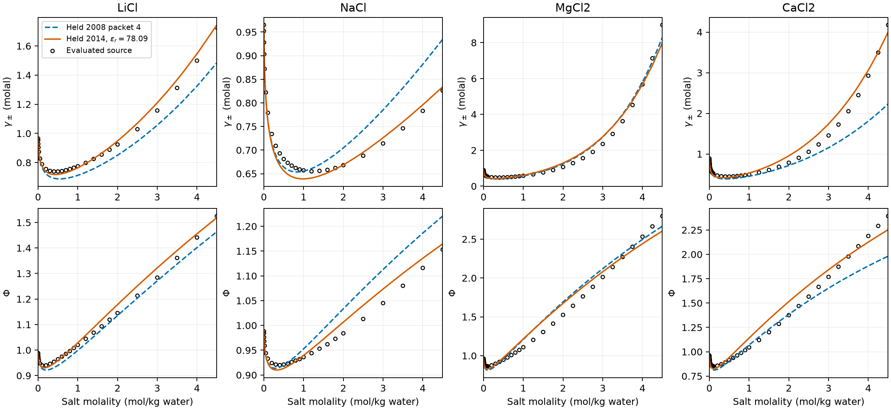

# Held 2014 chloride qualification

This is the preserved σ closest-approach record. The [current notebook](notebook.qmd)
compares its replay with the inferred shorter Debye–Hückel closest approach;
the LiCl/NaCl Pass verdicts below apply to σ only.

Held 2014 strategy 2 does **not** meet the owner's maximum-row target for
MgCl2 or CaCl2 at 298.15 K and 1 bar through 4.5 mol/kg water. Both activity
and osmotic coefficients fail. Its LiCl and NaCl rows pass on the selected
Hamer–Wu grids. The new `held-2014-strategy2/1` packet retains the published
compatible parameter subset for reproducibility; it is **not a recommended
divalent set**. No refit was performed.

The calculation uses the printed Held 2014 Tables 1–3, including explicit
cation–anion dispersion, and a declared supplemental water relative permittivity
of 78.09 from Figiel 2025 Table 1. Held 2014 gives the solvent-only dielectric
convention but no numeric value at 298.15 K. Its inherited citation chain does
not establish an exact authors' executable replay. A source-based sensitivity
at 78.446956, the Floriano–Nascimento 298 K value at 0.1 MPa, also fails both
divalent criteria. That sensitivity is a nearest-temperature probe, not a
substitute 298.15 K parameter adoption.

## Maximum row errors

Errors are absolute `log10(Engine/evaluated)` in decades. The target is at most
0.02 for **every** evaluated γ± and positive Φ row. All computed Φ values are
positive. Means and relative average deviations do not determine acceptance.

[`results/maximum-errors.csv`](results/maximum-errors.csv) retains each salt's
maximum γ± and Φ errors, their molalities (formula-unit mol/kg water), failing
row counts and verdict for packet 4 and Held 2014; the
[notebook](notebook.qmd#both-verdicts-on-the-same-evaluated-rows) tabulates the
Held 2014 maxima. Held 2014 passes LiCl and NaCl and fails MgCl2 and CaCl2; it
supplies no SrCl2 candidate. For MgCl2, Held 2014
fails 27/42 γ± rows and 14/42 Φ rows; for CaCl2 it fails 23/42 and 13/42.
The worst γ± predictions exceed the evaluated values by approximately 21.8%
(MgCl2) and 22.8% (CaCl2); their errors exceed the target by 0.065606 and
0.069353 decade. The worst Φ errors are positive, approximately 11.2% and
11.1%, exceeding the target by 0.025990 and 0.025722 decade. The sign changes
with concentration are retained in the row comparisons. For example, MgCl2 at
0.4 mol/kg remains low: γ± = 0.437135 against 0.4796.

The nearest-temperature dielectric probe gives maxima of 0.089433/0.046335
for MgCl2 and 0.093088/0.046082 for CaCl2 (γ±/Φ decades). It does not remove
the disagreement. This bounds that particular source ambiguity; it does not
prove invariance under arbitrary dielectric formulations.

## Sources and transcription

The evaluated rows were read from the printed PDFs, with table headers,
columns and doubtful OCR digits checked on rendered pages. No values were
taken from the issue's two divalent anchors. `inputs/sources.csv` retains the
Zotero parent/attachment identities, DOI, inspected PDF hashes and locators.
Full papers and page images remain outside the retained analysis.

- Held et al. 2014, DOI 10.1016/j.cherd.2014.05.017,
  `3DIW87Q5/TD5T732H`: water in Table 1, p.2888; strategy-2 ions and water-ion
  coefficients in Table 2, p.2889; cation–anion coefficients in Table 3 on the
  same page; packing and dielectric conventions in Section 2.4, p.2890.
- Goldberg and Nuttall 1978, DOI 10.1063/1.555569,
  `IJ9ZIG4H/UVGIXEPB`: MgCl2 Table 17, p.288 (PDF page 27); CaCl2 Table 20,
  p.291 (page 30); SrCl2 Table 23, p.294 (page 33). Mg/Ca each have 42 selected
  rows from 0.001 through 4.5 mol/kg. Sr has 42 rows through 4.038, including
  its 3.518 saturation row and the evaluated extension above saturation; it
  supplies no 4.5 row. That extension does not establish stable unsaturated
  liquid applicability.
- Hamer and Wu 1972, DOI 10.1063/1.3253108,
  `28NPJ5H6/5RS9QAMK`: LiCl Table 9, p.1063 (PDF page 18); NaCl Table 16,
  p.1067 (page 22). Each has 26 selected rows through 4.5 mol/kg.
- [Floriano and Nascimento 2004](https://www.scielo.br/j/bjp/a/Vvn4Fx9zQ7s5C8Hj9hjghwP/?lang=en),
  Eq.(3) and Table I, p.40: 298 K reference ε(10 MPa) = 78.85, a0 = 14.1113,
  a1 = 341.5902 MPa. Evaluating at 0.1 MPa gives 78.446956. The paper supplies
  these coefficients at discrete temperatures and does not specify their
  temperature interpolation; no interpolation was invented here.

`results/paper-packet-comparison.csv` retains 52 numerical coefficient and
length comparisons. `results/formulation-comparison.csv` retains the model
conventions, evaluated temperature expressions and the dielectric limitation.
All ions have one segment; screening uses σ and packing uses 0.88σ. The water
model uses the **printed Held 2014** values 1.2047, 353.95 K, 2425.7 K and
0.0451, plus its Table 1 footnote σ(T). These are distinct from the extra digits
retained in the historical Held 2008 packet. Same-sign ionic dispersion stays
excluded. The chloride-pair coefficients are Li 0.669, Na 0.317, K 0.064,
Mg 0.817 and Ca 1.000, coupled to the strategy-2 ion energies and diameters.
Water, Cl and alkali parameters were not fitted or adjusted to the evaluated
rows. Water–Na and water–K temperature expressions are evaluated at 298.15 K;
this packet does not support their temperature dependence outside that point.

The source rounding is preserved. The Mg/Sr standard deviations printed at
selected molalities and the Hamer–Wu aggregate statistics are retained in
`inputs/source-uncertainty.csv`. They are not interpolated into unprinted row
uncertainties or substituted for the owner's acceptance tolerance. CaCl2's
Table 20 refers uncertainty to Staples–Nuttall 1977; no Ca row uncertainty is
claimed from that reference here. These evaluated tables synthesize measured
data and correlations; their rows are not independent new experiments.

## Numerical and physical checks

The installed Engine provides density closure, infinite-dilution references,
γ± and Φ. The analysis does not implement another equation of state. It
revalidates `mean_ionic_activity_coefficient`, `molality_activity_conversion`,
`practical_osmotic_coefficient`, `debye_huckel_helmholtz`,
`same_sign_ionic_dispersion`, ALG-DENSITY and ALG-REFERENCE for these inputs.
The source definitions, including Held 2008 Eqs.(8)–(10) and Held 2014 Eq.(5),
remain compatible with the current Engine equations. No equation, algorithm
or runtime change is made.

The 1,110 retained liquid states include 81-point logarithmic prediction
sweeps from 0.001 to 4.5 mol/kg for each main salt and packet, the source rows,
the optional packet-4 Sr sweep and the two divalent dielectric probes.
There are 398 evaluated comparison rows across all modes. Every pressure
slope is positive (minimum 71,634 Pa m³/mol); the largest pressure residual is
4.19e-5 Pa. Electroneutrality residuals are zero. Independent fugacity
contraction and molal conversion agree within 3.34e-16 natural-log units;
solvent-activity contraction reproduces the native Φ in the retained
precision. These identities establish basis and computation consistency,
not physical accuracy.

The largest terminal reference log-fugacity change is 7.37e-5, about
3.2e-5 decade. This is a convergence diagnostic, not a rigorous error bound;
it is much smaller than the observed concentrated errors. No solver failures
or unavailable property rows are used to reach the verdict.

At 0.001 mol/kg, the Debye limiting law gives
`ln(gamma_pm) = -|z+ z-| A sqrt(I)` and
`Phi = 1 - |z+ z-| A sqrt(I)/3`, with I the molal ionic strength and
A = 1.180946 on the natural-log basis for the candidate's pure-water density
996.973 kg/m³ and εr = 78.09. [`results/debye-limit.csv`](results/debye-limit.csv)
retains the Engine's finite-size γ± and Φ and the limiting-law values for each salt.

The finite-size and short-range remainders are small and both quantities
approach unity from below in the dilute Debye description. At 0.001 mol/kg,
they are not exactly unity, especially for 2:1 salts whose I = 0.003 mol/kg.
The same file retains each remainder. This is a physical
sense check at the requested lower bound, not numerical qualification at
arbitrarily small molality. No dependence on #214 or native Φ below 0.001 is
introduced.



## Meaning, limits and reproducibility

The evidence answers the binary formulation question: correcting Held 2008
screening and then using the complete published Held 2014 subset does not
supply the requested divalent precision. This is numerical verification of
basis/closure and physical comparison against evaluated binary reference
data. It does not establish exact Held authors' executable reproduction,
mixed-brine validation, density-fit adequacy, caloric adequacy, or
transferability to another temperature, pressure or solvent.

The refit and its decisions are in
[issue #209](https://github.com/tannerpolley/ePC-SAFT/issues/209), delivered as packet
`figiel-2025-chloride-activity-refit/2` (PR #306). No source
values were optimized, and the trace osmotic correction remains independent.
The exact inspected wheel and input hashes are in `results/run-identity.json`;
packet fingerprints are in `inputs/packet-locks.json`. `scripts/run.py` reads the
packets from `data/packets/` and hashes them into the run identity; #341 removed the byte-identical leaf copies (record commit `21d7a112`). The retained record's `inputs/held-2008/4/…/parameters.json` and `inputs/held-2014/1/…/parameters.json` hashes equal the `data/packets/` files. Engine runtime physical lines remain 19,100,
at the hard ceiling. Engine-only work; no application repository was touched.

From the repository root, build/install the sole current wheel before replay:

```bash
env EPCSAFT_BUILD_JOBS=2 bash .codex/environments/setup.sh
env EPCSAFT_BUILD_JOBS=2 .venv/bin/python analyses/2026-held-2014-chlorides/scripts/run.py
env EPCSAFT_BUILD_JOBS=2 .venv/bin/python analyses/2026-held-2014-chlorides/scripts/plot.py
env EPCSAFT_BUILD_JOBS=2 bash tools/check-all.sh
```

`notebook.qmd` includes this retained interpretation and renders without
running the Engine. `bash tools/check-all.sh` passed: 109 Python numerical tests (one deselected),
six native checks, packet validation, equation index, layout, typing/lint and
architecture checks. No additional Engine numerical tests were added; the
source-grid replay and basis identities are the numerical falsifiers.

`results/energy-coordinate-invariance.csv` retains an identifiability probe:
scaling Mg/Ca u by 1.21 and mapping each water/Cl kij to
`1-(1-kij)/sqrt(1.21)` preserves both cross dispersion energies. Across five
molalities per salt, γ± changes by at most 1.57e-12 decade and Φ by
2.71e-11. These binary observations therefore cannot independently identify
u and both cross coefficients when all three are free and all same-sign
ionic dispersion is excluded. This conditional algebraic redundancy informs
the proposed owner choice of fit coordinates; it does not revise the
published parameters or constitute a refit.

Independent GPT-6.1 Sol high CSE review on the Codex provider returned
**Supported** for the transcription, bounded qualification and refit proposal,
with no required corrections. Review task `69fb7247-c646-4b6b-bc35-3c7bf67f0eca`
inspected scientific commit `efb2cb63b379f6dcb338328bf85e373e08fdbd54` against
baseline `502e8099051c00bf169198c970f3525bbcfac7fd`. It checked all 178 source
concentration rows and 398 signed comparisons, independently replayed 55
selected states and ten energy-invariance states, and reproduced the Debye
leading terms. It confirmed the packet/lock/wheel bytes and the stated
limitations. The later closeout changes only this review record; no scientific
input, calculation or result changes. This record is not promoted to manuscript
use.

## Current producer diagnosis (#750)

[The current diagnosis](results/current-main/diagnosis.md) records the unchanged failure,
the responsible Engine changes, retained comparisons, repaired reruns and remaining
limits. New results are separate from the original retained results.
