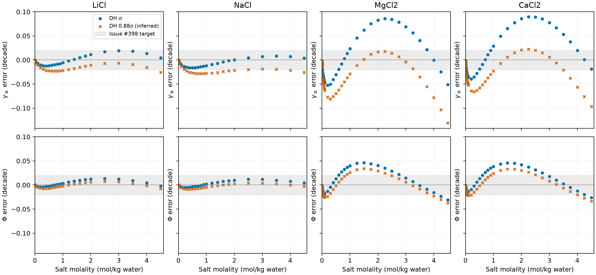

```{python}
import csv, json
from pathlib import Path
from IPython.display import Markdown, display
root = Path.cwd()
if not (root / "results/dh-088").exists():
    root = root / "analyses/2026-held-2014-chlorides"
def read(path):
    return list(csv.DictReader((root / path).open()))
sigma = [r for r in read("results/sigma-replay/maximum-errors.csv") if r["mode"] == "held2014"]
dh = read("results/dh-088/maximum-errors.csv")
old = {r["salt"]: r for r in read("results/maximum-errors.csv") if r["mode"] == "held2014"}
identity = json.loads((root / "results/dh-088/run-identity.json").read_text())
curves = {folder: read(f"results/{folder}/model-curves.csv") for folder in ("sigma-replay", "dh-088")}
all_curves = sum(curves.values(), [])
comparisons = {folder: read(f"results/{folder}/evaluated-comparison.csv") for folder in curves}
probe = next(r for r in comparisons["dh-088"] if r["salt"] == "MgCl2" and float(r["molality_mol_kg"]) == 2.25)
target = 0.02
T, P = float(all_curves[0]["temperature_K"]), float(all_curves[0]["pressure_Pa"])
native = identity["engine_provenance"][0]
packing, dh_factor = identity["packing_factor"], identity["dh_factor"]
def maximum(column):
    return max(abs(float(r[column])) for r in all_curves)
def max_error(row, quantity):
    return f'{float(row[f"max_abs_{quantity}_decade"]):.6f} ({float(row[f"{quantity}_worst_molality"]):g})'
```

## Outcome and basis

Held strategy 2 still fails for MgCl₂ and CaCl₂ with either Debye–Hückel
closest approach. LiCl and NaCl change from Pass with σ to Fail with
`{python} f"{dh_factor:g}"`σ because of their activity coefficients; their osmotic
coefficients pass with both conventions. Packing remains
`{python} f"{packing:g}"`σ throughout. No parameters were fitted.

The comparison is at `{python} f"{T:g}"` K and `{python} f"{P/1e5:g}"` bar,
with fully dissociated salts and formula-unit molality per kg of water.
The grid spans `{python} min(float(r["molality_mol_kg"]) for r in comparisons["dh-088"])`
to `{python} max(float(r["molality_mol_kg"]) for r in comparisons["dh-088"])` mol/kg.
The maximum allowed absolute $\log_{10}(\mathrm{Engine}/\mathrm{evaluated})$
is `{python} f"{target:g}"` decade on every γ± and positive Φ row;
nonpositive predicted Φ would fail. All retained Φ values are positive.

The shorter closest approach is **inferred**, not printed in the Held paper.
Its basis is the [#387 reproductions](https://github.com/tannerpolley/ePC-SAFT/issues/387)
and PRs [#395](https://github.com/tannerpolley/ePC-SAFT/pull/395),
[#397](https://github.com/tannerpolley/ePC-SAFT/pull/397), and
[#399](https://github.com/tannerpolley/ePC-SAFT/pull/399).
The published strategy-2 coefficients, water association, pair dispersion,
packing diameters, and supplemental water permittivity are held fixed.
The historical [σ record](README.md) and its root result files remain intact.

## Both verdicts on the same evaluated rows

Parentheses give the molality of the maximum error in mol/kg water.
Counts give failing γ±/Φ rows; a salt passes only when both counts are zero.

```{python}
lines = ["| Salt | Convention | Rows | Max γ± error (m) | Max Φ error (m) | Failing γ±/Φ rows | Verdict |",
         "|---|---|---:|---:|---:|---:|---|"]
for a, b in zip(sigma, dh):
    assert a["salt"] == b["salt"] and a["n_rows"] == b["n_rows"]
    for label, r in (("σ", a), (f"{dh_factor:g}σ, inferred", b)):
        lines.append(f'| {r["salt"]} | {label} | {r["n_rows"]} | {max_error(r, "gamma")} | {max_error(r, "osmotic")} | '
                     f'{r["gamma_fail_rows"]}/{r["osmotic_fail_rows"]} | {"Pass" if r["passes"] == "True" else "Fail"} |')
display(Markdown("\n".join(lines)))
```



At the issue's MgCl₂ probe, m = `{python} probe["molality_mol_kg"]` mol/kg,
the shorter closest approach gives γ± error
`{python} f'{abs(float(probe["log10_gamma_ratio"])):.6f}'` decade and Φ error
`{python} f'{abs(float(probe["log10_osmotic_ratio"])):.6f}'` decade.
This reproduces the reported improvement at that point. It does not establish
full-grid agreement: both divalent worst activity errors move to the upper
concentration endpoint, where predictions fall below the evaluated values.
The osmotic maxima decrease, but remain outside the same target.

## Numerical verification

The σ replay ran before the shorter-diameter variant. It exactly reproduces
the historical table at its displayed precision, including both divalent
worst molalities and the alkali Pass verdicts. Current-source and historical
full-precision maxima differ slightly:

```{python}
lines = ["| Salt | Change in max γ± error (decade) | Change in max Φ error (decade) |",
         "|---|---:|---:|"]
for r in sigma:
    lines.append(f'| {r["salt"]} | {float(r["max_abs_gamma_decade"])-float(old[r["salt"]]["max_abs_gamma_decade"]):.3e} | '
                 f'{float(r["max_abs_osmotic_decade"])-float(old[r["salt"]]["max_abs_osmotic_decade"]):.3e} |')
display(Markdown("\n".join(lines)))
```

`Reference.activity()` calls native `electrolyte_activity`; the analysis
reads its γ± and Φ and independently checks their fugacity contractions.
The current native Φ expression uses prescribed pressure in its extensive
Helmholtz identity. The direct fugacity check removes the density-closure
pressure residual from the chemical-potential difference so that both
expressions use the same pressure. The original contraction tolerances are
unchanged. This corrects the verification expression, not the predicted Φ.

Across `{python} len(all_curves)` retained states, the maximum absolute
pressure residual is `{python} f'{maximum("pressure_residual_Pa"):.3e}'` Pa,
and the smallest pressure slope is
`{python} f'{min(float(r["pressure_slope"]) for r in all_curves):.6g}'` Pa m³/mol.
The maximum charge residual is `{python} f'{maximum("charge_residual"):g}'`.
The maximum γ± contraction difference is
`{python} f'{maximum("gamma_formula_error"):.3e}'` natural-log units,
and the maximum Φ contraction difference is
`{python} f'{maximum("osmotic_formula_error"):.3e}'`.
The largest terminal reference log-fugacity change is
`{python} f'{maximum("reference_terminal_change_log_phi"):.3e}'`.
That reference diagnostic is not a rigorous error bound.
There are no failed or unavailable rows in either comparison.

## Implication for the divalent refit

The [#209](https://github.com/tannerpolley/ePC-SAFT/issues/209) reasoning that
motivated a divalent refit still holds in its bounded sense: published Held
strategy 2 does not meet the requested per-row γ±/Φ precision for MgCl₂ or
CaCl₂. The earlier statement that Held strategy 2 passes LiCl and NaCl is
specific to the σ convention; it does not hold with the inferred shorter
closest approach on these same evaluated grids.

This rerun does not requalify the distinct Figiel-based refit, its provisional
packet, hydration constraints, or downstream adoption. The closed #209 record
reports a provisional packet delivered at an owner-relaxed target while the
original per-row target remains unmet. Changing the Held comparison does not
undo that separate result. No Sr verdict is possible for Held strategy 2
because its packet supplies no Sr parameters. No Lithium repository was
contacted or changed.

## Sources, uncertainty, and replay

LiCl and NaCl use the retained Hamer–Wu tables; MgCl₂ and CaCl₂ use the retained
Goldberg–Nuttall tables. Exact source keys, table rows, saturation labels,
source uncertainty, and packet comparisons remain in `inputs/` and the
historical [source record](README.md#sources-and-transcription).
The grids synthesize measurements and correlations; γ± and Φ are related by
Gibbs–Duhem and are not independent observations. Unprinted row uncertainties
are not invented or substituted for the owner's target.

Water relative permittivity remains the declared supplement from Figiel:
`{python} json.loads((root.parents[1] / "data/packets/held-2014-strategy2/1/parameters/parameters.json").read_text())["correlations"][0]["constant"]["value"]["magnitude"]`.
The printed parameter rounding is preserved. These are native predictions
compared with evaluated binary data and numerical verification of basis and
closure. They do not establish an exact author executable replay or physical
validation for mixed brines, other temperatures, pressures, solvents, density,
or caloric properties. This rerun has not been independently reviewed or
promoted for manuscript use.

The Engine source identity is `{python} native`, with a clean Engine tree.
Separate `results/sigma-replay/` and `results/dh-088/` directories retain
row comparisons, continuous prediction sweeps, maxima, dilute checks, and
input/script hashes in their `run-identity.json` files. The historical σ
files are preserved. To replay from the repository root:

```bash
bash tools/setup.sh
.venv/bin/python analyses/2026-held-2014-chlorides/scripts/run.py
.venv/bin/python analyses/2026-held-2014-chlorides/scripts/run.py --dh-088
.venv/bin/python analyses/2026-held-2014-chlorides/scripts/plot-errors.py
python3 tools/check-notebook-numbers.py analyses/2026-held-2014-chlorides/notebook.qmd
bash tools/check-affected.sh origin/main
```

Rendering this notebook reads retained values only; it does not import the
Engine or run the calculation.

## Current producer diagnosis (#750)

The [current diagnosis](results/current-main/diagnosis.md) names the responsible
Engine changes, retained comparisons, rerun outcomes and remaining limitations.
Its numerical outputs are separate from the original results interpreted above.
The minimax cold-replay failure, where applicable, remains an open Engine
investigation; a completed fit or preflight does not establish physical validation.
