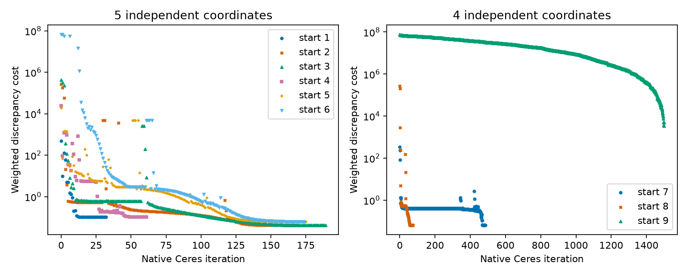

## Both one-coordinate trials fail binary accuracy

Both one-coordinate trials, with $k_{H,Cl}=0$ and $k_{H,Cl}=1$, identify
their sole fitted H–water dispersion correction under the frozen numerical
rule, then fail the frozen 2a Hamer–Wu osmotic-coefficient
root mean square error in both molality buckets. The retrial also fails the
upper-bucket osmotic maximum and activity mean absolute relative deviation.
The table places each trial's two buckets alongside the other trial; activity
errors are percentages and osmotic errors are dimensionless.



The H–Cl coefficient in each column is a **modelling assumption**. Stage one's
zero correction retains geometric-mean H–Cl attraction. The retrial's unit
correction removes H–Cl dispersion: the native combining-rule check returns
exactly zero cross energy. The Engine admits that coefficient without a code
change. Both trials use the same fixed hydrogen sizes and energy, fully
dissociated aqueous HCl, temperature, pressure, evaluated Hamer–Wu training
states, weights, transforms, starts, bounds, fit budgets and identification
rule. The [fresh retrial declaration](inputs/fit-declaration-issue-798-retrial.json)
changes only the H–Cl assumption and its description.

Binary accuracy is calibration evidence, not physical validation. These
locally identified endpoints do not demonstrate microscopic proton structure,
global uniqueness, mixture accuracy, physical model failure or global
infeasibility. The local excursion $h$ describes discrepancy resolution rather
than a confidence interval; shared evaluated-data lineage and discrepancy
weights do not establish measurement uncertainty.

H⁺ is unavailable on the chloride basis, and there is no `/3` parameter packet.
Reserved sources remain unopened for scientific scoring; no later mixture
checks or historical chloride-basis replay follows. Independent delivered review confirmed both trials' identification and binary
scores; neither has investigator promotion for manuscript use.

The [binary metrics](results/issue-798-retrial/binary-metrics.csv) and
[signed retrial errors](results/issue-798-retrial/issue-798-retrial-binary-errors.csv)
come from one scorer using the selected, finite, available retained predictions
in declared observation order. The same scorer reproduces the original
[stage-one signed errors](results/issue-798-retrial/issue-798-r2-binary-errors.csv).
The retrial's [fit statuses](results/issue-798-retrial/fit-status.csv),
[identification](results/issue-798-retrial/identification.csv),
[local resolution](results/issue-798-retrial/local-resolution.csv),
[native values](results/issue-798-retrial/fit-values.csv),
[trial failures](results/issue-798-retrial/trial-failures.csv),
[cross energy](results/issue-798-retrial/H-Cl-dispersion.csv), and
[execution identity](results/issue-798-retrial/native-identity.json) retain
all starts and the native calculation evidence. Presentation reads these files
without rerunning the fit.

## Stage-one identification details

The following native output was recorded at identification, before the binary
scoring reported above. The retrial
[native outcome](results/issue-798-retrial/outcome.txt) has the same limited
timing; both preserved native outcomes precede binary scoring.





This trial fixes the H–Cl dispersion correction to zero as an explicit
modelling assumption: it retains geometric-mean H–Cl attraction. Only the
H–water dispersion correction is fitted. The segment diameter and dispersion
energy use Held et al. (2008), Table 2; packing and Debye–Hückel diameters use
the frozen fraction of the segment diameter, and the Born diameter equals the
segment diameter. Their transfer to the chloride basis is an assumption.





The [fresh declaration](inputs/fit-declaration-issue-798-r2.json) retains the
ordered starts, fixed quantities, objective and identification limits.
Native Ceres performs the fits and returns exact weighted sensitivities,
singular values and unscaled inverse information. Lowest binary cost selects
the diagnostic endpoint; qualification data play no part in that selection.











The local excursion $h$ is computed from the declared cost increment and
native inverse information. It is a discrepancy resolution measure, not a
confidence interval. Endpoint distance is measured from the selected endpoint
in the fitted coordinate. Bound distances are ordered lower then upper.
The Hamer–Wu states are an evaluated binary reference with shared lineage;
the weights describe model discrepancy rather than measurement variances.
Identification is a numerical requirement, not physical validation or evidence
of microscopic proton structure, global uniqueness or mixture accuracy.

This trial originally stopped at identification. The retained predictions are
now scored above; reserved mixture scoring and the historical chloride-basis
replay remain unperformed.
No parameter packet is created. The [native values](results/issue-798-r2/fit-values.csv),
[trial failures](results/issue-798-r2/trial-failures.csv),
[execution identity](results/issue-798-r2/native-identity.json) and
[library mappings](results/issue-798-r2/native-mappings.txt) retain diagnostics
and the actual calculation identities. The presentation computes the tables
from retained files without repeating the fit. Stage-one identification has
received independent delivered review; manuscript use has not been promoted.

## Earlier multi-coordinate diameter and dispersion trials (#676)



The unrestricted model completed its starts at numerical bounds. The
Born–Debye–Hückel diameter restriction produced interior endpoints, but an
allocated original-seed start exhausted the amended iteration allowance.
The prescribed sequence therefore stops before the remaining restrictions.
There is no adopted hydrogen parameter set or new parameter packet. This is
incomplete numerical estimation, with no conclusion about physical model
failure or global infeasibility.

The question is whether an effective hydrogen ion on the
[frozen chloride basis](../../data/packets/figiel-2025-chloride-mixture-refit/2/packet.toml)
can represent evaluated binary acid properties and predict reserved common-ion
mixtures. The hydronium identity introduces neither hydration equilibrium nor
a change in solvent inventory. The [new declaration](inputs/fit-declaration-r2.json)
freezes the accepted amendment, original seeds, unchanged input hashes,
objective, full identification rule, committed calculation sources and built
library. The executable checked its actual loaded library path before fitting;
[execution identity](results/r2/native-identity.json) and
[library mappings](results/r2/native-mappings.txt) retain that verification.
No endpoint from the [first declaration](inputs/fit-declaration.json) entered
this fresh decision. Its declaration and result files remain unchanged;
the historical source/library discrepancy does not establish their equivalence
to this execution.

The [source record](inputs/source-provenance.json) identifies tables, evidence
classes, corrections, pressure conventions and missing uncertainties.







The training curve is the Hamer–Wu evaluation, rather than independent new
experiments. Its property columns share lineage and thermodynamic constraints.
The discrepancy weights are model comparison scales, not experimental
variances. The corrected water comparison also depends on that evaluation.

### Identification evidence for the earlier multi-coordinate trials

Full numerical rank does not establish practical parameter identification.
The unrestricted endpoints have active bounds and unavailable inverse
information. In the tied-diameter stage the converged endpoints exceed the
free-coordinate correlation and local-resolution limits. Their small separation
cannot override the incomplete original-seed start, which prevents a completed
stage decision. Later restrictions remain unattempted, as required by the
amendment's stopping rule.





Local excursions use the unscaled native inverse-information matrix and the
declared discrepancy increment. They are sensitivity quantities, not confidence
intervals or measured proton-size uncertainties. Missing matrices are
unavailable, not zero uncertainties. The [complete correlation matrices](results/r2/correlation.csv)
are native scalar readouts of the retained inverse-information matrices;
the presentation verifies their maxima against the native identification rows.



These vectors are diagnostic endpoints only. They are neither accepted
parameters nor estimates of microscopic proton structure.



The histories show objective progress within the allowance, not equivalence of
minima. Every trial failure remains available through the
[retained file reference](results/r2/trial-failures.json): this fresh execution
returned byte-identical failure rows to the historical file, so their shared
bytes have one storage owner. No historical endpoint was reused. The complete
[native values](results/r2/fit-values.csv) retain physical vectors, predictions,
residuals, exact Jacobians, singular spectra and vectors, bounds and costs.

### Qualification and claim limits for the earlier multi-coordinate trials



For those earlier multi-coordinate trials, no endpoint was identified, so
binary accuracy acceptance, held-out mixture qualification and the full
historical chloride-basis replay were not opened.
No qualified packet was created. The requested concentrated lithium application
state remains outside verified measurement coverage. Inherited concentrated
magnesium limits and evidence roles of the earlier chloride basis remain.



The optional full-solute activity calculation has separate numerical verification
in [the retained HCl comparisons](results/r3/activity-verification.csv); it does not
validate the unaccepted hydrogen parameters against measurements. Computational
comparison gates check preservation of prior numerical behavior, not acid-mixture
accuracy. The [delivery evidence](results/r3/delivery.json) identifies those checks
and their retained outputs.

The binary comparison uses the same HCl declaration in both calls. Its old
scalar values come from the retained pre-extension Engine image, and the native
reader requires bitwise equality with the current scalar call. The full-solute
values agree within the design tolerance. Trace HCl in each background salt
also agrees with the verification-only fugacity identity and returns a finite
osmotic coefficient. A scalar HCl call omits background salt and therefore
represents a different solution; its trace value is retained for comparison,
not used as the mixed-solution reference. Background names come from the retained candidate declaration; no background
denotes binary HCl. Molalities are moles per kilogram of water. Logarithms and
osmotic coefficients are dimensionless.



[The verification identity](results/r3/activity-identity.json) records both
Engine images and the unchanged fit-calculation bytes.
[Temporary result perturbations](results/r3/falsification.json) made the binary,
trace and old/new scalar checks fail; the source was restored before the
passing run. These are numerical verification cases, with no new measurement
comparison or parameter adoption. The fit, key-solve and corpus evidence is
retained without a rerun because runtime arithmetic and fit calculations are
unchanged.









The corpus rows preserve prior successes and documented refusals; zero
comparator failures does not mean every historical solve succeeded.

The presentation reads retained files and computes every displayed number;
the notebook never calls the Engine. The earlier multi-coordinate evidence
has not received independent delivered review or investigator promotion for
manuscript use. The earlier multi-coordinate sequence ended at its amended
work limit.
