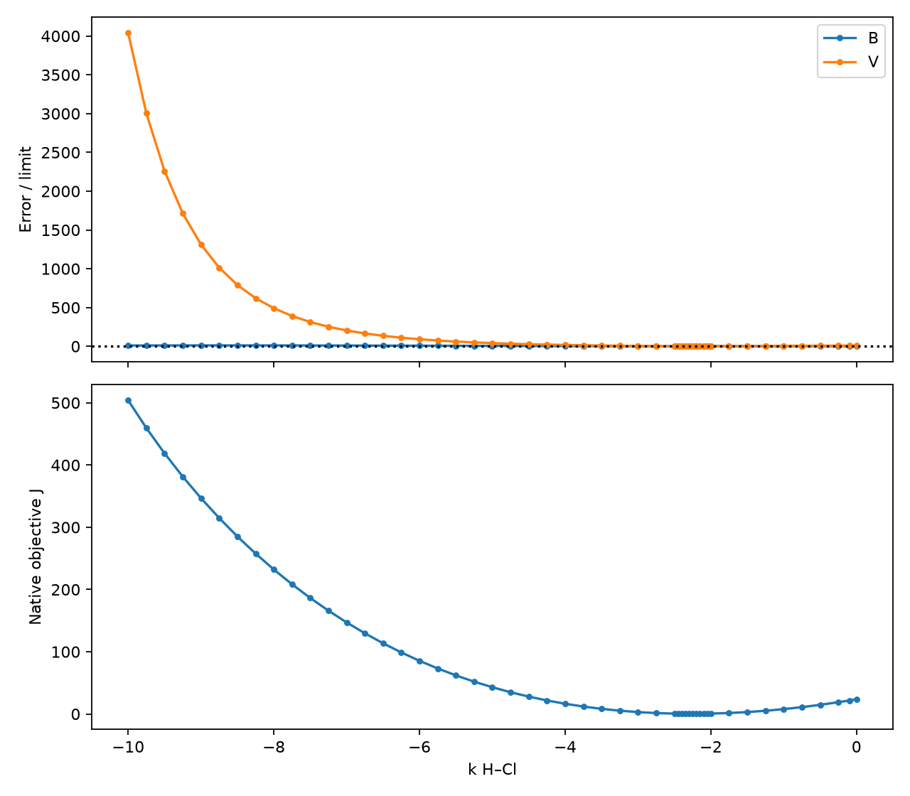
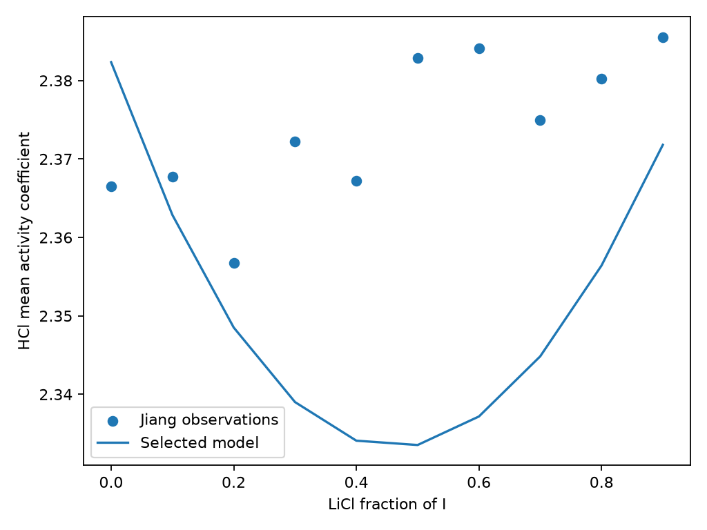

## Packet read-back preserves the inherited chloride results

The frozen hydrogen endpoint reproduced its retained predictions when loaded
from a staged parameter packet. All 25 compared result files were exactly
equal across the inherited chloride control, hydrogen extension and read-back
arms. The [preservation comparison](results/packet-readback-r4/preservation.json)
retains the file inventory. Copied input packets are excluded from this result
comparison; a separate document check verifies the inherited component, pair
and source prefixes and all other unchanged top-level fields.
The [admission record](results/packet-readback-r4/admission.json) confirms the
published parameter bytes equal the staged bytes. The
[outcome](results/packet-readback-r4/outcome.json) records the reached quantities.

All calculations used the declared temperature and pressure reported below. The loaded staged packet supplied
the parameters. Its [replay](results/packet-readback-r4/replay.json) matched all
70 fitted observations plus 14 adjusted-water guards of zero fitting weight,
and all 148 comparison rows, within the declared relative and absolute tolerances,
with matching availability and causes. The ten Jiang calibration rows were
also evaluated by the source evaluator and were kept separate from the
148 comparison rows. Fresh-process evaluations matched the reached values.
Every independent [binary and water bucket](results/packet-readback-r4/binary-guards.json)
passed with the metrics and limits reported below. The [14 numerical cases](results/packet-readback-r4/numerical.json)
passed; the largest log-activity identity error is reported below.



The following errors are calculated from the staged packet's read-back values.
HCl–water through 7 mol/kg and HCl–LiCl at ionic strength 5 are calibration.
The other mixture lines are report-only comparisons, with no accuracy pass/fail
rule. [Complete per-source and per-line errors](results/packet-readback-r4/accuracy.csv)
retain mean, worst and signed-mean errors, including pure-HCl endpoints scored
separately from mixtures.



The MgCl₂ mixtures are overpredicted on average: Roy's signed mean is about
+15.7%, with a worst absolute error about 52%. Some dilute lines have negative
signed means. HCl–LiCl underprediction grows with ionic strength, reaching
about −10% mean at 7 mol/kg. The two dispersion coordinates are one point
on a strongly correlated ridge, not a uniquely identified pair. These results
apply only at the declared temperature and do not support brines above the measured mixture
range, including 12.8–14.6 mol/kg. They provide calibration, comparisons with
measurements and numerical verification, without propagated measurement or
model uncertainty or independent physical validation. The read-back result
has not been independently reviewed or promoted for manuscript use.

Each arm executed the complete mixed-chloride realization inventory and the lithium
preservation calculations, including all 455 Yao realizations. The result files preserve
inherited predictions, metrics, failures and causes exactly. The staged
byte-identity admission passed and the hydrogen extension was published.
The exact physical-result comparison is numerical verification; it does not
revalidate inherited measurements or expand their scientific domain.

## The two existing H dispersion coordinates can meet the Jiang target

The declared profile found a **successful diagnostic candidate** under the
conditions below. All binary osmotic, binary activity and adjusted-water guards
pass, and the nine Jiang mixtures at $I=5$ meet the declared 5% mean and 10%
worst error targets. The selected guard table below also reports the pure-HCl
endpoint error separately. These values come from the retained profile,
not from the earlier two-coordinate identification screen.





This point changes only reciprocal H–water and H–Cl dispersion coefficients.
The inherited chloride basis and all H sizes and energy remain fixed. Native
Ceres fits the H–water coordinate conditionally at each fixed H–Cl value.
The five equal objective blocks are Hamer–Wu activity and osmotic coefficients
in two molality buckets plus the ten Jiang $I=5$ rows. The adjusted-water
comparison supplies guards and depends on Hamer–Wu; it is not independent
validation. The [frozen declaration](inputs/fit-declaration-issue-901.json)
identifies the accepted design, amendments and readiness by hash.



The [profile table](results/issue-901-profile-r2/profile.csv) contains 42 coarse
points and eight new refinement points. Every one of the three starts at each
point converged; all training and guard evaluations were available, finite and
numerically verified. No failed native trial was returned. The profile retained
both exact coordinate columns, density and reference diagnostics, fit costs,
conditional covariance, bound distances and iteration times. Fresh-process
[selected-point replay](results/issue-901-profile-r2/replay/training-comparison.csv)
and [source replay](results/issue-901-profile-r2/replay/summary.csv) agree within
the declared value allowances, with matching availability and causes.

Transfer accuracy remains limited. The selected point was frozen before any
comparison evaluation; repeating selection with comparison summaries unavailable
preserved it in the [invariance check](results/issue-901-profile-r2/selection-invariance.json).
The table reports mixtures separately from pure-HCl endpoints. Errors are
percent; each source's individual ionic-strength groups and endpoint rows remain
in the [transfer table](results/issue-901-profile-r2/transfer.csv). All comparison
rows passed numerical admission. Poor accuracy did not reject or replace the
candidate. These previously opened sources are report-only comparisons.



The [wall-time record](results/issue-901-profile-r2/wall-time.json) separates
native profile-process duration from preparation. Whole three-start call times
are retained in the [attempt table](results/issue-901-profile-r2/attempts.csv).
Individual-start wall times are unavailable; native per-iteration times are not
substituted for them. The optional pressure comparison was not run.



The signed objective-column correlation is the negative of the inverse-normal-matrix
correlation reported in the selected-point diagnostics below. Its absolute
magnitude is the same. Both exact columns remain strongly correlated:



This is a selected point on a ridge, not an identified parameter pair. Conditional
one-coordinate covariance gives no uncertainty in the fixed H–Cl coordinate;
no joint confidence interval or propagated measurement/model uncertainty is
reported. The finding is calibration and numerical verification with transfer
comparisons to measurements. It concerns the declared effective-H model at this
temperature, binary molality through 7 mol/kg and source ionic strengths through
7 mol/kg water. It does not establish arbitrary-mixture validity, global phase
stability, continuous-domain infeasibility, or a microscopic proton model.
It makes no concentrated TOP–FeCl₃ brine claim and changes no cation-mixing
record. No inherited coefficient was refitted. This profile selected the endpoint;
the subsequent read-back and preservation work published the parameter packet.
Independent delivered review and investigator promotion remain pending.

## Earlier joint trial: the sensitivity screen stopped optimization

The earlier joint calibration of $k_{H,w}$ and $k_{H,Cl}$ stopped before optimization:
the exact weighted residual columns fail the declared absolute-correlation
limit of **0.99** at every start. All predictions and exact columns are
available and finite; both column norms are positive. This is a numerical
information-screen result, rather than an optimized fit or physical validation.
The added mixture data do not separate these two interactions sufficiently
under the frozen objective and starting-point rule. No new hydrogen packet
is published.



Training now consists of 60 Hamer–Wu scalar targets (30 osmotic and 30 mean
ionic activity coefficients) and all 47 corrected Roy mixtures. Roy is
**training**, with equal total weight per ionic-strength line; its eleven
pure-HCl endpoints have zero fitting weight and remain required checks.
The four Hamer–Wu property/concentration groups retain their original weights.
The native observation path carries the complete fixed mixture inventory,
with pure-water references evaluated separately and exact parameter derivatives.

No optimizer was run, so there is no fitted endpoint, endpoint identification,
training-accuracy result or confidence interval for this joint trial.
Khoo–Mg, Jiang–Li and Khoo–Ca remain unopened, in that frozen qualification
order. Their predictions, the full preservation replay and staged packet
read-back were not reached. The first failed rule is the pre-fit correlation
screen; later checks cannot change that disposition.

The owner's osmotic accuracy RMS limit remains **0.011** in each binary
bucket, with maximum absolute error **0.03**. The fitted osmotic residual
scale remains **0.01**. All other declared limits remain unchanged.
The earlier single-coordinate calibration and Roy failure below are historical
comparisons; Roy no longer supplies held-out qualification for this joint trial.

The retained conditions and previously evaluated Roy inventories give the
training domains below. Analytical molalities are per kilogram of water;
all states are fully dissociated.



These bounds do not qualify arbitrary mixtures throughout that range.
The screen supplies local numerical information, not parameter uncertainty or
proof of global non-identifiability. TOP–FeCl₃ brines at 12.8–14.6 mol/kg,
other temperatures and additional ions are not covered.

## Earlier binary calibration and reserved Roy comparison

The selected effective hydrogen-ion model passes the binary comparisons under
the owner's relaxed osmotic root mean square (RMS) error limit of **0.011**, up
from **0.010**. All other limits are unchanged. It fails the first held-out
mixture source: Roy et al.'s HCl–MgCl₂ measurements. Across 47 true mixtures,
activity-coefficient mean and maximum absolute relative errors are
reported as the values in the source table below, against limits of **5%** and **10%**.
The chloride basis therefore has no adopted hydrogen records or `/3` packet.

The calculation uses the selected H–water endpoint and $k_{H,Cl}=0$, with the
fixed hydrogen dimensions and energy in the
[parameter declaration](inputs/fit-declaration-issue-798-r2.json).
The endpoint was selected by the lowest binary fitting cost before mixture
qualification. It was reused without fitting again or adding starts.
The zero H–Cl correction is a modelling assumption that retains geometric-mean
cross attraction; it does not identify a microscopic proton interaction.

The retained conditions below give temperature and liquid pressure; the
source table gives both liquid pressures used for the comparison.


 The calibration domain is at most
**7 mol/kg water**. The held-out Roy source reaches ionic strength 5 mol/kg.
These results do not cover concentrated extraction brines or other temperatures.

## Binary calibration and adjusted water activity

The 60 retained Hamer–Wu predictions cover 30 binary states. The two RMS
comparisons pass under the relaxed limit; they failed under the former 0.010
limit. The fitted objective and its 0.01 osmotic residual scale were unchanged.
The activity-coefficient errors below are percentages; osmotic errors are
dimensionless. Maximum osmotic error remains limited to 0.03, and activity
mean/maximum absolute relative errors remain limited to 2%/5%.



The 14 adjusted Messnaoui water-activity rows also pass, separately in both
buckets. RMS and maximum absolute error limits remain 0.003 and 0.006.



The [water rows](results/binary-water-qualification/native/water.csv) preserve
measured and adjusted $K$, original and adjusted water activity and osmotic
coefficient, predictions, signed errors and liquid-density evidence.
The correction uses the retained adjusted water activity directly; it was
neither reconstructed nor fitted. Its lineage includes the Hamer–Wu evaluation,
so this is not independent physical validation. The source's uncertainty
footnote assigns about 0.0005 above water activity 0.95 and 0.002 below it;
molality and temperature standard uncertainties are 0.01 mol/kg and 0.02 K.
These were not propagated into parameter or prediction intervals.

Original Messnaoui water errors can be obtained from the same predictions and
preserved original targets. The
[report-only water predictions](results/binary-water-qualification/report-only/report.csv)
cover the 14 El Guendouzi rows and nine Hamer–Wu extrapolation states at 8–16
mol/kg. Those extrapolations do not extend the qualified domain. Parenthesized
source $K$ values were not parsed as numbers. These report-only comparisons
supply no rejection rule and cannot rescue a failed required comparison.

## Numerical verification before qualification

The [numerical cases](results/binary-water-qualification/numerical/numerical.csv)
compare scalar and full-solute binary log activity coefficients at molality
0.001, 0.2, 1, 3 and 7 mol/kg, then finite and trace HCl in LiCl, MgCl₂ and
CaCl₂ backgrounds. Every log-activity identity difference is below the declared numerical limit;
the numerical summary below gives the largest difference and its limit.


The mixed-solution comparison uses the finite fugacity/reference identity
only for verification; native full-solute activity supplies predictions.
The analytical inventory retains common chloride and electroneutrality,
with total solute-species molality for normalization.
Required densities and pressure slopes are finite and positive. Density
closure residuals and reference-solvent density residuals are retained.
The reference uses analytic insertion, with no dilution-sequence convergence
error. The native owner supplies the solvent-state density closure record.

A [fresh-process replay](results/binary-water-qualification/cold/equivalence.json)
returns identical numerical-case values and identical values, availability and causes for
all 14 adjusted-water states and 23 report-only binary states. These binary
replays now run before the Roy source read; the first delivery omitted them.
The per-value differences and frozen allowances are retained in the
[adjusted-water comparison](results/binary-water-qualification/cold/native/comparison.csv)
and [report-only comparison](results/binary-water-qualification/cold/report-only/comparison.csv). All 60 direct selected-parameter
training predictions agree with their retained counterparts within the
ALG-FIT relative/absolute allowances, including the dilute osmotic allowance.
The [training comparison](results/binary-water-qualification/cold/training-comparison.csv)
retains each difference and its allowance. This is numerical verification,
not a measurement comparison. Historical old/new scalar evidence remains
separate in [the earlier comparison](results/r3/activity-verification.csv).

## First held-out source and stopping point

Roy et al., Table I, pp. 912–913, supplies 47 true mixtures and 11 separately
scored pure-HCl endpoints. Its ionic-strength fraction is
$y_B=3m_{MgCl_2}/I$, with $m_{HCl}=I(1-y_B)$.
Source-reported derived HCl activity coefficients are used directly. All 58 rows
were rechecked visually against the printed 25 °C columns; eight fields in
five rows were corrected, including the last background fraction at
ionic strength 2.5 mol/kg. The [transcription record](results/binary-water-qualification/roy-transcription.json)
identifies every correction and the source PDF hash. Predictions at both
pressures were regenerated without refitting.
The retained rows preserve cell potential, source locator, standard potential
at the stated temperature (retained in the source rows), and the one-atmosphere hydrogen-gas convention.
Liquid pressure is compared separately, reconstructing references at each
pressure. No electrode offset was fitted.



Neither whole-source nor fixed-ionic-strength decisions change with liquid
pressure. The pressure differences are retained for every source row. The eleven
pure-HCl endpoints pass the pooled 2% mean / 5% maximum limits. The
largest endpoint error (at ionic strength 3 mol/kg) is below the 5% maximum; no
per-endpoint 2% rejection applies.
The true-mixture whole-source failure already rejects qualification.

[Signed source errors](results/binary-water-qualification/roy/100000/errors.csv),
[pressure differences](results/binary-water-qualification/roy/pressure-differences.csv)
and the [source hash](results/binary-water-qualification/roy-open.sha256)
retain the reached comparison. Roy quotes approximately 0.0006 uncertainty
in $\log_{10}\gamma$; no row-specific uncertainty model or uncertainty
propagation was added. The model error here is much larger than that scale.

Execution stopped at this failure. The subsequent Khoo HCl–MgCl₂, Jiang
HCl–LiCl and Khoo HCl–CaCl₂ sources remain unopened. A matched Roy cold
comparison, historical chloride preservation replay, staged packet writing,
read-back and promotion were not reached. No packet was written.
The [outcome](results/binary-water-qualification/outcome.txt) and
[execution identities](results/binary-water-qualification/execution-identity.json)
identify the retained calculation.

Binary agreement is calibration evidence; Roy is held-out qualification that
fails the declared model-accuracy limits. The result supports rejection of
this endpoint for the declared mixture use. It does not establish global
infeasibility, physical model failure, parameter confidence intervals,
microscopic proton structure or measured mixture water-property accuracy.
