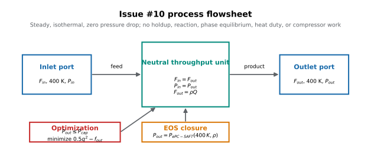
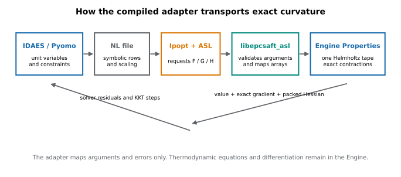
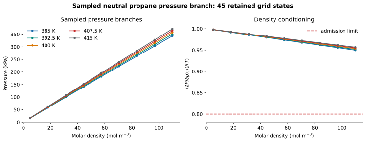
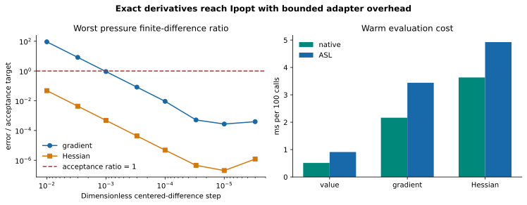
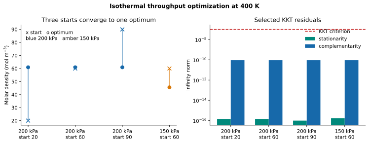

## Question

Does the bounded neutral propane IDAES adapter transport exact native pressure
curvature through ASL and solve the declared six-variable, four-row throughput
model on the sampled positive-slope branch?

## Retained inputs

| Quantity | Retained value |
|---|---|
| Packet | Gross–Sadowski 2001 propane, version 2 |
| Physical parameter tuple | Labeled below from the retained summary |
| Process temperature | 400 K, fixed at both ports |
| Adapter domain | 385–415 K, 5–110 mol/m³ sampled grid |
| Native-only dilute reference domain | 400 K, 0.001–1 mol/m³ |
| Process variables | `f_in`, `f_out`, `p_in`, `p_out`, `r`, `q` |
| Process rows | flow, pressure, volume, EOS pressure |

The exact packet, wheel, ASL library, executable, and option identities are
retained in `results/summary.json`; independent-reference values are retained
once in `results/references.csv`.

## Method and recalculation boundary

The Engine owns the common Helmholtz calculation, pressure derivatives, and
CppAD third-order contractions. The ASL library exposes the compiled evaluator;
IDAES/Pyomo owns only the process rows, explicit unit scaling, and solver call.
The retained campaign used Ipopt exact curvature and the solver-consumed
symbolic-label `.nl/.row/.col` files for the whole-NLP checks.

This notebook is a read-only view. It reads retained JSON and CSV outputs only;
it does not build a wheel, load ASL, invoke IDAES, call Ipopt, or recalculate
any numerical result.

```{python}
#| echo: false
#| output: asis
import csv
import json
from pathlib import Path

results = Path("results")
summary = json.loads((results / "summary.json").read_text())
with (results / "references.csv").open(newline="") as stream:
    references = list(csv.DictReader(stream))
with (results / "process.csv").open(newline="") as stream:
    process = list(csv.DictReader(stream))
with (results / "lagrangian.csv").open(newline="") as stream:
    lagrangian = list(csv.DictReader(stream))
with (results / "cost.csv").open(newline="") as stream:
    cost = list(csv.DictReader(stream))

print("| Parameter | Value | Unit |")
print("|---|---:|---|")
parameter_labels = (
    ("Segment count, m", "dimensionless"),
    ("Segment diameter, sigma", "angstrom"),
    ("Dispersion energy, epsilon/k", "K"),
    ("Molar mass", "kg/mol"),
)
for (label, unit), value in zip(parameter_labels, summary["parameter_strings"], strict=True):
    print(f"| {label} | {value} | {unit} |")
print()
print("| Artifact | Retained identity |")
print("|---|---|")
print(f"| Status | {summary['status']} |")
print(f"| Source commit | `{summary['source_commit'][:12]}` |")
print(f"| Wheel SHA-256 | `{summary['wheel_sha256'][:16]}...` |")
print(f"| ASL library SHA-256 | `{summary['asl_library_sha256'][:16]}...` |")
print(f"| Reference / process rows | {len(references)} / {len(process)} |")
print(f"| Whole-NLP directional rows | {sum(row['kind'] == 'directional' for row in lagrangian)} |")
print(f"| Retained cost rows | {len(cost)} |")
```

## Process flowsheet

{fig-alt="Feed enters a steady neutral throughput unit and leaves at the same temperature and pressure. An ePC-SAFT pressure closure connects outlet density to pressure."}

The unit has two degrees of freedom before optimization. The pressure cap fixes
the highest feasible density; the objective then selects the matching interior
volumetric flow. No equilibrium calculation occurs anywhere in this example.

## Adapter path

{fig-alt="IDAES and Pyomo write the nonlinear model, Ipopt requests function gradients and Hessians through ASL, the adapter maps arguments to Engine Properties, and exact results return to Ipopt."}

The adapter is intentionally thin: it validates two real state arguments and
four immutable parameter strings, then asks the Engine's existing Helmholtz tape
for the requested order. Pyomo owns the process algebra; the Engine owns the
thermodynamics and exact differentiation.

## Sampled pressure branch

{fig-alt="Pressure increases with density at five temperatures. The pressure-density derivative divided by RT stays above the 0.8 admission limit at all sampled states."}

The left panel shows the 45 retained model evaluations, not experimental data.
The right panel is the branch-admission check: every sampled
$(\partial P/\partial\rho)_T/(RT)$ remains above 0.8.

## Derivatives and adapter cost

{fig-alt="Worst pressure gradient and Hessian errors decrease under centered-difference refinement and enter the accepted region after intentionally failing coarse probes. Warm ASL evaluations cost more than direct native calls, especially for Hessians."}

The convergence panel reports the worst error-to-target ratio across all retained
pressure states and directions at each step. Coarse finite differences may fail;
the accepted adjacent-step and numerical-floor rules identify the resolved
region. Timing is for three retained 100-call batches on this machine and is not
a general speed claim.

## Process solution

{fig-alt="Three different initial densities converge to the same 200 kilopascal optimum, while a 150 kilopascal case converges to a lower density. Selected stationarity and complementarity residuals remain below the KKT criterion; additional checked residual classes are retained in results/process.csv."}

The three 200 kPa starts converge to the same state. The 150 kPa changed-cap case
lands at a lower density and flow, demonstrating that the EOS call changes the
process optimum rather than acting as a constant lookup.

## Key results

The visible result table below is generated from retained JSON/CSV values.

```{python}
#| echo: false
#| output: asis
accepted = sum(row.get("status") == "ok" and row.get("termination") == "optimal" for row in process)
directional = sum(row.get("kind") == "directional" for row in lagrangian)
transport = summary["derivatives"]["transport_passed"]
print("| Check | Retained result |")
print("|---|---|")
print(f"| Native/ASL value, gradient, Hessian transport | {transport} |")
print(f"| Scalar derivative ladders | {summary['derivatives']['derivative_ladders_passed']} passed |")
print(f"| Whole-NLP Lagrangian-Hessian ladders | {summary['whole_nlp']['cases']} passed; {directional} step rows |")
print(f"| Maximum whole-NLP scaled error | {summary['whole_nlp']['maximum_scaled_lagrangian_hessian_error']} |")
print(f"| Invalid density and changed immutable inputs | {summary['invalid_domain_rejected']} / {summary['immutable_input_rejected']} |")
print(f"| Process starts and changed cap | {accepted}/{summary['process_cases']} optimal |")
print(f"| Independent references | {summary['references']['row_count']} rows; {summary['references']['all_passed']} |")
print(f"| Conditioning margin | {summary['conditioning_grid']['pressure_slope_over_rt_min']} |")
```

The three starts at 200 kPa and the changed cap at 150 kPa produce the following
retained solutions. These are illustrative process optima at 400 K.

```{python}
#| echo: false
#| output: asis
print("| Cap (kPa) | Pressure (kPa) | Start density (mol/m³) | Density (mol/m³) | Flow (mol/s) | Q (m³/s) | Primal | Stationarity | Complementarity |")
print("|---:|---:|---:|---:|---:|---:|---:|---:|---:|")
for row in process:
    print(f"| {float(row['cap']) / 1000:g} | {float(row['P']) / 1000:.6f} | {float(row['start_rho']):g} | {float(row['rho']):.8f} | {float(row['F']):.9f} | {float(row['Q']):.9f} | {float(row['primal_residual_inf']):.3g} | {float(row['stationarity_inf']):.3g} | {float(row['complementarity_inf']):.3g} |")
```

Cold setup includes mixture preparation and the first tape recording. Warm
times below are medians of three measured batches of 100 evaluations across
the nine retained states; timings describe this machine and run only.
The current replay shared the host with the fixed-feed and interruption
checks. The timing comparison is descriptive and does not establish a
performance change across Engine revisions.

```{python}
#| echo: false
#| output: asis
print("| Path | Cold setup (ms) | Warm value (ms/100) | Warm gradient (ms/100) | Warm Hessian (ms/100) | Tape reuse |")
print("|---|---:|---:|---:|---:|---|")
for name, result in summary['cost'].items():
    times = [1000 * result['warm'][str(order)]['median_s'] for order in range(3)]
    print(f"| {name} | {1000 * result['cold_elapsed_s']:.3f} | {times[0]:.3f} | {times[1]:.3f} | {times[2]:.3f} | {result['recording_reuse_passed']} |")
print()
print(f"The post-entry cancellation probe observed Ipopt iteration zero and terminated its process group: {summary['failure_probe']['process_group_terminated']}.")
```

## Interpretation

The retained evidence supports the compiled neutral propane transport boundary
and the illustrative isothermal throughput solve on the declared sampled
branch. The process solution agrees with the independent reduced pressure-cap
reference, while the KKT and derivative-check records show that the solver
received the generated exact curvature.

The second-virial rows at 0.001–1 mol/m³ are native-only dilute-limit references.
They do not pass through ASL and do not widen the adapter's declared 5–110 mol/m³
sampled domain.

## Claim boundary

This is not a qualification of global phase stability, association,
electrolytes, phase equilibrium, reactive loading, or any Lithium application.
The sampled pressure-slope margin is a finite domain check, not a global
stability certificate.

## Current MUMPS campaign (#720)

The external Ipopt 3.14.19 and explicit MUMPS complete the current campaign on
`ca719012`. The older selected Ipopt 3.13.2 lacks five required options. All
original numerical criteria pass with the suitable executable. These results
verify the bounded neutral-propane calculations and derivative transport;
they supply no electrolyte, phase-stability or application validation.

```{python}
#| echo: false
current = json.loads(Path('results/issue-720/summary.json').read_text())
print(json.dumps({k: current[k] for k in ('ipopt_version', 'asl_version', 'solver_options',
    'conditioning_grid', 'derivatives', 'whole_nlp', 'process_accepted', 'process_cases')}, indent=2))
```

[The summary](results/issue-720/summary.json), [domain](results/domain.csv),
[references](results/references.csv) and
[process](results/issue-720/process.csv) retain the values. Full derivative tables
and logs remain in `build/issue-720/idaes-explicit-mumps/`. The external solver
environment stays outside the repository; every retained solver log selects
MUMPS. No historical reference was replaced.
