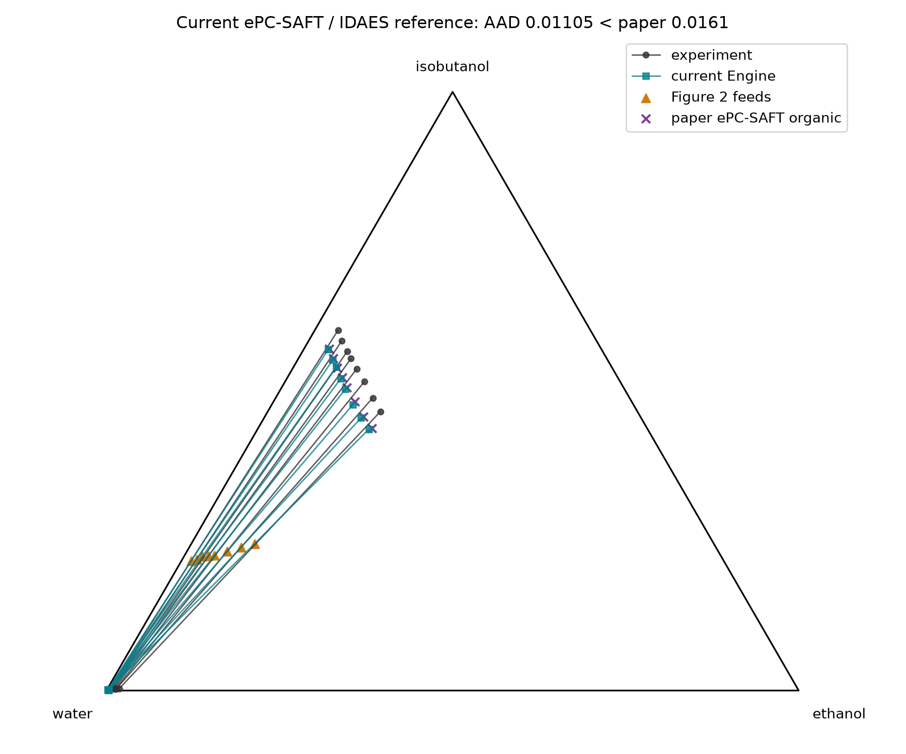
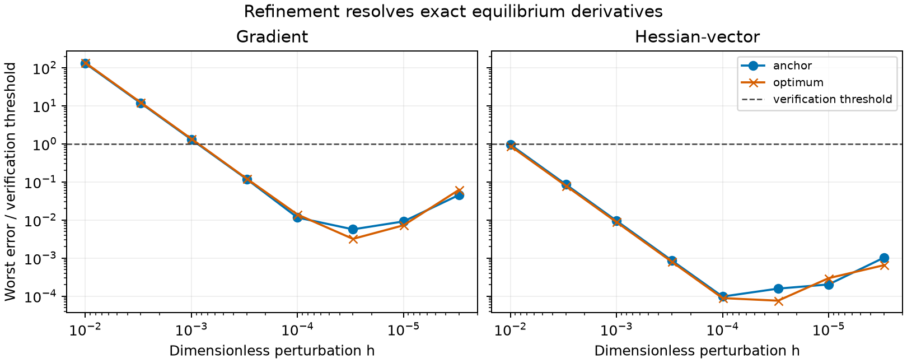

```{python}
#| echo: false
import csv
import json
import sys
from pathlib import Path

sys.path.insert(0, "scripts")
import check_records as declared  # declared F1-F4 inputs only; nothing is solved here

results = Path("results")


def rows(path):
    with (results / path).open(newline="") as stream:
        return list(csv.DictReader(stream))


qualification = json.loads((results / "fixed-feed/qualification.json").read_text())
point4 = next(r for r in rows("fixed-feed/stage-results.csv") if r["point_id"] == "4")
factor = 1.0 + float(point4["feed_formula_nacl"])
live = json.loads((results / "live/summary.json").read_text())
identity = json.loads((results / "live/identity.json").read_text())
probes = {f["case"]: f for f in live["failures"]}
controls = {  # each failure probe's ASL controls (water, ethanol, isobutanol, NaCl), mol, from its retained log
    name: ", ".join(f"{float(v):g}" for v in (results / f"live/failure-{name}.log").read_text().split("controls=")[1].split()[0].split(","))
    for name in ("boundary", "unavailable")
}
baseline, cases = live["baseline"], live["optimization"]
best = cases[0]
text = (results / "live/record.netstrings").read_text()
tokens, i = [], 0
while i < len(text):
    j = text.index(":", i)
    tokens.append(text[j + 1 : j + 1 + int(text[i:j])])
    i = j + 2 + int(text[i:j])
k = tokens.index("anchor_controls")
anchor = [float.fromhex(t) for t in tokens[k + 2 : k + 2 + int(tokens[k + 1])]]
inlet = [anchor[0], anchor[1], anchor[2] * best["si"], anchor[3] * best["ss"], anchor[3] * best["ss"]]
records = json.loads((results / "live/records/summary.json").read_text())
comparisons, errors, files, timings = (rows(f"live/records/{name}.csv") for name in ("comparisons", "errors", "files", "timings"))
loads = {
    p.stem: float(p.read_text().split(" load ")[1].split()[0]) for p in sorted((results / "live/records/lithium").glob("*.log"))
}
```

## Flowsheet and ownership

### Selected live result

Issue #832 selects the current retained #461 rerun in `results/live/` for
delivered review and subsequent investigator promotion. The notebook and
README use that same rerun. No optimization or Engine calculation was
repeated for this selection. The older promoted result at
`4dada5de086446d3fb7cf68ad75df7c658c8251d` remains historical; its tighter
stationarity bound in the manuscript applies only to that older result and
must not be attached to the selected rerun.

The selected records include the baseline and all starts, full outlet flows,
named multipliers, residuals, solver logs, nonlinear programs, derivative
transport, refinement ladders, endpoint certificates and failure probes.
The record hash and repeated identity below link those numerical records to
the historical wheel and callback library. The stored stationarity residuals
are reported as retained reconstruction results, without claiming a new
independent reconstruction here.

```{python}
#| echo: false
#| output: asis
import hashlib
assert live['identity'] == identity
assert hashlib.sha256((results / 'live/record.netstrings').read_bytes()).hexdigest() == identity['record_sha256']
for name, entry in zip(('baseline', 'start-0.9', 'start-1.0', 'start-1.1'), (baseline, *cases), strict=True):
    for filename, key in (('stage.nl', 'nl_sha256'), ('ipopt.opt', 'option_file_sha256')):
        assert hashlib.sha256((results / 'live' / name / filename).read_bytes()).hexdigest() == entry[key]
    assert (results / 'live' / name / 'ipopt.log').is_file()
for entry in live['failures']:
    assert (results / f"live/failure-{entry['case']}.log").is_file()
print(f"Selected source `{identity['source_commit']}`, wheel SHA-256 `{identity['engine_wheel_sha256']}`, "
      f"callback SHA-256 `{identity['library_sha256']}`. Retained maximum optimization stationarity: "
      f"{max(v['stationarity'] for v in cases):.12g}; objective: {best['objective']:.16g}.")
```

This is local numerical verification at the declared fixed temperature,
pressure and two-liquid branch. Record completeness permits review; it does
not establish independent review, promotion, physical validation or a global
optimum. The fixed-feed and multiple-record studies elsewhere in this
notebook retain their own execution identities.

The current Engine solves a declared water-rich and isobutanol-rich liquid
split for each fixed feed. IDAES receives the accepted phase amounts and
compositions as immutable parameters and maps them to two outlet ports. Engine
thermodynamics are not duplicated inside the process model.

```text
feed -> current ePC-SAFT equilibrium -> fixed IDAES settler -> aqueous outlet
                                                        `-> organic outlet
```

The eight square IDAES models have zero degrees of freedom and close component
flow, charge, total phase flow, phase fraction, and composition to their stated
tolerances.

```{python}
#| echo: false
#| output: asis
stages = rows("fixed-feed/stage-results.csv")
print(f"| Largest retained residual over the {len(stages)} phase rows | Maximum |\n|---|---:|")
for label, column, unit in (
    ("Engine explicit-species material balance", "engine_material_balance_max_abs", " mol"),
    ("Engine phase charge", "engine_phase_charge_max_abs", ""),
    ("Engine pressure relative residual", "engine_pressure_max_relative", ""),
    ("Engine classified equilibrium residual", "engine_classified_residual_max_abs", ""),
    ("IDAES component balance", "idaes_component_balance_max_abs", " mol/s"),
    ("IDAES charge residual", "idaes_charge_residual_abs", " mol/s"),
    ("IDAES phase-flow closure", "idaes_phase_flow_closure_abs", " mol/s"),
    ("IDAES composition mapping", "idaes_composition_max_abs", ""),
):
    print(f"| {label} | {max(abs(float(r[column])) for r in stages):.2e}{unit} |")
```

The retained rows use packet v7, which restores the Gross–Sadowski 2002 Eq. 3
size factor in the three unlike association volumes, and installed wheel
`ad12b19fcd8b3b4a87c355490386ecc911485ac1efc4b7a3f547e2393f803e46`.
Relative to packet v6 the phase compositions move by up to `0.00807` in mole
fraction.

The reference has one mole per second of explicit species. A live consumer
using one mole per second of formula species must multiply outlet amounts by
`1 + z_NaCl`; at point 4 this factor is `{python} f"{factor:.16f}"`. This gives
organic ethanol flow `{python} f"{baseline['flows'][6]:.12g}"` mol/s and
recovery `{python} f"{baseline['recovery']:.12f}"`.
The conversion changes extensive amounts while preserving phase compositions
and recovery.

## Thermodynamic comparison



The calculation uses explicit sodium and chloride species. For comparison with
the paper, one NaCl formula amount is `(x_Na+x_Cl)/2`; water, ethanol,
isobutanol, and NaCl are then renormalized to the four-component formula basis.
The resulting `{python} qualification["counts"]["formula_comparisons"]`-coordinate
grand AAD is `{python} f"{qualification['grand_formula_aad']:.7f}"`, below the
paper's reported ePC-SAFT grand AAD of
`{python} f"{qualification['paper_epcsaft_grand_aad']:g}"`. The digitized
paper-model organic branch comparison has AAD
`{python} f"{qualification['paper_organic_salt_free_aad']:.7f}"` and maximum
absolute deviation `{python} f"{qualification['paper_organic_salt_free_max_abs']:.7f}"`.
The packet v6 values without the size factor are historical and kept in the
[README](README.md#positive-result).

## Decision and limits

This is a positive thermodynamic and IDAES reference for the current Engine on
the stated fixed-feed local branch. It demonstrates that the current
contributions, properties, equilibrium solver, and process mapping reproduce
the source paper's correlation-scale behavior closely enough for this bounded
adapter example.

It is not independent predictive validation or agreement within measurement
uncertainty. It does not establish global phase stability, a differentiable
in-solver callback, optimization, reactions, or Lithium Extraction chemistry.

## Live exact-Hessian feasibility result

The separate [live result](results/live/summary.json) replaces
the fixed outlet factors with compiled Engine phase-component responses.
At `{python} point4["temperature_K"]` K and 100 kPa, it minimizes normalized
isobutanol and salt use, $s_i+s_s$, subject to at least 96.5% ethanol recovery
in the organic outlet. Water and ethanol feeds remain fixed;
$0.85\leq s_i,s_s\leq1.15$.

The retained run is the 2026-10-13 rerun on main (#461). It used the non-editable wheel with SHA-256
`{python} identity["engine_wheel_sha256"]` and the installed ASL library with SHA-256
`{python} identity["library_sha256"]`, at source commit `{python} identity["source_commit"][:8]`
(tree clean: `{python} not identity["source_dirty"]`). It passed all seven #76 falsifiers using the v3 mapped
transport record required by parent #66 (record SHA-256 `{python} identity["record_sha256"]`). The record is
unchanged from the 2026-09-25 packet-v7 replay. Values differ from that replay only at roundoff, from Engine changes
made since (#461).

| Quantity | Packet v7 result |
|---|---:|
| Isobutanol multiplier $s_i$ | `{python} f"{best['si']:.12f}"` |
| NaCl multiplier $s_s$ | `{python} f"{best['ss']:.12f}"` |
| Objective $s_i+s_s$ | `{python} f"{best['objective']:.12f}"` |
| Organic ethanol recovery | `{python} f"{best['recovery']:.12f}"` |
| Maximum independent stationarity residual | `{python} f"{max(c['stationarity'] for c in cases):.2e}"` |
| Maximum complementarity residual | `{python} f"{max(c['complementarity'] for c in cases):.2e}"` |
| Maximum component closure, mol/s | `{python} f"{max(c['material'] for c in cases):.2e}"` |

The final explicit-species split below uses the first start's retained optimum.
All entries are mol/s on the one-second basis; displayed digits are rounded,
while the closure check uses the full-precision retained values.

```{python}
#| echo: false
#| output: asis
names = ("Water", "Ethanol", "Isobutanol", "Na$^+$", "Cl$^-$")
print("| Component | Inlet | Aqueous outlet | Organic outlet |\n|---|---:|---:|---:|")
for i, name in enumerate(names):
    print(f"| {name} | {inlet[i]:.12g} | {best['flows'][i]:.12g} | {best['flows'][5 + i]:.12g} |")
```

Three starts give this same local optimum; Ipopt consumes exact Jacobians and
Hessians and reports no derivative-check errors. This is numerical feasibility
on the declared branch, not a global optimum or physical validation. A table
is sufficient for these scalar results; no new curve is inferred from three
converged points.



The `{python} f"{len(rows('live/transport.csv')):,}"` public/ASL transport
comparisons are identical. The `{python} f"{len(rows('live/ladders.csv')):,}"`
refinement rows and `{python} len(rows('live/endpoints.csv'))` endpoint
certificates retain both coarse disagreement and refined agreement. The plot
shows the worst error divided by the reused neutral-analysis threshold for all
ten outputs and eight directions; that threshold is at least as strict as the
unit-floor reporting rule. This is numerical verification, not measurement
uncertainty. Full Jacobian rows and the raw-decision row and Lagrangian
Hessians agree with the public response to
`{python} f"{max(c['nl_transport_max_abs'] for c in cases):.2e}"`. Named KKT
multipliers and `{python} len(live["failures"])` isolated probes are retained. The `determinism` probe checks that
cold, warm and reordered requests agree; each of the other
`{python} sum("cache_recovery_fgh" in f for f in live["failures"])` returns its expected typed failure and recovers
the cache.

The two topology fixtures were replaced in #461. Their earlier conditions, isobutanol control 0.001 mol and ethanol
control near zero, solve since solver changes #370 and #174.

- **`boundary`.** The controls are (`{python} controls["boundary"]`) mol. The #461 diagnosis found positive TPD for the
  single liquid there against salt-free trial phases and the electrolyte trials tested, so the declared
  isobutanol-rich phase vanishes. Stability against ionic trial phases is not certified: the native stability tools
  refuse them for this permittivity model. The probe returns
  `{python} probes["boundary"]["error"].split(":", 1)[1]`.
- **`unavailable`.** The feed is salt only, with controls (`{python} controls["unavailable"]`) mol. The solve
  returns "rank-deficient declared equations" without a state, and the probe returns
  `{python} probes["unavailable"]["error"].split(":", 1)[1]`. The cause, two liquids of pure NaCl with undetermined
  amounts, is inferred, not inspected.

These are failure meanings, not operating states.

The dependency diagnosis is decisive: mixing Engine's Ipopt 3.11.9 with the
outer Ipopt 3.14.19 crashes. The selected isolated IDAES Ipopt 3.13.2 executable
leaves Engine's system dependency unchanged and accepts the complete frozen
options through its native option file. No tolerance or native reference was
changed. On the packet-v7 wheel the installed-wheel `bash tools/check-all.sh`
gate passed 96 Python tests, the native suites, packet validation, Ruff, mypy,
analysis layout (64 leaves), and architecture checks; the discarded 3.14 build
and its failures remain diagnosis evidence. The
[live README section](README.md#live-exact-derivative-callback) links the exact
wheel, raw results, dependency diagnosis and reproduction commands.

An independent review supported the 2026-09-25 replay; the 2026-10-13 rerun has not been independently
reviewed. This result
does not qualify manuscript use, physical extraction, reactive HBTA/TOPO
chemistry or a Lithium IDAES flowsheet.

## Several immutable records in one ASL process (#452)

**Question.** Can one process hold several distinct immutable equilibrium
records, each prepared once, and return for each record exactly the values and
exact derivatives it returns when run alone?

**Result.** Yes, on the changed wheel, for the records and call sequences
below. Every value, gradient and packed Hessian entry of
`{python} sum(r["check"] == "F1" and r["wheel"] == "slice" for r in comparisons)`
interleaved calls equals the same record's single-record call bitwise.
Each record is prepared once, and the
`{python} records["observations"]["slice"]["prepared"]["limit"][-1] + 1`th
distinct record was refused on these #452 wheels; #825 later removed that
ceiling, and the current F4 check admits 17 distinct records and evaluates all
17 again without re-preparation. Single-record results are bitwise unchanged between
the main and changed wheels. This is numerical verification of the callback,
not physical validation.

| Record | Species (packet v7) | Controls, mol | Conditions | Phase identity |
|---|---|---|---|---|
| A | water, ethanol, isobutanol, Na$^+$, Cl$^-$ | 4: the live anchor F0 and F0·(1, 1, 0.95, 0.95) | `{python} point4["temperature_K"]` K, 100 kPa | water, gap 0.001 |
| B | water, isobutanol | 2: G0 = `{python} declared.G0` and G1 = `{python} declared.G1` | `{python} declared.B_TEMPERATURE_K` K, `{python} f"{declared.B_PRESSURE_PA / 1e3:g}"` kPa | isobutanol, gap 0.1 |

The F1 sequences hold `{python} len(declared.MODES["A"])` calls of A and
`{python} len(declared.MODES["B"])` of B at orders 0 and 2 in forward and
reversed row order; the interleaved mode alternates them, switching record
`{python} sum(a[1] != b[1] for a, b in zip(declared.MODES["AB"], declared.MODES["AB"][1:]))`
times. F4 uses B with continuation `max_steps` from 4 upward; anchor calls
never continue. Each mode is a fresh single-threaded process making raw
`_ARGLIST` calls; only the requested real-control derivative blocks are read.

```{python}
#| echo: false
#| output: asis
labels = {
    "preflight": "Preflight: A and B finite at every call",
    "F1": "F1: interleaved equals single-record, bitwise",
    "F2": "F2: preparation lines 1, 1 and 1, 2",
    "F3 errors-A": "F3: errors on A alone, then recovery",
    "F3 errors-B": "F3: errors on B alone, then recovery",
    "F3 errors-AB": "F3: errors with A and B resident, then recovery",
    "F3 errors-AB prepares no third record": "F3: no third preparation",
    "F4": "F4 (#452 historical): 16 admitted, 17th refused, B0 recovers",
}
mark = {True: "pass", False: "fail"}
print("| Criterion | Main wheel | Changed wheel |\n|---|---|---|")
for key, label in labels.items():
    print(f"| {label} | {mark[records['outcomes']['main'][key]]} | {mark[records['outcomes']['slice'][key]]} |")
```

On the main wheel the failures are the limitation under test: all
`{python} records["observations"]["main"]["AB_B_calls_rejected_as_record_changed"]`
B calls of the interleaved mode return NaN with
`defining_equations_not_satisfied` and diagnostic
`immutable equilibrium record changed`, no preparation line exists, and the
resident-record F3 and F4 setups cannot be reached. Its single-record error
modes give the same statuses as the changed wheel.

The changed wheel's error calls keep their typed statuses; each error leaves
every output nonfinite, and each record afterwards recovers its first anchor
evaluation bitwise (allowed: the probe recovery tolerance of
`run_live_settler.py`).

```{python}
#| echo: false
#| output: asis
print("| Mode | Call | Record | Errmsg | Diagnostic | As expected |\n|---|---|---|---|---|---|")
for r in errors:
    if r["wheel"] == "slice":
        print(f"| {r['mode']} | {r['tag'] or 'limit'} | {r['record']} | `{r['errmsg']}` | {r['diagnostic']} | {r['match']} |")
```

```{python}
#| echo: false
#| output: asis
single = [r for r in comparisons if r["check"] == "single-record"]
entries = sum(len(r["a"].split()) for r in single)
print(
    f"Single-record checks. In modes A and B, {sum(r['bitwise'] == 'True' for r in single)} of {len(single)} calls "
    f"({entries} values and derivative entries) are bitwise equal between wheels. "
)
for campaign in ("khudaida", "lithium"):
    group = [r for r in files if r["campaign"] == campaign]
    print(f"{campaign.capitalize()}: {sum(r['equal'] == 'True' for r in group)} of {len(group)} file comparisons equal. ", end="")
print()
```

The Khudaida campaign is the live campaign without the `boundary` and
`unavailable` probes (#461): its tables and record are byte-identical,
`summary.json` is equal after removing identity, timing and output-path fields,
and each probe log gains exactly one preparation line. In the malformed-record
probe the diagnostic becomes the record's own parse message
(`trailing equilibrium record data`). The Lithium v1.0 HBTA/TOPO reactive
replay (tag commit `d1460923`, isolated environment) was run main, changed,
main, changed, main; all 13 units are accepted in every run and every JSON, CSV,
option and record file is equal after removing `*_s` timing keys and the
Engine library identities.

```{python}
#| echo: false
#| output: asis
runs = ("main-1", "slice-1", "main-2", "slice-2", "main-3")
print("| Lithium unit, s | " + " | ".join(runs) + " |\n|---|" + "---:|" * len(runs))
print("| Load average at start | " + " | ".join(f"{loads[r]:.1f}" for r in runs) + " |")
for r in timings:
    if r["file"] == "campaign.json" and (r["key"] == "elapsed_s" or r["key"].startswith("units.")):
        print(f"| {r['key'].removeprefix('units.').removesuffix('.elapsed_s')} | " + " | ".join(f"{float(r[x]):.1f}" for x in runs) + " |")
```

```{python}
#| echo: false
#| output: asis
units = [r for r in timings if r["file"] == "campaign.json" and (r["key"] == "elapsed_s" or r["key"].startswith("units."))]
mains = ("main-1", "main-2", "main-3")
for run in ("slice-1", "slice-2"):
    above = sum(float(r[run]) > max(float(r[m]) for m in mains) for r in units)
    below = sum(float(r[run]) < min(float(r[m]) for m in mains) for r in units)
    print(f"Run {run} is above the three main runs' range on {above} of {len(units)} rows and below it on {below}. ", end="")
print()
```

Timing is supporting evidence only. The first changed-wheel run started at the
highest load. Every result file of every run is identical after timing removal,
so both wheels did the same solver work; the wall-time differences are not
attributed to a cause. Three main samples give no statistical bound.

```{python}
#| echo: false
#| output: asis
print("| Identity | Main wheel | Changed wheel |\n|---|---|---|")
for key in ("wheel_sha256", "library_sha256"):
    print(f"| {key} | `{records['identity']['main'][key]}` | `{records['identity']['slice'][key]}` |")
for name in ("A", "B"):
    print(f"| record {name} SHA-256 | `{records['identity']['main']['record_sha256'][name]}` | `{records['identity']['slice']['record_sha256'][name]}` |")
```

**Limits.** Bitwise identity holds on one machine and build, for two records
and one call order per record. The #452 ceiling counted records (removed by #825); per-record memory is
unmeasured. The two records are Engine-owned examples, not Lithium's set C
chemistry; Lithium owns its set C replay after it re-pins. The raw per-call
values, error calls, stderr logs and comparisons are in
[results/live/records](results/live/records/summary.json). This section has
not yet been independently reviewed.
