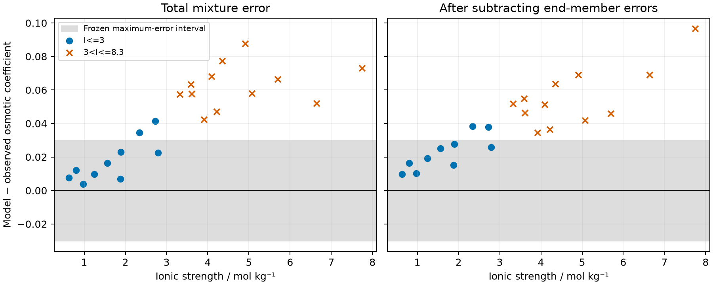



# Stage A: Li⁺ on the qualified chloride basis

The Li⁺ refit meets the trace-LiCl Harned bound and Lithium's activity-transfer
targets, but fails both held-out Yao LiCl–MgCl₂ buckets and the Hamer–Wu binary
guard. Subtracting the pure-salt end-member errors leaves a mixture error
above the same frozen limits. The unchanged KCl–CaCl₂ basis also fails its
held-out check. These stop conditions prevent a new parameter packet.
The evidence is native prediction against held-out measured osmotic
coefficients, together with comparisons between numerical activity models.
The fitted ion sizes have no physical-validation claim.



## Question and method

[Engine issue 640](https://github.com/tannerpolley/ePC-SAFT/issues/640) asks
whether refitting Li⁺ alone on the qualified Na⁺/Mg²⁺/Ca²⁺/Cl⁻ basis can
repair Li-bearing brines while preserving the accepted divalent activity
transfers. The binding design's route A trains on Hamer–Wu LiCl and
El Guendouzi LiCl–NaCl at equal total source weight, holds out Yao LiCl–MgCl₂,
and keeps K⁺ as a check. It retains the original Figiel form, including the
Born term, ion-fraction permittivity, excluded same-sign dispersion and tied
packing diameter.

The [frozen declaration](inputs/fit-declaration.json) owns the coordinates,
bounds, source scales, starts, controls, row selections, comparison limits
and stop rules. The native Ceres least-squares fit and optimum-selection rule
reuse the [chloride brine refit](../2026-chloride-brine-refit/README.md).
Ceres reports half the sum of squared scaled observation residuals.
The [Engine fitting algorithm](../../engine/docs/science/algorithms.md#alg-fit)
owns the optimizer and exact derivatives. Python declares the observations
and reads native results. No Engine runtime source was changed.

## Observations and provenance

- Hamer and Wu (1972), Zotero `28NPJ5H6`, Table 9, with exact page and row locators in the
  [retained LiCl rows](inputs/hamer-wu-1972-licl.csv), including the upper
  molalities already transcribed for stage zero.
- El Guendouzi et al. (2004), measurement Zotero `PPC82MCC`,
  [observation packet](../../data/packets/el-guendouzi-2004-licl-nacl-observations/1/packet.toml).
  The points were read from Lassin et al. (2015), Zotero `UCN2I6PC`,
  Fig. 22, printed p. 244. The packet records the inverted legend reading.
  Both duplicate compositions remain. The points were not checked against
  the original El Guendouzi table.
- Yao et al. (1992), *Thermodynamics of Aqueous Electrolyte Solution:
  Isopiestic Determination of Osmotic and Activity Coefficients in
  LiCl–MgCl₂–H₂O at 25 °C*, Zotero `PELPB487`, Chinese, Table 1, p. 841:
  [observation packet](../../data/packets/yao-1992-licl-mgcl2-observations/1/packet.toml).
  Scoring uses printed molalities and Φ and recomputes ionic strength.
  The illegible row remains excluded; pure-salt endpoints are reference
  checks. Rows above the declared ionic-strength range are reported only.
- Robinson and Covington (1968), Zotero `L43EDHNC/RXXNACBK`, Table 1,
  printed p. 240:
  [KCl–CaCl₂ observation packet](../../data/packets/robinson-covington-1968-kcl-cacl2-observations/1/packet.toml).
  Starred measurements remain; the source excludes them only from its own
  fitted expression. Pure-salt endpoints are reference checks.

The declaration lists each CSV and source PDF digest. Source rounding uses
the declared finite cases, preserving structural zeros and nominal bucket
membership. Each source is perturbed separately, in each independent printed
input and at both source-wide joint endpoints. These cases do not exhaust
the corners of all rounding intervals and do not define statistical error bars.

## Fit and parameter constraints





The selected optimum lies on the physical Born-diameter floor. Its local
covariance is withheld. The higher-cost optimum lies on the numerical Born
diameter ceiling and is reported as unbounded beside its bounded value.
It is outside the frozen selection band and cannot replace the selected
optimum on the basis of held-out performance.



## Binary guard and Li–Na training



The stage A compromise raises the Hamer–Wu RMS above its guard, while the
maximum stays inside its limit. The binary-only stage-zero fit passed the
guard. This comparison identifies the cost of the source compromise under
the fixed weights; it does not distinguish a better weighting policy from a
limitation of the model form. Changing weights after fitting is prohibited.



The high-ionic-strength Li–Na training RMS exceeds the pre-declared
reference-model residual, while its maximum stays below that reference.
That reference is the residual of the published Pitzer description used by
the design, including its model bias. It is not a measured noise floor and
is not an independent Li–Na validation dataset.

## Held-out mixtures and end-member attribution





Every scored Yao raw residual is positive: the model predicts a larger
osmotic coefficient and lower water activity than observed at these
compositions. The error grows across the ionic-strength buckets.
The design's mixing residual subtracts the ion-molality-weighted endpoint
residuals from each mixture residual. Both mixing buckets still fail.
The known sulfuric-acid-reference disagreement therefore cannot account
for the whole scored failure. The limits stay frozen.



The KCl–CaCl₂ failure belongs to the unchanged basis. The absence of Li⁺ in
those compositions prevents this Li-only fit from repairing it. A K⁺ refit
would reopen the earlier mixture qualification and requires the owner's
decision. The unavailable KCl–NaCl source remains unevaluated.

## Trace LiCl and Lithium's model comparisons

The stage-zero reader computes trace LiCl in NaCl from native residual
chemical potentials and checks its molality-scale convention against the
native binary activity. The bound comparison uses the model's own pure
LiCl and NaCl end-members. With Li–Na in training, it is partly in-sample.
Song et al. (2010), Zotero `W3AX2GHK`, Table 5, supplies the report-only
fitted mixing terms beside it.



### Report-only trace LiCl in divalent brines





The [retained predictions](results/trace-divalent.csv) complete design §5
and readiness r1 C6. The table enumerates the eight prescribed scalar
reporting states; an interpolated concentration curve would add no tested
claim. Stage A raises trace LiCl activity relative to baseline in both
backgrounds. Its Li–Mg values exceed the Song comparator throughout this
grid. These differences have no pass/fail limit and do not alter F3 or the
qualification stop.

The comparator uses Song et al. (2010), Zotero `W3AX2GHK`, Tables 1 and 5
([paper](https://doi.org/10.1360/zb2010-40-9-1286)). The
[retained Pitzer coefficients](results/trace-divalent-song.json) and
[per-ion predictions](results/trace-divalent-song.csv) identify the model
comparison. The fitted mixing coefficients are informed by Yao mixtures;
these trace values are predictions, without measured trace uncertainty or
physical validation. Li–Ca has no comparator under the accepted amendment.
The binary-reference agreement checks the numerical convention only.

### Lithium activity transfers

Lithium's frozen compositions are copied read-only from its source
inventory. The Engine retains its declared water amount and lumps Sr into
Ca. Pitzer uses native Reaktoro equilibrium with explicit Sr and its original
water-mass convention. Both models are evaluated at the design pressure;
Lithium's historical results used atmospheric pressure. Each candidate is
compared with the baseline at the same design pressure.
The Li/Na and neutral-salt activity transfers are adoption targets and
comparisons between numerical models. They qualify no mixture by themselves.





## Decision and limits



The stage B trigger is true because Yao fails after endpoint attribution and
the Li–Na high-ionic-strength training RMS exceeds its reference-model
residual. The separate Hamer–Wu guard also requires diagnosis of the
weighting or form. Stage A stopped before a further fit. The separately
authorized stage B follows below; no K⁺ refit was attempted.
The finite multistart result does not establish global impossibility for
every parameter set, and it supplies no basis for relaxing a frozen limit.

No `figiel-2025-chloride-mixture-refit/2` parameter packet was created.
Its conditional domain would have included only LiCl–MgCl₂ over passing Yao
buckets and LiCl–NaCl over the fitted range if the trace bound, binary guard
and reference-residual check all passed. Those conditions did not hold.
Li–Ca and the unavailable ternary measurement check remain missing evidence;
neither receives a pass. Temperature transfer, physical interpretation of
the fitted diameters and application adoption remain outside this result.

The report has not been independently reviewed or promoted for manuscript use.
Reproduction commands and retained numerical paths are in the [README](README.md).

# Stage B: joint Li⁺, Na⁺ and Mg²⁺ fitting

The owner authorized this newly weighted experiment after the stage A
diagnosis. Its question is whether the unchanged Figiel form can preserve
the Na/Mg/Ca water-property qualification while removing the Li–Mg error.
Ca²⁺, K⁺, Cl⁻ and water remain fixed. The three free cations each have segment,
Debye–Hückel and Born diameters and water/Cl dispersion coefficients; packing
is tied to segment diameter. Fixed dispersion energies avoid the exact
degeneracy with the two fitted dispersion coefficients.

The [stage B declaration](inputs/stage-b-declaration.json) records all sources,
working discrepancy scales, coordinates, starts, controls and limits. The
seven source/salt blocks include the fixed calcium binary cost. These weights
are neither experimental standard deviations nor a measurement covariance.
The held-out measurements had already been inspected in earlier work; this
is a declared second look, not a new blinded validation dataset.



## Execution and the row-metadata correction

The original fit executable is retained as
[execution source](inputs/stage-b-executed.py.txt), together with the unchanged
pre-fit declaration. Its shared cation-list mutation mislabeled the NaCl
training rows in descriptive metadata. The native observation declarations
still selected sodium correctly. The first post-fit training evaluation
therefore encountered a pure-solvent state and stopped. A separate module
identity error also interrupted multiprocessing dispatch before the full
comparison returned.

The corrected executable scopes the free-cation list to coordinate
enumeration and restores the comparison module used for process dispatch.
The [NaCl metadata erratum](inputs/stage-b-nacl-row-metadata.json) and
[verification record](results/stage-b/metadata-correction.json) retain the
corrections. Native predictions at every corrected training composition
agree with the retained fit within ALG-FIT's existing osmotic-coefficient
tolerances, and the reconstructed weighted cost agrees with the native cost.
The fit was not repeated. No source, observation, coordinate, start, weight,
limit or fitted parameter changed. The expanded NaCl metadata correction is
post-fit and does not retrospectively make that metadata pre-registered.
All completed comparisons and the intervening diagnostics remain inside
the original total compute budget.

## Search result and parameter constraints







All declared starts were attempted. Only the grid and anchored starts listed
as converged can enter selection; the iteration-limited points cannot.
The two converged starts belong to the same optimum under the frozen
coordinate-identity rule. Every free cation reaches its crystal Born-diameter
floor. The selected point has full local rank but active bounds, so covariance
is withheld. Its diameters are fitted model quantities, not physically
validated ion sizes. No selected coordinate reaches an artificial box limit.



## Old chloride water properties



The full frozen realization set, source-flag alternatives, reconstruction
choices, endpoints and anchors were evaluated by the original comparison
code. The table preserves both the original limits and the accepted
Dinane–Mounir source-agreement amendment. Rard–Miller is training/reporting;
its high-bucket maximum is not a new independent qualification gate.
The old packet's owner exception does not transfer to the new candidate.



Binary-reference predictions and nominal residuals remain in the
[selected optimum's held-out results](results/stage-b/optimum-1/held-out/optimum-1/).
The complete row realizations and native state diagnostics are retained under
`build/issue-640/stageB/optimum-1/results/`.



## Lithium mixtures and training guards



Both raw Yao buckets fail in every frozen rounding case. Endpoint subtraction
reduces the higher-bucket error but leaves both mixing errors above their
limits. Stage B therefore does not remove the Li–Mg discrepancy. The retained
source-reference mismatch in set 8 cannot explain the entire failure.





The new weighting preserves the LiCl binary guard, unlike stage A. The
Li–Na high-bucket water-activity RMS still exceeds the reference-model
residual. That comparison includes the reference model's bias and is not a
measured noise floor or an independent Li–Na validation result.

## Activities and transfer preservation



The trace bound passes using the candidate's own newly fitted LiCl and NaCl
end-members. Its binary-reference convention was checked against native
binary activities. The Song values remain report-only; no measured trace
comparator was available, and Li–Na training makes this bound partly in-sample.



The Li/Na, neutral LiCl and KCl model targets pass. The MS-2 Na²/Mg transfer
changes too far from the original packet even though its absolute
Engine–Pitzer difference stays inside the target. This fails the inherited
divalent-preservation condition. Comparisons retain the frozen inventories,
water/Sr conventions and pressure; application adoption remains with Lithium.



These eight values are report-only predictions on the same states and basis
as stage A. Li–Mg retains the native Song Pitzer comparator with unequal-charge
mixing. Li–Ca has no comparator or assigned pass limit. The discrete-state
table enumerates the requested predictions without implying a continuous
concentration curve or measured trace validation.



The K/Ca parameters and their failing checks are inherited unchanged.
Missing Li–Ca, Li–Na–K and KCl–NaCl measurements remain missing evidence.

## Decision, diagnosis and limits

Stage B fails the full old chloride rule, both Yao buckets, divalent transfer
preservation and the high-bucket Li–Na reference residual. No new parameter
packet was created, and the original packet remains untouched. Source weighting
repairs the LiCl binary compromise but the allowed joint cation freedom does
not remove the measured Li–Mg mixture error at the converged optimum. The
endpoint-attributed residual and set-8 omission diagnostic retain a substantial
mixture discrepancy.

The next scientific step is a new physics design outside this campaign,
using source-backed equations and a numerical falsifier for any proposed
pair-specific contribution. This result neither proves global impossibility
for the present form nor selects an association or microscopic mechanism.
The iteration-limited starts, finite rounding cases, reused held-out sources,
El Guendouzi source limitations and post-fit metadata correction bound the
evidence. No additional starts, relaxed limits, refitted K/Ca/Cl coefficients
or new thermodynamic terms are authorized by these results.

This stage B notebook has not been independently reviewed or promoted for
manuscript use. Delivered review remains with the lead.

# Native cation mixing calibration (#658)



This result supersedes neither stage A nor stage B's recorded failures: the added term and amended acceptance define this separate calculation. Yao is calibration evidence, not independent validation.

The [complete joint-check declaration](inputs/cation-mixing-declaration.json) retains the original unshifted observations, starts, weights, bounds and optimizer controls. [The calibration declaration](scripts/cation_mixing.py) submits 96 observations to the native fitter; 96 are available, with zero trial failures. Packing remains tied to $0.88\sigma$. The fixed θ/ψ pair came from the declared 289-point grid; no continuous seven-coordinate optimum is claimed. The new packet is `figiel-2025-chloride-mixture-refit/2`; `/1` remains byte-identical.

The owner amended Yao RMS to 0.0105 in both frozen buckets and upper-I El Guendouzi water-activity RMS to 0.0032 because the bounded joint grid showed a tradeoff between Yao mixture error, the Li–Na residual and divalent transfer preservation. Yao maximum 0.027 and every other physical limit remain unchanged. These are owner amendments, not the original frozen limits or estimates of measurement uncertainty. All 455 printed-rounding realizations pass in each Yao bucket; their complete values and original-limit verdicts remain in [the rounding record](results/cation-mixing/yao-rounding.csv).











The prediction-error comparison covers nominal and worst-rounding Yao RMS/max, Hamer–Wu and both El Guendouzi buckets. The current base includes #646/#647/#648/#652 after the joint-check image `afee797e`; equal-parameter evaluation does not show a material physical-value or Li-action change.

The [endpoint-attributed mixing residuals and set-8 omission](results/cation-mixing/yao-mixing.csv) remain separate diagnostics. Omitting set 8 does not change the frozen scored rows, fitting inputs or raw-error verdicts.





[All reproduction and preservation counts](results/cation-mixing/checks.json) are retained.



The checks cover the extensive potential, chemical potentials, Euler homogeneity, exact zero pressure increment, pressure-closed Φ, face values and nonzero insertion columns. Isolated pair/triple potential and chemical-potential orders retain the leading Debye–Hückel limit. Pure water has unit water activity and undefined mixture Φ.



The 22-row Yao Jacobian uses five Li coordinates plus θ/ψ, in their declared physical units with unit coordinate scales. All columns are available. The native singular values above describe local sensitivity, not a seven-coordinate fit or covariance; the two normalized mixing columns have condition number 5.82.





Li–Ca has no measured comparator or assigned limit. The inherited K/Ca F6 failure and missing Li–Ca, Li–Na–K and KCl–NaCl evidence remain; this calibration does not qualify them.



These are numerical preservation checks; they do not transfer the exception to a new scientific claim. The term is limited to the stated aqueous liquid domain. Gas, dry, mixed-solvent, nonaqueous, temperature, caloric and stability use are unqualified. Independent delivered review and application adoption remain with their owners.

## Additional neutral components (#781)



These are numerical verifications of construction and the declared-solvent
basis. Baseline and candidate `/2` qualification values remain identical, and
no coefficients were refitted. The term acts in every phase with positive
declared water mass. Organic-phase effects remain unqualified extrapolation;
no extraction capability is established. The dry neutral reference amendment is
verified separately below.

## Additional anions (#814)



## Zero declared solvent (#819)


