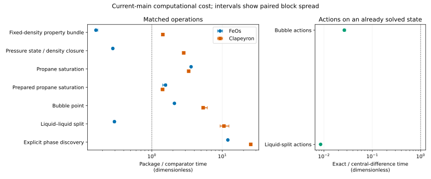

Prepared propane saturation takes 39.8 and 39.2 µs in the two Engine workers, compared with 92.2 and 91.8 µs for ordinary declared saturation.
The fresh prepared-call ratios are 1.56 [1.43, 1.62] against FeOs and 1.43 [1.35, 1.46] against Clapeyron.
The cost ordering varies by operation: the Engine takes less time than FeOs for the fixed-density bundle, density closure and liquid split, and more time than Clapeyron for each matched operation measured here.
Exact actions on an already solved state take 0.0264 [0.0256, 0.0282] of the package's bubble central-difference time and 0.00856 [0.00836, 0.00873] of its liquid-split central-difference time.
These are marginal derivative costs, excluding the central solve.

All planned operations, including prepared saturation, passed fresh numerical agreement.
The selected evidence contains 114 blocks and the full planned sample count shown below, with all preflight and timed-return checks passing.
This is numerical verification of returned thermodynamic quantities and a host-specific hardware measurement.
It is not physical validation or evidence of equivalent global phase-search coverage.
Independent delivered review and investigator promotion remain outstanding; the manuscript has not been updated.

## Question and fixed calculation basis

What warm serial elapsed times do the Engine, FeOs 0.10.1 and Clapeyron.jl 0.6.29 require when their returned thermodynamic quantities match?
The accepted [issue 929](https://github.com/tannerpolley/ePC-SAFT/issues/929) design retains the frozen release's selected inputs and quantity-specific tolerances and adds one prepared call for the same propane saturation state.
The measurement image is detached main commit `e4fdf32c9131526a1ae4938ff30d9c5245462156`, captured after pull request 889 merged.
Later changes on main do not change this frozen image.



The [selected inputs](inputs/inputs.json) fix the property bundle at 300 K and 500 mol/m³ and the 32-pressure liquid-propane sequence at 300 K.
The bundle returns pressure in Pa, residual molar enthalpy in J/mol, residual molar isochoric heat capacity in J/(mol K), component log fugacity coefficient and residual Helmholtz energy divided by RT.
Density closure reports elapsed time per state, dividing each sequence's existing inner timed calls by 32.
The [declared cases](inputs/declared-cases.json) preserve the cross-check's propane saturation, ethanol/butane bubble point and water/pentanol liquid split, with their parameter conversions and solver controls.
The [cross-check declarations](../2026-competitor-cross-check/scripts/engine.py), [head-to-head declarations](../2026-head-to-head-comparisons/scripts/h2h_engine.py) and [density benchmark](../2026-density-root-benchmark/README.md) own the reused declarations and method definitions.
Their loaded files and inputs are pinned in [preparation.json](results/preparation.json).

The electrolyte calculation uses eight independent water/ethanol/isobutanol/sodium/chloride feeds on the explicit-ion amount basis, at the temperature and pressure listed above.
Its [model snapshot](inputs/electrolyte-model.json) fixes solvent-only constant permittivity, direct Born form and Debye–Hückel diameters equal to segment diameters.
The constant permittivity is a calculation condition, not a qualified physical correlation.
The [feed table](inputs/electrolyte-feeds.csv) and model snapshot were checked against the captured source before acquisition.
Electrolyte timings cover the entire eight-feed set and have no comparator.

## Fresh value agreement and timer boundaries

The [preflight returns](results/preflight.json), [normalized values](results/preflight-values.json) and [operand checks](results/checks.csv) contain fresh calculations on the frozen image.
No historical physical return or elapsed time contributes to the selected result.
Phases are sorted by density for matching, preserving the water-rich fraction's meaning.
Each equilibrium requires admitted success and its requested residual criterion; discovery must record an attempt and return the same two-phase quantities as the comparators.





Every timed sample is checked against its own fresh preflight return.
In addition, each timed comparator sample is compared directly with corresponding samples from both Engine workers under the quantity-specific bounds.
Each exact-action sample is compared with its central difference in the same worker and repetition, and every electrolyte set is checked for component balances, phase charge and mole-fraction sums.
The complete operands and allowances remain in [timed-value-checks.csv](results/timed-value-checks.csv).
All checks in the selected acquisition pass.

Model construction, process startup, Julia compilation, request transport and warmups lie outside the sample timers.
Ordinary saturation passes an existing declaration to `solve_equilibrium`, which compiles the problem anew for each timed solve and extracts the return.
Prepared saturation compiles once before warmups, then performs a fresh `compiled.solve_saturation()` and `saturation_values()` extraction per sample.
Its matched quantities are pressure, both phase densities and both pure compositions; diagnostic snapshots are retained but do not define an equal diagnostic-output comparison.
The prepared row uses its own fresh comparator solves and block medians.
No solved endpoint or previous root is supplied between samples.

For actions, the central equilibrium and compiled problem exist before timing.
The bubble directions are temperature, binary interaction, ethanol association energy and association volume; observables are pressure and vapor ethanol fraction.
The liquid-split directions are temperature and binary interaction; observables are the water fraction in each liquid and the water-rich phase amount.
Central differences retain the existing steps and include shifted declarations and re-solves.
The native Engine performs all thermodynamic calculations; Python declares inputs, times calls and reads returns.

## Host admission, attempts and selection

Each acquisition runs through the retained [reservation wrapper](scripts/reserve-core.sh).
It fences physical core 15/31 off from the four named user slices; serial workers use logical CPU 31, nice 10 and one numerical thread.
System services and the login session remain outside this fence, so the core is reserved from user programs only.
A block is admitted only with the core reserved and no listed compiler process before and after it.
One-minute load is recorded, not used for admission.



Two independent Engine workers bracket FeOs and Clapeyron; repetition 1 reverses the order used in repetitions 0 and 2.
For each worker and operation, the reported absolute time is the median of three block medians, accompanied by their minimum and maximum.
A comparator ratio uses six paired ratios: each Engine worker divided by the same-repetition comparator median across the three repetitions.
The action ratios likewise pair exact and central-difference medians in the same worker and repetition.
Reported ranges describe observed spread, not confidence intervals.

The first measurement controller was interrupted after six completed blocks because its copied compiler list omitted versioned Clang process names.
All six blocks and 110 samples remain in `results/raw/measurement-1.jsonl.gz` and are excluded in [acquisition-exclusions.json](results/acquisition-exclusions.json).
The correction changed only compiler detection and child cleanup; the Engine image, physical declarations and numerical tolerances stayed unchanged.
The distinct initial preparation and raw preflight records are retained with `-initial` filenames.
Byte-identical derived checks and normalized values are stored once, with both attempts mapped to their retained files and SHA-256 hashes in [identical-preflight-copies.json](results/identical-preflight-copies.json).
A fresh preflight passed before `measurement-2` acquired all three repetitions using the corrected list.
No block from the first attempt contributes to any selected time or ratio.
The replacement acquisition required no disturbance retry and contained no numerical exclusions.



The selection table counts the replacement acquisition; the separately excluded initial attempt is described above.
The reducer selects one complete operation attempt, including both action and central-difference members, and never chooses by speed or mixes attempts.
Complete bundle, declared-equilibrium and prepared-saturation cases have 75 samples per worker; density, discovery and electrolyte cases have 15; each action or central-difference set has 30.
Fifteen density samples represent 480 individual density calls per worker, and fifteen electrolyte samples represent 120 feed solves per worker.
The [block table](results/blocks.csv), [sample table](results/samples.csv) and [host snapshots](results/host.csv) retain the actual selections.

## Paired computational costs

Ratios below unity mean that the Engine call takes less elapsed time than the named comparator at the matched state.
The density-closure range against Clapeyron is entirely above unity in this campaign; it does not support the historical equal-cost interpretation.
Prepared saturation reduces the Engine call cost at the same physical state, while remaining above both comparator times here.





The table reports the complete electrolyte-set times and block ranges for both Engine workers.
These ranges are the minimum and maximum of the three block medians, not uncertainty in a physical property.

## Meaning, limits and retained identity

The comparison answers the cost question for these declarations, timer boundaries, warm serial calls and this host.
Matching pressure, density, composition and phase amount does not imply equal initialization, stopping rules, reuse or search coverage.
The observed ratios provide no universal speed factor, startup-cost estimate, threaded-throughput estimate or application prediction.
The earlier unmatched methane/ethane case remains outside this campaign; it was not re-evaluated or substituted for the selected two-phase point.

Clapeyron.jl times are lower than in the earlier release campaign at the same package version, 0.6.29: the property-bundle median is 6.00 versus 18.7 µs, and the liquid-split median is 0.454 versus 2.42 ms (this campaign versus the [earlier statistics](../2026-release-computational-cost/results/statistics.csv); [current statistics](results/statistics.csv)).
The recovered earlier `definitions.jl` (`93ef4873`) and the restored file used here (`9fcbfb1e`) are byte-identical apart from one trailing newline, with no executable difference.
The earlier campaign did not record its Julia process launch options or affinity; this campaign records both.
The cause of the timing difference is undetermined.
Package/comparator ratios here use this campaign only.

The [image identity](results/image.json) owns the exact source commit, isolated interpreter, editable-loader mapping, Python-file hashes and three native-image hashes.
The image record SHA-256 is `b09a677634d4ce58f1aa9e2b9a45390946a48670ec1077c4b05cdec657aa71d5`.
The guard disables editable rebuilds before the first Engine import, refuses process launches and checks mapped native bytes.
Workers recheck loaded mappings at completion; preparation bytes were rehashed after acquisition and remained unchanged.
The interpreter identity reports the actual isolated Python, with the unused fit-launcher alias removed.

[statistics.csv](results/statistics.csv) owns absolute times and block ranges; [ratios.csv](results/ratios.csv) owns every displayed paired ratio and the independent-worker controls.
The compressed raw replies retain the full numerical returns, diagnostics, identities and requests.
Presentation reads these retained files without importing the Engine, and Quarto renders with execution disabled.
Delivered review and investigator promotion must precede any manuscript update.

The full fast delivery gate passes, including the Python and native checks, lint, type checking and architecture checks.
The affected-area gate permits only the exact design-required input snapshot paths and hashes.
Identical derived preflight records are stored once with the attempt mapping above.
