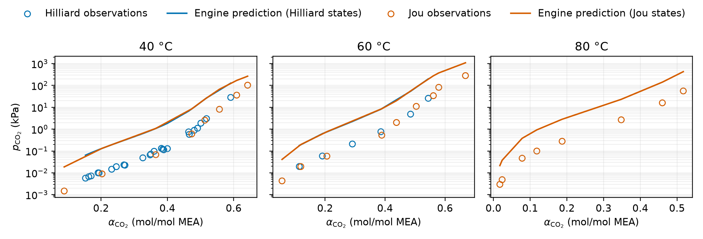

## Question

Does the parameter set fitted to 131 speciation targets predict independent
CO2 partial-pressure observations for 30 wt% aqueous MEA?

## Retained inputs

| Input | Role |
|---|---|
| [`inputs/source/vle-pressure.csv`](inputs/source/vle-pressure.csv) | 58 source-backed Hilliard (2008) and Jou et al. (1995) observations |
| [`results/co2-partial-pressure-validation.csv`](results/co2-partial-pressure-validation.csv) | Exact plotted observations, Engine predictions, statuses, and physical residuals |
| [`results/co2-partial-pressure-validation.json`](results/co2-partial-pressure-validation.json) | Aggregate comparison and certificate metrics |
| [`results/summary.json`](results/summary.json) | Accepted simultaneous full-space regression result |

Hilliard and Jou identify experimental sources, not alternative models. Every
prediction comes from the same fitted ePC-SAFT Engine model. Each observation
supplies temperature, total pressure, and CO2 loading to a public,
fixed-pressure, single-finite-phase GREPE calculation. The liquid CO2 fugacity
is compared with the measured CO2 partial pressure. The specialized
reactive-bubble interface is not called.

The fit input supplies reaction-standard-state correlations at 20, 40, 60,
and 80 °C. This comparison uses the 40, 60, and 80 °C observations and does
not extrapolate reaction constants to 100 or 120 °C. Fifty-five observations
fall within the parameter document's 10 Pa to 300 kPa pressure domain. Three
higher-pressure Jou observations remain in the table as unevaluated domain
exclusions.

## Recalculation

This cell recomputes the displayed ratios from the retained table. It does not
import ePC-SAFT or run equilibrium or regression.

```{python}
#| eval: false
import csv
from collections import defaultdict
from math import log10
from pathlib import Path
from statistics import median

table = Path("results/co2-partial-pressure-validation.csv")
rows = [
    row
    for row in csv.DictReader(table.open())
    if row["prediction_status"] == "evaluated"
]
groups = defaultdict(list)
for row in rows:
    ratio = float(row["predicted_pco2_kpa"]) / float(row["observed_pco2_kpa"])
    groups[(row["source_key"], float(row["temperature_c"]))].append(ratio)

for key, ratios in sorted(groups.items()):
    factor = 10 ** median(abs(log10(value)) for value in ratios)
    print(key, len(ratios), factor, min(ratios), max(ratios))
```

## Results

| Observation source | Temperature (°C) | Evaluated rows | Factor from median absolute log error | Engine/observed range |
|---|---:|---:|---:|---:|
| Hilliard (2008) | 40 | 24 | 11.92 | 4.50–14.46 |
| Hilliard (2008) | 60 | 6 | 10.60 | 7.73–11.15 |
| Jou et al. (1995) | 40 | 8 | 10.77 | 2.57–15.93 |
| Jou et al. (1995) | 60 | 9 | 9.59 | 3.87–16.25 |
| Jou et al. (1995) | 80 | 8 | 8.42 | 7.23–10.19 |

Across all 55 evaluated observations, the median absolute
`log10(Engine/observed)` error is 1.024, equivalent to a factor of 10.57. The
maximum ratio is 16.25. All evaluated states satisfy the retained material
balance, reaction-affinity, and pressure-residual checks, and none failed
numerically.

{fig-alt="Log-scale CO2 partial pressure versus loading at 40, 60, and 80 degrees Celsius. Engine prediction lines lie above Hilliard and Jou observation points."}

## Interpretation

The Hilliard and Jou subsets exhibit similar discrepancies because both
interrogate the same Engine relationship over overlapping temperature and
loading ranges. Their independent observations broadly agree while the single
Engine prediction lies high. The evidence therefore points to model or
fitted-parameter discrepancy, not a Hilliard-specific calculation.

The comparison does not identify whether the dominant cause is the
speciation-only regression objective, the fixed reaction-standard-state
values, the fitted parameter subset, or another model-form limitation. A
pressure-inclusive regression and parameter-identifiability analysis are
needed to distinguish those explanations.

## Claim boundary

The parameter set reproduces the admitted speciation fit and its physical
certificates. It fails this independent CO2 partial-pressure validation and
must not be described as pressure-validated. Measurement uncertainty is not
available in the retained table, so this notebook makes no
uncertainty-weighted acceptance claim.
