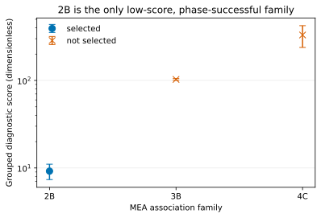
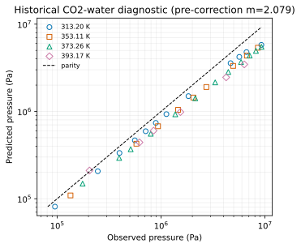

# Nine-species 30 wt% MEA parameter authority

## Active bundle scorecard

| Item | Active value or disposition |
|---|---|
| Bundle | `mea-co2-h2o-nine-species-active`, version 1, `active_provisional` |
| Scientific status | `diagnostic_candidate`; not accepted or transferred |
| Species / reactions | 9 true species / 5 reactions, products-positive convention |
| Coordinates | 139: 46 fixed, 6 candidate, 85 provisional, 1 fitted, 1 missing |
| Active bundle | [`inputs/active-bundle.json`](../../inputs/active-bundle.json), SHA-256 `7d32da2685b5d7d9e351eb566d52e54add38c0f7d96608f135cdc9b1d255fb28` |
| Runtime parameters | [`parameters.json`](../../inputs/data/mea-co2-h2o-nine-species-estimation/1/parameters/parameters.json), SHA-256 `12e380a27eb615e25bae580f8c1ec852020879917b08fa16a5821ae76311550d` |
| Packet | `mea-co2-h2o-nine-species-estimation/1`, fingerprint `d02c109c035c79ea27905eb115a9a107afa4d5299abb6f17492285142f0a7b32` |
| Neutral-fit wheel (historical) | SHA-256 `d59abedb354fbd163ea918d3cc96b607f6e8ce8ec7c1f730d12b9653a1541e5d`; `k_MEA,H2O` requalified on the current API by [`2026-wolbach-sandler-requalification`](../../../2026-wolbach-sandler-requalification/README.md) |
| Neutral family | 2B selected; `k_MEA,H2O = -0.07352749874985018` fitted to 25 admitted Cai rows |
| CO2-water | induced association retained; pre-correction replay only: 39 Kiepe rows, log-pressure RMSE `0.3599215453`, mean log bias `-0.3343839953` |
| CO2-MEA | missing; `k_CO2,MEA = 0` is a placeholder, not a fitted zero |
| Reactive promotion | blocked: candidate-4 N=8 did not converge; no complete fit or active reactive interaction block |
| Validated domains | pressure `null`; speciation `null` |





Exact plotted values: [`neutral-association-selection.csv`](figures/output/neutral-association-selection.csv) and [`kiepe-pressure-parity.csv`](figures/output/kiepe-pressure-parity.csv).

## Fixed structure

Species order is CO2, MEA, H2O, MEAH+, MEACOO-, HCO3-, CO3^2-, H3O+, OH-. Charges are `0, 0, 0, +1, -1, -1, -2, +1, -1`; charges, molar masses, and the reaction matrix are fixed. Every reaction vector uses products-positive signs:

| Reaction | Stoichiometry | Source status |
|---|---|---|
| R1 | `-2 H2O + H3O+ + OH-` | Austgen (1991), fixed baseline |
| R2 | `-CO2 - 2 H2O + HCO3- + H3O+` | Austgen (1991), fixed baseline |
| R3 | `-H2O - HCO3- + CO3^2- + H3O+` | Austgen (1991), fixed baseline |
| R4 | `MEA - H2O - MEACOO- + HCO3-` | Tong (2012) / Aroua (1999), fixed; extrapolated above about 323 K |
| R5 | `MEA - H2O - MEAH+ + H3O+` | Bates and Pinching (1951), fixed; extrapolated above about 323 K |

The source standard state is aqueous molality at infinite dilution in water, reference pressure 100000 Pa. The Provider applies the retained `source-standard-state-to-provider-neutral-reference` transformation; this is not a reaction-sign change.

## Neutral pure parameters

The active CO2 segment count is `2.0729`, the Gross–Sadowski (2001) Table 2 value. `2.079` belongs only to the retired historical calculation noted by the MEA source audit. CO2 `sigma = 2.7852 Å` and `epsilon/k = 169.21 K` remain paired with that source family. The selected MEA row is `m = 3.0353`, `sigma = 3.0435 Å`, `epsilon/k = 277.174 K`; water remains the retained Held/Figiel-compatible family. These are fixed here, not re-fitted by reactive pressure.

## Association

| Family | Grouped mean score | SE | Phase success | Disposition |
|---|---:|---:|---|---|
| 2B | 9.2127559013 | 1.8448718706 | yes | selected and frozen |
| 3B | 102.7292591340 | 2.4396974659 | yes | outside one-SE set |
| 4C | 393.0699141866 | 2.9397681134 | yes | outside one-SE set |

The [native topology table](neutral-mea-water/figures/output/topology-selection.csv)
replaces the historical incomplete 4C score; 4C now fits completely but remains
outside the one-standard-error set. The comparison uses the same water family
and admitted Cai MEA-water evidence. The one-SE rule selects 2B without ambiguity. Cross association uses the retained arithmetic-energy/geometric-volume combining rule. Induced CO2-water association remains the baseline.

## Physical binaries

MEA-water is fitted only after 2B selection. The retained CO2-water replay evaluates all 39 Kiepe rows and shows systematic underprediction, but it used the pre-correction CO2 segment count `2.079`. It is historical warning evidence, not active-bundle evidence or a promoted calibration tier; the corrected `2.0729` bundle has not been replayed against Kiepe. CO2-MEA lacks genuine neutral identification and remains visibly missing with a zero placeholder.

## Ionic, electrostatic, and Born terms

Original Born is the active baseline. The [ionic-electrostatics decision](ionic-electrostatics/README.md) compares the three Born forms against retained water and MEA partial pressures at NMR speciation: SSM is rejected, and SSM+DS is weakly but consistently favoured over original Born, which stays the baseline as a status-quo choice. The hash-bound `inputs/active-bundle.json` keeps its earlier dispositions as a historical input. The 85 inherited ionic molecular, packing, Debye–Hückel, Born, dielectric, and suppression coordinates are explicitly provisional. `segment_diameter`, `packing_diameter`, `debye_huckel_diameter`, and `born_diameter` retain distinct meanings; none is called a hydrated diameter.

## Reactions

R1-R5 remain source-audited baselines. R4 uses `ln K = a + b_K/T`, `(a, b_K) = (2.151, -1545.3 K)`. R5 uses `ln K = -ln(10)(a_K/T + b + c_K^-1 T)`, `(a_K, b, c_K^-1) = (2677.91 K, 0.3869, 0.0004277 K^-1)`. No reaction coefficient is re-fitted from pressure. R4/R5 above roughly 323 K are candidate extrapolations.

## Reactive full-mixture terms

Candidates 1-4 are rejected Validation evidence, not active bundles. Candidate 4 ended `maximum_iterations_exceeded` after 80 iterations and 40133.06 s. Objective was `49.9142893830` (`49.8088018033` pressure, `0.1054875798` speciation); outer stationarity was `22.7922829552`, complementarity `0.0010000000`, and dual-sign violation `0.0389444603`. All eight local equilibrium certificates passed, but the outer fit did not. The retained full-space endpoint then failed the unchanged `1e-12 mol` amount floor at `1.4621395112e-13 mol`. No ternary correction or added reactive interaction survives.

## Domains

| Domain | Temperature / status |
|---|---|
| Computational | 293.15–393.15 K, 30 wt% MEA |
| CO2 source fit | 216–304 K (Gross–Sadowski); values above 304 K are candidate extrapolation |
| Cai MEA-water fit observations | 362.81–431.85 K and 66.66–101.33 kPa |
| Source-qualified | record-specific; Provider result is 313.15 K; R4/R5 above about 323 K are extrapolated |
| Candidate evaluation | 293.15–393.15 K; `candidate_extrapolation` |
| Validated pressure | missing (`null`) |
| Validated speciation | missing (`null`) |

One-temperature execution is a smoke test only. No complete 123-state/210-target fit ran, so Xu pressure and Jakobsen speciation remain untouched.

## Certification

The rejected terminal replay retains wheel SHA-256 `909e7c03786316cba04d7e679c52a58f20b5cc6f5a2a8ee48a92c4e308010c9f`, old packet fingerprint `69bbcf1e59d312a0da94031491d430af8686566b9e38ed2a208d792d90510050`, N=8 input SHA-256 `044e9e35d636034a0881c019fa5aa375353a3a54b8d2edfc09a097962176a367`, and result SHA-256 `d799a0e6469eec05d4412bc1093c78f101fcd436efa0c3db671a62555d0a80d1`. These identify the failed run at `f25d9c97bdf3f38ff806065f45d060e3cd4a0bfb`, not the active provisional bundle.

`inputs/active-bundle.json` and the materialized packet were written by `data/tools/promote_mea_active_bundle.py`, removed from the Engine in #341 (parameter adoption belongs to MEA; Git keeps the script). The plots regenerate from the retained bundle:

```bash
.venv/bin/python analyses/2026-mea-parameter-estimation/scripts/figures_prepare_plot_data.py
MPLBACKEND=Agg .venv/bin/python analyses/2026-mea-parameter-estimation/scripts/figures_render_plots.py
```

The 40133.06 s replay is retained in Git history and is not a current replay command.

## Downstream transfer

No MEA-Thermodynamics or MEA-Absorption-Column files changed. Transfer is blocked until a bounded full-space root action produces a complete fit, independent Xu/Jakobsen metrics, non-degraded physical evidence, and reviewed immutable wheel/packet/bundle identities. Other amines remain methodological evidence only and supply no numeric MEA coordinate.
