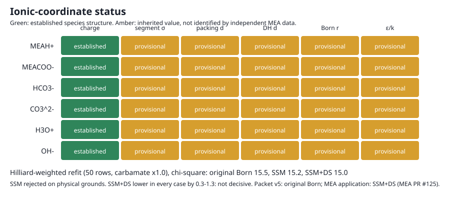

# Ionic and electrostatic qualification

Pre-rule record: the retained results were produced by a Python solver before the native calculation rule (#234, 2026-10-01); they are history, not reproducible by the current scripts. The fixed-state fugacity fits, calibration offsets, loading-bias estimation and profiled holdout offsets were removed from `compare.py`, and the Hamer–Wu chloride, Lee-only and joint fits were removed with `chloride.py`.

## Decision

At measured liquid speciation, measured water and MEA partial pressures over CO2-loaded 30 wt% MEA **cannot decisively rank original Born against SSM+DS**. Refits weighted by Hilliard's own stated measurement uncertainties plus the project's ±5 % carbamate assumption (#161) give SSM+DS the lower χ² in every case tested: three uniform carbamate scales, a free loading-linear carbamate bias, and a holdout on Hilliard's independent Appendix F NMR speciation scored without refitting. The margin is only 0.3–1.3 χ² units, and at most 3.6 even with the weights shrunk to the observed scatter. The decisive threshold set before the runs is 10. With the two ion–solvent k_ij fitted, the forms differ by less than the measurement and speciation uncertainty. **SSM is rejected on physical grounds**: its fitted ion–water k_ij is about −1.7 (unlike energy about 2.7 times the geometric mean), and the separate aqueous check with packet ion–solvent k_ij = 0 gives negative SSM osmotic coefficients at 1–4 mol/kg. Packet v5 in this repository states original Born (`c_shell = 0`, `c_dielectric = 0`), and every comparison here changes only those two coefficients; no packet coordinates change. SSM+DS remains an admissible alternative. The six ions' diameters, Born radii and dispersion energies stay provisional: the comparison is almost insensitive to them. Reactive pressure is not used. 

**The MEA application does not evaluate original Born.** Its selected record omits both coefficients, and MEA-Thermodynamics `analyses/mea_parameter_bundle/scripts/shared_evaluation.py` (`MODEL_RUNTIME_DEFAULTS`) fills (1, 1). The application therefore runs SSM+DS.
- **Evidence.** MEA-Thermodynamics PR #125 (open), check N1: NaCl osmotic-coefficient ARD 25.4 % as loaded at (1, 1), against 1.24 % at (0, 0).
- **Engine rule.** PR #125 attributes the same fill to the Engine's resolution rule, because water has f_solv = 1.5. This repository's Python loader instead rejects an omitted coefficient (`missing electrolyte/c_shell`), so that part is PR #125's statement, not verified here.
- **Owner of the decision.** The MEA Born-form decision belongs to MEA-Thermodynamics #121 decision 21. That decision fits both forms on the full MEA calibration data with the exact-derivative fitter, under a 40–80 °C pass rule.
- **Lee and Lee route.** The Lee and Lee (1998) MEAH⁺Cl⁻ route (#161 1(d)) was stopped by owner decision on 2026-09-29. Its fits are kept below as diagnostics and make no ranking claim.



The machine-readable decision is [`decision-table.json`](decision-table.json). The per-ion coordinate table is [`decision-table.csv`](decision-table.csv).

## Why the earlier "no data" negative was wrong

The earlier record ran zero comparisons because it looked for ionic volumes, static permittivity or MEAH+ activity data. The first two cannot rank the Born forms in this model:

- **Density is Born-blind.** The runtime bulk permittivity depends on temperature and composition but not density. The Born term therefore adds nothing to pressure. At a fixed loaded state, all three forms give the same molar density to 16 digits (`born-sensitivity.csv`). The 128 analog salt densities and the Amundsen loaded densities cannot discriminate the forms, even with qualified counterions.
- **Permittivity data test the shared bulk-permittivity input,** not the Born form. Hajj (2024) microwave-fitted "static" values also rise with loading (71 to 93 at 293 K), the opposite of an ionic decrement.

Observables that do respond are ion and solvent chemical potentials. At a fixed loaded state (loading 0.40, 313.15 K), the Born form alone changes ln φ by these amounts:

| Species | SSM vs original Born | SSM+DS vs original Born |
|---|---|---|
| water | +0.38 | +0.05 |
| MEA | −2.97 | −0.43 |
| CO2 | −2.86 | −0.32 |

A usable observable was already retained in the repository: solvent partial pressures at a state whose speciation was measured independently. Comparing the liquid fugacity `x_i φ_i P` with the measured partial pressure needs no reaction constant, so the reactive-pressure ban is respected.

## Comparison

**Data:**
- Hilliard (2008) water and MEA partial pressures, 30 wt% MEA, 313.15 K (21 states) and 333.15 K (4 states), loading 0.15–0.49.
- Böttinger et al. (2008) ¹³C NMR speciation at the same temperatures and MEA strength, interpolated in loading.
- MEAH+ closes the charge balance and free MEA closes the amine balance. Below loading 0.46, Böttinger reports all absorbed CO2 as carbamate; the NMR CO2 balance closes within 3.3 %.

**Model:** current packet revision 5, including the MEA 2B κ conversion to the Engine's σ³ convention (`κ = 0.036287`), with only `(c_shell, c_dielectric)` changed. The same wheel and code were used for the packet v4 comparison; v5 is the decision basis. Parameter-file SHA-256: v4 `7f87d3a81be71aae05be80c94eaf7af36554f96d07c8beb17d64da13e83f4c25`; v5 `1ba95275f9e23264250e891aee3d6284d801f73205dad255101e6561b29aee5f`.

**Speciation bias:** every case is repeated with carbamate scaled by 0.95 and 1.05.

The Born term vanishes at zero loading, so the loading slope of `ln(model/observed)` removes a constant neutral-model offset. The neutral model's own dependence on loading stays in each slope. At fixed speciation and unfitted coordinates the three forms differ only in the Born term, so differences between their slopes are the Born response alone, while each slope also carries that shared neutral part (`solvent-fugacity-trends.csv`).

| Water slope at 313 K, unfitted | Value |
|---|---|
| original Born | −0.084 to −0.069 (±0.017) |
| SSM | +0.82 to +0.89 (±0.02) |
| SSM+DS | +0.019 to +0.029 (±0.017) |

The observed water partial pressure is flat with loading. SSM predicts a +37 % rise over the range.

**Refit per form (#163, assumed weights):** 50 observations and six fitted parameters per form, using an assumed 2 % water and 10 % MEA scatter combined with each row's carbamate-perturbation spread. The refit uses `x_scale=0.1`, `diff_step=1e-4` and three starts `(0, 0)`, `(−0.042, 0.117)`, `(0.022, 0.220)`; no solver tolerances were changed. All nine v5 fits converged successfully from all starts. The table gives χ² and fitted k_ij for v4 and v5, plus the maximum v5 `||Jᵀr||∞` across starts and the v5 start-to-start spreads. Full records are [`solvent-fugacity-refit-v4.csv`](solvent-fugacity-refit-v4.csv) and [`solvent-fugacity-refit.csv`](solvent-fugacity-refit.csv).

| Form | Carbamate scale | χ² (v4 → v5) | k_ion-water (v4 → v5) | k_ion-MEA (v4 → v5) | max `||Jᵀr||∞` (v5) | Δχ² (v5 starts) | Δk_water | Δk_MEA |
|---|---:|---:|---:|---:|---:|---:|---:|---:|
| original Born | 0.95 | 7.4063 → 7.4068 | +0.103365 → +0.103423 | +0.273551 → +0.273564 | 0.0598 | 9.0e-7 | 0.000100 | 0.000142 |
| SSM | 0.95 | 5.2574 → 5.2576 | −1.728531 → −1.728503 | −1.278323 → −1.278354 | 0.0389 | 1.1e-6 | 0.000083 | 0.000100 |
| SSM+DS | 0.95 | 6.5476 → 6.5481 | −0.089846 → −0.089764 | +0.141791 → +0.141879 | 0.0511 | 7.5e-7 | 0.000049 | 0.000056 |
| original Born | 1.00 | 8.6574 → 8.6580 | +0.077965 → +0.077953 | +0.290583 → +0.290535 | 0.0677 | 1.5e-5 | 0.000267 | 0.000320 |
| SSM | 1.00 | 6.4026 → 6.4029 | −1.712670 → −1.712633 | −1.223223 → −1.223239 | 0.0066 | 1.0e-6 | 0.000032 | 0.000044 |
| SSM+DS | 1.00 | 7.7987 → 7.7993 | −0.112337 → −0.112269 | +0.160280 → +0.160320 | 0.1058 | 4.2e-6 | 0.000166 | 0.000194 |
| original Born | 1.05 | 15.7663 → 15.7674 | +0.043287 → +0.043429 | +0.305276 → +0.305416 | 0.1528 | 1.2e-5 | 0.000164 | 0.000173 |
| SSM | 1.05 | 11.1244 → 11.1250 | −1.709939 → −1.709871 | −1.173022 → −1.173001 | 0.0137 | 6.9e-7 | 0.000035 | 0.000042 |
| SSM+DS | 1.05 | 14.4303 → 14.4313 | −0.144522 → −0.144507 | +0.176045 → +0.176030 | 0.0879 | 1.3e-6 | 0.000084 | 0.000087 |

Across all v5 rows and starts, the largest gradient infinity norm is 0.15281; the largest start-to-start spread is `1.55e-5` in χ², `0.000267` in ion–water k_ij and `0.000320` in ion–MEA k_ij. The v4-to-v5 changes are small but nonzero: χ² shifts by +0.00020 to +0.00108, with maximum absolute k shifts of 0.000142 (water) and 0.000140 (MEA). The ranking is unchanged at all three carbamate scales: SSM, then SSM+DS, then original Born by χ². The exact derivative API does not represent this fixed-measured-composition observable; the resolved finite-difference step is used instead.

**SSM is rejected on physical grounds, despite its lowest χ².** At v5 its pressure-fit ion–water k_ij is −1.73 to −1.71 and its ion–MEA k_ij is −1.28 to −1.17. Under `u_ij/√(u_i u_j) = 1 − k_ij`, these imply unlike-energy multipliers about 2.71–2.73 for water and 2.17–2.28 for MEA. The separate aqueous 1:1 MEAH+–MEACOO− osmotic check at 298.15 K uses the unmodified packet ion–solvent k_ij = 0, not these fitted candidates:

| Molality (mol/kg) | 0.1 | 0.5 | 1 | 2 | 4 |
|---|---:|---:|---:|---:|---:|
| Original Born | 0.937684 | 0.970803 | 1.042752 | 1.183656 | 1.409471 |
| SSM | 0.813035 | 0.359332 | −0.151671 | −1.096943 | −2.760659 |
| SSM+DS | 0.923512 | 0.901281 | 0.906950 | 0.924360 | 0.935341 |

At packet ion–solvent k_ij = 0, the negative SSM values at 1, 2 and 4 mol/kg show the shell-only form is physically inadmissible with the unchanged packet coordinates. The pressure fit separately requires the implausible unlike-energy multipliers above; the osmotic check was not evaluated at those fitted candidate k_ij values. These packet-coordinate osmotic checks are identical for packets v4 and v5.

**With assumed weights (#163), SSM+DS fits better than original Born at every carbamate scale** (6.548 vs 7.407, 7.799 vs 8.658, 14.431 vs 15.767 on v5), and SSM is lower than both but physically rejected. The calibrated ranking below replaces the assumed weights, adds a loading-dependent carbamate bias and a holdout. Other checks under original Born:
- ±10 % in ion dispersion energy, ±5 % in ion diameters or ±10 % in Born radii move the water slope by 0.025 at most.
- A ±0.1 change in the ion–water k_ij moves the water slope by 0.044.
- A ±0.1 change in either k_ij moves the MEA slope by 1.1–1.3.
- Source: `coordinate-sensitivity.csv`.

These k_ij values are fitted candidates only. They are not promoted into the parameter packet, and no holdout at matched speciation exists.

## Calibrated ranking (#161)

**Weights from the source.** Hilliard (2008) states the uncertainties of the UT low-temperature apparatus that produced these partial pressures. The source is Zotero item `DNQUPRMT`, PDF attachment `LB7LUETY`; printed page = PDF page − 57. Each row's standard uncertainty in `ln p` combines the terms below in quadrature. The temperature, loading and carbamate terms are propagated through the unfitted original-Born model, so all forms share one set of weights. Per-row values are in [`solvent-fugacity-weights.csv`](solvent-fugacity-weights.csv).

| Quantity | Stated by Hilliard | Locator | Used in σ(ln p) |
|---|---|---|---|
| Vapor-phase concentration (FT-IR) | ±2.0 % relative, expanded; coverage factor not stated | §2.3.4, p. 29 (citing Goff 2005) | 0.020, taken as standard |
| FT-IR analyzer | ±3.0 % of full scale | §2.3.4, p. 28 | not used; full scale per species not stated |
| Reactor pressure | ±0.08 % of 0–8 bar full scale; gas at atmospheric pressure | §2.3.4, p. 27 | 0.0063 |
| Reactor temperature | controlled within ±0.1 °C | §2.3.4, pp. 27–28 | model `d ln f/dT × 0.1 K`: 0.005 (water), 0.007 (MEA) |
| CO2 loading | ±2.0 % relative standard | §2.3.4, p. 29 | model `d ln f/dα × 0.02α`: up to 0.003 (water), 0.25 (MEA) |
| NMR amine total against the dioxane standard | ±3.0 % (1–5 wt% dioxane) to ±5.0 % (<1 wt%); no per-species carbamate uncertainty stated; Hilliard's own regression uses σx = 1.0 % (p. 440) | §3.11, pp. 62–63 | context only |
| Carbamate speciation | **project assumption (#163), not Hilliard**: ±5 % relative, the same as the carbamate scales | — | half-spread at carbamate ×(1 ± 0.05): up to 0.003 (water), 0.75 (MEA); dominates MEA rows above loading 0.35 |
| Apparatus check | water AARD 4.40 % vs Kell (1984); MEA AARD 7.31 % vs DIPPR; vapor-pressure analysis uncertainty ±2.0 % | §2.4, pp. 34–37 | context |
| Hilliard's own regression weight | σ(P_MEA) = 2.0 % (DRS default) | Table 13.4-2, p. 440 | context |

Water rows get σ ≈ 0.022; MEA rows get 0.033 at low loading, rising to 0.75 at loading 0.49, where free MEA is a small difference of large terms. The **measured state** evaluates each row at its Appendix D.4 temperature and MEA molality (6.85–7.58 mol/kg, 39.85–40.35 °C and 59.77–59.96 °C; [`Hilliard_2008_AppendixD4_7m_MEA.csv`](../../../inputs/source/library/observations/vapor_liquid_equilibrium/Hilliard_2008_AppendixD4_7m_MEA.csv), pp. 914–915). The nominal state (30 wt%, 313.15/333.15 K) is retained for attribution.

**Holdout speciation.** Hilliard Appendix F.2 (p. 933; [`Hilliard_2008_AppendixF_7m_MEA_NMR_speciation.csv`](../../../inputs/source/library/observations/liquid_speciation/Hilliard_2008_AppendixF_7m_MEA_NMR_speciation.csv)) reports ¹³C NMR speciation for 7 m MEA at 40 and 60 °C. The samples are separate from the VLE samples and were measured on a different instrument from Böttinger's. Every species in a spectrum carries one dioxane internal-standard scale factor (Hilliard eqs. 3-7 and 3-8), and the NMR amine totals vary from 6.9 to 8.6 mol/kg H2O against the nominal 7. Carbamate and bicarbonate are therefore used only as ratios to the NMR amine total, placed at the NMR loading (carbamate + bicarbonate)/amine. The tabulated loading matches that ratio in some rows only; at the tabulated loading, the NMR carbon (carbamate + bicarbonate) is 10.5 % above the stated CO2 at the highest 40 °C loading (12-5) and 24 % below it at the lowest (12-1). That breaks the carbon balance, so the tabulated loading is not used. All 25 fitted states lie inside the Appendix F loading range.

**Loading-dependent carbamate bias.** One extra coordinate `b` scales carbamate by `scale × (1 + b (α − ᾱ))`, with ᾱ = 0.323. `b` is bounded so that free MEA and carbamate stay positive. The optimizer coordinate is the multiplier at the highest loading, which starts at 1. With the installed SciPy, `diff_step` is relative to |x|, so near `b` = 0 the step scales with |b| (√eps at exactly 0) and round-off dominates that Jacobian column. The first attempt, with `b` itself as the coordinate, returned stale Jacobian columns: gradient 4.4 against a central-difference 0.002.

**Method.** The #163 refit is unchanged: `x_scale=0.1`, `diff_step=1e-4`, starts `(0, 0)`, `(−0.042, 0.117)`, `(0.022, 0.220)`, six parameters (seven with `b`), and 50 rows. All 30 fits succeed from all three starts. The largest `||Jᵀr||∞` is 0.250 (SSM+DS with `b`, ×0.95). Across starts, the largest spreads are 9.5e-5 in χ², 0.00078 in k_ion-water, 0.00086 in k_ion-MEA and 0.0010 in `b`. Records: [`solvent-fugacity-refit-calibrated.csv`](solvent-fugacity-refit-calibrated.csv) and [`solvent-fugacity-holdout.csv`](solvent-fugacity-holdout.csv).

**Decision rule, fixed before the runs.** Both admissible forms have the same parameter count, so Δχ² = ΔAIC; a difference of 10 or more leaves the worse form essentially no support. A case's difference is divided by max(1, reduced χ² of the better form), so weights that prove too small cannot inflate it. The ranking is decisive only if every deciding case favours the same form by at least 10. The deciding cases are the measured-state refits with and without `b` at all three scales, and the frozen Appendix F holdout at all three scales.

| Case (measured state unless noted) | Carbamate | χ² original Born | χ² SSM | χ² SSM+DS | Born − SSM+DS | at observed scatter |
|---|---:|---:|---:|---:|---:|---:|
| Refit (a) | ×0.95 | 13.836 (ν: 0.314) | 13.378 | 13.263 (0.301) | 0.573 | 1.90 |
| Refit (a) | ×1.00 | 15.513 (0.353) | 15.167 | 14.953 (0.340) | 0.560 | 1.65 |
| Refit (a) | ×1.05 | 23.760 (0.540) | 23.292 | 23.171 (0.527) | 0.588 | 1.12 |
| Refit, nominal state | ×0.95 / ×1.00 / ×1.05 | 9.486 / 10.388 / 17.544 | 10.846 / 12.165 / 19.600 | 9.113 / 10.067 / 17.246 | 0.37 / 0.32 / 0.30 | 1.80 / 1.40 / 0.76 |
| Refit with bias `b` (c) | ×0.95 | 13.836 | 13.328 | 13.261 | 0.575 | 1.87 |
| Refit with bias `b` (c) | ×1.00 | 14.526 | 13.839 | 13.873 | 0.653 | 2.03 |
| Refit with bias `b` (c) | ×1.05 | 15.376 | 14.370 | 14.616 | 0.760 | 2.24 |
| Refit, σ without the carbamate term (sensitivity) | ×1.00 | 111.343 (2.531) | 98.725 | 106.841 (2.428) | 4.502 | 1.85 |
| Appendix F holdout, frozen (b) | fit ×0.95 | 24.721 | 26.978 | 23.927 | 0.794 | 1.66 |
| Appendix F holdout, frozen (b) | fit ×1.00 | 14.902 | 14.369 | 14.072 | 0.830 | 2.95 |
| Appendix F holdout, frozen (b) | fit ×1.05 | 20.002 | 14.589 | 18.660 | 1.342 | 3.60 |
| Appendix F holdout, offsets re-profiled | fit ×0.95 / ×1.00 / ×1.05 | 19.555 / 14.676 / 16.984 | 16.752 / 12.451 / 12.685 | 18.506 / 13.964 / 16.100 | 1.05 / 0.71 / 0.88 | 2.61 / 2.34 / 2.52 |

ν is reduced χ² (44 degrees of freedom; 43 with `b`; holdout frozen χ²/50). "At observed scatter" divides the difference by the better form's reduced χ², which is what the weights would give if they were shrunk to match the data.

- **(a) Calibrated weights.** Reduced χ² is 0.30–0.54, so Hilliard's stated uncertainties are larger than the observed scatter. Water rows alone give χ² ≈ 3.5 for 25 rows: 2.2 % stated against about 0.8 % observed. Using the measured state raises χ² by 2.5–6.2 for every form; the rows do not follow the small reported temperature and molality excursions. The order is the same in both states. Fitted k_ij at ×1.00: original Born +0.146 ± 0.037 (water), +0.348 ± 0.046 (MEA); SSM+DS −0.043 ± 0.038, +0.221 ± 0.048.
- **Carbamate term in σ.** The ±5 % carbamate assumption enters both σ and the scale scenarios. It dominates σ for the high-loading MEA rows, where the Born term is largest. Without it (sensitivity row), reduced χ² rises to 2.4–2.5 and the gap widens to 4.50. After scaling by reduced χ² that is 1.85, still far below 10, and SSM+DS is still lower. The whole gap comes from the MEA rows: at ×1.00, the water χ² is slightly lower for original Born (3.631 against 3.689).
- **(b) Holdout.** Both admissible candidates carry over to the independent Appendix F speciation. Frozen reduced χ² is 0.28–0.49, comparable to the fit. SSM+DS stays lower by 0.79–1.34, and by 0.71–1.05 when only the four neutral offsets are re-estimated.
- **(c) Loading bias.** The fitted slope is not significant at ×0.95 and ×1.00: `b` = 0.002 ± 0.167 and −0.215 ± 0.147 for original Born; −0.016 ± 0.171 and −0.231 ± 0.150 for SSM+DS. At ×1.05 it is −0.42 ± 0.13 and −0.44 ± 0.13, a correction of ±7 % across the loading range. Together with the lower χ², this says the data prefer a uniform scale near 1.00 over 1.05. The order survives every bias fit, and the margin grows slightly, to 0.58–0.76.

**Conclusion.** SSM+DS is lower than original Born in all 16 calibrated cases, including the sensitivity without the carbamate term, but never by more than 1.34 χ² units at the stated weights (4.50 without the carbamate term, 1.85 after scaling), or 3.6 at the observed scatter. That is a likelihood ratio of at most about 2 in favour of SSM+DS (exp(Δχ²/2) = 1.32–1.96 in the deciding cases at the stated weights), not a decisive preference. These partial pressures at matched speciation do not separate the admissible forms while the ion–solvent k_ij are fitted, because those k_ij absorb the unfitted slope difference. Data that fix the ion–solvent interaction independently of these pressures can. The machine-readable record is `calibrated_ranking` in [`decision-table.json`](decision-table.json).

## MEAH⁺Cl⁻ vapor pressures: diagnostic only (#161 1(d), superseded by MEA-Thermodynamics #121)

The owner stopped this route on 2026-09-29. MEA-Thermodynamics #121 decision 15 dropped the MEAH⁺–water route, because the model water's second virial coefficient misses IAPWS by 35–75 % (MEA-Thermodynamics PR #125, open). These fits make no ranking claim. They are kept because they diagnose why the route could not rank the forms. The calculation script was retired under #234.

**Data.**
- **Source.** Lee and Lee (1998), Table 3 (p. 470), 2-hydroxyethylammonium chloride in water at 298.15–333.15 K and 0.097–10.01 mol/kg. The retired script read the transcription frozen by MEA-Thermodynamics PR #122 and checked its SHA-256.
- **Transcription check.** An independent transcription made here from the same Zotero PDF (`W2DQHSJM` / `DHPZTLHI`) agreed with it in all 110 (T, m, P) rows, and was then discarded.
- **Weights.** σ(ln P) combines the LiCl-check accuracy of 0.03 kPa (Table 1, p. 469), the 0.01 kPa print step, and ±0.1 K through ΔvapH = 43.40 kJ/mol (Table 6).
- **Offsets.** One ln offset per isotherm is profiled.

**Cl⁻ under each form** ([`chloride-qualification.csv`](chloride-qualification.csv)). Set-up:
- Figiel 2025 Cl⁻, with its Li⁺, Na⁺ and K⁺ and their pair k_ij, inside packet v5's families: solvent-only permittivity, ε_ion = 8.
- Scored against Hamer–Wu LiCl, NaCl and KCl ln γ± at 298.15 K.

| Case | Cl⁻–water k_ij | MIAC MARD LiCl / NaCl / KCl |
|---|---:|---|
| Figiel's own framework (ion-fraction suppression) | −0.30 | 5.2 / 4.7 / 3.9 % |
| original Born, Cl⁻–water k_ij refit | +0.132 | 5.2 / 5.7 / 1.7 % |
| SSM+DS, Cl⁻–water k_ij refit | −1.010 | 14.1 / 3.7 / 10.9 % |
| SSM+DS, k_ij and Born diameter refit (diameter at its 8 Å bound) | −0.749 | 13.1 / 4.1 / 9.0 % |

- **Original Born.** With solvent-only permittivity in a single solvent, the original Born term is linear in the ion amounts, so it drops out of γ± and of water activity. One k_ij reaches Figiel's accuracy.
- **SSM+DS.** Under SSM+DS the shell diameter D_i = d_i(1 + (f_mix − 1)/|z_i|) shrinks as ions (f = 1) replace water (f = 1.5), and nothing offsets it without ion-fraction suppression. This is the same failure MEA-Thermodynamics PR #125 check N1 found for NaCl φ at (1, 1).

**Lee rows alone** ([`lee-fit.csv`](lee-fit.csv), residuals in [`lee-rows.csv`](lee-rows.csv)).
- **The data fix a combination, not the Born form.** At 313–333 K, χ² is 560–562 for 63 rows for every form and Cl⁻, so these rows cannot tell the forms apart. They fix only k(MEAH⁺–water) + 0.59 k(Cl⁻–water).
- **Weights are not the cause.** The white-noise level estimated from successive-row differences is 0.7–1.4 σ per isotherm.
- **Neither is Cl⁻.** The χ² does not depend on the Cl⁻ convention.
- **The residuals run smoothly with molality.** There is 1 sign change in 20 at 313 K in the 313–333 K fit, and at 298 and 303 K in the all-isotherm fit. At 333 K the residuals fall to −3 to −13 σ above 8.4 mol/kg.
- **Cause: a temperature trend.** A reciprocal-temperature slope on k(MEAH⁺–water) takes b = +926 ± 130 K (original Born) or +948 ± 142 K (SSM+DS). It lowers the reduced χ² from 9.5 to 5.2–5.5 at 313–333 K, and from 17 to 4.1–4.4 over all five isotherms.
- **Contrast with Hilliard.** With the refit Cl⁻, a constant k(MEAH⁺–water) is −0.219 ± 0.013 (original Born) against Hilliard's +0.146 ± 0.037. Under SSM+DS it is −0.068 ± 0.014 against −0.043 ± 0.038, but with a Cl⁻ that misses LiCl and KCl.

**Joint Hilliard + Lee refits** ([`lee-ranking.csv`](lee-ranking.csv), [`lee-holdout.csv`](lee-holdout.csv)). These use the #178 method, with the ion–water k_ij shared by MEAH⁺, MEACOO⁻ and the Lee rows.
- **Convergence.** Every fit converged from all three starts (χ² spread ≤ 5.5e-4). The central-difference gradient is ≤ 0.56, and the Gauss–Newton predicted χ² decrease is ≤ 6.4e-5 against χ² of 346–1723. The larger `||Jᵀr||∞` values (up to 3.2) reported by SciPy come from its one-sided difference, not from unconverged fits.
- **The joint misfit is Lee's own.** The joint reduced χ² (5.5–6.0 with a constant k, 3.4–3.5 with the slope) comes from the Lee rows (301–562 of the χ²).
- **The difference between forms depends on the ion–water k model.** With a constant k, the difference is 24.8–34.1 χ² units in favour of SSM+DS (33.4–36.5 on the frozen Appendix F holdout). With the slope, it falls to between −1.0 and +2.3 (between −8.4 and +2.3 over all isotherms): original Born fits the Lee rows better (301 against 318), SSM+DS fits Hilliard better (28–42 against 45–60). The sign also reverses with Figiel's published Cl⁻.
- **What this means.** These rows carry the model water's temperature misrepresentation and a Cl⁻ convention that cannot be qualified under SSM+DS. They do not rank the forms.

## What would separate original Born from SSM+DS

Any of these could make the ranking decisive:

1. For the MEA application: MEA-Thermodynamics #121 decision 21, which fits both forms on the full MEA calibration data with the exact-derivative fitter under a 40–80 °C pass rule.
2. MEAH⁺ salt osmotic or activity data with a counterion qualified under both forms and a water model whose temperature dependence is qualified. Lee and Lee (1998) alone fix only a MEAH⁺/Cl⁻ combination.
3. New measurements of solvent partial pressure and speciation on the same samples, with reported uncertainty.

## Evidence searched (2026-09-24)

Sources: repository, MEA-Thermodynamics clone, Zotero library (read-only) and open literature.

| Candidate | Disposition |
|---|---|
| Hilliard 2008 P_H2O and P_MEA with Böttinger 2008 speciation | Admitted; the comparison above |
| Hilliard 2008 Appendix F.2 ¹³C NMR speciation, 7 m MEA, 40/60 °C | Admitted as holdout (#161); ratios to the NMR amine total |
| Lee and Lee 1998, MEAH+Cl- vapor pressure | Diagnostic only (#161 1(d)); superseded by MEA-Thermodynamics #121; frozen there by PR #122 |
| Bates and Pinching 1951, MEA/MEAH+Cl- electromotive force | Ionic strength ≤ 0.08 mol/kg; the forms barely differ there |
| MEAH+ salt osmotic, isopiestic or freezing-point data; MEAH+ carbamate or bicarbonate activity | None found |
| MEAH+Cl- dilution enthalpy or heat capacity | None found; only MDEAH+Cl- (Hawrylak 2006) |
| Augusto 2022, Dhage 2026, Amirchand 2022 analog densities; Amundsen 2009 loaded density | Born-blind |
| Hajj 2024 loaded permittivity; Agieienko and Buchner 2024 unloaded permittivity; Hsieh, Floriano and Nascimento leads | Test bulk permittivity only |
| Loaded-MEA CO2 partial pressure | Needs free molecular CO2, which NMR does not resolve; otherwise reactive |

## Runtime input and legacy Issue #126

Issues #117 and #126 are in the archived `tannerpolley/ePC-SAFT-legacy-2` repository. Legacy #126 is still open there. The runtime conflict it was meant to reconcile is resolved in this repository:
- Packet revisions 2 through 5 of `mea-co2-h2o-nine-species-estimation` state original Born with solvent-only permittivity.
- The MEA-Thermodynamics application record omits `c_shell` and `c_dielectric`, and its evaluation fills (1, 1), so the application runs SSM+DS (MEA-Thermodynamics PR #125). MEA-Thermodynamics #121 decision 21 owns that choice.

Three inconsistencies remain in files this analysis does not own:
- The campaign's pinned `inputs/data/.../1/parameters/parameters.json` is byte-identical to packet revision 1. It still carries SSM+DS with Zuber ion-specific suppression and no longer loads on the current Engine (`missing model/electrolyte/ionic_dispersion`).
- `inputs/active-bundle.json` labels SSM+DS "rejected", which this evidence does not support.
- The revision 2/3 packet descriptions list three changes from revision 1 but omit the Born-form change.

## Distinct parameter roles

| Coordinate | Role | Status |
|---|---|---|
| Formal charge | Electrostatic species structure | Established |
| Segment diameter, `sigma` | PC-SAFT molecular reference diameter | Provisional inherited |
| Packing and Debye–Hückel diameters | Hard-sphere packing and closest approach; both `0.88 sigma` | Provisional convention |
| Born diameter | Radial length in Born charging work | Provisional inherited or transferred |
| Dispersion energy, `epsilon/k` | PC-SAFT dispersion energy | Provisional inherited |
| Bulk permittivity | Salt-free solvent correlation (runtime `solvent-only`) | Provisional transfer |
| Ionic-region permittivity | One model-level Born-shell value, 8; used only by SSM+DS | Provisional |

Equal packing and Debye–Hückel values do not merge their roles. None of these diameters is a hydrated diameter.

## Domain and limits

The comparison holds for 30 wt% MEA at 313.15 and 333.15 K, 6.6–22 kPa and loading 0.15–0.49. All coordinates other than the Born form and the two fitted k_ij are held at packet revision 5 values. The calibrated ranking applies to Hilliard's stated measurement uncertainties, taken as standard uncertainties, plus the project's ±5 % carbamate assumption (the sensitivity without it keeps the same order), and to carbamate from either NMR source within ±5 % uniformly or a linear trend in loading; it does not cover an arbitrary loading-dependent speciation error.

At carbamate scale 1.00, fitted MEA neutral offsets (ln units) are +0.3037, +0.1322 and +0.2809 for original Born, SSM and SSM+DS at 313 K, and +0.6462, +0.4568 and +0.6183 at 333 K. For the two admissible forms the offsets are large, so the neutral model overpredicts MEA volatility. That is a separate neutral-model question.

## Reproduction

```bash
.venv/bin/python analyses/2026-mea-parameter-estimation/scripts/ionic_compare.py   # fixed-parameter comparisons; defaults to packet v5
.venv/bin/python analyses/2026-mea-parameter-estimation/scripts/ionic_qualify.py
.venv/bin/python analyses/2026-mea-parameter-estimation/scripts/ionic_qualify.py --check
```

The retired calibrated and chloride commands reproduced the retained #163/#178 values bit for bit on wheel SHA-256 `b55665901b881836f90af010c22bd16a51a687a4e83242ab6d7d5d10118e582a` (#161, 2026-09-29). `compare.py` now evaluates fixed-parameter comparisons only. `qualify.py` reads the retained fit tables, requires the installed wheel to pass `tools/verify-installed-wheel.py`, and records the wheel, packet and comparison-output SHA-256 values.
