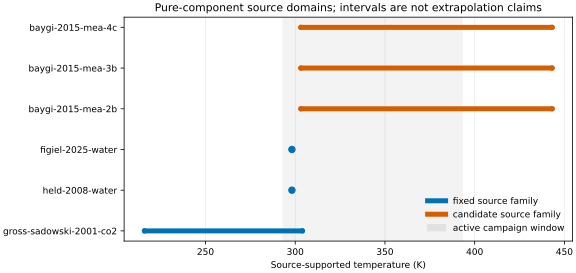

# Pure-component source authority

Issue [#113](https://github.com/tannerpolley/ePC-SAFT/issues/113), child of [#80](https://github.com/tannerpolley/ePC-SAFT/issues/80), classifies the retained CO2, H2O, and MEA pure/self-association coordinates without changing the active parameter bundle.

## Result

- CO2 `m = 2.0729`, `sigma = 2.7852 Å`, and `epsilon/k = 169.21 K` are fixed to Gross and Sadowski (2001), Table 2, over 216–304 K. The installed materialization currently evaluates only through 300 K because its resolved model-domain intersection is narrower. The retired `m = 2.079` differs by `0.0061` (`0.294275%`) and has no exact retained primary-source locator.
- Held (2008) reports `m = 1.204659`, `epsilon/k = 353.9449 K`, `epsilon_AB/k = 2425.6714 K`, and `kappa_AB = 0.0450989` at 298.15 K and 1 bar. The active values match the rounded Figiel (2025) family (`1.2047`, `353.95 K`, `2425.7 K`, `0.04509`) plus `f_solv = 1.5`, not the exact Held digits. Use outside that source point is candidate transfer, not a source-established domain.
- Baygi and Pahlavanzadeh (2015), Table 2, reports separate MEA 2B, 3B, and 4C pure parameter sets fitted over 303.15–443.15 K with the absolute-relative-error objective in Eq. (8). All three remain candidates here. The executed 3B `A=1/B=2` orientation is provisional because Baygi also describes its inverse. Pure-property AADs do not identify a neutral-mixture topology; Issue #114 owns that selection.
- The active neutral-MEA relative permittivity and solvation factor, the transferred water permittivity polynomial domain, and the original fit bounds/covariance/row residuals remain provisional or missing as recorded in [`evidence.json`](evidence.json).

The machine-readable coordinate table is [`coordinates.csv`](coordinates.csv). Exact source-family rows are in [`source-families.csv`](source-families.csv), and public installed-wheel evaluations are in [`installed-wheel-evaluations.csv`](installed-wheel-evaluations.csv).



Exact plotted intervals: [`source-domain-coverage.csv`](figures/source-domain-coverage/output/source-domain-coverage.csv).

## Retained historical check

The data-only plot render is the supported local view. `evidence.json` is the
retained historical producer record; its producer `build_evidence.py` was removed
by #341 (record commit `21d7a112`) and used
wheel SHA-256
`d59abedb354fbd163ea918d3cc96b607f6e8ce8ec7c1f730d12b9653a1541e5d`,
Engine commit `0def56adc38e133f5fcd1ad031649f41529a8888`, immutable v2 inputs,
and the retired `epcsaft.unit_registry` and quantity-valued state outputs.
They are not current verification commands. Current-wheel reconciliation
belongs to a separate migration and must not partially replace this packet or
its retained results.

```bash
MPLBACKEND=Agg .venv/bin/python analyses/2026-mea-parameter-estimation/scripts/pure_components_render_plot.py
```

The public-EOS checks use `rho = 10 mol m^-3` only to falsify load/domain/non-finite failures across each retained source family. They are not saturation-fit residuals or topology-selection evidence.
