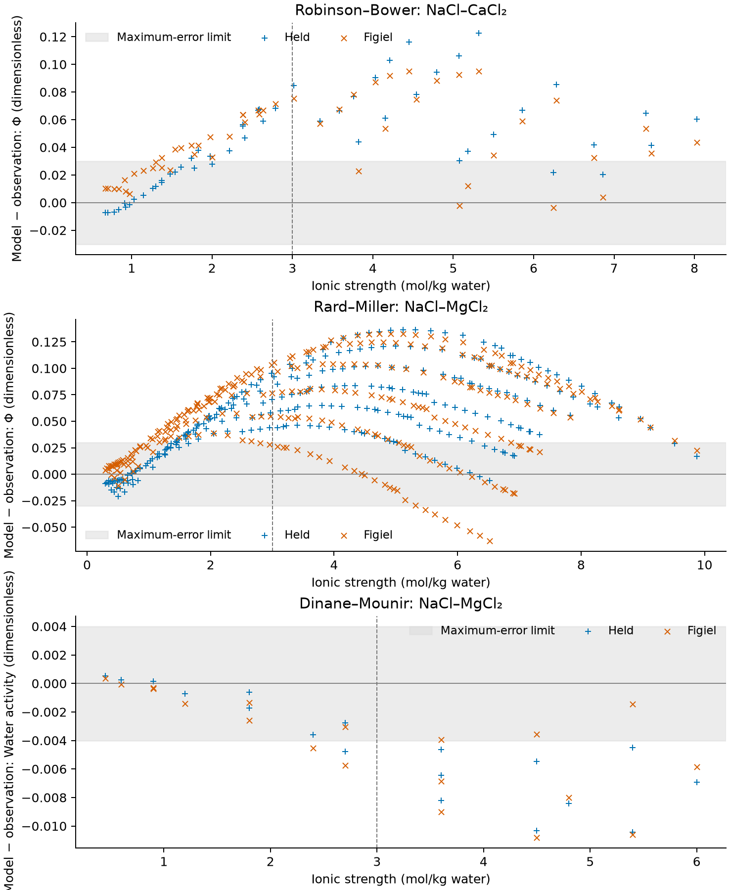

Neither the complete Held declaration nor the provisional Figiel chloride
refit qualifies against the independent NaCl–MgCl₂ and NaCl–CaCl₂ water-property
observations at the frozen engineering limits.
Both fail every source and ionic-strength bucket, throughout the frozen
source-input sensitivity cases.
The Figiel binary-fit improvement does not transfer consistently: it improves
the two high-ionic-strength isopiestic buckets, worsens all lower-strength
buckets, and increases the high-strength hygrometric maximum error.
This is a **documented failure of mixture qualification**, supported by
available native predictions and retained measured-data residuals.

## Question, measurement basis and method

The [accepted design and lead resolution](https://github.com/tannerpolley/ePC-SAFT/issues/556#issuecomment-6204697972)
ask whether either immutable declaration describes measured mixture water
properties and whether the provisional binary refit improves every independent
mixture bucket.
No mixture refit or parameter selection was performed.
The [committed specification](inputs/comparison-specification.json),
[explicit realizations](inputs/frozen-realizations.csv) and
[input hashes](inputs/input-files.json) were frozen before the first residual.

The primary quantities follow the experiments:

- [Robinson and Bower (1966), Tables 1–2, p. 314](https://doi.org/10.6028/jres.070A.027):
  NaCl–CaCl₂ isopiestic compositions, converted to practical osmotic coefficient
  using the actual reference molality and the source NaCl reference anchors.
- [Rard and Miller (1987), Tables I–II, pp. 86–87](https://doi.org/10.1021/je00047a025):
  NaCl–MgCl₂ isopiestic compositions, converted with each physical row's own
  NaCl or CaCl₂ reference molality and coefficient.
- [Dinane and Mounir (2003), Table 1, p. 18](https://doi.org/10.1016/S0378-3812(02)00300-X):
  measured NaCl–MgCl₂ water activity; the explicit salt molalities determine
  composition.

Formula-salt molalities are per kilogram of water.
Complete dissociation gives $I=m_N+3m_D$ and total solute-species molality
$q=2m_N+3m_D$.
The source conversion $ln a_w=-M_wq\Phi$ relates two representations of the
same observation; they are never counted as independent residuals.
Robinson's divalent particle-fraction labels differ from the NaCl
ionic-strength fractions used by the magnesium papers.
The [source metadata](inputs/mixed-chloride-water-observations/1/sources/source-records.json)
retains the conversion equations, uncertainty wording and table locators.



Every equation-of-state property and pure-reference closure runs in native
Properties through `ref.solvent_activity(x=...)`.
The pure liquid reference uses the same temperature, pressure, complete
parameters and permittivity model as its mixture.
Both full declarations retain water, sodium, magnesium, calcium and chloride
in that order, including unoccupied species.
Held uses solvent-only permittivity and no Born term; Figiel retains its
composition-dependent permittivity and corrected Born term.
Equal permittivity model does not require equal evaluated mixture and pure-water
permittivities.
The [parameter locks](inputs/packet-locks.json) identify the unchanged Held
packet version 1 and provisional Figiel packet version 2.
The latter remains a boundary optimum with the parameter-identification limits
of [Engine issue 209](https://github.com/tannerpolley/ePC-SAFT/issues/209).

## Measured-property comparison and verdicts


::: {style="overflow-x: auto;"}

:::

Bias is model minus observation.
The isopiestic coefficient bias is predominantly positive, while the
hygrometric water-activity bias is negative.
The declarations therefore predict greater water chemical-potential depression
than the measured mixtures generally support.
Both the RMS and maximum-error conditions fail in every nominal bucket.
The source-wide result cannot be rescued by selecting the better declaration
in one regime or by pooling differently measured quantities.



The water-activity limits are separate error limits calibrated at one measured
high-strength endpoint, as retained in the
[source-only calibration](inputs/activity-limit-calibration.json).
They are not equivalent coefficient limits over the dataset.
The low-strength hygrometric verdict concerns water activity only.
The [full-range metrics](results/bucket-metrics.csv),
[exact source-fraction metrics](results/fraction-metrics.csv) and
[nominal residuals](results/nominal-residuals.csv) retain the individual scores.

## Frozen sensitivity cases and transfer falsifier

The realizations include printed-input half-place perturbations, shared
reference and fraction changes, source-wide joint rounding, stock and
concentration changes, Robinson reference alternatives and the source-flag
omission.
Shared quantities move together, and derived molalities, ionic strength and
particle molality are recomputed consistently.
Both declarations receive identical realized inputs.
Bucket membership follows nominal source composition; any perturbed crossing
is retained in the row record.
These finite cases are conditional scenarios, not exhaustive interval corners,
probability distributions or independent measurement standard deviations.



No absolute bucket verdict changes under the frozen cases.
Robinson's reference reconstruction sensitivity remains below its frozen bound.
The source-flag omission remains an additional diagnostic and does not replace
the all-point Rard comparison:



Transfer requires a resolved RMS reduction and no maximum-error growth in
every source, bucket and frozen realization.
Positive RMS improvement in the next table favors Figiel; positive
maximum-error growth opposes transfer.



The two high-strength isopiestic buckets satisfy this relative comparison
throughout the frozen cases.
All three low-strength buckets fail it, and the high-strength hygrometric
bucket fails because its maximum error grows despite a smaller RMS.
The stipulated transfer claim therefore **fails**.
Relative improvement in some buckets does not establish absolute adequacy.
The [complete transfer table](results/transfer-tests.csv) and
[realization coverage](results/realization-coverage.csv) show every test.
When a realization changes one source only, unchanged sources explicitly use
their nominal record; no source or bucket is omitted.

## Source uncertainty and reference diagnostics

Robinson and Bower supply no numerical per-row coefficient uncertainty.
The local-quadratic reconstruction comparison is a sensitivity estimate,
not a measurement uncertainty or a rigorous interpolation-error bound.
The five inconsistent printed ratio/fraction rows retain their original
tokens and printed-ratio alternatives.
Their printed ratio-fit differences are not error bars.

Rard and Miller report scatter about smooth curves, concentration agreement,
stock analyses and common reference contributions.
The five low-reference equilibrations are not identified individually, and
the exact stock-to-series assignment is unavailable.
The realization list therefore uses labelled shared whole-table and
whole-source cases without inventing pointwise assignments.
The following magnitude ratios keep the reported component labels:



A relative concentration figure is not itself a Phi uncertainty, and reference
components remain correlated systematic effects.
These ratios are descriptive scales, not standardized residuals or confidence
statistics.
Dinane and Mounir describe their dispersions as fit/model deviations in the
text and measurement uncertainties in the symbol list.
That ambiguity is retained; the diagnostic Phi conversion does not replace the
primary water-activity verdict.
An engineering-limit pass would not establish agreement within experimental
uncertainty.

Pure-salt endpoints and reference anchors are scored separately below and are
excluded from all mixture verdicts:



Every pure-salt endpoint row above exceeds the 0.01 Phi RMS limit under both
declarations, so the mixture failure is not isolated to a mixture-specific
mechanism: the evidence shows that these fixed declarations are inadequate for
the tested water properties.

[Binary reference rows](results/binary-reference-checks.csv) and the endpoint
rows in the nominal residual file retain these diagnostics.
Isopiestic ratio residuals remain in the full row record without a separate
acceptance limit.
The original Engine–Pitzer comparison named in
[the Lithium request](https://github.com/tannerpolley/ePC-SAFT/issues/556)
remains a model-to-model diagnostic; its decade criterion is not used to judge
these measured water properties.
No Pitzer calculation or individual-ion validation is added.

## Numerical evidence and tested domain



All native mixture predictions are available, with positive pressure-density
slopes and the retained pressure closure errors.
The pure-water references return activity exactly one and the named undefined
coefficient, as retained in [pure-reference checks](results/pure-reference-checks.csv).
The [native-state table](results/native-predictions.csv) preserves state status,
causes, branch, root count, convergence records and evaluated permittivity.
The [complete compressed residual table](results/residuals.csv.gz) retains every
source-specific realization, including excluded-from-score source-flag rows.
All-source coverage aliases identify the unchanged rows explicitly.
The numerical repeat agreement is far smaller than the transfer comparison
resolutions and does not explain the observed discrepancies.



The measured comparisons test fully dissociated, single-water-solvent
declarations on the listed ternary compositions at the stated temperature.
The one-bar calculation is a convention because the isopiestic sources do not
establish a complete pressure correction.
These are prescribed liquid states; they establish neither global phase
stability nor pressure dependence.
The measured mixture domain is independent of the prior single-salt fit
domain, and some NaCl molalities exceed that fit domain.
No coordinates or reference standards were tuned to these residuals.
The evidence combines **numerical verification** of the native property with
an **unsuccessful physical-validation attempt** against measured water
properties.
It does not validate individual-ion activities or extraction predictions.

## MS-2 application basis and composition extrapolation



The [raw MS-2 inventory](inputs/smackover-selected-base-feed-ms2.csv) is retained
with its [source identity and conversion basis](inputs/application-basis.json).
Its ionic strength lies **inside** the measured Rard and Robinson ranges.
Calling this an ionic-strength extrapolation would be incorrect.
The extrapolation is **in composition**: two ternary systems do not qualify a
simultaneous sodium/calcium/magnesium feed with its additional ions.
The formal inventory has an unreconciled charge imbalance; no speciation,
precipitation or conditioned extraction inlet is inferred.
The source temperature also differs from the study temperature.
This study supports no parameter adoption for that feed, extraction chemistry,
carbonate chemistry, solids, temperature dependence or calorics.

## Reproduction and decision

Run `scripts/compare.py` with the checkout's editable Engine to evaluate the
frozen cases, then run `scripts/present.py` to format retained numbers and
figures.
The presentation script imports no Engine and performs no model calculation.
Quarto runs with execution disabled and consumes these retained displays only.
The [run identity](results/summary.json) binds source, specification and native
binary hashes; the [presentation inventory](figures/presentation-inputs.json)
binds the displayed values.
The factual observations are published separately as the immutable
`mixed-chloride-water-observations/1` data packet, with no predictions or
qualification verdict embedded in it.

The decision is to return the documented mixture failure and all residuals.
Neither declaration is selected for Lithium's mixed-brine use by this study.
A later mixture refit would require a separate accepted design.
Stage A and this Stage B comparison have independent delivered support; this
notebook has not had investigator promotion for manuscript use.

## Wu inlet and reagent projections with frozen chloride packet /3

This separate study implements [#926](https://github.com/tannerpolley/ePC-SAFT/issues/926),
part of [#902](https://github.com/tannerpolley/ePC-SAFT/issues/902).
It predicts the chloride projections of Wu's treated feed, fresh scrub,
regeneration reagent and fresh strip, using the complete H⁺-containing `/3` packet.
No parameter was fitted and no new packet was published.
The tables are source-relative evidence summaries, never qualification.
Independent delivered review and investigator promotion remain outstanding.

[The frozen input declaration](inputs/issue-902-p12-r1/input-identities.json)
retains source paths and hashes; the copied source tables retain printed tokens,
locators, reference standards, phase labels and exclusions.
Lithium #255 owns the Wu inventory: treated cations are converted from grams per
litre using its atomic masses, scrub retains incoming LiCl, regeneration retains
the carbonate dose separately, and strip is converted from molarity.
The three assumed water masses are discrete sensitivities, not measurements or
confidence limits. Fe, contacted acidity, carbonate dissolution and outlet water
inventories are unavailable. The treated-feed hydrate dose is not counted twice.

All evaluations use native Properties at the declared room temperature and
primary pressure. The separate pressure table repeats the acid and Wu states
with same-pressure solvent and solute references.
The native producer owns composition arithmetic, source conversions, signed
errors, neighbours and descriptive envelopes.
Water activity and osmotic coefficient share an observation; calculated
hygrometric activity coefficients supply no additional activity measurements.
Jiang's positive and Roy/Khoo's negative decimal-log conventions are preserved.



Errors are prediction minus reference. `lnGammaHCl` and `lnGammaMgCl2`
use natural logarithms; `lnAHCl` and `lnAMgCl2` denote neutral products.
`B_obs` is a symmetric maximum absolute source-relative discrepancy on the
selected composition lines and concentration bands crossed by the water cases.
The summary names every contributor and the row determining each union maximum; source-specific
roles and reference alternatives remain separate in
[the attached bands](results/issue-902-p12-r1/coverage.csv).
The feed and scrub water maxima come from the dependent, smoothed Rard
Table IX row 33 at 5.8 m. Regeneration maxima come from its row 29 at 5 m.
These are evaluated comparisons, separate from Rard's primary measurements.
The strip water union maxima come from unadjusted Messnaoui correction
sensitivity at 6 m; the smaller adjusted-water-only scales remain separate
contributors in the table.
Adjusted Messnaoui matches at 5 and 6 m are calibration-selected guards;
its 7.5 m comparison is one-sided and borrowed. Hamer–Wu brackets 7.5 m
on the same evaluated curve above the calibration range.
Matched regeneration signed discrepancies retain each measured or evaluated
reference separately in the summary and attachments; none is averaged.
Each state also retains a separate phase-unresolved note and unavailable
contacted or outlet inventory, including the metal-bearing strip outlet.
Composition matching uses a relative molality tolerance of $10^{-9}$:
$|a-b| \le 10^{-9}\max(|a|,|b|)$ for each cation in mol/kg water.
Bracketing applies the same tolerance to each cation molality divided by ionic
strength at both concentration endpoints; zero and nonzero species remain distinct.
This tolerance handles arithmetic roundoff, not measurement uncertainty.
It corrects ten regeneration attachments from borrowed comparison scales to
bracketing-evidence summaries (between-row error remains unverified):

| Water basis, kg-water/L | Source and reference | Observables | `coverage.csv` lines |
| --- | --- | --- | --- |
| 0.8 | Rard reference paths, second CaCl₂ reference | Water activity; osmotic coefficient | 656–657 |
| 1.2 | El Guendouzi 2001, printed | Water activity; osmotic coefficient | 826–827 |
| 1.2 | Rard reference paths, H₂SO₄ reference | Water activity; osmotic coefficient | 850–851 |
| 1.2 | Rard Table IX, printed | Water activity; osmotic coefficient; log mean activity coefficient; log neutral product | 862–865 |

The El Guendouzi rows now have coverage “inside independent evidence; reference
dependent”; the other eight retain their dependent-comparison coverage.
The 456 finite attachments comprise 42 complete matches, 36 brackets and 378
borrowed comparisons. All predictions, source residuals, band magnitudes and
all other retained result files are byte-identical to the preceding correction.

A finite borrowed scale supplies no guaranteed error at an unmeasured Wu state.
Li, Na and K product errors in the feed, trace-Li scrub activity, actual acidity,
carbonate regeneration and contacted/outlet inventories remain unbounded.

[Every signed source comparison](results/issue-902-p12-r1/errors.csv),
[statistics by source, line, role, phase and concentration band](results/issue-902-p12-r1/source-statistics.csv),
and [nearest rows and composition differences](results/issue-902-p12-r1/nearest.csv)
retain the evidence behind the summary. Rard primary reconstructions and its
correlated alternatives remain separate from its smoothed table. Robinson's
absolute reconstructions remain provisional comparison scales. The disputed
binary magnesium series is retained rather than averaged into Rard.
Yao's inherited exclusions and printed-rounding realizations are sensitivity
records, not additional experiments. Empty groups and absent observables do not pass.

The predicted water-mass spread is separate from the comparison scale:



The [numerical diagnostics](results/issue-902-p12-r1/numerical.csv) retain
positive density and pressure slope, achieved closure and native stopping limit,
and direct neutral log-activity identities.
[Composition, Rard conversion and acid replay checks](results/issue-902-p12-r1/checks.csv)
verify the stated numerical relations.
The following unchanged acid guards preserve the published endpoint;
they do not qualify the Wu mixtures:



The [acid study](../2026-hydrochloric-acid-chloride-basis/notebook.qmd)
owns its historical replay and endpoint selection evidence.
These new results support numerical verification and source-relative comparisons.
They provide no independent physical validation of the complete Wu circuit,
trace-Li selectivity or phase stability. Source uncertainty remains incomplete;
reference, rounding and water-mass sensitivities are not combined statistically.

Reproduce from the checkout root with its own environment:

```bash
EPCSAFT_BUILD_JOBS=6 nice -n 10 .venv/bin/python analyses/2026-mixed-chloride-water-activity/scripts/wu_inputs.py
EPCSAFT_BUILD_JOBS=6 nice -n 10 tools/native-run wu_chloride_coverage
.venv/bin/python analyses/2026-mixed-chloride-water-activity/scripts/wu_present.py
```

Inherited Na/K evidence remains secondary:
[the chloride packet provenance](../../data/packets/figiel-2025-chloride-mixture-refit/2/provenance/source-origin.toml)
identifies the Na–Mg and Na–K–Ca calibration owners, while
[the existing Na–Ca and Na–Mg residuals](results/nominal-residuals.csv)
retain the separate water comparisons. Those systems contain neither the
simultaneous five-cation feed nor trace-Li activity measurements.
Their water residuals are not converted into NaCl or KCl product-error bounds.
