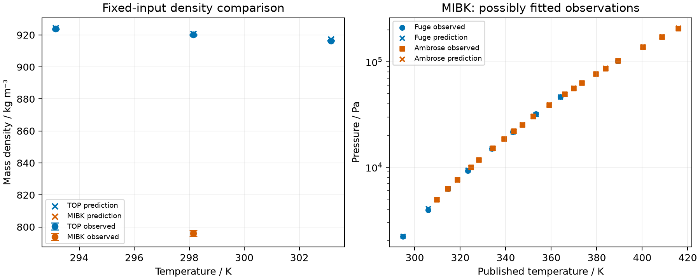

Fixed TOP and MIBK inputs pass the density engineering screen. The TOP
predictions exceed Fang's primary uncertainty bound at every temperature;
the independent MIBK density comparison agrees within its chosen expanded
interval. Both MIBK vapor sources pass their separate engineering screens.
Those vapor differences are descriptive: the observations may belong to the
existing fit and their measurement uncertainty budgets remain unavailable.
No coefficients were fitted. These results have not been independently
reviewed or promoted for manuscript use.

## Fixed inputs and source roles

The [input notes](inputs/README.md) retain complete declarations and source
locators. Yu's TOP tuple is assigned to the branched CAS identity as an
explicit modeling assumption, with effective unlike-site association and no
residual dipole. This does not establish batch identity or physical molecular
self-association. Fang is an external comparison of unknown fitting
independence. MIBK preserves the inherited mass and dipole formulation; its
later density measurement supplies an independent applicability comparison.

The native parameter read-back is exact for continuous values and discrete
site choices, stronger than the design's specified tolerance:



## Density comparisons

The primary Fang nominal pressure is scored separately from the compiler
pressure. MIBK uses its source pressure. Source-interval agreement is distinct
from the one-percent density screen. In the tables, one means the stated
comparison passes and zero means it fails; `NA` means the comparison is
unavailable. Numerical closure has its own table.



The TOP compiler-pressure comparison also lies outside its separate expanded
interval. Temperature shifts do not remove the TOP source-scale discrepancy.
MIBK's separate temperature, pressure and mass-only alternatives remain inside
its chosen expanded density interval. These are finite sensitivities, not a
joint confidence region or parameter uncertainty propagation.



## Descriptive MIBK vapor comparison

The native solve uses a pure feed, free liquid and zero-pinned incipient vapor,
fixed temperature and free pressure. Each source row is repeated from cold
pressure guesses at half and twice the observed value. No source correlation
is used as an observation. Fuge temperatures use the declared conventional
Celsius conversion; Ambrose's published historical scale is retained.



Per-source maxima retain the two vapor sources separately from the two density
comparisons. A vapor screen pass cannot establish independent validation or
measurement-level agreement; neither fit membership nor a row-level source
uncertainty budget was recovered.



## Numerical closure

All liquid states have positive mechanical slope, positive finite density and
the requested branch. All vapor attempts have distinct liquid and vapor
densities, positive slopes, closed material balance and chemical equilibrium,
and pressure agreement from the two starts within the design limits.
Numerical convergence does not prove global stability or physical accuracy.
The retained maxima below are computed natively; individual attempts and raw
residuals remain available in the result tables.







The numerical failure table is empty because no final thermodynamic attempt
failed. An initial input declaration stopped before any calculation because it
omitted the required neutral charge entry; the corrected declaration and the
original diagnostic are retained separately in `results/declaration-failure.json`.



## Carrier prediction and excluded claims

Each row below is **dependent on the n-dodecane stand-in**. It predicts the
owner-selected pure-component carrier at the declared pressure; no measured
technical-kerosene density or composition was adopted. There is no physical
accuracy screen for these predictions, and no uncertainty has been established.



Okeme's calibrated GC-retention estimates and their compiler rendering remain
report-only, as listed in the [source notes](inputs/README.md). No TOP vapor
estimate was calculated. TOP volatility, independent vapor qualification,
actual technical-carrier characterization, mixed-organic interactions and
application extraction predictions remain unqualified. Pure-liquid agreement
does not justify adopting any of those capabilities.
