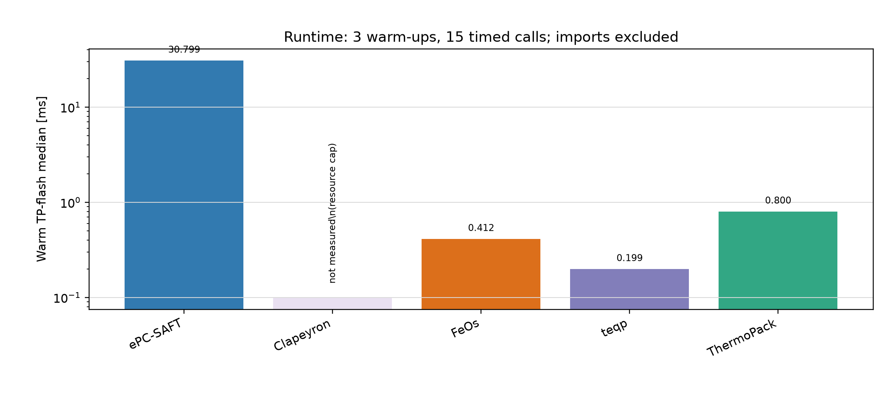

# PH/PS numerical verification

[The caloric comparison notebook](notebook.qmd) records issue #224 slice A's
neutral extensive PH/PS round trips, exact derivatives and FeOs comparison, and
slice B's critical-equation candidates and envelopes against FeOs and teqp.
Its retained tables and limits are separate from the historical inspection below.

Issue #832 verifies an HTML render of the corrected notebook and both retained
qualification-table includes, without running a model calculation. The selected
critical and bubble/dew reference comparisons remain discrete points; the
continuous curve retained in `2026-algorithm-illustrations` has a separate
review boundary. FeOs critical compositions and teqp's polished locus
compositions remain distinct. The rendered notebook and log are under
`build/issue-832/render/2026-open-source-equilibrium-comparison/notebook.html`
and `build/issue-832/render-2026-open-source-equilibrium-comparison.log`.
Independent delivered review and investigator promotion remain open.

# Current ePC-SAFT and open-source equilibrium comparisons

The [2026 FeOs/Clapeyron shared-case benchmark](../2026-competitor-cross-check/notebook.qmd)
compares propane, associating mixtures, NaCl and acetone on one recorded host.
Its source-digit, reference and convention diagnosis is separate from the
historical methane/ethane and external rows below.

Updated 2026-09-23. This is the comparison entry point; case-specific analyses
remain the owners of their inputs, original external rows and provenance.
No external package or Julia process ran during this refresh; only the Engine
rows were regenerated, on the EOS derivative-projection branch
(`perf/eos-derivative-projection`, Engine source of `4e723ea1`) with installed
wheel SHA-256 `aa95dcf7ff164aea649a857f2a5bd12a52ad51d1906e714fa65ec9a7e3ae2bce`
([values](results/current-engine.csv), [provenance](results/provenance.json)).
Every Engine value still matches its retained external row within the checks
below. The earlier 2026-09-22 performance-branch snapshot (wheel `4268f839…`,
flash 5.374 ms) is historical and is not reproduced here.

## Current numerical comparisons

| Case | Current Engine result | Runtime median [ms] | External coverage |
|---|---|---:|---|
| [Propane saturation, 300 K](../2026-neutral-pcsaft-equilibrium-comparison/README.md) | P = 998660.895740 Pa | not measured | Clapeyron, FeOs, teqp, ThermoPack |
| [Methane/ethane bubble, 180 K, x(CH4)=0.5](../2026-binary-methane-ethane-bubble-point/README.md) | P = 1596859.111303 Pa; y(CH4) = 0.956360242961 | 10.142 | FeOs, ThermoPack |
| [Methane/ethane TP flash, 180 K, 1 MPa, z(CH4)=0.5](../2026-binary-methane-ethane-tp-flash/README.md) | beta(V) = 0.326154679039; x(CH4) = 0.294537595547; y(CH4) = 0.924491472211 | 6.124 | all four; Clapeyron timing missing |

The refresh checks current Engine values against every available original row:
fractions within 1e-8 absolute and pressure/density within 1e-7 relative.
These are implementation-agreement checks, not experimental validation.
All three cases were rerun on this wheel. The flash uses the central cold case
from a fresh `performance.py current` run (15 samples), which also re-passed
that analysis's nine-case value assertions.



| TP-flash path | Median [ms] | p10–p90 [ms] | Measurement status |
|---|---:|---:|---|
| ePC-SAFT general driver | 6.124 | 5.981–6.222 | wheel `aa95dcf7…`, 2 warm-ups / 15 calls |
| FeOs native flash | 0.412 | 0.284–0.452 | historical, 3 warm-ups / 15 calls |
| teqp phase solve + lever rule | 0.199 | 0.162–0.236 | historical, 3 / 15; wrapper status unset |
| ThermoPack native flash | 0.800 | 0.640–1.035 | historical, 3 / 15 |
| Clapeyron native flash | not measured | not measured | state values retained; bounded specialization exceeded memory cap |

These are warm-process, cold-nonlinear-start timings, excluding imports/model
construction. Engine includes automatic initialization with no phase guesses.
teqp solves two coexisting phases with supplied phase guesses and recovers the
feed fraction by the lever rule; it is not a feed-aware flash interface in the measured
path. Its small residual is retained although the solve did not report success.
Different exposed algorithms and noncontemporaneous measurements prevent an
algorithm-neutral or rigorously paired cross-package speedup claim.

The fresh bubble timing is 10.142 ms, p10–p90 9.828–10.670 ms (5 warm-ups /
25 calls), within the spread of the earlier 10.021 and 10.030 ms cohorts. Runs
used one BLAS/OpenMP thread. A trace of 15 warm cold flash solves on this wheel
(6.15 ms median traced) attributes 2.85 ms per solve to 333 EOS evaluations and
3.17 ms to driver-exclusive time: Ipopt/MUMPS plus untraced preparation,
polishing and checks. That exclusive time, not EOS derivatives, now bounds how
close the single general driver can come to the dedicated flashes above.

## Where the general reactive driver pays off

The [nine-species Li/Na reactive extraction study](../2026-reactive-electrolyte-driver/notebook.qmd)
uses two liquid phases and two reactions in the same equilibrium driver. Its
producer was rerun twice per wheel with `--results` outside the repository
(one thread, one pinned core, one warm-up and five alternating samples per
workload); the per-sample rows are retained in
[reactive-projection-timings.csv](results/reactive-projection-timings.csv):

| Workload (median of five, run 1 / run 2) | main `cee3acc6…` [ms] | projection `aa95dcf7…` [ms] |
|---|---:|---:|
| Cold solve, reused model (31 iterations) | 61.585 / 59.819 | 54.630 / 49.019 |
| Cold solve, fresh model/tapes (31 iterations) | 62.856 / 59.713 | 52.444 / 49.717 |
| Previous-result seed (12 iterations) | 41.840 / 41.177 | 36.256 / 34.744 |
| Three exact responses, one batch | 1.703 / 1.663 | 1.673 / 1.642 |
| Three exact responses, separate requests | 3.228 / 3.281 | 3.162 / 3.120 |
| Finite-difference responses, six solves (83 iterations) | 300.796 / 292.710 | 255.341 / 243.314 |

Projection lowers the solve rows by 11–18% with unchanged iteration counts; the
exact-response rows are unchanged within noise because they already use full
preparation once. The batched exact response costs about 148 times less than
six finite-difference solves on this wheel. This is incremental derivative
cost, not an end-to-end flowsheet speedup. The retained reactive rows record
timings, iterations and success only; state and derivative agreement between the
wheels is established by the Engine's native checks and recorded oracle rows (#128),
not by this table. Declared phase supports and local branch checks are not a
global phase-stability proof.

Batching three independent exact responses shares preparation and factorization:
3.120 ms separately versus 1.642 ms batched (47.4%) in run 2 above; the notebook's
[result section](../2026-reactive-electrolyte-driver/notebook.qmd#result-and-scope)
retains the earlier same-wheel measurement on main `80f23237` (48.7%).

For Lithium optimization the useful boundary is the jointly solved phase split,
reaction/speciation, charge balance and reagent inventory. Exact derivatives of
that coupled solution let an outer optimizer change O/A, carrier concentration
and incoming loaded-solvent composition while accounting for changing Li/Na
partitioning and available extractant. Separate flash/speciation iteration or
finite differences can require many extra full solves and amplify solve noise.
Ipopt is useful because this is a constrained coupled problem, not because a
simple neutral binary flash needs a general nonlinear optimizer.

The referenced **Review IDAES adapter capabilities** task reports qualified
reactive first/second callback derivatives at fresh and loaded states. Its
connected stage reached an optimum, but a Hessian finite-difference qualification
check was still failing when inspected. That newer adapter branch is not this
wheel, and its complete flowsheet qualification and performance are not claimed
here. One Engine driver does not mean one Ipopt instance for an entire flowsheet:
an outer IDAES/Pyomo optimizer can call the inner Engine equilibrium driver.
Smooth local implicit derivatives do not automatically survive phase appearance,
support changes or singular equilibria.

## Performance candidate dispositions

1. **Reactive previous-state initialization: the blind-skip shortcut is rejected.**
   A reactive previous-result solve still runs `boundary_start`, which performs
   current-condition declared-root admission before the previous coordinates are
   overlaid; only neutral, non-associating two-phase TP split seeds bypass it. An anchored local-root check is
   not equivalent, as an existing native counterexample demonstrates. On this
   wheel the seed cuts Ipopt iterations from 31 to 12 and the solve from 49.0 to
   34.7 ms (run 2 above); the traced cold solve spends 9.4 ms in `boundary_start`.
   [Issue 103](https://github.com/tannerpolley/ePC-SAFT/issues/103) retains the
   bounded negative result, not a claim that all reuse is impossible.
2. **Independent response preparation is shared within one explicit call.**
   `solved_state_first_actions` supplies the 47.4% response-time saving above;
   mixed higher-order requests still use their original meaning and owner.
   The newer IDAES callback path needs its own integration/profile before this
   saving can be claimed there ([issue 104](https://github.com/tannerpolley/ePC-SAFT/issues/104)).
3. **EOS derivative projection is implemented on this branch.** Optimizer phase
   preparation differentiates only V, support amounts and T when free, and the
   association site partials no longer form the full tape Jacobian; the timing
   rows above are the retained evidence
   ([issue 105](https://github.com/tannerpolley/ePC-SAFT/issues/105)).

An untraced profile breakdown of the cold reactive solve is not retained; the density search was observed as the largest remaining EOS consumer and remains a performance question for issue 105.

## Bounded reproduction

Build/install the intended wheel through the normal Engine environment first.
This command reuses the existing pure/bubble collectors, checks the flash sample
wheel hash, retains new bubble samples, and never imports an external EOS package:

```bash
(
  ulimit -v 700000
  timeout -k 3s 30s nice -n 19 taskset -c 0 env \
    OMP_NUM_THREADS=1 OPENBLAS_NUM_THREADS=1 MKL_NUM_THREADS=1 \
    RUNTIME_WARMUPS=5 RUNTIME_SAMPLES=25 \
    .venv/bin/python analyses/2026-open-source-equilibrium-comparison/scripts/refresh_engine.py
)
.venv/bin/python analyses/2026-binary-methane-ethane-tp-flash/scripts/render_figures.py
```

The render step only reads retained values. A different wheel must first obtain
its own flash samples via the case's existing `performance.py`; it cannot silently
reuse these measurements. External source identities, native test outcomes and
resource failures remain in their original case analyses, not new claims about
current external development branches.

The reactive rows come from installing each wheel in turn and running
`taskset -c <core> env OMP_NUM_THREADS=1 OPENBLAS_NUM_THREADS=1 MKL_NUM_THREADS=1
.venv/bin/python analyses/2026-reactive-electrolyte-driver/scripts/run.py --results <dir>`;
each run's `timings.csv` rows are copied, with the wheel identity, into
[reactive-projection-timings.csv](results/reactive-projection-timings.csv).

## Historical capability inspection and target comparison

**Investigation date:** 2026-09-21

**Engine snapshot:** `2f44dfc171dec80cf7a28c699039326a4b74bf7f`

## Question and comparison boundary

The comparison target is not merely a flash routine. The current Engine
specification calls for:

- one equilibrium driver and one shared Helmholtz implementation;
- exact weighted Lagrangian curvature for admitted TP, bubble/dew, and
  vapor-fraction specifications;
- phase amounts, supports, electroneutrality, and reaction constraints;
- implicit state/property actions through third order on smooth branches,
  including active EOS parameters;
- ePC-SAFT association and electrolyte contributions; and
- caloric/reference inputs and residual-EOS parameter fitting.

These requirements are documented in [`docs/scientific/CONTEXT.md`](../../docs/scientific/CONTEXT.md#engine-responsibilities)
and [`engine/docs/science/algorithms.md`](../../engine/docs/science/algorithms.md).

The important distinction is between four levels of differentiation:

1. derivatives of the Helmholtz EOS;
2. Jacobians/Hessians used internally to solve equilibrium;
3. derivatives of an equilibrium solution with respect to inputs or
   parameters; and
4. a general higher-order action interface that carries all implicit chains.

The inspected packages supply overlapping EOS, phase-equilibrium and implicit
differentiation capabilities. The inspection did not establish an equivalent
single reactive-electrolyte driver/action interface in those entry points; it is
not proof that no other package or extension can provide one.

## Closest open-source candidates

| Tool | What it does that is close | Material gap to the Engine target |
|---|---|---|
| **Clapeyron.jl** | Closest overall framework. It supports Helmholtz/SAFT models, PC-SAFT variants, automatic differentiation of EOS properties, phase equilibria, parameter estimation, and current ePCSAFT electrolyte models combining neutral EOS, DH/MSA/Born electrostatics, and dielectric models. Its root-solver documentation describes implicit-function-theorem differentiation, including arbitrary-order derivatives through `IFTDuals`. ([EOS/AD documentation](https://clapeyronthermo.github.io/Clapeyron.jl/dev/properties/basic/), [ePCSAFT/electrolytes](https://clapeyronthermo.github.io/Clapeyron.jl/dev/eos/electrolytes/), [implicit differentiation](https://clapeyronthermo.github.io/Clapeyron.jl/dev/implicit_differentiation/)) | Its documented flash methods are still method-specific: `RRTPFlash` is first order and is the listed electrolyte flash; `MichelsenTPFlash`, `MultiPhaseTPFlash`, and `GeneralizedXYFlash` are second order with different model/phase limits. The flash interface calls the problem non-reactive, and I found no reaction-equilibrium driver equivalent to the Engine's stoichiometric, charge-safe formulation. ([flash matrix and interface](https://clapeyronthermo.github.io/Clapeyron.jl/dev/properties/flash/)) |
| **FeOs + feos-torch** | Closest differentiable PC-SAFT equilibrium example. FeOs uses generalized hyper-dual numbers for exact partial derivatives of Helmholtz EOSs and calculates pure/multicomponent phase equilibria. `feos-torch` exposes PyTorch automatic differentiation through selected PC-SAFT equilibrium outputs, including gradients of vapor pressure with respect to PC-SAFT parameters and bubble/dew calculations. ([FeOs](https://github.com/feos-org/feos), [feos-torch](https://github.com/feos-org/feos-torch)) | The documented `feos-torch` surface is a focused PC-SAFT differentiable-equilibrium package: vapor pressure, liquid density, equilibrium liquid density, and bubble/dew pressure. It is not a general reactive/electrolyte equilibrium compiler or a third-order equilibrium-action interface. |
| **teqp** | Very strong EOS kernel. It provides generic automatic differentiation, PC-SAFT with association, composition derivatives, and phase algorithms whose Jacobians are generated from the EOS. Its generalized phase-equilibrium algorithms are deliberately model-agnostic. ([derivatives](https://teqp.readthedocs.io/en/latest/derivs/derivs.html), [algorithms](https://teqp.readthedocs.io/en/latest/algorithms/index.html)) | It is intentionally not a feature-rich property/equilibrium platform. The current implementation exposes EOS derivatives and solver Jacobians, but not the Engine's reactive-electrolyte inputs, reaction constraints, one-driver specification compiler, or general equilibrium-solution action ladder. |
| **ThermoPack** | Mature open-source multiphase engineering library with TP/PH/PS/UV flashes, VLE/LLE/VLLE diagrams, and derivative outputs with respect to temperature, pressure, volume, and mole numbers. ([project](https://github.com/thermotools/thermopack), [differentials and flashes](https://thermotools.github.io/thermopack/vcurrent/getting_started.html)) | It exposes selected analytic/numerical derivative routines rather than a generic Helmholtz autodiff tape with arbitrary higher-order implicit actions. I found no equivalent reactive-electrolyte equilibrium formulation or single exact-curvature driver. |

## What is actually unusual about the Engine

Having full EOS derivatives is necessary for the Engine's equilibrium work, but
it is not the whole differentiable-equilibrium capability. The Engine combines
those derivatives with a compiled constrained equilibrium problem and retains
the implicit chains through density, association, reaction, phase, and parameter
coordinates. Its current design requires one Ipopt driver with exact curvature,
while its scientific context targets directional actions through third order.

That is the part that makes the Engine unusual. The closest comparisons divide
the work between separate concerns:

- Clapeyron is closest in model breadth and has the strongest documented
  implicit-AD story, but its equilibrium methods expose different derivative
  orders and different physics boundaries rather than one common reactive
  driver.
- FeOs-torch is closest in demonstrating gradients of phase-equilibrium outputs
  with respect to PC-SAFT parameters, but it is narrower in equilibrium
  specifications and model physics.
- teqp is closest in the derivative-first EOS architecture, but intentionally
  leaves higher-level property and application workflows to other packages.
- ThermoPack is closest in broad engineering flash coverage and selected
  differentials, but not in generic higher-order automatic differentiation.

## Capability-inspection conclusion

Yes: open-source tools exist that are genuinely comparable in pieces.

The strongest single near-match is **Clapeyron.jl**, especially now that it has
ePCSAFT/electrolytes and implicit differentiation. The strongest match for
**differentiable PC-SAFT equilibrium outputs** is **FeOs + feos-torch**. The
strongest match for the **EOS derivative kernel** is **teqp**.

No single inspected tool provides the complete combination that the Engine is
being built to provide: ePCSAFT electrolyte/reaction equilibrium, one shared
constraint driver, exact curvature, and controlled higher-order actions through
the equilibrium solution. Therefore, the Engine is not redundant merely
because these projects exist. Its value is the integration boundary between
the EOS and the reactive equilibrium/action system.

The practical use of these projects is as comparative references:

1. compare neutral PC-SAFT values and EOS derivatives against teqp and FeOs;
2. compare ePCSAFT electrolyte conventions and phase calculations against
   Clapeyron; and
3. compare equilibrium sensitivities on small PC-SAFT cases against
   feos-torch/Clapeyron before claiming broad Engine action coverage.

This original capability inspection did not clone or build the external projects, and it does
not claim that their latest development branches are numerically equivalent to
the Engine. It compares their current public documentation and source-level
capability descriptions against the Engine's stated requirements.

#341 removed slice B's fix-round `key-solves/work.csv`, byte-identical to the electrolyte round-5 work rows; its `summary.json` stays (record commit `21d7a112`).
