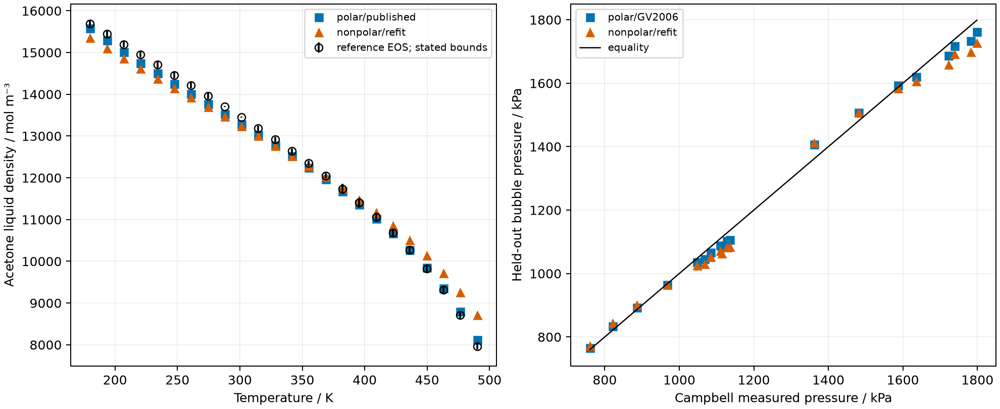

The Gross–Vrabec polar model with its own parameters improves acetone liquid
density and the held-out acetone–n-pentane pressure comparison relative to the
selected nonpolar model with its own parameters. The published polar sets do
not improve every vapor-pressure comparison. This is a comparison of complete
model and parameter pairs, so the improvement cannot be assigned to the added
term at fixed parameters.

**Claim class:** published fitted-model/reference comparison; calibration and
held-out prediction for analysis-owned refits. The separate teqp term comparison
is numerical verification. Reference-equation agreement is not independent
physical validation.

## Question, conditions and data roles

Does the optional Gross–Vrabec dipole term improve polar-fluid saturation and
acetone–n-pentane vapor–liquid equilibrium under the selections retained here?
The [README](README.md#complete-modelparameter-pairs-compared) owns the source
locators and uncertainty conventions. Gross–Vrabec Table 2 supplies the published
polar parameters; Gross–Sadowski supplies the ether and pentane nonpolar sets.
Nonpolar acetone and DMSO use local refits, with local polar refits as a separate
comparison. [ADR 0011](../../docs/scientific/decisions/0011-optional-dipole-dipole-term.md)
owns the optional term.



Acetone, dimethyl ether and diethyl ether use evaluated reference equations
through the retained CoolProp source rows. DMSO uses the ThermoML measurements
identified in the README, including the near-saturation pressure approximation
for liquid density. Alternating calibration/validation labels define this
analysis's pure refits. They do not identify the unavailable original KDB/DIPPR
training observations. The reference equations may share experimental ancestry
with those databases. DMSO measurements postdate the published polar parameters.

Campbell Table I supplies paired liquid/vapor pentane mole fractions and pressure.
The binary interaction is fitted to the lowest-temperature digitized isotherm;
the warmer paired observations are withheld from that interaction fit. Pure
parameter ancestry still applies. Campbell's Margules model is fitted separately
per isotherm and is not a held-out pressure prediction. The paired table and
the separate symbol digitization are different reference sets.

## Saturation and binary evidence





The all-row and withheld-row columns preserve their distinct roles. The paired
pressure ranking favors the polar model after binary calibration, while the
Margules pressure residual has an in-sample advantage. Unavailable optimizer
starts in `results/summary.json` remain unavailable; a successful selected fit
does not imply every initialization worked. The pure native conversion and
historical binary wheel are separate executions, identified by `wheel_sha256`
and `binary_wheel_sha256` in that summary. `results/batch3-comparison.json`
retains the conversion diagnostics. `results/teqp-dipolar-rows.csv` supplies
fixed-state term references, not physical observations.

## Uncertainty and limits

Pressure and density uncertainty fields in `results/pure-rows.csv` belong to the
named reference sources; blanks mean no stated uncertainty. Diethyl-ether bounds
are deviation envelopes, not expanded measurement uncertainties. The density
panel shows the retained acetone bounds. The binary digitization and printed
composition precision limit how strongly small model differences can be read.
`results/summary.json:reproduction` retains the property-specific gap checks:
published acetone and DMSO pressure gaps fail the predeclared reproduction
criterion, and the selected reference bounds do not resolve those gaps.

Pure fitted coefficients remain correlated; the retained conditional covariance
describes local conditioning only. The evidence establishes neither global
identifiability nor predictive uncertainty. No electrolyte, ion, cross-multipole
or global-stability claim follows. The binary results keep their historical
wheel identity and have not been recomputed on current main.

## Presentation and review boundary

`nice -n 10 .venv/bin/python tools/present-paper-evidence.py` reads retained CSV/JSON
and prepares the included tables and figure without importing the Engine.
The pure table uses `results/pure-summary.csv`; the binary table uses
`results/binary-xy-summary.csv`; the plot reads their row-level companions.
The readiness finding is batch A of the issue-501 promotion review.
This notebook presentation has not been independently reviewed or promoted for
manuscript use.
