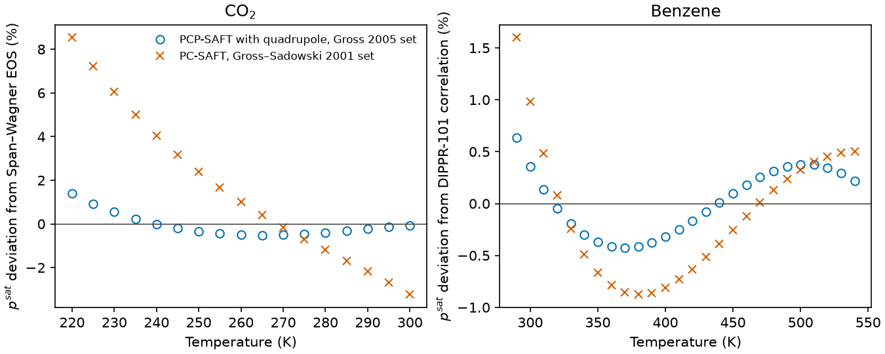

```{python}
#| echo: false
import csv
import json
from pathlib import Path

results = Path("results")
summary = json.loads((results / "summary.json").read_text())
rows = list(csv.DictReader((results / "engine-rows.csv").open()))
worst = summary["max_relative_vs_clapeyron"]
aad = summary["aad_percent"]
commit, clean = summary["engine_provenance"]


def count(kind, species=""):
    return sum(r["kind"] == kind and r["case"].startswith(species) for r in rows)


def e(value):
    return f"{value:.1e}"
```

**Question.** Does the Engine's quadrupole term (ADR 0014) equal the Gross (2005)
equations, and with the paper's own parameters does it reproduce the paper's
vapor-pressure improvement for CO2 and benzene?

**Answer.** Yes, within the stated limits. The term equals Clapeyron 0.6.29 to
`{python} e(worst["a_qq"])` relative at four fixed states, and FeOs 0.10.1 to
`{python} e(summary["max_relative_vs_feos"]["a_qq"])` at the three states where every m ≤ 2 (FeOs caps each m
and carries longer J constants, so its criterion is looser). Saturation pressures
agree to `{python} e(worst["p_sat"])` and the CO2/N2 bubble points to
`{python} e(worst["p_bubble"])`. With the quadrupole, the CO2 vapor-pressure AAD
against Span–Wagner over 220–300 K is `{python} f"{aad['carbon-dioxide quadrupole vs Span-Wagner 220-300 K']:.3f}"` %.
The nonpolar Gross–Sadowski 2001 set gives
`{python} f"{aad['carbon-dioxide nonpolar GS2001 vs Span-Wagner 220-300 K']:.2f}"` %;
the paper reports 0.34 % and 2.78 % against IUPAC tables. Benzene over
290–540 K gives `{python} f"{aad['benzene quadrupole vs DIPPR-101 290-540 K']:.3f}"` %
against DIPPR-101 (paper 0.29 %; the readiness review found 3.00 % with the dipole's m ≤ 2 cap).
The nonpolar set gives `{python} f"{aad['benzene nonpolar GS2001 vs DIPPR-101 290-540 K']:.3f}"` %.

Evidence class: the Clapeyron rows are numerical verification (code identity).
The saturation AADs reproduce the paper's physical result against reference
correlations, not new validation. The CO2/N2 bubble point checks the mixing
rule's code identity only.

## Saturation pressure against reference correlations



The quadrupole set removes most of the CO2 temperature trend that the nonpolar set
shows. For benzene, both sets stay within about 1.6 %, and the quadrupole set
roughly halves the AAD, mostly between 320 and 460 K. The Span–Wagner and DIPPR
references carry their own uncertainty, which is not propagated here, and they are
not the data behind the paper's AADs.

## Method and conditions

- **Parameters.** CO2 and N2 use the Gross (2005) Table A1 literature-Q sets, and
  benzene uses its single set (`data/packets/gross-2005/1`), with n_Q = 1 and
  k_ij = 0. The nonpolar comparison uses `gross-sadowski-2001/3`.
- **Term isolation.** a_qq = a^r(polar family) − a^r(same parameters without it), at
  fixed T, ρ and x.
- **Comparator.** Clapeyron `QPCPSAFT` (`scripts/clapeyron_reference.jl`), one Julia
  process. Its moments are rescaled to the Engine's debye bridge, which uses the
  CODATA 2018 vacuum permittivity, so both codes see identical reduced moments.
  Its saturation and bubble solves use the tight tolerances of the competitor
  cross-check, because Clapeyron's defaults stop near the solved-value criterion.
- **References.** CO2 uses Span–Wagner. Benzene uses the DIPPR-101 form with coefficients taken
  from the readiness probe, not checked against the DIPPR compilation (Gross 2005 data ref. 2).
- **FeOs.** `scripts/feos_reference.py`, with the same moment rescaling; benzene is
  excluded because FeOs applies the dipole's cap to each m.
- **Engine solves.** Each solve runs natively through the one equilibrium driver
  (`scripts/compare.py`). The rows are
  `{python} count("a_qq")` term states, `{python} count("p_sat", "carbon-dioxide")` CO2
  and `{python} count("p_sat", "benzene")` benzene saturation temperatures, and
  `{python} count("p_bubble")` bubble points. There were no failed solves.
- **Engine source.** Editable build of commit `{python} commit`, with
  `{python} "no" if clean else "some"` uncommitted Engine changes.

Persistent checks are in `engine/tests/eos/test_quadrupolar.py`, against the retained
Clapeyron and FeOs rows: term identity, the second-virial limit, saturation with both AAD
criteria, the bubble point, exact derivatives and the absent-species limit; the
file states each criterion.

## Limits

- The quadrupole constants come from simulations up to elongation L* = 0.8 and
  0.5–0.99 T_c; benzene's chain length lies beyond them, the source's own
  extrapolation.
- The source finds its mixing rule unsuitable for mixtures with more than one
  quadrupolar component. The CO2/N2 rows show code identity, not mixture accuracy.
- No claim for ions or electrolyte combinations, or for composition derivatives
  above first order along an absent quadrupolar species.
- The dipole–quadrupole cross term remains retired. teqp 0.23.2 is not a quadrupole
  comparator: its third-order term has the opposite sign and the dipole's J3 table.

This report has been independently reviewed as numerical verification; it is not
promoted for manuscript use.
