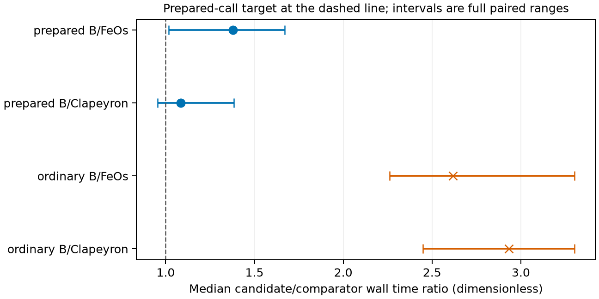
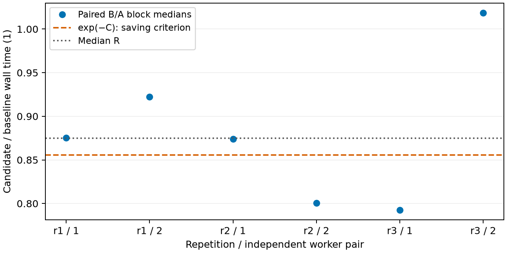
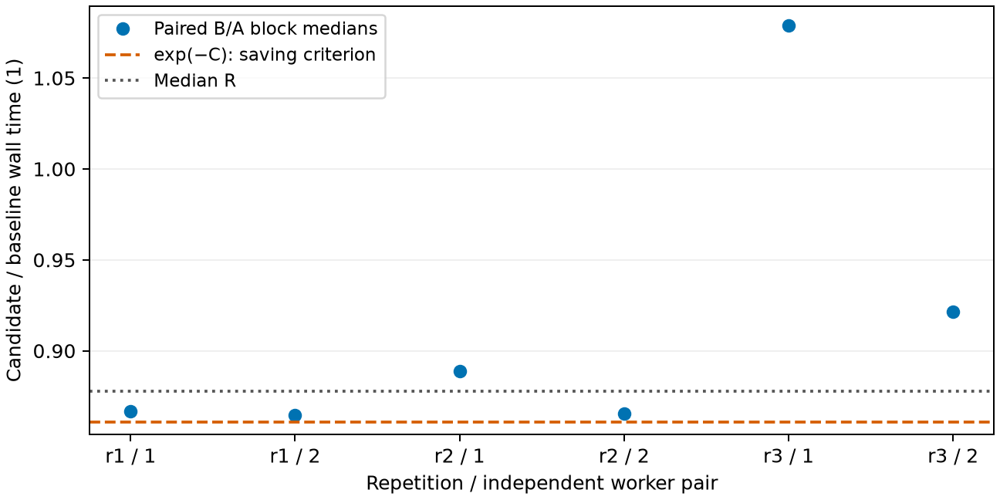
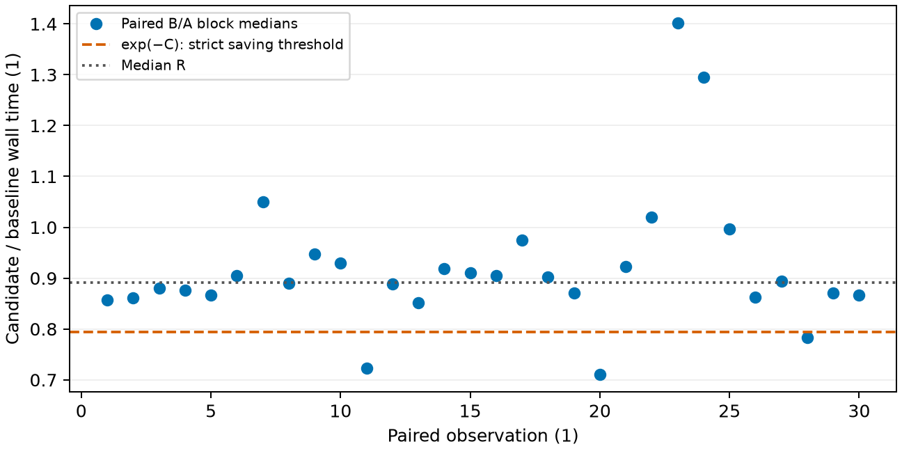

## Question and basis

Does the exact two-density reduction preserve pure-fluid coexistence and its
solved-state actions while reducing the cost of the declared propane request
`C1-300`? This notebook reports numerical verification of the fixed model and
single-host cost measurements. It supplies no new physical validation or
parameter adoption. Independent delivered review and investigator promotion
for manuscript use remain outstanding.

The governing pressure and chemical-potential equalities, log-density Jacobian,
volume-series projection and extensive basis are defined in
[the Engine equations](../../engine/docs/equations.md#one_component_two_density).
[The algorithm](../../engine/docs/science/algorithms.md#alg-equilibrium) owns the
start, full-row criterion, double polish, conditioning estimate, conditional
wider arithmetic, branch admission and original-start fallback. The
[accepted scoped decision](../../docs/scientific/decisions/0009-general-platform-one-driver.md)
keeps these operations inside the existing equilibrium driver. The accepted
amendments define the retained comparison and cost criteria.

The declared request and model parameters come from the existing
[comparator input owner](../2026-competitor-cross-check/inputs/cases.json) and
[Gross–Sadowski propane packet](../../data/packets/gross-2001-propane/3/parameters/parameters.json).
The nonpolar, polar and associating qualification inventories retain the same
source declarations used by their reproduction analyses. All coexistence,
action, fitting and independent root calculations run in native code.
Python declares requests or reduces retained measurements.

## Interim prepared-call package

The merged-head qualification below compares a detached checkout of current main
with the candidate after main integration. Equations, parameters, row criteria,
precision decisions and both anchored density checks remain unchanged.
The whole-call prepared measurement compiles the declaration before timing,
then starts each native solve afresh and reads the existing result quantities.
No previous root or result carries between calls.



This is numerical and computational verification on one shared host, with an
observed control envelope rather than a confidence interval. It supplies no
physical validation, universal speed claim or manuscript promotion.
These interim observations do not qualify the dedicated route below.

The earlier daytime run remains separate evidence below. Its measurements are
not pooled with the merged-head campaign or used to qualify the merged images.
Its historical image identities, gates and limits apply only to that run.



## Original reduction: numerical agreement

The regular inventory was fixed before the precision trigger was implemented.
The table compares candidate B against frozen A using quantity-scaled errors,
with separate strict relative pressure and density checks. The boundary group
also contains near-critical requests and a refused request with retained rows;
its maximum density difference therefore uses the accepted conditioning-aware
comparison. The regular subset keeps the strict comparison independently.



The per-state work table compares the candidate against round three. The added
correction occurs only at the regular propane boundary point identified in
[the retained per-state table](results/regular-work-deltas.csv). The catalogue,
polar and associating states keep their previous values and work. No regular
state engages extended arithmetic.



The unchanged ancillary check compares each solved density to the
Bell–Deiters starting density and pressure to the vapor-density equation-of-state
pressure. Its original limits remain in the existing native check. The largest
segment-count row also has an independent binary128 evaluation of the remaining
log-density correction. This comparison verifies the numerical calculation;
the ancillary is not a physical observation.



The near-critical table distinguishes published states from rejected attempts.
Working bits and corrections on a refused request describe the rejected attempt,
not an available physical state. The forward-error estimate combines the achieved
reduced residual, its evaluation floor and the reduced inverse norm. It is a
first-order estimate, not a rigorous bound on every equation-of-state operation.
The independent reference reuses contribution equations with CppAD binary128
volume derivatives, rather than the production Taylor derivative representation.
The branch refusal near criticality remains a numerical limitation and does not
establish physical nonexistence.



Available first and higher actions and parameter-fitting columns compare with A
on the retained observable and coordinate scales. The checks cover nonzero affine
origins, independent and tied coordinates, and Difference and LogRatio residuals.
Acetone uses the active parameter families supported by A; methanol includes
association energy and volume. The Clapeyron identity and inner-association
refinement operands remain in the linked tables.



[The failure diagnostics](results/failure-diagnostics.json) retain density-ordering,
work-limit and invalid-input causes. An interrupted association calculation
reaches prediction without a value and with its original association-residual
cause. A physically valid coexistence point re-expressed in an all-pinned
singular declaration satisfies the defining rows; its rank-deficient actions keep
the central pressure and density values. This diagnostic re-expression is not a
new production solve or a new admitted branch.

[The key-solve bitwise comparison](results/key-bitwise.json) includes the unchanged
ionic and reactive states and the frozen fitting value and column arrays. The
engineering gates use the same prepared baseline and same-host full-fit control.
These gate timings are distinct from the quiet-host comparator measurements.



## Historical computational cost of the original reduction

The original prepared-call target was missed against both comparators. The remaining
prepared-call cost reduction was examined in the interim package above.
Ordinary solving is faster than A, but remains slower than each comparator.
The paired ranges and same-image controls below bound these single-host findings.

The ordinary workload reuses the release worker's entire call, including native
compilation and return extraction. The prepared candidate workload compiles the
same declaration once during untimed preparation; each timed call starts a fresh
compiled solve and extracts pressure, both densities and convergence diagnostics.
No solved state, density root or endpoint is reused between samples. FeOs and
Clapeyron retain their release-worker saturation methods and extraction boundary.
Prepared reuse therefore measures a different calling workload from ordinary
one-shot solving.

[Image A](results/image-A.json) and [image B](results/image-B.json) identify the
prepared sources, interpreter, editable loader, install plan and loaded image
hashes. Guarded workers forbid subprocess launches and rebuilds and recheck image
identity after measurement. Both Engine images have independent control workers.
[Preflight](results/preflight.json) and [per-sample postflight checks](results/checks.csv)
compare pressure and both densities before interpreting cost. The frozen release
records are unchanged.



All arms use the same logical CPU, niceness and single-thread numerical pools.
The controller reuses release interleaving, warmup, repetition and quiet-host
admission. [Block records](results/blocks.csv) contain preparation time and host
load before and after every arm; [selection](results/selection.csv) records any
disturbed operation and its complete replacement. Disturbed samples are retained
and selection never depends on speed. Absolute times below are medians of block
medians; intervals span those block medians. Comparator ratio intervals span all
paired block ratios from both candidate workers. These are observed ranges, not
confidence intervals or significance tests.







The prepared-call criterion applies independently to each comparator. A median
above the displayed target remains a missed requirement; numerical agreement
and improvement against A do not waive it. Same-image controls quantify the
spread on this host. These measurements do not establish universal speed or
performance outside the declared request and worker configuration. Julia reports
wall time only; missing CPU times are displayed as unavailable.

## Scope and retained evidence

The change keeps the same physical parameters, thermodynamic equations, full-row
criteria and branch checks. Source and parameter uncertainty were not estimated.
The no-wider-`long double` branch was not exercised on this host. Fixed-pressure
saturation, mixtures, new critical solvers and derivative families outside A's
support remain outside this task.



The gross source accounting uses the unchanged baseline and the pinned
formatter. Properties remains at its authorized gross allowance; the existing
layer and total ceilings pass. Source probes, full gate logs, candidate identity
and the build report are retained under the main checkout's
`build/issue-854/build-r4/`. This notebook reads the retained tables in
`results/`; presentation does not rerun thermodynamics or timing.

## Dedicated prepared saturation entry: earlier comparison

The dedicated route adds a prepared
native entry that shares the existing two-density reduction and refinement.
The historical baseline and accounting base are `7929f13be`, after the failure-observation
prerequisite merged. The earlier measurements above retain their original
calling boundaries and acceptance; the following comparison uses the owner's
amended requirement: a resolved paired saving against main. A cost below FeOs
is reported but does not decide the accepted saving criterion.

The retained request is `C1-300`, with the same Gross propane parameters, fixed
`300 K`, one mol feed, free pressure, Liquid and zero-pinned Vapor, and caller
row criterion. Each timed call regenerates its declaration-derived start,
performs full-row and physical admission, evaluates both phase pressures at the
exported densities, constructs the returned values and destroys temporary
results. Compilation stays outside the prepared timer; no solved endpoint or
temperature-dependent preparation carries between calls. A's native pressure
bridge uses its pinned Properties implementation and does no solving.

The [frozen images](results/issue-886/image-B.json),
[paired observations](results/issue-886/paired-ratios.csv),
[block observations](results/issue-886/blocks.csv) and
[selection](results/issue-886/selection.csv) identify the measured calls.
The six paired ratios define $R$; the largest absolute logarithm among the
same-image controls defines $C$. Acceptance requires $-\ln R>C$ strictly.
The envelope is empirical, with no confidence-interval interpretation.



The [state comparison](results/issue-886/state-comparison.json) uses the fixed
regular inventory and the same near-critical cases as the accepted reduction.
Independent binary128 evaluation checks the actually exported densities.
The [native transport controls](results/issue-886/failure-checks.json) place
actual association-refusal records from the merged producer at the changed
current/trial boundaries. They verify recovered observations, separate terminal
records, absent unmeasured fields, and exact work sums for successful and failed
fallback. These are controlled transport checks, not new physical parameter
cases. A rejected damping trial followed by success, nonfinite and singular
corrections, work limits, and allocation failure are also exercised. No trace
capture is required. Allocation failure propagates.

The [boundary checks](results/issue-886/boundary-checks.json) retain reversed
phase identities, actual phase pressures, eligibility/options behavior and
snapshot ownership. An unresolved near-critical branch remains a refusal;
this does not establish physical absence of coexistence. The
[action comparison](results/issue-886/actions-summary.json) covers native
solved-state actions and fitting columns. The retained gate numbers use the
same-host full-fit control and final numerical image.

The saving is unresolved under the owner's empirical envelope, so this
implementation does not satisfy the amended performance acceptance. The result
is numerical verification of unchanged thermodynamic calculations and a
single-host cost observation. Source and parameter uncertainty were not
estimated. The no-wider-`long double` branch is not exercised on this host.
Independent delivered review and investigator promotion remain outstanding.
Full logs, numerical tables, controlled-source drivers and frozen-head native
lint/sanitizer records are retained in the main checkout's
`build/issue-886/build-r2/`. Rendering reads retained results and reruns no model
or timing calculation.

## Dedicated prepared entry after interim-package integration

The baseline is detached main `f0e0de987`; the integrated numerical image is
`a74199547`. Both images include the shared cold enumeration and use the same
physical admission owner. This comparison is separate from every earlier run;
no earlier timing observations enter its reduction.

The declared propane state, one-mol basis, complete-call boundary and unchanged
comparison allowances are those stated above. CPU 31, niceness ten, one numerical
thread, load1 strictly below four and absence of compilers govern admission.
Three interleaved repetitions supply six paired ratios and both same-image
controls, each block with five warmups and 25 whole-call samples.



The paired whole-call criterion **does not pass**, as shown in the table above.
The envelope describes observed same-image variation, not a confidence interval.
The fresh comparator ratios are reporting observations. All quantity comparisons
pass their unchanged ordinary or conditioning-aware rules. Deferred admission
records and every raw observation remain retained.

The regular inventory is bitwise identical, with no availability differences.
Both images retain wider arithmetic and one refinement in the two successful
near-critical cases. Independent binary128 corrections lie within the
exported-state estimates. The unresolved boundary state remains refused.
Failure-record, routing, phase-pressure and snapshot controls pass. Native
actions and fitting columns retain 985 rows with zero scaled difference.
All six corpora retain their admission/refusal inventories with zero differing
values; explicit native checks pass 19/19. Same-host controlled key solves and
full fits preserve states and frozen work and pass the no-slowdown ceilings.

This is numerical verification and a single-host computational-cost observation.
It provides no physical validation, parameter uncertainty or global error bound.
Platforms without wider long double were not exercised. Independent delivered
review and investigator promotion remain outstanding. The [retained measurements](results/dedicated-integrated/saving.json),
[paired observations](results/dedicated-integrated/paired-ratios.csv),
[numerical comparison](results/issue-886/state-comparison.json) and
[gate observations](results/dedicated-integrated/gates.json) own the displayed values.

## Longer prepared whole-call campaign

The longer campaign repeats the declared C1-300 propane prepared call at 300 K
on the one-mol basis above. Detached A is main `f0e0de987`; B is
`7441a73d4`. The rebuilt A and reused B have exactly the r3 native-library and
mapped-package hashes. No Engine calculation changed. This section retains r4
separately from r1–r3 and does not pool their observations.

Fifteen repetitions, with reversed arm order on alternate repetitions, give
30 A/B pairs and 15 each of the A=A and B=B controls. Every arm retains five
warmups and 25 complete-call samples. CPU 31, niceness ten and one numerical
thread are unchanged. The complete-call boundary and extracted quantities are
those of the prepared entry above; each sample solves afresh.



The strict criterion **does not pass**: $-\ln R < C$. As before, $R$ is the
median of paired B/A block medians and $C$ is the maximum absolute log ratio
across this campaign's A=A and B=B controls. The median saving is positive,
but it is unresolved against the observed control envelope. Increasing the
pair count did not resolve the saving under the accepted rule. The envelope
is empirical and is not a confidence interval.

The first complete 90-block attempt reached load1 4.20 and was rejected in
full. Its complete replacement supplies all reported pairs; no quiet
subset was selected from the rejected attempt. Both raw attempts remain
retained. The accepted before/after loads and timing interval are tabulated
above. No compilers were observed. Admission uses only load1 strictly below
four and no compilers. The campaign completed within the six-hour limit.

All returned pressure and density comparisons pass the unchanged
quantity rules. The accepted blocks retain their requested sample counts,
worker affinity and niceness, and successful image rechecks. These observations
verify the fixed-state numerical agreement and single-host computational cost;
they supply no new physical validation or global thermodynamic error bound.
Earlier numerical inventories and key-solve gates are retained as earlier
evidence and were not rerun by this timing campaign. Paired performance
acceptance remains unmet; independent delivered review and any merge decision
remain with the lead.

The [raw blocks](results/dedicated-integrated-r4/raw/measurement-1.jsonl.gz),
[rejected attempt](results/dedicated-integrated-r4/raw/measurement-0.jsonl.gz),
[paired ratios and controls](results/dedicated-integrated-r4/paired-ratios.csv),
[calculated saving](results/dedicated-integrated-r4/saving.json),
[quantity comparisons](results/dedicated-integrated-r4/checks.csv) and
[campaign conditions](results/dedicated-integrated-r4/campaign.json) retain the
operands and provenance for these claims.

## Shared-property integration before the quiet-host campaign

The fixed-temperature pure-fluid coexistence problem retains one two-density reduction and refinement owner. Main's shared property and parameter changes are present in both A and B. This round changes no equations, tolerances, physical admission or numerical methods.

The fixed 251-state regular set has bitwise equal exported values, with no availability differences. Native solved-state actions and fitting columns give 985 rows across 6 cases and maximum scaled difference 0.0.

Routing, reversed phases, options, fallback, snapshot ownership and failure-record controls pass. Allocation failure propagates. The two critical-temperature cases retain 64-bit long double and one refinement. Independent binary128 remaining log-density corrections are 3.5660414473122905e-14 and 3.9995706012090774e-13; these remain within the exported-state estimates. The unresolved boundary remains refused.

A=A then A/B key solves use --fit --control. Serial samples use CPU 31; full fits use full host affinity and native default workers. No gate failures: [].

F1 serial CPU A/B, s: 4.632801428/4.636749781.

Reacting heat capacity serial CPU A/B, s: 0.6305160719999998/0.6354940540000005.

Full-fit wall A/B, s: 9.262318736000452/8.795460058987373. The full control values remain in the retained r5 evidence.

No prepared-call campaign ran in this round. Tonight’s 30-pair command retains five warmups and 25 samples per arm, CPU 31, niceness 10 and one numerical thread. Both load1 and load5 must be below 4 with no compilers at admission and after each block; a disturbed operation is rejected in full under the existing retry policy. Earlier timing remains separate and unresolved.

The formatted runtime count in the retained r5 accounting is within its total ceiling; all layer ceilings pass. The task adds 666 gross, removes 75 and adds 591 net lines against fb27d881f, including campaign support, within 750 gross / +610 net.

These results are numerical verification, with no physical validation or parameter-uncertainty claim. Independent delivered review and the paired whole-call saving decision remain open.

Full source drivers, values and logs are retained in the main checkout’s `build/issue-886/build-r5/`. Detached A is kept at `fb27d881f`; B is the merged candidate.

## Integration with current main, 29 October

The r5 dedicated saturation entry was integrated with main `94b4de381`.
Both sides’ declarations and behavior are retained. The same shared two-density
calculation and original-start continuation remain the numerical owners.

The [retained preservation values](results/integrate-r6/preservation.json)
show all values in the fixed regular inventory are bitwise equal,
with no availability differences. The 985 native action and fitting rows across
six cases have zero maximum scaled difference. All six equilibrium inventories
have zero A/B differences. Routing, failure records, optional absence, snapshot
ownership and allocation-failure propagation pass their existing controls.

At both critical temperatures, the images retain one 64-bit long-double refinement.
The [independent binary128 corrections](results/integrate-r6/critical-summary.json)
remain within the exported-state estimates. This verifies the calculation for
these declarations; it supplies no physical validation or parameter uncertainty.

[Formatted change accounting](results/integrate-r6/formatted-change-lines.json)
against current main, including retained campaign support, is 665 gross additions,
75 removals and +590 net lines, within the owner’s 750 gross / +610 net allowance.
The integrated runtime count and all layer ceilings are recorded in the qualification report; every ceiling passes.

The [owner’s 29 October decision](results/integrate-r6/owner-acceptance.json) accepts the existing r5 campaign under a
“within reach of the competitors” standard: prepared propane saturation r5
35.3 µs, main 41.1 µs, FeOs 30.0 µs and Clapeyron 31.2 µs. The strict
$-\ln R > C$ test failed. These owner-supplied campaign values are historical
r5 evidence; no new prepared-call timing campaign or integrated-head speed
claim is made. Independent delivered review remains the lead’s gate.

Full drivers, loaded-image identities and logs are retained in the main
checkout’s `build/issue-886/integrate-r6/`.

The [A=A key-solve control](results/integrate-r6/key-control.json.gz) and
[A/B comparison](results/integrate-r6/key-comparison.json.gz) pass with
`--fit --control`. Returned states and required work counts are identical;
serial CPU and full-fit wall measurements remain below their named ceilings.
The full-fit returned-state difference is zero. These are no-slowdown checks,
separate from the accepted historical prepared-saturation campaign.
