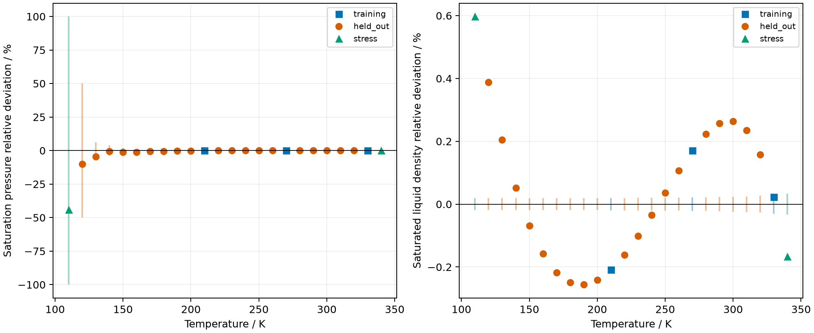

The retained modern propane fit describes the fitted saturation pressure and
liquid-density states closely, with wider deviations on withheld and stress
states. This notebook selects the dated October replay and assigns data roles
from its actual fitting input. Historical methane, ethane and July propane
results remain separate records and do not enter this comparison.

**Claim class:** calibration plus prediction on measurements withheld from this
modern parameter fit (`MODERN_REFIT`). The packet comparison is descriptive.
Conditional covariance and repeated optimizer convergence are numerical fit
diagnostics; they do not validate prediction uncertainty or global identifiability.

## Question, method and conditions

How does the selected propane parameter fit compare with Glos, Kleinrahm and
Wagner Table 2 measurements outside its training states? The retained
`results/propane-replay-2026-10-01.json` specifies a native least-squares fit of
log pressure and log saturated-liquid mass-density ratios, using unit weights.
The first declared optimizer start supplies the displayed parameters.
`inputs/source/propane-baseline.csv` owns the training states and quantities;
the packet supplies the fixed molar mass. Source expanded uncertainties were
not used as fitting weights.



## Corrected training and held-out roles

The retained CSV's `role` column comes from an older packet. In particular,
the cold row labelled training there is absent from this replay's fitting input.
The presentation uses `replay_role`: temperatures in the actual training CSV are
training; the packet's stress rows remain stress; all other states are held out.
Thus the extra cold state is included in the actual held-out cohort. The
dated CSV and its provenance remain unchanged. The following table exposes
every inherited and corrected label rather than silently treating the old
packet's training cohort as this fit's cohort.



Glos measurements postdate Gross–Sadowski's published propane parameters, so
they were not training observations for that published set. The modern fit
does use the selected Glos training rows. Temperature-range overlap alone
does not determine observation overlap.

## Retained comparison



The average absolute relative deviations use the corrected cohort, including
the genuine cold holdout. Stress states are reported separately. The large
cold-pressure relative deviation must be read with its source uncertainty;
the whole state range does not satisfy a single accuracy claim. A small fitted
objective is compatible with visible withheld-density discrepancies.

## Uncertainty, provenance and limits

`results/propane-replay-2026-10-01.json` retains the source digests, wheel identity,
all starts, training residuals, conditional covariance and claim limits.
`results/batch3-comparison.json` retains the native-conversion comparison.
All declared starts converge in the selected replay. The earlier September
record includes an unavailable initial evaluation; its change in availability
does not establish which intervening Engine change caused it.

The conditional standard deviations assume independent, equally uncertain
log-space residuals and a regular local linearization at an interior solution.
The residual variance has few degrees of freedom. Neither it nor the
multistart spread is a validated predictive uncertainty estimate. The source
expanded uncertainties belong to the observations, not to model predictions.
The coldest stress state lies outside the fitted domain. No held-out claim
transfers to other fluids, mixtures or properties, and no parameter adoption
follows from descriptive agreement with the packet or historical fit.

## Presentation and review boundary

`nice -n 10 .venv/bin/python tools/present-paper-evidence.py` reads the dated CSV,
JSON and retained training CSV to prepare these displays. It does not refit or
evaluate thermodynamic states. The readiness finding is batch A of the
issue-501 promotion review. This notebook presentation has not been independently
reviewed or promoted for manuscript use.
