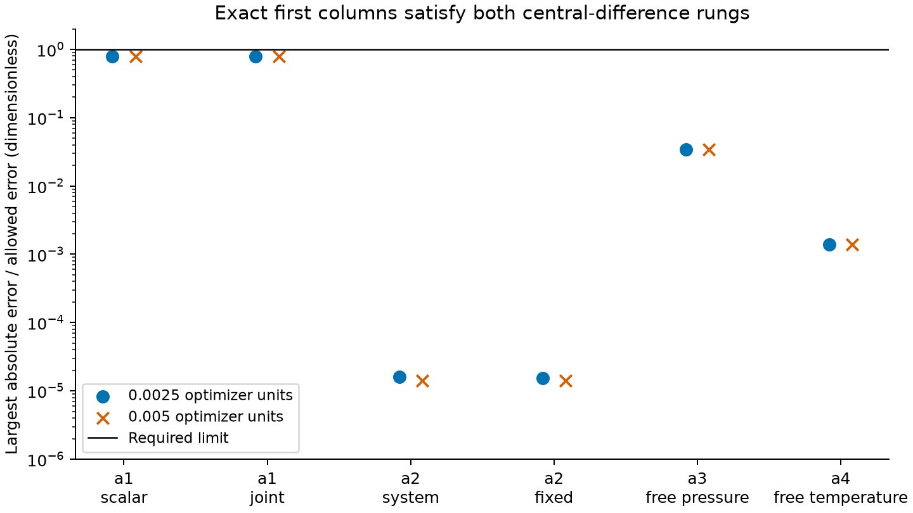

```{python}
import csv
import json
from pathlib import Path
results = Path("results")
summary = json.loads((results / "summary.json").read_text())
cold = json.loads((results / "cold-start.json").read_text())
def rows(name):
    with (results / name).open(newline="") as stream:
        return list(csv.DictReader(stream))
def table(name):
    data = rows(name)
    print("| " + " | ".join(data[0]) + " |")
    print("|" + "|".join("---" for _ in data[0]) + "|")
    for row in data:
        print("| " + " | ".join(row.values()) + " |")
regularity = rows("regularity.csv")
```

Named reaction-equilibrium constants can be fitted jointly with residual EOS
parameters through the Engine's existing solved-state first actions. The
manufactured two-liquid, referenced aqueous and vapor–liquid cases qualify
dimensionless log-residual columns at the unchanged first-order criterion.
Noise-free scalar and temperature-law coefficients are recovered from displaced
starts. The current Engine-owned exchange test uses analytic identical-species
amount ratios and recovers $(\ln 2,-\ln 2)$; its former SciPy comparator is
retired. The earlier comparisons below retain their original manufactured
inputs and identified wheel, rather than qualifying the replacement case.
These are numerical verification results, not physical validation or
application parameter adoption.

## Question and derivative definition

[Issue #187](https://github.com/tannerpolley/ePC-SAFT/issues/187) asks whether the
scalar ln K or stored a, b, c, d coefficients can join the existing bounded
least-squares fit without duplicating equilibrium or differentiation.
The [equation owner](../../engine/docs/equations.md#reaction_constant_coordinate_derivative)
and [ALG-FIT](../../engine/docs/science/algorithms.md#alg-fit) define the calculation.
For a stored temperature law,

$$
\ln K_r(T)=a_r+b_r/T+c_r\ln(T/T_{ref,r})+d_rT,
\qquad \phi(T)=(1,1/T,\ln(T/T_{ref}),T).
$$

The units of a, b, c, d are 1, K, 1 and K⁻¹. A scalar coordinate is ln K
on the reaction's declared source basis. The shared minimum-norm
stoichiometric mapping gives $s_\theta=-N^+e_r\phi_k$ for dimensionless species
standard potentials. Only chemical rows receive this direct term. The existing
defining Jacobian then gives $y_\theta=-F_y^{-1}F_\theta$. Observation actions,
residual slopes, weights and the affine coordinate scales complete the chain.
At free temperature, the same Jacobian already contains the temperature
dependence of the temperature law; coefficient directions use its basis at
the solved central temperature.

The amount-ratio observation is
$D=(n_q\sum_{i\in A}x_{qi})/(n_p\sum_{j\in B}x_{pj})$.
Its derivative uses the quotient rule on the existing phase-component-amount
actions. A ratio with an undefined denominator cannot supply a finite
observation. Reaction names, rather than declaration positions, identify the
coordinates across states.

## Inputs and derivative comparison

The [native input owners](../../engine/tests/native/regression_reaction_checks.cpp)
define four manufactured cases. No application sources or parameters are used.

| Case | State and quantity | Fitted directions |
|---|---|---|
| a1 | Two liquids, A+B⇌C; x_C, L1 fraction, C amount ratio | Scalar ln K; also interleaved k_AC, ln K, σ_B |
| a2 | Formula reaction H₂O⇌Na⁺+Cl⁻ at its retained temperature; x_Na⁺ | Referenced a and b, both system and fixed source pressure |
| a3 | Manufactured J1 bubble at its retained temperature; pressure and methane partial pressure | Unreferenced a, b, c, d |
| a4 | The same J1 state at fixed bubble pressure; free temperature | Unreferenced a and d |

The J1 fixture uses the existing methane–ethane parameter pair and equimolar
feed, with liquid amount free and vapor pinned at zero. The manufactured
reaction `iso` uses the stoichiometry and polynomial coefficients retained in
[cold-start.json](results/cold-start.json). Its a=`{python} cold["inputs"]["a"]`
makes the J1 state at `{python} cold["inputs"]["T_guess_K"]` K satisfy the
reaction. The bubble pressure is `{python} cold["inputs"]["P_fixed_Pa"]` Pa.
The test first requires the same pressure and
compositions, no topology event, and an available nonzero reaction action.

All compared columns are $\partial\ln y/\partial u$ for unit-weight
log-ratio residuals. The derivative rows retain both central-difference
rungs and their allowed errors. The refined rung has the tighter tolerance;
both must meet the signal criterion. The coefficient scales follow the stored
temperature-law basis; the joint chart's interaction and diameter scales are
specified by the native input owner. The
[retained step probe](results/eos-step-probe.csv) shows second-order central
truncation in the original physical steps; the selected affine chart keeps
the ratio truncation within the criterion and the phase-fraction signal
above its minimum. Equations, solver methods, bounds and tolerances are unchanged.



The [derivative rows](results/derivatives.csv) retain exact columns, both
finite-difference rungs, signal, central prediction and allowed error.
[Regularity diagnostics](results/regularity.csv) retain the central residual,
condition estimate and nonzero composition action admitted by the shared owner.
The largest central residual is `{python} max(float(r["central_residual"]) for r in regularity)`;
condition estimates range from `{python} min(float(r["condition"]) for r in regularity)`
to `{python} max(float(r["condition"]) for r in regularity)`.
[Identity rows](results/identities.csv) separately check declaration versus
physical-row order, the a2 source-basis prediction, and the unscaled a3 basis
ratio $1:1/T:\ln(T/T_{ref}):T$ at the retained row tolerances.

## Known-value recovery

The [recovery rows](results/recovery.csv) retain coefficient values, errors
and the unchanged native tolerances. The first fit jointly recovers k_AC and
scalar ln K from two-liquid observations. The second recovers a and b from
bubble pressure and vapor methane fraction at the declared temperatures. The third
uses two reactions and reverses their declaration order in the second feed;
it falsifies positional tying of the fitted constants.

```{python}
#| output: asis
table("recovery.csv")
```

The costs are `{python} [r["final_cost"] for r in summary["recovery"].values()]`,
with retained trial-failure counts and rank-two covariance diagnostics.
This establishes local
recovery for the retained noise-free inputs. It does not establish parameter
identifiability for arbitrary experimental datasets. A table is sufficient for
these few scalar recoveries; no parameter trajectory or uncertainty
distribution was measured.

## Preparation and a changed reaction coordinate

The validation preparation introduced by #200 originally compares the model's
EOS active values with the resolved affine values. Reaction constants are
problem declarations, so they need their own exact declaration comparison.
The integrated fit preserves the EOS comparison and uses the existing
physical-state equality owner to compare rewritten scalar K or correlation
coefficients before reusing a compiled problem. The successful-point cache
continues to compare the complete optimizer vector, including every reaction
coordinate.

The additional numerical check uses the a1 two-liquid fixture and a displaced
supplied reaction constant. The retained affine chart exposes rounding of its
resolved value. This deliberately exposes a difference between the
validation declaration and the actual initial fitting point, while the EOS
active-value key is empty. The initial prediction must equal the independently
solved resolved-constant value at the unchanged tolerances in the identity table.
The old supplied constant produces a resolved log-prediction difference,
so reusing it would fail the numerical comparison. This check qualifies
preparation invalidation; it does not qualify optimization or derivatives in
that deliberately ill-scaled affine chart. Values and the observed contrast
are retained in `identities.csv` and `summary.json`. The log-prediction
contrast is `{python} summary["preparation"]["log_prediction_change"]`;
the rebuilt composition and initial cost are retained in the identity rows.

The reaction-only displaced-start b2 and b3 recoveries catch a stale compiled
problem retained across ln K or coefficient steps, because the known values
and objective cannot then be recovered. The joint b1 fit also checks EOS and
reaction coupling. They do not isolate the first affine-resolution
rounding case; the added preparation check does. No new equation, tolerance,
bound, solver method or scientific acceptance use is introduced by the cache
comparison.

## Analytic exchange and historical comparator

The [current native test](../../engine/tests/regression/test_reaction_constants.py)
defines identical neutral ethane pseudo-species in two fixed-support liquids.
Equal residual chemical potentials cancel, giving analytic component-amount
ratios $(2,1/2)$ and coefficients $(\ln 2,-\ln 2)$. The test checks phase
amounts, supported compositions, conserved amounts, ratio residuals and
coefficient recovery; it performs no Python optimization. This is numerical
verification of manufactured chemistry, not physical extraction validation.

The earlier exchange comparison used different conserved amounts and Engine-
generated ratios. Its SciPy fit is retained history, not the current method.
The wheel identity is `{python} summary["wheel_sha256"]`; the historical costs
are `{python} summary["exchange"]["engine_cost"]` (Engine) and
`{python} summary["exchange"]["scipy_cost"]` (SciPy), on that earlier objective.

```{python}
#| output: asis
table("exchange.csv")
```

The [historical law and balance rows](results/exchange-laws.csv) retain their
original basis. They are not equal-number expectations for the analytic case.

## Admission and the separate cold-start finding

The five required inadmissible targets are refused with the reaction name:
affinity targets, supplied standard Gibbs vectors, dependent reaction sets,
K fixed by thermochemistry, and referenced reactions at free temperature.
The retained messages in [summary.json](results/summary.json) also cover
inconsistent tied declarations, scalar coefficients other than a, and
inconsistent common-molality source bases. These are input safeguards;
they are not numerical evidence for refused physical predictions.

The original a4 cold start returned no state, with message “phase V corrected density
left the anchored branch window”, despite an optimizer convergence message.
The residual remains with its rejection in the retained cold-start record. The exact parameters, physical
declaration, polynomial coefficients, default-start declaration and diagnostics
are retained in [cold-start.json](results/cold-start.json), reproducible with
[cold_start.py](scripts/cold_start.py). Empty returned T, P and composition
arrays do not represent physical zeros.

The owner approved declared J1 compositions and packing fractions for a4,
with no change in equations, bounds, tolerances or solver methods. That solve
returns the retained J1 temperature, pressure, compositions and packing fractions; the
native identities and regularity gate protect that requirement. The cold
branch-window failure is diagnosed and corrected separately under #204:
the sole dense feed root made the initializer seed identical phases. The
[cold-vapor notebook](../2026-cold-vapor-branch/notebook.qmd) retains the root
identities, unchanged admission window and recovered cold J1 state. This
study's first-derivative qualification remains at its declared regular state.

## Scope, provenance and review

[summary.json](results/summary.json) identifies the installed non-editable
wheel SHA-256 and integrated source base `fe00aa6a` (including #200). Numerical runs request one
OpenMP and BLAS thread, two build jobs, priority 10, a shared process lock and
finite wall-time caps. Effective library thread counts were not independently
measured. [README.md](README.md) gives the reproduction commands.

This change qualifies first derivatives only. It does not qualify mixed or
second reaction-coordinate actions, caloric derivatives of fitted coefficients,
referenced free-temperature fitting, application chemistry or physical
parameter adoption. The required native equilibrium, boundary and parameter
fit programs, the full fast gate and the canonical Khudaida slice are the
software and numerical checks for the changed owner. Their success alone is
not physical validation.

Independent cse:review by GPT-6.1 Sol at high effort returned **Supported**
for the integrated result at `7acb7d9b4b4539b596b622b18607b1684aa6c4f5`,
against `fe00aa6a`, with no required corrections. The reviewer checked the
derivative route, preparation invalidation, numerical falsifiers and retained
interpretation. This notebook remains unpromoted for manuscript use.

## Reaction enthalpy shift at a declared pivot

The source reaction enthalpy can move through one native affine direction while
preserving the supplied equilibrium correlation at the declared pivot. The
[equation](../../engine/docs/equations.md#reaction_constant_coordinate_derivative)
and [fit algorithm](../../engine/docs/science/algorithms.md#alg-fit) own its
mathematics and admission. [Issue #484](https://github.com/tannerpolley/ePC-SAFT/issues/484)
and its MEA acceptance amendment own the tested scope. Bounds and adoption
remain with the application.

The retained native checks use the frozen F1 declarations and a separate
Kim–Svendsen finite loading interval, with vapor CO₂ feed at one pascal.
The interval uses the source's two loading endpoints and zero pinned vapor
bubble declarations. Transporting it to other temperatures creates derived
verification inputs; it does not create calorimetry measurements. The lowest
verification temperature lies below the supplied CO₂ Shomate interval, so only
that heat cell uses the approved separate declaration labelled **numerical
extrapolation for derivative verification; no physical-validity claim**. It
extends the lower endpoint and changes no coefficient, anchor, other interval,
original packet or Engine admission rule.

```{python}
#| output: asis
shift_results = results / "enthalpy-shift"
shift_summary = json.loads((shift_results / "summary.json").read_text())
print("Verification temperatures (K):", shift_summary["temperatures"])
print("Centered physical shifts (J/mol):", shift_summary["steps"])
print("Frozen F1 SHA-256:", shift_summary["original_packet_sha256"])
print()
print("| Quantity | Largest error |")
print("|---|---:|")
for label, key in (("Pivot ln K (dimensionless)", "pivot_max"),
                   ("Reaction enthalpy derivative (dimensionless)", "enthalpy_direction_max"),
                   ("Source replay ln K (dimensionless)", "source_replay_max"),
                   ("Source replay enthalpy (J/mol)", "enthalpy_replay_max"),
                   ("Combined column versus coefficient sum", "combined_max")):
    print(f"| {label} | {shift_summary[key]:.6g} |")
print()
print("| Observation | Resolved residual relative error | Physical prediction relative error |")
print("|---|---:|---:|")
for kind, entry in shift_summary["families"].items():
    print(f"| {kind} | {entry['resolved_relative_max']:.6g} | {entry['physical_relative_max']:.6g} |")
```


The native driver compares physical prediction, optimizer prediction and
unit-weight residual columns, applying observation weights natively for the
weighted comparisons. Coarse centered shifts pass MEA's required relative
criterion on resolved columns and its absolute near-zero criterion. Further
halvings distinguish truncation improvement from numerical-floor scatter;
[the four rungs](results/enthalpy-shift/refinement.csv) and
[solve residuals](results/enthalpy-shift/columns.csv) retain cells without
monotonic improvement. Pivot pressure and species columns are near zero by the
fixed-pivot constraint. The native law and its decadic reciprocal view replay
without repeating the fitted shift. The manufactured source fit and an
interleaved EOS fit recover their declared shifts; this is no identifiability
claim for real MEA data.

The unchanged F1 point, full fits and existing sequence declarations retain
identical outputs and solver work. Paired native timing supports the current
no-slowdown comparison; the permanent fit-speed check and its absolute CPU
ceiling remain open in #449. Sequence starts and minimax explicitly refuse the
new coordinate. Species-reference disagreements remain refused at both heat
endpoints and in the native point reader. These results are numerical
verification and await independent delivered review; they are not physical
validation or investigator promotion.

## Plain coefficient with a pivot-preserving enthalpy shift

[Issue #557](https://github.com/tannerpolley/ePC-SAFT/issues/557) extends the
existing parameter chart: the plain coefficient is assigned before the shift
is added, regardless of declaration order. The completed native law is returned
once per shifted reaction. Both coordinates use the existing solved-state and
thermal-reference actions, including both finite-addition heat endpoints.
The equation and fitting algorithm above remain the scientific owners.

The [Kim–Svendsen declaration](inputs/kim-svendsen-interval.json) freezes the
source row from Amine `b6aee49c` together with the complete endpoint problems,
EOS parameters, ideal calorics, source references, feed state and residual
scale. [Its identity](inputs/kim-svendsen-identity.json) records the full local
hash and the recovered declaration's prior hash. The verification program
reads Engine-local inputs only. The pressure and species declarations come
from the unchanged frozen F1 packet. The source reciprocal R5 coefficient is
restored before constructing the combined chart; its plain value and final
shifted coefficient remain separate quantities.

```{python}
#| output: asis
pair_summary = json.loads((results / "coefficient-enthalpy-pair/summary.json").read_text())
print("Temperatures (K):", pair_summary["temperatures_K"])
print("Plain source values (K):", pair_summary["plain_a_k_K"])
print("R5 shift centers (J/mol):", pair_summary["shift_centers_J_mol"])
print("Plain steps (K):", pair_summary["plain_steps_K"])
print("Enthalpy steps (J/mol):", pair_summary["enthalpy_steps_J_mol"])
print()
print("| Numerical check | Observed | Required bound |")
print("|---|---:|---:|")
for label, key, bound in (("Pivot ln K error", "pivot_max", "2e-12"),
                           ("Applied reaction-enthalpy slope error", "enthalpy_max", "1e-12"),
                           ("Manufactured optimizer recovery error", "recovery_max", "1e-8 + 1e-10 relative"),
                           ("Native-law prediction replay error", "replay_max", "exact")):
    print(f"| {label} | {pair_summary[key]:.6g} | {bound} |")
print()
print("| Observation | Resolved Richardson relative error | Near-zero absolute error |")
print("|---|---:|---:|")
for kind, values in pair_summary["families"].items():
    print(f"| {kind} | {values['resolved_relative_max']:.6g} | {values['near_zero_absolute_max']:.6g} |")
print()
print("No-pair bitwise comparisons:", pair_summary["no_pair"])
```

The [column table](results/coefficient-enthalpy-pair/columns.csv) retains both
raw centered differences, their raw errors, prediction signals, and central
and stepped solve residuals. The binding lead resolution compares the native
column with the Richardson value from the two prescribed steps. Raw steps
have no pass/fail interpretation. Physical prediction columns, optimizer
prediction columns, unit-weight residual columns and weighted residual columns
are reported separately. The finite differences verify first derivatives;
they are not a second derivative implementation.

[Native laws](results/coefficient-enthalpy-pair/native-laws.json) retain the
plain values, incremental shifts, pre-applied amounts and total shifts.
[Replay comparisons](results/coefficient-enthalpy-pair/replay.csv) attach
completed laws and fitted EOS parameters directly to the native prediction
reader, without reapplying coordinates or rounding through a decadic view.
The [shift-only starting record](results/coefficient-enthalpy-pair/preapplied.json)
retains the separate nonzero-start recipe and translated bounds. That recipe
qualifies shift-only Route 1; Route 2 starts from zero pre-applied shift.

These values establish numerical verification on the declared states and
noise-free recovery cases. The transported heat temperatures are verification
inputs, with the separately labelled lowest-temperature Shomate extrapolation
retained unchanged. They add no calorimetry measurements or physical validity
claim. The residual scale is a declared numerical scale, not a newly inferred
measurement uncertainty. This section awaits independent delivered review and
investigator promotion; it does not establish parameter identifiability in the
application's joint refit.
