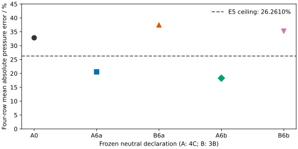

The implemented E3 comparisons pass on the four inherited MDEA–CO₂–water
bubble states and the 50 selected fixed-speciation MEA observation rows. No
consistency defect was found. This is numerical verification of identities on
specified branches, not physical validation or evidence that association
explains the remaining pressure errors. No Engine equation or parameter changed.
Delivered review r1 rejected the previous concentration, amount and start controls.
The corrected evidence below awaits independent review.

E3 uses 1 kg initial water for Kuranov rows 11, 18, 50 and 51. The inherited
constants retain same-system-pressure pure-water insertion references. Native
raw-x and common-molality declarations use the qualified #912 starts. The native
driver independently assembles species references, finite-solution quotients,
phase fugacities and conserved inventories. At each retained pressure, measured
pressure and one bar it checks both pressure-reference models, with an additional
inventory-conserving reaction-direction perturbation. The manufactured fixed-source
model contributes no physical improvement score. Pressure transport is pointwise;
no pressure-dependent source law or additional bubble solver was introduced.

Conserved inventories are evaluated separately for both solved declarations,
including their zero-amount incipient vapors. Molality constants use the declared
solvent molar mass and solute stoichiometry independently of the native helper.
Pointwise molality and molarity quotients assemble finite-solution concentrations
and activity coefficients separately from the chemical-potential contraction.

Pure-water log-density T, P and combined T/P first directional derivatives are
compared with refined central differences. Temperature and combined-direction
errors decrease on refinement. Pure-pressure differences reach roundoff;
no decreasing-error claim is made for that plateau. These checks qualify first
density derivatives, with errors and limits retained below.

Signed omissions and a multiplicative liquid-amount perturbation exceed the
corresponding equality limits. Each control retains its analytical prediction
and an explicit check that the unmodified equality's limit is exceeded.





`results/e3.csv` and `results/mea.csv` retain comparisons and their individual
limits. `results/e3-summary.json` gives counts, maximum disagreements and failures.
The pressure actions and unit-insertion derivatives use native exact derivatives.
The compiler comparisons use actual pressure coordinates in Pa and row-series
mixed temperature–pressure actions. Negative controls retain the signed missing
constant-conversion, pressure-factor and reference-derivative offsets.

The MEA inputs preserve packet 5, original Born, the absent CO₂/MEA association
edge, the Böttinger interpolation, and the canonical Hilliard total pressures.
`inputs/mea-rows.json` freezes all 50 distinct observation/component selections.
`inputs/mea.txt` retains species amounts on 1 kg unloaded 30 wt% solution,
nominal and reconstructed carbon, and historical solvent fugacities. Native output
retains prescribed fractions, CO₂ fugacity and carbon-closure differences as data,
not zero-affinity tests. Chemical potentials of absent bicarbonate are undefined;
their zero amounts remain in the output and amount controls, while the logarithmic
chemical-potential identity applies only to present species. Reactive MEA pressures,
reaction constants and predicted speciation remain deferred by design.

The E4 MDEA comparison fits one neutral constant offset to each candidate's
inherited dispersion law, fixing its higher thermal coefficients. Three starts
are retained for each of two pressure-grouped splits and two source parameter sets.
Every fit has rank one, finite conditional covariance and no active bound; all
held-out native predictions are available. A fixed coordinate chart and explicit native optimizer starts give distinct
physical coefficient starts. The starts agree to the coefficient and held-out
cost resolutions shown below. Omitting the explicit offset exceeds the
start-mapping comparison limit; signed errors are retained for every run.



The published pure tuples and association schemes stay fixed. Electrolyte and
reaction parameters are unchanged.



The quantities above are sums over three held-out temperatures, twice the native
least-squares cost retained in `results/e4.json`. Dividing each by three gives
the design's mean squared score and leaves its percentage reduction unchanged.
This matched MDEA comparison misses the improvement requirement in one split.
It does not reject all possible common-water candidates or establish transfer.
Source digitization bounds remain in the retained rows; they are not numerical
solver tolerances or independent measurement uncertainties.

**E4 remains incomplete.** Matched MEA source d³ comparisons, induced versus
acceptor-only ketone, the three-coordinate combined candidate and frozen reactive
and salted transfer scoring have not been qualified. The designated Mohammad
water/MIBK source has metadata but no companion evidence index (`manifest.json`) in the installed
corpus, and no salt-free endpoint table was found in the retained repository
inputs. Pure-MIBK density/vapor observations cannot replace mutual-solubility
training observations. No missing comparison is scored as passed. The source
orientation of the matched MEA 3B declaration also needs resolution: the design
specifies donor/acceptor multiplicities 1/2, whereas the retained Baygi pure replay
uses 2/1; exchanging those labels leaves a pure fluid unchanged but can change
unlike association. No source orientation was inferred from a scheme label.

The unchanged Engine A=A timing control passes with identical protected states
and work counts. This qualifies preservation of the unchanged Engine, not the
cost or transfer behavior of an E4 association candidate. Local checks and full
evidence are retained in the main checkout's `build/issue-922/`. Numerical limits
are predeclared design choices; these calculations estimate no measurement
uncertainty and establish neither uniqueness nor global stability. The notebook
has not been promoted for manuscript use. Review and owner disposition remain open.

## E5: frozen neutral parameters do not reduce the reactive deficit

E5 predicts total bubble pressure with zero new fitted parameters. It uses the
corrected E4 central-start coefficients frozen at `48b23a091`, the full neutral
MDEA/water tuples, and the unchanged electrolyte and source-reaction declarations.
Design `build/issue-919/design-e5.md` and Ready review `readiness-e5-r1.md` in the
main checkout fix the numerical limits. The 3B declarations change water as well
as MDEA; these comparisons cannot isolate site multiplicity as a cause.



Errors are signed percentages of measured Kuranov total pressure, using the
printed temperatures and molalities and 1 kg initial water. Each row is a
prediction, with no reactive fitting. Both 3B splits exceed the predeclared
four-row mean-absolute-error ceiling and worsen rows 11/18 by more
than one percentage point. Both matched fitted 4C controls outperform 3B on this
subset, but neither control preserves the other retained rows.

The table also reports the mean absolute errors across the 63 other rows.
Respectively 53 and 55 non-target rows under B6a/B6b
worsen by more than one percentage point. No row was removed: all five
declarations returned 67 solutions. Full-cohort and eight-isotherm scores,
including each isotherm after target removal, are in `results/e5-summary.json`.

The six measured neutral temperatures satisfy both candidates' row and isobar
no-worse limits. The held-out E4 predictions reproduce the frozen results within the design's
replay tolerance; individual discrepancies and MSEs are retained in
`results/e5-qualification.json`. This does not change E4's forward
20% miss. Pure-property and common-water source comparisons remain unqualified.

All 335 reactive solves meet the retained classified-row, independently
recomputed fugacity, reaction-affinity, phase-sum and inventory tolerances.
Positive mechanical slopes and site fractions in (0,1] were checked at both
returned phases. A0 pressures replay the frozen roots; input differences and
source hashes are retained in the main checkout's `build/issue-922/e5/`.
Water–CO₂ association is recomputed by the unchanged Wolbach–Sandler declaration
using the changed water self energy/volume and diameter. Source K is unchanged;
`reference_C` and `compiled_log_Krho` are retained at common A0 pressures and
candidate endpoints in each native CSV.

The candidate work-count condition also fails: B6a increases iteration and
Hessian counts on 40 rows, B6b on 41 rows, relative to A0. Native counts and
single-pass CPU times are retained; these times alone do not qualify paired
candidate cost. The unchanged-Engine key-solve evidence is kept separately in
`build/issue-922/e5/`. The design stop rule applies to the pressure and
preservation failures. Further candidate x/m, derivative, pure-property and
changed-water non-MDEA qualification was stopped; no common-default or complete
numerical qualification is claimed. Unchanged non-MDEA inputs and Engine source
remain intact, but the full non-MDEA numerical matrix was not replayed here.

The frozen-neutral-transfer explanation fails this E5 threshold. This does not
exclude association effects generally or identify reaction constants, source
pressure convention, or measurements as the remaining cause. The inherited
same-system-pressure reference convention is retained; it is not physically
validated by these numerical checks. Parameter-split spread is sensitivity,
not a confidence interval. Independent delivered review and owner adoption or
archive decisions remain open; these results are not promoted for manuscript use.

The fresh same-environment key-solve comparison returns identical states and
work counts, including ionic liquid–liquid equilibrium, the reacting MEA flash,
the eight-point Khudaida sequence and nominally unloaded MEA. F1 and reacting-Cp serial CPU values and their frozen ceilings are retained
in `results/e5-key-solves.json`; both sides satisfy the ceilings. The paired wall-time spread is retained
in `key-solves-AA-r2/summary.json`; it does not qualify changed candidate cost.
The first attempt rejected a changing source identity before any comparison;
the second ran after source edits stopped. No timing guard was waived.
