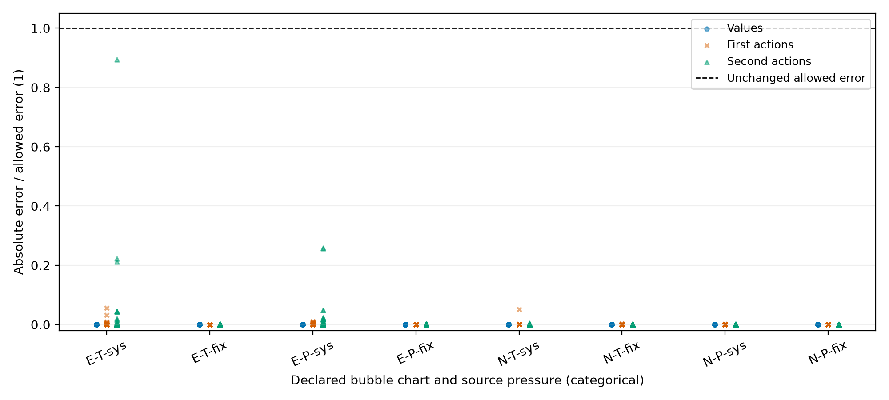
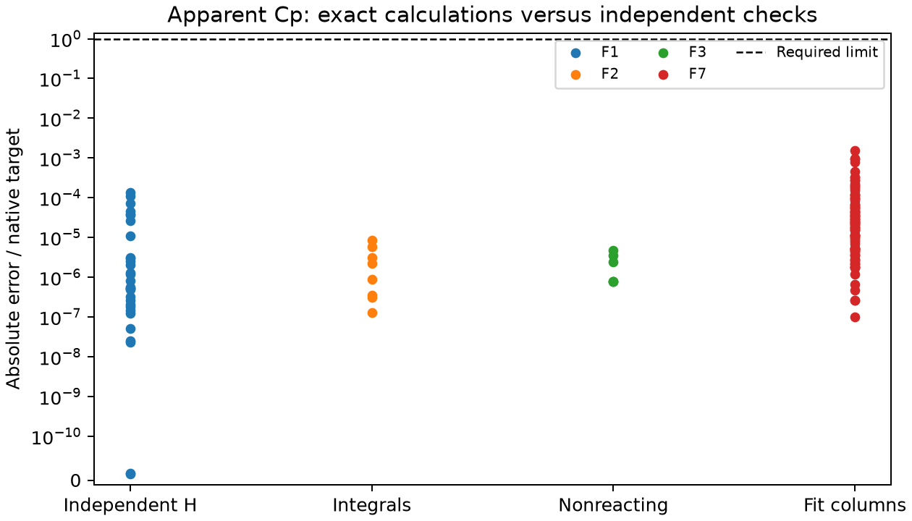

## Named-release rerun (#680)

This section reads only the retained named-release outputs. The evidence is
**numerical verification** on the stated manufactured or shared-model inputs.
It establishes no physical validation or global-stability certificate.
Independent delivered review and owner promotion for manuscript use remain open.

```{python}
#| output: asis
import csv as _csv
import json as _json
from pathlib import Path as _Path
_rr = _Path("results/main-8298c602")
_rp = _json.loads((_rr / "provenance.json").read_text())
_rs = _json.loads((_rr / "summary.json").read_text())
def _rt(headers, data):
    print()
    print("| " + " | ".join(headers) + " |")
    print("| " + " | ".join("---" for _ in headers) + " |")
    for row in data:
        print("| " + " | ".join(str(x) for x in row) + " |")
print("Release: `" + _rp["release"] + "`. Wheel SHA-256: `" + _rp["wheel_sha256"] + "`.")
_rt(["Quantity", "Named release", "Previous matching selectors", "Criterion"], [
    ["Reacting caloric comparisons", _rs['comparisons'], _rs['previous_same_selectors'], "native row-specific criteria"],
    ["Failed comparisons", _rs['failed'], "none in previous qualification", "each asserted criterion"],
    ["Largest error / criterion", _rs['max_error_over_criterion'], _rs['previous_max_error_over_criterion'], "ratio at most unity"],
    ["Assertions with no numeric ratio defined", _rs['ratios_unavailable'], "not recomputed", "do not infer a ratio"],
])
print("\n" + _rs['count_limit'])
print("\nIndependent enthalpy/Cp quadrature comparisons:\n")
_rt(["Identity", "Unit", "Integral", "Independent increment", "Error / criterion", "Previous error / criterion", "Allowance", "Refinement / quarter target"],
    [[r['comparison_id'], r['unit'], r['integral'], r['independent_increment'], r['error_over_criterion'], r['previous_error_over_criterion'], r['criterion'], r['refinement_over_quarter_target']] for r in _rs['quadrature']])
```

The complete requests, returned operands, causes and wheel identity stay in
[the retained run](results/main-8298c602/). No start, physical input, method,
option or criterion was adjusted to obtain agreement.

## Earlier retained studies

The remaining sections describe their original wheels and their original
review boundaries; they are not numbers from the named release.

The native readout executables were compiled from the matching release source.
Their recorded dynamic-library paths select the native Engine and solver
libraries contained in the installed wheel. The broader repository checks use
a separate editable environment and do not supply these numbers. Counts are
reported for the named native selectors; the earlier headline aggregate is not
a count of this same population. Full compressed logs preserve each comparison
and its physical inputs, method, allowance, refinement and verdict.

```{python}
from pathlib import Path
import csv
import json
from IPython.display import Markdown, display
root = Path.cwd()
while not (root / 'ARCHITECTURE.yaml').is_file():
    root = root.parent
results = root / 'analyses/2026-reactive-caloric-actions/results'
current = results / 'main-2026-10-06'
provenance = json.loads((current / 'provenance.json').read_text())
def retained(name):
    return root / provenance['tables'][name]
def table(path, delimiter='\t'):
    return list(csv.DictReader(path.open(), delimiter=delimiter))
def show(headers, rows):
    display(Markdown('\n'.join(['| ' + ' | '.join(headers) + ' |',
        '| ' + ' | '.join('---' for _ in headers) + ' |',
        *['| ' + ' | '.join(str(x) for x in row) + ' |' for row in rows]])))
qualification = table(retained('qualification.tsv'))
comparisons = table(retained('comparisons.tsv'))
original = table(retained('original-order.tsv'))
movements = table(retained('native-row-movements.tsv'))
timing = json.loads((current / 'timing-summary.json').read_text())
```

The current-main replay tests record-anchored Gibbs calorics, prescribed and
free-intensive exact actions, and the central-temperature extraction correction
on declared manufactured branches. The tables below read retained native results.
This is **numerical verification**, with no physical calorimetry, reaction
chemistry validation, parameter adoption, global stability or universal
infinite-dilution error bound. The apparent isobaric heat-capacity build below
retains its own observation, column, quadrature and synthetic-recovery evidence.
Correction (2026-10-09): the integrated slices 1–3 received independent
delivered review (Supported, no findings) and merged through
[PR #301](https://github.com/tannerpolley/ePC-SAFT/pull/301); slice 4 received
delivered review (Supported, no findings) and merged through
[PR #310](https://github.com/tannerpolley/ePC-SAFT/pull/310). The investigator
promoted these results for the package manuscript (#228) within the limits stated here.

## Integrated density closure and temperature scaling

```{python}
show(['Source', 'Revision or wheel SHA-256'], [
    ['Candidate runtime and native checks', provenance['source_commit']],
    ['Integrated main', provenance['main_commit']],
    ['Candidate wheel', provenance['preparation']['wheel_sha256']],
    ['Main timing wheel', provenance['main_preparation']['wheel_sha256']]])
```

The source preserves main's pressure-closest density publication, duplication
removals, trace payload construction inside `Scope::observe`, and the separate
exact-inventory incipient extension. The F9 verification conflict retains the
caloric branch's lower-column comparisons and generalized reaction contraction,
using main's resolved-state and Hessian reuse at each shifted point. Integration
adds no runtime calculation.

The extraction uses the fixed central temperature scale $T_0$, restoring a
partial with $k$ temperature labels by division by $T_0^k$. Outer directions do
not differentiate that divisor. Physical increments, references, tolerances,
refinement rules and work limits retain their native definitions in
[ALG-ACTIONS](../../engine/docs/science/algorithms.md#alg-actions) and the
[accepted issue](https://github.com/tannerpolley/ePC-SAFT/issues/225).

### Values and actions on the declared branches

E uses identical ethane pseudo-species, a declared reacting liquid and an
incipient vapor. N uses the manufactured nonidentical neutral ternary and the
owner-selected coexistence pressure and starts. Both bubble-temperature and
bubble-pressure specifications use system-source and fixed-source references.
The independent source-pressure choices, native parameter declarations, record
anchors, feed directions, combined controls and actual solved centers are
retained with every comparison in [comparisons.tsv](results/main-2026-10-06/comparisons.tsv).

The following central quantities retain the actual solved temperature, pressure,
liquid and incipient-vapor frozen Gibbs-volume heat capacities. They are
reference-anchored chart quantities on these manufactured branches.

```{python}
central = {}
for r in comparisons:
    parts = r['comparison_id'].split('/')
    if len(parts) == 4 and parts[0] == 'F6' and parts[2] == 'value':
        central.setdefault(parts[1], {})[parts[3]] = r['model']
show(['Bubble chart', 'Temperature, K', 'Pressure, Pa',
      'Liquid c_v,G, J/(mol K)', 'Vapor c_v,G, J/(mol K)'],
     [[name, q['T'], q['P'], q['total-cv_G'], q['total-cv_G-V']]
      for name, q in central.items()])
```

The F6 action reference uses centered differences of exact first actions.
For mixed second actions, the smaller estimated reference uncertainty selects
the differentiation order before comparison with the candidate. Agreement and
quarter-target refinement remain separately required. The original-order
previous-failure row is checked even if the other order is selected.

```{python}
show(['Native selector', 'Satisfied', 'Failed', 'Observations', 'Maximum error / criterion'],
     [[r['test_id'].removeprefix('native.'), r['pass'], r['fail'], r['observations'],
       f"{float(r['max_error_over_target']):.9g}"]
      for r in qualification if 'reactive-caloric-F6-' in r['test_id']])
```



F1 rebuilt-value differences test prescribed E/I/U actions separately from
F6. Properties P4 preserves direct-density and pressure-closed calorics through
third order, mixed directions, heat capacities and volume chains. Ionic,
Hessian/pressure/volume, F8 pure identities, F9 finite-terminal derivatives,
Born-coordinate checks and the lower-admission ladder retain their distinct
native references and criteria.

```{python}
selected = ('reactive-caloric-E-', 'reactive-caloric-I-', 'reactive-caloric-U',
            'properties.p4', 'properties.electrolyte-coordinates', 'properties.m5',
            'properties.reference-f8', 'properties.reference-f9',
            'properties.reference-limits', 'properties.born-parameter',
            'properties.residual-cv-temperature-extraction')
show(['Native selector', 'Satisfied', 'Failed', 'Maximum error / criterion'],
     [[r['test_id'].removeprefix('native.'), r['pass'], r['fail'],
       f"{float(r['max_error_over_target']):.9g}"]
      for r in qualification if any(x in r['test_id'] for x in selected)])
show(['Reference order', 'Exact action', 'Reference', 'Absolute error', 'Allowed error',
      'Refinement / quarter target'],
     [[r[k] for k in ('order', 'exact', 'reference', 'error', 'target',
                       'refinement_over_quarter_target')] for r in original])
```

The frozen residual-$c_v$ first action is independently pinned to the retained
binary128 reference, in J/(mol K). The table reads both operands and the native
absolute criterion; it does not compute another derivative.

```{python}
pin = next(r for r in comparisons if r['comparison_id'] == 'residual-cv/temperature-extraction/A1')
show(['Candidate', 'Binary128 reference', 'Absolute tolerance', 'Native verdict'],
     [[pin['model'], pin['reference'], pin['atol'], pin['verdict']]])
```

### Native-row reconciliation with #222

Rows retain `(source, id, occurrence)` identities because distinct measurements
can share a comparison identifier. Fresh native recordings are compared with
the qualified caloric checkpoint, fresh current-main operands, and the retained
pre-scaling baseline. Every moved value requires an independent native reference,
identity or discrimination before the binding recording is refreshed.

```{python}
show(['Recording or reconciliation', 'Entries'],
     [[k.replace('_', ' '), v] for k, v in provenance['row_reconciliation'].items()])
show(['Movement cause', 'Entries'],
     [[r['cause'], r['count']] for r in table(retained('classification-summary.tsv'))])
```

The current replay regenerates the movement, independent-reference, reference-order
and classification tables byte-for-byte. Their earlier numeric owners remain
retained; the new provenance and raw logs establish current-source requalification.

The [movement table](results/main-integration/native-row-movements.tsv) retains
all operands, changes, reference methods, metrics, criteria and causes. The
[additional independent comparisons](results/main-integration/independent-references.tsv)
cover surface values/actions and parameter-fitting observations whose recordings
alone are transport checks. Gauge discrimination requires a nonzero separation;
balance, root, covariance and unmet-tolerance checks retain their named residual
metrics. Large required discrimination differences are not agreement errors.
The older [#222 integration](results/main-integration/native-row-movements.tsv)
remains separately retained under its own source identity.

### Equivalent-work timing

```{python}
show(['Case', 'Main iterations/evaluations/Hessians', 'Candidate iterations/evaluations/Hessians',
      'Main median, s', 'Candidate median, s', 'Median paired change, %', 'Range, %',
      'Maximum relative state difference'],
     [[name, '/'.join(str(c['work_A'][k]) for k in ('iterations','evaluations','hessian_calls')),
       '/'.join(str(c['work_B'][k]) for k in ('iterations','evaluations','hessian_calls')),
       f"{c['median_A_seconds']:.6g}", f"{c['median_B_seconds']:.6g}",
       f"{c['median_change_percent']:+.4g}", str(c['range_percent']),
       c['max_relative_state_difference']] for name,c in timing['cases'].items()])
```

Each paired observation includes both AB and BA order, one numerical thread,
a fixed CPU, equal niceness and a complete warmup. Solve-call timing excludes
build, import and result transport. Work counts are the primary no-slowdown
criterion; paired times are measurements on a shared host. Their spread limits
causal timing claims and supplies no universal speed bound. The
[timing summary](results/main-2026-10-06/timing-summary.json) is retained; the
raw work, state and pair rows remain at record commit `21d7a112`.

### Checks and source size

```{python}
show(['Check', 'Result'], [[k,v] for k,v in provenance['checks'].items()])
show(['Layer', 'Added vs main', 'Removed vs main', 'Net', 'Current physical lines', 'Soft', 'Hard'],
     [[r[k] for k in ('layer','added','removed','net','current','soft','hard')]
      for r in table(retained('budgets.tsv'))])
```

Parameter fitting, bindings and Python retain their inherited soft-ceiling
overruns for the shared native calculations and their required input/result
transport. The current hard ceilings come solely from `ARCHITECTURE.yaml`.
Source size does not establish numerical correctness.

## Thermodynamic meaning and limits

The [record-anchored caloric equations](../../engine/docs/equations.md#reference_species_calorics)
complete reaction Gibbs, enthalpy, entropy and heat-capacity standards through
the same stoichiometric system. The Gibbs-conjugate volume $v_G=g_P$ remains
separate from EOS volume. System-reference internal energy is $u_G=h-Pv_G$;
the frozen quotient $c_{v,G}=c_p+T v_{G,T}^2/v_{G,P}$ first uses raw partials
at fixed composition, then follows the solved path for an action.

A finite $v_G$ and finite nonzero $v_{G,P}$ define the current invertible chart.
Volume and slope signs are recorded separately. A system-pressure reference
can yield a positive Gibbs-volume pressure slope while EOS mechanical slopes
remain positive. Those reference-anchored quantities are not reacting
constant-total-volume heat capacities or stability certificates. Fixed-source
system-pressure terms are analytic zeros and recover the mechanical identities.

The lower-column ladder and completed quotient changes test the declared
terminal molalities, source pressures and neutral ratios. Doubled Na/Cl ratios
traverse the same neutral curve at doubled loading. Observed terminal changes
and independent finite-terminal comparisons establish no infinite-dilution
bias bound or physical electrolyte validity.

## Retained qualification and diagnosed failures

Earlier evidence remains under its original source and wheel identities:

- [Diagnosed arithmetic failures](results/diagnosis.csv) and
  [original provenance](results/provenance.json).
- [Prescribed caloric replay provenance](results/current-source-provenance.json), with
  [the supported scoped runtime review](results/current-source-review.md)
  at `14c32d1af98dbf362eb0f48e34129ee08814b3ee`.
- [Lower-reference cause preservation](results/lower-reference-causes.csv) and
  [its provenance](results/lower-reference-provenance.json): the existing
  manufactured admission boundary preserves an available sibling column and
  transports the rejected column's owned measured cause to its caloric consumer.
- Temperature extraction: [both reference orders](results/temperature-extraction/original-order.tsv)
  and [classified native movements](results/temperature-extraction/native-row-movements.tsv).
- Earlier density/scaling integration: [its original-order reference](results/main-integration/original-order.tsv) and
  [source identities, costs and limits](results/main-integration/provenance.json).

Their full comparison tables remain at record commit `21d7a112`.
Earlier scoped reviews do not establish acceptance of the current integrated
source; the integration review recorded on #225 does. This notebook supports
bounded numerical verification of slices 1–3, scaling and slice 4.


## Apparent equilibrium isobaric heat capacity

The native calculation differentiates extensive system enthalpy along a
fixed-pressure thermal path and divides by the declared feed sum. Its first
action includes the derivative of that normalization. This measures the model's
reaction and phase relaxation as well as the frozen phase response. It requires
driven temperature and pressure, fixed support and one regular smooth branch.
It establishes no physical calorimetry, application parameter validity or global
stability. Delivered review returned Supported with no findings (PR #310).

```{python}
slice4 = results / 'slice4'
cp_provenance = json.loads((slice4 / 'provenance.json').read_text())
cp_rows = table(slice4 / 'comparisons.tsv')
cp_checks = [r for r in cp_rows if r.get('verdict') in ('True', 'False')]
def cp_selected(label):
    if label == 'F7 columns':
        return [r for r in cp_checks if r['comparison_id'].startswith('F7/') and
                ('/physical-' in r['comparison_id'] or '/optimizer-' in r['comparison_id'])]
    return [r for r in cp_checks if r['comparison_id'].startswith(label + '/')]
show(['Criterion', 'Comparisons', 'Failed', 'Maximum native error / target'], [
    [label, len(cp_selected(label)), sum(r['verdict'] == 'False' for r in cp_selected(label)),
     max((float(r['input_error_over_target']) for r in cp_selected(label)
          if r.get('input_error_over_target')), default='not recorded')]
    for label in ('F1', 'F2', 'F3', 'F7 columns')])
show(['Base', 'Candidate wheel SHA-256', 'Review'], [[cp_provenance['base'],
     cp_provenance['preparation']['wheel_sha256'], cp_provenance['review']]])
```

The first apparent-Cp action reference comes from independently rebuilt native
H values, with physical increments, feed normalization and Richardson
refinement. The existing wide reconstructions supply the value precision needed
for the mixed differences. Production H A1 predictions supply only the separate
rebuilt-prediction fitting-column comparisons. Both use their unchanged native
absolute and relative criteria and quarter-target refinement requirement.

The quadrature uses composite Gauss–Legendre nodes and independent endpoint
solves. Every node retains temperature, pressure, feed, amount, composition,
density closure, site residuals and action conditioning. Both source-pressure
choices are tested separately. The two identities compare the enthalpy increment
with the feed-normalized Cp integral and the Cp increment with its thermal-action
integral.

```{python}
show(['Case / identity', 'Unit', 'Integral', 'Independent increment', 'Refinement / quarter target'], [
    [r['comparison_id'], r['unit'], r['model'], r['reference'], r['input_refinement_over_quarter_target']]
    for r in cp_selected('F2')])
recovery = [r for r in cp_checks if r['comparison_id'].startswith('F7/recovery/')]
show(['Recovery check', 'Returned value', 'Reference', 'Native verdict'], [
    [r['comparison_id'], r['model'], r['reference'], r['verdict']] for r in recovery])
rank_row = next(r for r in recovery if r['comparison_id'].endswith('/rank'))
show(['Physical coordinates', 'Singular values', 'Rank', 'Active bounds', 'Conditional covariance'], [[
    rank_row['input_physical'], rank_row['input_singular_values'], rank_row['input_rank'],
    rank_row['input_active_bounds'] or 'none (native empty list)', rank_row['input_covariance_status']]])
show(['Coordinate', 'Native relative recovery error'], [
    ['tied epsilon', rank_row['input_epsilon_relative_error']], ['b', rank_row['input_b_relative_error']]])
covariance = json.loads(rank_row['input_conditional_covariance'])
show(['Physical coordinate', 'epsilon A', 'epsilon B', 'b'], [
    [name, *covariance[3*i:3*i+3]] for i, name in enumerate(('epsilon A', 'epsilon B', 'b'))])
```

The synthetic fit uses a Difference residual with the declared scale and unit
weights. Only the tied EOS energy coordinate and reaction b are recovered;
a/c/d are checked as exact columns. The retained local rank and interior-bound
result qualify this pair on the manufactured fixed-source data. The reported
physical-coordinate covariance entries have squared kelvin units and are
conditional on the chosen model, fixed inputs and unit-variance residual model;
it supplies no experimental uncertainty or general coefficient identifiability.
System enthalpy, finite-addition enthalpy, free-temperature endpoints, multiphase
sums and pinned-zero contributions have separate preservation comparisons.



The no-slowdown decision uses the native iteration, evaluation and Hessian counts
on identical solved states. Paired wall time is supporting evidence on the shared
host, with its observed spread retained rather than interpreted as a timing guarantee.

```{python}
historical_timing_path = root / cp_provenance['key_solve_timing']
if historical_timing_path.is_file():
    cp_timing = json.loads(historical_timing_path.read_text())
    show(['Solve', 'Main work', 'Candidate work', 'State difference', 'Median time change (%)', 'Range (%)'], [
        [name, item['work_A'], item['work_B'], item['max_relative_state_difference'],
         item['median_change_percent'], item['range_percent']]
        for name, item in cp_timing['cases'].items()])
else:
    display(Markdown('The earlier timing file is unavailable in this checkout; no current cost result is inferred.'))

```

The [native comparisons](results/slice4/comparisons.tsv) retain every rung,
endpoint and quadrature state. The [source and wheel record](results/slice4/provenance.json)
links the raw commands and failures. Rendering reads those values and runs no
Engine calculation.
