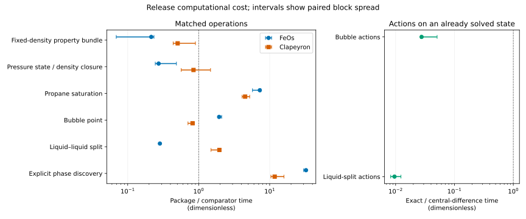

The cost comparison depends on the operation and comparator.
The fixed-density bundle costs less than either comparator on this host, whereas explicit phase discovery costs more.
The pressure-state comparison with Clapeyron spans equal cost across the paired blocks, so its median alone does not resolve which implementation is faster.
The exact first-order actions cost a small fraction of the package's own central differences when the central state is already solved.
That last comparison concerns marginal derivative work; it is not a total equilibrium-solve speedup.

This is numerical verification and a hardware timing measurement on declared cases.
It is not physical validation, a global phase-stability proof, or an application-parameter qualification.
Independent delivered review and owner promotion remain outstanding.
No manuscript text is changed by this study.

## Question and calculation basis

Issue [#681](https://github.com/tannerpolley/ePC-SAFT/issues/681) selects release `main-8298c6029ebb8b467929badc4a223c580ec591ab`.
The package was built from a detached checkout inside this task's build directory, using the release's own setup instructions and environment.
The retained [preparation record](results/preparation.json) and [image identity](results/image.json) identify the source, build options, editable loader, Python files and native libraries.
The worker refuses a rebuild or a substituted native image and rechecks the loaded images at the end.

The declared conditions are:



The property bundle returns pressure in pascals, residual molar enthalpy in joules per mole, residual molar isochoric heat capacity in joules per mole kelvin, component log fugacity coefficients and residual Helmholtz energy divided by the gas constant and temperature.
The pressure-state row measures density closure on a changing-pressure liquid sequence and reports cost per state.
The other equilibrium rows report cost per declared solve.
Mixture preparation, worker startup, Julia compilation, warmups and request transport are outside the reported samples.
The measured calls include the return extraction used by the existing timing methods.

The electrolyte row is package-only by the task's design.
It measures a complete set of independent declared liquid–liquid solves, with the feed amounts normalized on the explicit ion basis in [the feed table](inputs/electrolyte-feeds.csv).
The [model snapshot](inputs/electrolyte-model.json) is the existing head-to-head study's `constant-permittivity` declaration: solvent-only constant permittivity, direct Born form, and Debye–Hückel diameters equal to segment diameters.
This deliberately fixed permittivity is a calculation condition, not an adopted physical correlation.

## Reused methods and value agreement

The timing controller reuses the [existing campaign](../2026-audit-timing-campaign/scripts/campaign.py)'s persistent worker classes, timers and interleaving loop.
The leaf's adapters select the named release and the requested declarations; they add strict admission before each block.
The FeOs Python environment and the Clapeyron one-process FIFO server are the existing comparator environments.
The retained raw identities record their actual versions, process identifiers, affinity and numerical-thread settings.
No earlier audit timing value enters this comparison.

The [head-to-head declarations](../2026-head-to-head-comparisons/scripts/h2h_engine.py) supply the constant-permittivity feeds and central-difference closures.
The [cross-check declarations](../2026-competitor-cross-check/scripts/engine.py) supply the saturation, bubble and liquid–liquid cases, including their source parameter conversions.
The [density benchmark](../2026-density-root-benchmark/README.md) supplies the changing-pressure sequence and comparator density methods.
The leaf retains the exact selected [inputs](inputs/inputs.json), [declared cases](inputs/declared-cases.json), fresh [preflight returns](results/preflight.json) and [normalized values](results/preflight-values.json).
Preflight elapsed times are deliberately unused.

Each comparator must return the same pressure, phase densities, compositions and, where defined, phase fractions before its measurement is admitted.
The numerical rules reuse the existing timing study's quantity-specific tolerances:



The agreement table reports the largest error divided by its allowed error, so quantities with different units are not combined as an absolute error.
A value below unity satisfies the stated rule.
The full operands and allowances remain in [checks.csv](results/checks.csv).



An initial discovery probe at a different point on the existing methane–ethane grid returned a stable single phase in the package.
FeOs returned a no-split diagnostic without a state density, while Clapeyron retained an additional zero-fraction phase.
Those returns did not provide the same physical state quantities for a timing comparison.
They remain in [the initial preflight record](results/preflight-initial.json) and supply no reported timing.
The selected two-phase grid point then matched all comparators before measurement.
Every final measured comparison is value-matched; the result does not extend to the rest of the discovery grid.

## Host admission, interleaving and spread

The owner's task response defines quiet admission by the one-minute load and the absence of compiler processes from other tasks, immediately before and after each block.
The exact limit, polling interval and waiting allowance are retained in [the inputs](inputs/inputs.json).
The controller checks every few minutes while waiting, observes other tasks' processes, and never stops them.
Compiler observations and rejected admissions remain in [deferred-host.jsonl](results/deferred-host.jsonl).



Two independent package workers bracket FeOs and Clapeyron in alternating order across repetitions.
Each worker uses one numerical thread and the same logical CPU.
For each operation and worker, the headline time is the median of its block medians.
The absolute-time table also gives the minimum and maximum block median; the retained statistics additionally contain the sample tenth and ninetieth percentiles.
Each comparator ratio uses the paired package and comparator block medians from the same repetition, including both package workers.
The displayed ratio is their median and its interval is their full range.
These intervals describe observed run-to-run spread, not statistical confidence limits.
The package-to-package controls remain in [ratios.csv](results/ratios.csv).

One block crossed the admission limit during propane saturation.
The controller retained the disturbed block, excluded it, and repeated the operation with all workers and repetitions.
The complete retry supersedes the earlier quiet saturation blocks without selecting by speed.
The admission-only records contain no timing blocks; the measured records use the owner's revised admission rule.



The [block table](results/blocks.csv) distinguishes selected, disturbed and superseded blocks.
The [host table](results/host.csv) records the corresponding before/after load, time and compiler observations.
All timed returned values, including the excluded and superseded blocks, pass the numerical repetition checks in [timed-value-checks.csv](results/timed-value-checks.csv).

## Computational cost

Smaller package/comparator ratios mean less elapsed time for the package at the matched state.
The points and intervals below come only from [the ratio table](results/ratios.csv).
The derivative panel uses a separate denominator and excludes the central solve.



The following table gives the absolute elapsed times, including the package-only electrolyte set.
Each pressure-state sample is divided by the number of states in its changing-pressure sequence; the electrolyte sample is the whole feed set.



## Meaning and limits

The comparison quantifies these implementations' warm, serial calls at these states on this host.
Different initialization, reuse, stopping and discovery methods can have different costs while returning the same state.
Matching outputs does not make their internal search work identical or establish equivalent global phase-search coverage.
The package-to-package controls and paired spread bound the interpretation of small timing differences.
In particular, the pressure-state ratio against Clapeyron crosses equal time in the observed spread.

For marginal actions, the central equilibrium state and compiled problem already exist.
The bubble case differentiates pressure and vapor composition in the temperature and existing active-parameter directions.
The liquid–liquid case differentiates the two water compositions and water-rich phase amount in the temperature and binary-interaction directions.
The central-difference calls use the same directions and the existing head-to-head step sizes, retained beside the action returns.
Their cost includes constructing the shifted parameter declarations and resolving the displaced states.
Neither action ratio includes the cost of the original central solve.

The results support the operation-specific timing comparison and the stated first-order numerical checks.
They do not support a single package-wide speed factor, startup-cost claim, threaded-throughput claim or application prediction.
The analysis remains unpromoted until the independent delivered review and the owner's decision.

## Retained records and presentation

The raw compressed records under [results/raw](results/raw/) retain every timing request, return, worker identity and host snapshot.
[samples.csv](results/samples.csv) owns the individual elapsed times; [statistics.csv](results/statistics.csv) owns the block summaries; [ratios.csv](results/ratios.csv) owns the displayed ratios and paired spread.
The reduction reads fresh records only.
The presentation script reads those retained files and produces the tables and figure without importing the Engine or rerunning the model.

The existing worker guard rewrites `sys.executable` to its native-fit launcher alias, which therefore appears in the raw identity's `executable` field.
This study launches no fits or fit workers.
The actual package interpreter command is the `python` path in [image.json](results/image.json); the guard's mapped native-library paths and hashes identify the loaded release.
