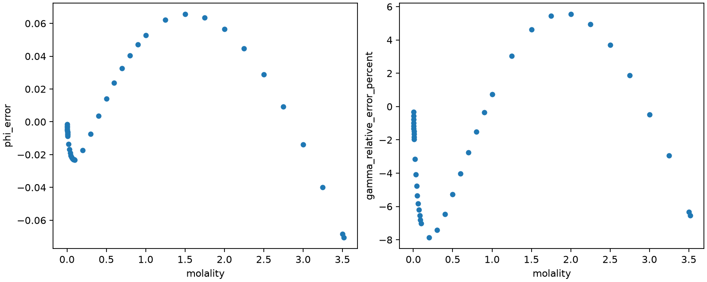
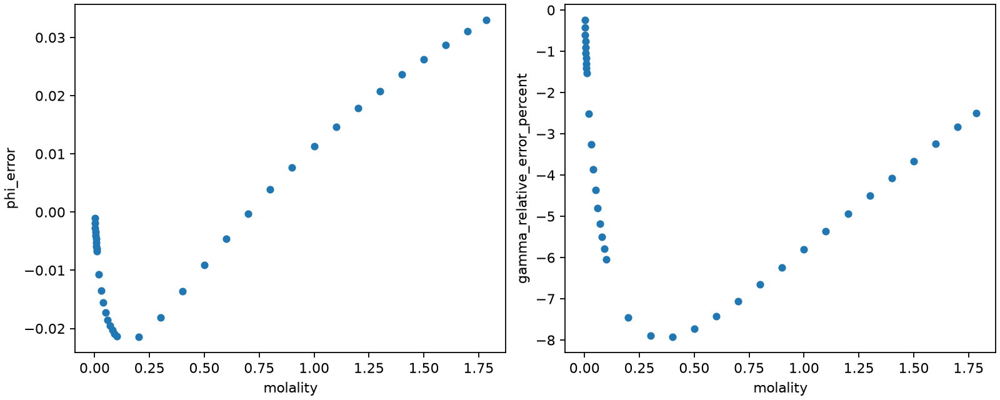

## Ba mixtures: the two dispersion columns still fail the screen

All nine frozen Ba points exceed the declared absolute correlation limit.
Every point has all binary and mixture observations available, complete finite
exact columns, positive weighted-column norms and nonempty native state/reference
diagnostics. Adding the Robinson–Bower mixtures therefore does not satisfy the
specified local separation rule for Ba–water and Ba–chloride dispersion.
Fitting, endpoint identification, binary accuracy and selected-endpoint mixture
statistics were not reached. The rejected screen permits no fitted parameter pair.





### Source roles and the approved reference replacement

The existing evaluated BaCl₂ binaries and all admitted Robinson–Bower mixtures
are training observations. El Guendouzi remains the reserved untrained check;
its [fixed row identities](inputs/el-guendouzi2003-reserved-rows.csv) are recorded
without predictions or scores. No check value enters the objective, screen,
stopping decision or parameter selection.



Robinson and Bower's [Table 1](https://doi.org/10.6028/jres.069A.004) gives
isopiestic compositions and NaCl-reference links. The historical reference curve
was not recovered. The owner approved the osmotic column of Hamer and Wu's
[Table 16](https://doi.org/10.1063/1.3253108), linearly interpolated in analytical
molality, as a replacement. The declared historical solvent convention and the
native water molar mass remain distinct: conversion preserves isopiestic water
activity. The source arithmetic follows the frozen `817-REF` and `817-MAP` in
the [accepted amendment](https://github.com/tannerpolley/ePC-SAFT/issues/817#issuecomment-6372194727).

The [frozen targets](inputs/robinson-bower1965-targets.csv),
[reference values](inputs/robinson-bower1965-references.csv),
[knots](inputs/hamer-wu1972-nacl-knots.csv) and
[source identities and exclusions](inputs/ba-mixture-source-provenance.json)
retain the exact inputs. The native reproduction below verifies every admitted
target, shared run reference, rounded source-ratio interval and solvent conversion.
Displayed digits resolve the arithmetic check and add no measurement precision.

::: {.callout-note collapse="true"}
### Complete target reproduction


:::

The replacement misses the central printed activity in Robinson–Bower Figure 1.
The retained deviations below disclose the activity shift and its propagation
to the three mixtures sharing that reference. These systematic shifts are not
model residuals, all-run bias bounds or a subtraction from the targets. The
printed-knot rounding contribution excludes interpolation curvature,
evaluated-reference uncertainty, historical-scale differences and measurement
error. Shared references induce shared contributions; discrepancy weights do
not establish independent errors or statistical confidence intervals.



### Frozen model, weights and every screen point

Only the reciprocal Ba–water and Ba–chloride pair coefficients vary. The
Held, Cameretti and Sadowski [Table 2](https://doi.org/10.1016/j.fluid.2008.06.010)
segment diameter and dispersion energy stay fixed. Packing and Debye–Hückel
lengths retain the declared proportional reduction; the Born length equals
the segment diameter. These transfers to the refitted chloride basis are
modelling assumptions. The liquid is homogeneous and fully dissociated.



Binary osmotic/activity observations share half the discrepancy-normalized
objective weight in their four unchanged concentration/observable groups;
mixtures share the other half. The [declaration](inputs/fit-ba-mixture.json)
owns scales, bounds, points, starts and work limits. The native shared producer
forms the weighted columns once and evaluates the same correlation rule at
every point. The following table gives the complete small set of scalar
decisions, so a separate plot adds no information to the all-points rule.





The [complete columns](results/ba-mixture/sensitivity.csv) retain predictions,
residuals, raw derivatives, unit-weight residual derivatives, weights,
objective-weighted derivatives, full mixture compositions and source identities.
[Full-file and ordered binary64 hashes](results/ba-mixture/sensitivity-sha256.json)
bind these columns and the nonempty diagnostics before any conditional fit.



The [native traces](results/ba-mixture/prefit-diagnostics.csv) retain liquid
densities, pressure slopes, branches, convergence and binary reference ladders,
including pure water. The [verification](results/ba-mixture/verification.json)
confirms that binary predictions and raw/unit-weight columns reproduce the
earlier Ba screen; the new binary weighted columns have the prescribed
equal-source reduction. It also records refusal of absent and rejected screens,
all target reproductions, diagnostic coverage and byte identity of every earlier
H, Ba, Sr and sulfate result. The shared scorer and earlier declarations remain
unchanged. The [execution identity](results/ba-mixture/native-identity.json)
identifies the checkout's own editable Engine, generated transport and executable.

### Conditional fit, transfer and claim limits



The screen stopped before the six-start sequence. No fitted endpoint,
identification result or binary accuracy comparison exists for this attempt.
Every successful future fit must return to the owner before any El Guendouzi
prediction or score, even if binary accuracy passes. No packet was written.

The reserved check includes lower ionic strengths than the mixture training
minimum and sodium-rich compositions beyond its sodium-molality range; the
[source record](inputs/ba-mixture-source-provenance.json) gives the exact ranges.
This is declared concentration/composition transfer. Its source pressure is
unreported; later nominal-pressure interpretation and check limits require
the owner's separate decision. The pure-BaCl₂ saturation cap does not establish
ternary solid stability.

This result is numerical sensitivity evidence at the declared conditions and
discrepancy scales. It supports rejection of these frozen local screens, without
proving global non-identifiability or physical-model failure. It establishes
neither untrained physical validation nor parameter adoption, temperature or
pressure transfer, other mixed-brine performance, ion pairing, solid equilibria,
density/caloric accuracy or microscopic meanings of the pair coefficients.
Independent delivered review remains with the owner; this notebook is not
promoted for manuscript use.

## Sulfate: local-resolution screen stops before fitting

The effective sulfate candidate is admitted with the frozen chloride-basis
Li–Mg–Cl mixing term retained. Every prescribed sulfate–water point has complete
finite observations and exact derivatives, a positive weighted norm, and an
interior coordinate. Every point fails the declared local-resolution limit.
The complete screen therefore fails. No fit, endpoint identification or binary
accuracy comparison was run.







The table presents the complete small set of prescribed scalar decisions;
a plot would add no information about the all-points stopping rule. Full
precision is retained in the [screen summary](results/sulfate/sensitivity-summary.csv).
The resolution quantity is

$$h=\sqrt{2\Delta J\,C_{11}},\qquad C_{11}=\|A\|_2^{-2},$$

where $A_i=\sqrt{w_i}b_i$ is the exact objective-weighted residual derivative.
The [declaration](inputs/fit-sulfate.json) fixes the point-cost increment,
bounds, resolution limit, observations, source weights and conditional starts.
This prospective discrepancy-resolution calculation is numerical verification
of the declared screen, not a confidence interval or a global identification
claim. Pairwise correlation is inapplicable with a single free coordinate.

### Effective-model assumptions and transfer risk

The model assumes a homogeneous, fully dissociated, nonacid aqueous liquid.
Only the symmetric sulfate–water dispersion coefficient is free, as one joint
native `Kij` target. Segment count, diameters, dispersion energy, solvation,
cation–sulfate corrections and all existing chloride-basis quantities stay fixed.
Sulfate–chloride and sulfate self-dispersion follow the same-sign-ion exclusion.
The fixed values and their units are shown below.



The sulfate segment diameter, energy and cation–sulfate coefficients transfer
from Held et al., [*ePC-SAFT revised*](https://doi.org/10.1016/j.cherd.2014.05.017),
Tables two and three, strategy two. Packing and Debye–Hückel diameters follow
the declared segment-diameter reduction; the Born diameter equals the segment
diameter as an explicit transfer assumption. The
[source record](inputs/sulfate-source-provenance.json) and frozen design give
exact locators and the distinction between source values and assumptions.
Held's unlike-ion coefficients were fitted with its own pure-ion set. The
refitted chloride basis has different cation lengths, Born lengths and dielectric
treatment, so this transfer can miss the concentration shape. No source-consistent
calibrated sulfate set on the chloride basis is claimed.

Under [the cation-mixing decision](https://github.com/tannerpolley/ePC-SAFT/issues/795#issuecomment-6359875965),
$\theta(\mathrm{Li},\mathrm{Mg})$ applies with additional anions, while the retained
$\psi(\mathrm{Li},\mathrm{Mg},\mathrm{Cl})$ term applies to chloride alone.
**$\psi(\mathrm{Li},\mathrm{Mg},\mathrm{SO_4})$ is zero by assumption** under
[the Engine admission work](https://github.com/tannerpolley/ePC-SAFT/issues/814).
No extra sulfate-specific mixing coefficient is introduced.

### Observation basis and numerical checks

The [audited training rows](inputs/sulfate-training.csv) comprise both declared
binary salts and the LiCl–MgSO₄ mixture series. Guendouzi et al.
[water-property measurements](https://doi.org/10.1016/S0021-9614(02)00315-4),
Tables three and six, supply the experimental binary osmotic coefficients;
Zhang et al. [isopiestic measurements](https://doi.org/10.1021/acs.jced.5b00987),
Table three, supply mixture water activities. Native conversion uses analytical
ionic molalities on a kilogram-of-water basis, without hydration-water
subtraction. Water activity and its derived osmotic coefficient count as a single
observation. The [native admissions](results/sulfate/mixture-admission.csv) retain
source-cell identity, salt, bucket, molalities, ionic strength, osmotic denominator,
observed values, normalized composition, charge-balance admission and weight.

Binary buckets share half the total discrepancy weight and mixtures receive
the other half. These weights describe model discrepancy, not independent
measurement variances. The binary source and the mixture reference electrolyte
each introduce shared experimental dependence. Calculation pressure is nominal;
it is not an assertion of an exact experimental pressure.







The coordinate readback verifies equal reciprocal entries, a single active
physical parameter and a unit optimizer map. The native joint physical partial
already differentiates both reciprocal entries and is compared directly with
the exact optimizer column. Both prescribed centered differences pass and
verify derivatives only. Nonempty native prediction diagnostics cover every
screen point and every perturbed evaluation, retaining solution and reference
states, all binary dilution rungs, density, pressure, positive pressure slope,
regularity information and branch/root-count agreement.

The [exact columns](results/sulfate/sensitivity.csv),
[joint-partial and difference comparisons](results/sulfate/length-verification.csv),
[state/reference diagnostics](results/sulfate/prefit-diagnostics.csv), and
[file and ordered binary64 hashes](results/sulfate/sensitivity-sha256.json)
preserve the result before any possible fitting. Missing, stale, rejected and
incomplete-diagnostic screens refuse the native fit call. Earlier declarations
and numerical results retain their original bytes.

### Decision and limits

The fixed transfer hypothesis fails this prospective local-resolution screen
at every prescribed point. This does not establish global non-identifiability,
physical-model failure or physical validation. Concentration-shape accuracy was
not tested at a fitted endpoint. The failed screen returns to the owner without
changing a parameter, free set, observation, discrepancy weight or tolerance.
The reserved mixture and density studies remain unopened and unhashed. No
parameter packet is written. Any later successful fit must return to the owner
before reserved checks.

This sulfate notebook section has not received independent delivered review or
investigator promotion for manuscript use. Earlier Sr and Ba evidence follows.

## Sr diameter and water dispersion screen

The declared diameter-and-water-dispersion screen fails. Some prescribed points
have separated columns, but the complete grid does not meet the prospective
absolute-correlation limit. Every point has complete finite native prediction,
residual and derivative columns, with positive weighted norms. The table gives
the unrounded-file result at each point; its displayed values are rounded only
for reading. Fitting, endpoint identification, binary accuracy scoring and
selected-endpoint Clegg metrics were not reached.







This experiment is a **lead decision**, as recorded in the
[frozen declaration](inputs/fit-sr-sigma.json) and its design and amendment hashes.
Every successful fit must return to the owner before qualification or a
parameter packet. This failed screen likewise returns to the owner without
changing the grid, free set, observations, bounds or limits.

### Free coordinates and assumptions

The Sr segment diameter and Sr–water dispersion coefficient are the only free
coordinates. The diameter coordinate moves segment, packing, Debye–Hückel and
Born lengths together through the declared native target coefficients. The
following table retains the applied lengths in angstrom, the dimensionless
pair coefficients, the native lower diameter bound, and the exact coordinate
map coefficients. The declaration owns the origins, scales and both bounds;
the local-resolution and endpoint-agreement limits use each coordinate's own
physical span.







The fixed Sr–chloride coefficient is a modelling assumption. Sr dispersion
energy is fixed at [Held, Cameretti and Sadowski](https://doi.org/10.1016/j.fluid.2008.06.010),
Table two, strontium row. The tied-length ratios are inherited
transfer assumptions. The lower bound applies the declared crystal-diameter
floor to every tied length, using [Marcus](https://doi.org/10.1039/FT9918702995),
Table one, strontium row. The upper length and dispersion
bounds are numerical search limits. The complete former chloride basis,
segment count, charge, solvation factor and absent Sr–Na correction stay fixed.
The model assumes a homogeneous fully dissociated liquid; a liquid density root
does not establish phase stability. A diameter change jointly changes several
model contributions and cannot isolate a microscopic hydration radius.

The observations, source admissions, discrepancy weights and conditions are
those of the earlier binary-plus-Clegg experiment described below. The complete
Clegg source remains training, with half the discrepancy-normalized source
weight. Dependent evaluated binary curves and shared isopiestic references do
not supply independent measurement variances or confidence intervals.

### Exact derivatives and pressure-branch verification

The combined diameter derivative is the sum of the four native physical
partials, multiplied by their declared target coefficients. Those independent
physical partials and the screen column agree under the frozen numerical
equivalence allowance. Native centered differences at both declared steps
verify each raw prediction column at the Held-diameter, former-water-endpoint
point. Finite differences generate no screen or fitting column.





The diagnostic table covers every screen and centered-difference evaluation.
Density uses mol per cubic metre; the pressure derivative uses pascal per
mol per cubic metre. Native prediction results retain the finite-composition
state, pure-water reference, binary reference states and all dilution rungs.
Their positive pressure slopes and convergence records check branch regularity;
centered-difference evaluations preserve the central branch and root count.
The [nonempty diagnostic file](results/sr-sigma/prefit-diagnostics.csv) retains
state identities, densities, pressures, slopes, branch labels, root counts,
convergence information, reference values, availability and explicit causes.
No measurement-uncertainty model was added to obtain these records.

The [physical-partial and difference checks](results/sr-sigma/length-verification.csv),
[applied coordinates](results/sr-sigma/length-coordinates.csv) and
[comparisons with the preceding mixture screen](results/sr-sigma/length-previous.csv)
retain every numerical comparison. At the common Held-diameter points,
predictions and raw, residual and weighted water columns agree with the preceding
mixture screen under the frozen equivalence allowance.
The [file and ordered-column hashes](results/sr-sigma/sensitivity-sha256.json)
bind these nonempty diagnostics, verification values, complete screen,
declaration, input bytes, transported parameters, executable and native library
before any fit could be allowed. Missing or rejected screens refuse fitting.

### Meaning and claim limits

This is local numerical sensitivity evidence under the stated calibration
assumptions. It rejects the all-points screen even though some points pass.
It establishes neither global non-identifiability, physical-model failure,
physical validation, microscopic parameter meaning nor composition-transfer
accuracy. The finite discrete correlations answer the prescribed decision;
a continuous curve would add no evaluated evidence, so the result is tabulated.
All earlier retained numerical results remain byte-identical.

No fitted endpoint exists. Identification, binary accuracy and informational
selected-endpoint Clegg statistics are not reached. Guo values and Ba mixture
data remain unopened; the condition-only Guo rule retained below remains for
a separately authorized later stage. No parameter packet was written.
Independent delivered review and investigator promotion for manuscript use
remain pending.

## Earlier Sr binary-plus-mixture screen: fitting is not reached

Adding the complete Clegg NaCl–SrCl₂ source to Sr training still leaves every
frozen point above the declared absolute-correlation limit. All native
predictions, residuals and both exact derivative columns are complete and finite;
both weighted norms are positive. The retained screen below gives each point,
its correlation, norms, combined objective and first failed requirement. This
finite sensitivity result rejects the declared local screen. Fitting, endpoint
identification and binary accuracy scoring were not reached.









### Source admission, composition and weights

[Clegg, Rard and Miller](https://doi.org/10.1021/je0495987), Table 2,
manuscript printed pages listed in the [source record](inputs/clegg2005-provenance.json),
supplies isopiestic total salt molalities, NaCl ionic-strength fractions and
NaCl reference molalities and osmotic coefficients. Every occupied cell was
checked against the rendered source. Blank cells are absent measurements.
The printed Series-two references already contain the authors' stock correction;
no further correction was applied. All thermostat-marked experiments remain,
with their reported times measured after temperature control was restored.
The [transcription](inputs/clegg2005-table2.csv) retains the printed central
values, plus/minus entries, equilibration times and footnotes. The plus/minus
entries are not independent standard uncertainties.

With analytical salt molalities $m_N$ and $m_S$ in mol per kilogram water,
the source equations reconstruct ionic strength $I=m_N+3m_S$, total individual-ion
molality $D=2m_N+3m_S$, and the observed practical mixture osmotic coefficient
$\Phi^{obs}=2m^*\phi^*/D$. The printed reference coefficient $\phi^*$ is not
itself a mixture coefficient. The shared native producer checks reconstructed
salt and ionic-strength balances, electroneutrality and osmotic balance before
screening. These checks verify arithmetic; Clegg prints no separate mixture
coefficient for an independent printed-value comparison.

The native mixture observation uses the full water, sodium, strontium and
chloride composition and the same-temperature, same-pressure pure-water
reference. The [admission rows](results/sr-mixture/mixture-admission.csv) retain
both salt molalities, ionic strength, osmotic denominator, observed coefficient,
normalized composition, row weight and decision. The
[admission hashes](results/sr-mixture/admission-sha256.json) were closed and
read back before the screen. The
[complete columns](results/sr-mixture/sensitivity.csv) retain source-cell and
coordinate identity, composition, observed and predicted quantity, unit-weight
residual, raw derivative, residual derivative, weight, weighted derivative,
availability and cause.

The binaries and Clegg each receive half the total discrepancy-normalized source
weight. The four internal binary groups keep equal shares within the binary
half; all Clegg cells share the mixture half equally. The exact scales and
weights come from the [declaration](inputs/fit-sr-mixture.json) and retained
native columns. These are discrepancy weights, not inverse measurement
variances. Shared isopiestic reference values and the common NaCl reference
convention prevent interpreting the scalar count as independent measurements.
The whole Clegg source is now training evidence.

### Assumptions and interpretation limits





The fixed Sr sizes and energy, all previous chloride-basis values and every
other interaction remain unchanged. Both reciprocal Sr–water and Sr–chloride
dispersion corrections are declared coordinates. The absent Sr–Na correction
keeps the candidate's existing default convention. The model assumes a
homogeneous fully dissociated liquid. Nominal calculation pressure is listed
above; the source does not establish it as a measured experimental pressure.
A liquid density root does not establish phase stability.

The two exact native columns are weighted once before applying the declared
inverse-information correlation identity given in the historical screen
section below. Their compensation remains too strong under the prospective
rule. The table lists discrete prescribed points; no interpolation or
continuous-search inference is intended. This is numerical sensitivity evidence
for a calibration design. It establishes neither global non-identifiability,
physical-model failure, independent physical validation, microscopic parameter
meaning nor untrained composition-transfer accuracy. No parameter packet was
written. All earlier retained numerical results remain byte-identical.

### Informational mixture training metrics



These selected-endpoint osmotic root mean square and maximum absolute errors
have no qualification thresholds. They could not rescue a failed binary accuracy
check or select a different endpoint. No selected endpoint exists in this attempt.

### Guo subset fixed for a later stage

The [frozen declaration](inputs/fit-sr-mixture.json) retains the following
condition-only predicate, copied prospectively from the accepted design:



Apply the ionic-strength cap to three times the sum of the two divalent salt
molalities, using unrounded source central conditions. Membership cannot depend
on activity values, residuals, numerical convergence or whether a row helps an
accuracy limit. A failed prediction inside the subset remains a required
failure. These conservative caps describe inherited comparison coverage and
binary boundaries, not mixed-salt saturation curves. A newly discovered phase
conflict returns to Design.

Guo values, numerical source files and hashes remain unopened; the subset count
has not been calculated. Its later comparison is explicitly a composition-and-pressure
transfer check. The Engine must use the source pressure in the table, and later
readiness must settle its pressure-transfer treatment and water-activity error
limits before any values or predictions are opened. Ba mixture data remain
unopened. This attempt stops before every untrained source.

The [screen hashes](results/sr-mixture/sensitivity-sha256.json),
[native identities](results/sr-mixture/native-identity.json),
[mapped library](results/sr-mixture/native-mappings.txt),
[policies](results/sr-mixture/solver-policy.csv) and
[timing](results/sr-mixture/screen-timing.json) retain the numerical execution.
The point evaluator exposes no density/reference trace arrays here; the
header-only diagnostic file is an explicit absence, not an extra result.
Independent delivered review remains pending; this notebook is not promoted
for manuscript use. The conditional fitting path was not exercised.

## Historical binary-only screens

### Two-coefficient sensitivity screen stops before fitting

The independent Sr and Ba screens both reject the declared pair of dispersion
coordinates before fitting. Every declared point has complete finite native
prediction and residual derivatives and positive finite weighted column norms;
every retained absolute correlation exceeds the declared limit. The point
coordinates, norms, signed correlations, decisions and evaluation times are
read from the retained tables below. The columns therefore fail the frozen
local separation requirement under these fixed inputs and discrepancy weights.
No two-coefficient fit, endpoint identification or evaluated-binary scoring
was performed. The owner retains the mixture-training and qualification split
decision before any further fitting.

**Assumptions:** the physical basis, transferred ion lengths and dispersion
energies, homogeneous fully dissociated liquid, pressure convention, training
rows, discrepancy weights and frozen chloride parameters remain those of the
stage-one trial documented below. Both reciprocal ion–water and ion–chloride
coefficients are now free, with their bounds, origin and scale declared in
[the Sr request](inputs/fit-sr-two-k.json) and
[the Ba request](inputs/fit-ba-two-k.json). The initial zero chloride correction
is a grid location rather than a fixed modelling assumption in these requests.
The inherited finite lower bound is a numerical search boundary, not a physical
prior. The failed single-coordinate endpoints supply only the last row of each
frozen screen grid; they are excluded from the conditional fit starts.

The exact unit-weight native residual derivatives are weighted once in the
shared C++ producer. For its retained columns $x$ and $y$, the signed local
inverse-information correlation is

$$
\rho=-\frac{x^T y}{\lVert x\rVert_2\lVert y\rVert_2}.
$$

The diagnostic tables list each prescribed point rather than interpolating
between points or implying a continuous search. Their nearly opposite columns
allow changes in the two pair corrections to compensate locally in the
training predictions. Rejection at these points establishes failure of this
prospective screen, not global non-identifiability across the numerical box,
physical-model failure or independent physical validation. This is numerical
sensitivity evidence for a calibration design. It supplies no fitted pair,
confidence interval, mixture prediction, sulfate evidence or adoption claim.

### Sr: complete finite columns fail the correlation limit











[All row and coordinate columns](results/two-k/Sr/sensitivity.csv),
[full-precision screen values](results/two-k/Sr/sensitivity-summary.csv),
[file and ordered-column hashes](results/two-k/Sr/sensitivity-sha256.json),
[execution identities](results/two-k/Sr/native-identity.json),
[actual mapped library](results/two-k/Sr/native-mappings.txt),
[resolved numerical policies](results/two-k/Sr/solver-policy.csv) and
[preparation and screen process times](results/two-k/Sr/screen-timing.json)
retain this attempt.

### Ba: complete finite columns fail the correlation limit











[All row and coordinate columns](results/two-k/Ba/sensitivity.csv),
[full-precision screen values](results/two-k/Ba/sensitivity-summary.csv),
[file and ordered-column hashes](results/two-k/Ba/sensitivity-sha256.json),
[execution identities](results/two-k/Ba/native-identity.json),
[actual mapped library](results/two-k/Ba/native-mappings.txt),
[resolved numerical policies](results/two-k/Ba/solver-policy.csv) and
[preparation and screen process times](results/two-k/Ba/screen-timing.json)
retain this separate attempt. No Sr result changed the Ba declaration.

### Numerical verification and evidence limits

The native readout was independently checked for full ordered row and coordinate
coverage, finite columns, the residual transformations, weighting, norms and
correlation identity. At the common chloride-zero geometric-mean and enhanced
water-attraction points, predictions and weighted water columns reproduce the
retained stage-one values within the frozen preservation tolerance. The exact
errors and file-identity checks are retained under `build/issue-795/`.
The prefit density/reference diagnostic files remain header-only because the
native point evaluator exposes no such arrays for these requests; no extra
reference or density result is inferred. Point evaluation time includes native
reference preparation; the separate timing files retain transport, build and
screen-process wall times. No optimizer time was spent.

All original stage-one result bytes are preserved. For those binary-only attempts,
reserved measured binary and mixture sources stayed unopened and unhashed,
and no packet was written.
The conditional fit implementation and shared scorer were not exercised by
these rejected screens. Independent delivered review of this new notebook and
its numerical evidence remains pending; it is not promoted for manuscript use.

## Retained stage-one result: identified endpoints fail binary accuracy

Both separate ion–water dispersion fits satisfy the frozen local identification
rule, then fail evaluated-binary accuracy in each concentration bucket.
The first failed requirement for each ion is the lower-bucket osmotic root mean
square error. No reserved measurement source or mixture source was opened,
and no parameter packet was written. These endpoints are diagnostic
calibrations and are unavailable for adoption under this design.

Binary accuracy is calibration evidence, not physical validation. The evaluated
activity and osmotic columns share source evidence and thermodynamic constraints;
scalar target counts do not count independent measurements. Discrepancy weights
are comparison scales rather than experimental variances. The local excursion
$h$ measures discrepancy resolution, not a statistical confidence interval.
These results establish neither global uniqueness nor physical-model failure.

### Physical basis and assumptions

The trials use fully dissociated, homogeneous aqueous SrCl₂ or BaCl₂ on the
unchanged [chloride basis](../../data/packets/figiel-2025-chloride-mixture-refit/2/parameters/parameters.json).
Each appends only its own cation. A salt molality denotes moles of analytical
salt per kilogram of water, with one divalent cation and two chloride anions
per salt formula unit. Stoichiometric ionic strength is three times salt molality.
The two concentration buckets, their exact denominators and all accuracy limits
are read from each declaration and retained predictions below.

**Modelling assumptions:** the source-fitted effective hydrated-ion sizes and
energies of [Held, Cameretti and Sadowski (2008), Table 2](https://doi.org/10.1016/j.fluid.2008.06.010)
are transferred to the different water, chloride and electrostatic physics of
the frozen basis. Segment count and solvation factor are fixed to unity.
Packing and Debye–Hückel diameters follow the declared Held/Figiel reduction;
the Born diameter equals the segment diameter without a radius conversion.
The fixed tables below give the actual values. Ion–chloride dispersion
corrections are fixed to zero as explicit assumptions, retaining geometric-mean
attraction. Only each reciprocal ion–water dispersion correction is fitted.
No H endpoint, sulfate, ion pairing, solid equilibrium or extra mixing
parameter enters either request.

[Goldberg and Nuttall (1978), Tables 23 and 26](https://doi.org/10.1063/1.555569)
provide the evaluated training values. The complete selected gamma and osmotic
columns were visually checked against the genuine Zotero PDF before freezing
and hashing the inputs. The source prints gamma first; each request declares
osmotic then gamma at ascending molality. The evaluated saturated-liquid row
is included, and rows above that ion's evaluated saturation boundary are
excluded. A liquid density root does not establish phase stability.
[Source identities and exclusions](inputs/source-provenance.json) retain the
attachment hash, source locators, units, exclusion reasons and uncertainty limits.
Pressure is treated as nominal atmospheric liquid pressure; pressure
qualification is outside this stage.

### Native sensitivity, fitting and identification

The [single shared producer](../2026-hydrochloric-acid-chloride-basis/scripts/activity.cpp)
uses native exact parameter derivatives, Ceres fitting and native inverse
information. Before any fit, every declared start evaluates every target.
For unit-weight residual derivative $b_i$, the producer forms
$A_i=\sqrt{w_i}b_i$ in C++ and retains the raw prediction derivative separately.
The osmotic residual already includes its declared difference scale; the
activity residual is a log ratio. The endpoint Jacobian is already weighted.
No finite difference supplies a fitted derivative, and no second weighting
is applied to the returned endpoint column.

The transport flushes and hashes every prefit file and the ordered binary64
raw, unit-weight and objective-weighted columns before invoking the fit process.
All columns have finite predictions and derivatives and a positive norm.
The prefit tables retain those norms and the correctly weighted objective
cost at each initial coordinate. The point evaluator exposes no density or
reference traces for these requests without measurement uncertainty; its
header-only diagnostic files represent that absence, not an additional result.

Identification requires every start to converge with available predictions,
then selects the minimum finite cost. At that minimum and every comparable
endpoint, the native sensitivity is nonzero, rank is full, inverse information
is finite and positive, bounds are inactive and sufficiently distant, and both
local excursion and endpoint separation satisfy the frozen limits.
No residual-variance multiplier rescales inverse information.
All costs, statuses, selected coordinates and excursions below read retained files.

### Sr: identification and evaluated-binary calibration





#### Prefit sensitivity



The [complete sensitivity columns](results/stage1/Sr/sensitivity.csv) retain source row,
start, molality, observable, prediction, native residual, raw derivative,
unit-weight residual derivative, weight, objective-weighted derivative,
availability and cause. [Prefit hashes](results/stage1/Sr/sensitivity-sha256.json) bind the
full files and ordered binary64 columns before fitting.

#### Every start and the selected endpoint











The [native values](results/stage1/Sr/fit-values.csv),
[fit status and termination causes](results/stage1/Sr/fit-status.csv),
[trial failures](results/stage1/Sr/trial-failures.csv),
[local resolution](results/stage1/Sr/local-resolution.csv), and
[resolved native solver policies](results/stage1/Sr/solver-policy.csv) preserve the complete
attempt. A header-only trial-failure file means no trial failure was reported;
the finite endpoints and convergence records provide the numerical result.

#### Each binary accuracy metric against its limit





The [signed row errors](results/stage1/Sr/2a-binary-errors.csv) and
[full-precision metrics and individual decisions](results/stage1/Sr/2a-binary-metrics.csv)
come from the unchanged metric implementation in the
[shared scorer](../2026-hydrochloric-acid-chloride-basis/scripts/score.py).
Missing, duplicated, nonfinite or unavailable predictions are refused with
the original denominators retained. No alternate endpoint is scored to obtain a pass.
The [execution identity](results/stage1/Sr/native-identity.json) and
[actual native mappings](results/stage1/Sr/native-mappings.txt) identify the source hashes,
generated parameter transport, executable and executing native library.

### Ba: identification and evaluated-binary calibration





#### Prefit sensitivity



The [complete sensitivity columns](results/stage1/Ba/sensitivity.csv) retain source row,
start, molality, observable, prediction, native residual, raw derivative,
unit-weight residual derivative, weight, objective-weighted derivative,
availability and cause. [Prefit hashes](results/stage1/Ba/sensitivity-sha256.json) bind the
full files and ordered binary64 columns before fitting.

#### Every start and the selected endpoint











The [native values](results/stage1/Ba/fit-values.csv),
[fit status and termination causes](results/stage1/Ba/fit-status.csv),
[trial failures](results/stage1/Ba/trial-failures.csv),
[local resolution](results/stage1/Ba/local-resolution.csv), and
[resolved native solver policies](results/stage1/Ba/solver-policy.csv) preserve the complete
attempt. A header-only trial-failure file means no trial failure was reported;
the finite endpoints and convergence records provide the numerical result.

#### Each binary accuracy metric against its limit





The [signed row errors](results/stage1/Ba/2a-binary-errors.csv) and
[full-precision metrics and individual decisions](results/stage1/Ba/2a-binary-metrics.csv)
come from the unchanged metric implementation in the
[shared scorer](../2026-hydrochloric-acid-chloride-basis/scripts/score.py).
Missing, duplicated, nonfinite or unavailable predictions are refused with
the original denominators retained. No alternate endpoint is scored to obtain a pass.
The [execution identity](results/stage1/Ba/native-identity.json) and
[actual native mappings](results/stage1/Ba/native-mappings.txt) identify the source hashes,
generated parameter transport, executable and executing native library.

### Evidence boundary and decision

The fits answer a local numerical identification question and a calibration
accuracy question under fixed, labelled assumptions. Both ions identify,
then fail calibration accuracy. The independent Ba declaration was unchanged
by the Sr result. No failure authorizes changing a fixed diameter, ion–chloride
convention, training row, discrepancy weight, bound, start or work allowance.
Measured binary validation, mixture prediction, preservation replay, sulfate,
acidic chemistry, mineral prediction and packet adoption remain outside this
result. Reserved source values were neither opened nor hashed.

The [Sr declaration](inputs/fit-sr.json) and [Ba declaration](inputs/fit-ba.json)
retain the frozen design and readiness hashes, source hashes, conditions,
starts, bounds, per-start limits, identification constants, accuracy limits
and isolated generated-header paths. The frozen records and delivery logs
remain under `build/issue-795/`. The historical H declarations, numerical
results and notebook remain byte-identical; their stored presentation was
reproduced without a model call.

This delivered notebook has not been independently reviewed or promoted
by the investigator for manuscript use. Later qualification requires a
separate accepted design and readiness decision; this result opens no later stage.
