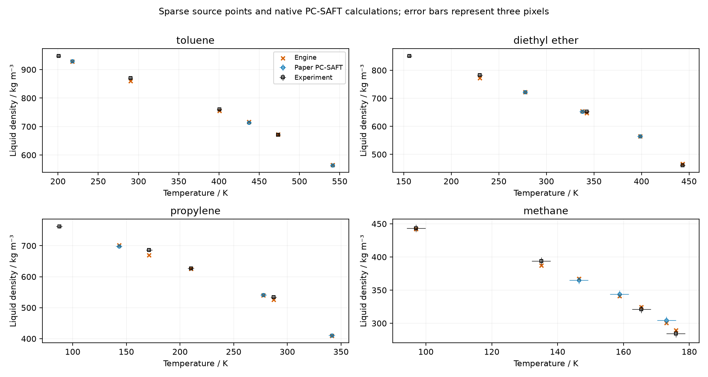
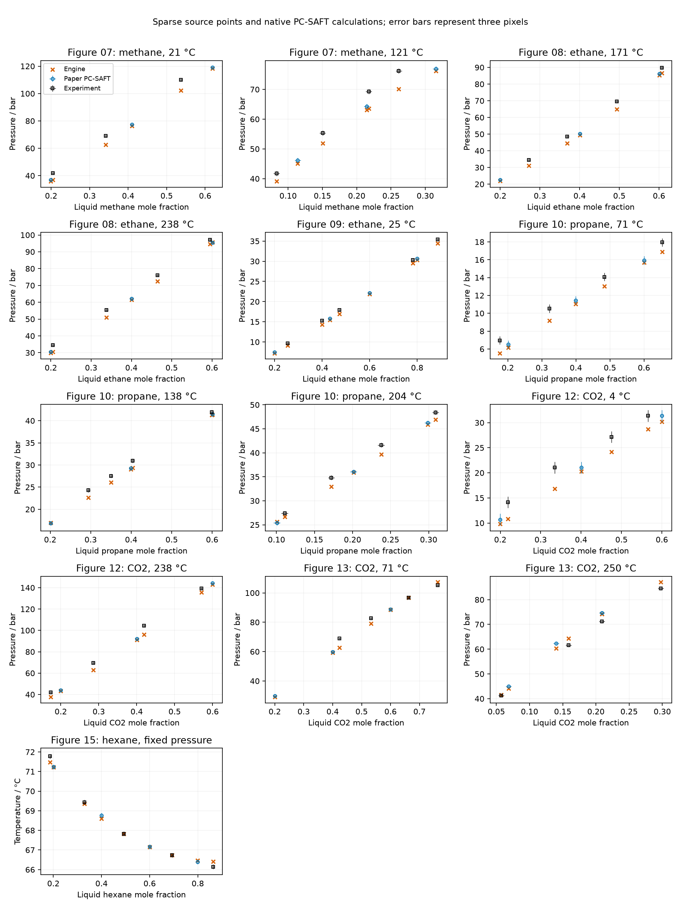

```{python}
#| include: false
import csv
import json
from pathlib import Path
import sys
from IPython.display import Markdown, display
here = Path.cwd()
if not (here / 'results/run.json').exists():
    here = here / 'analyses/reproduction/2001-gross'
sys.path.insert(0, str(here / 'scripts'))
from present import rows, summary, table, groups
run = json.loads((here / 'results/run.json').read_text())
tol = json.loads((here / 'inputs/tolerances.json').read_text())
pure = rows('pure-saturation.csv')
comp = rows('figure-comparisons.csv')
ternary = rows('ternary-comparisons.csv')
ternary_diag = rows('ternary-diagnostics.csv')
qualified = [r for r in comp if r['success'] == 'True' and r['numerical_tolerance_met'] == 'True']
model_rows = [r for r in qualified if r['reference'] == 'model']
failed = [r for r in comp if r['success'] != 'True' or r['numerical_tolerance_met'] != 'True']
stats = summary()
binary_model_rows = [r for r in model_rows if r['figure'] != '03']
source_diag = rows('source-diagnosis.csv')
source_flash = [r for r in source_diag if r['maximum_composition_absolute_error']]
source_bubble = next(r for r in source_diag if r['probe'] == 'bubble pressure at selected liquid')
defects = rows('engine-defect-cases.csv')
uncertainty = rows('density-temperature-uncertainty.csv')
independent = json.loads((here / 'results/independent-code-run.json').read_text())
toluene_defect = next(r for r in defects if r['component'] == 'toluene')
propylene_defect = next(r for r in defects if r['component'] == 'propylene')
propylene_row = next(r for r in comp if r['component'] == 'propylene' and r['numerical_tolerance_met'] == 'False')
propylene_probes = [r for r in rows('diagnosis.csv') if r['component'] == 'propylene' and r['phase_pressure_relative_closure']]
rerun_counts = rows('rerun-counts.csv')
rerun_changes = rows('rerun-changes.csv')
ether_defect = next(r for r in defects if r['component'] == 'diethyl ether')
ether_probes = [r for r in rows('diagnosis.csv') if r['component'] == 'diethyl ether' and r['phase_pressure_relative_closure']]
ether_closure = [float(ether_defect['baseline_phase_pressure_relative_closure'])] + [float(r['phase_pressure_relative_closure']) for r in ether_probes]
original_methane = next(r for r in uncertainty if r['component']=='methane' and r['basis']=='reviewer original source point')
def show(data, columns):
    import io
    from contextlib import redirect_stdout
    out = io.StringIO()
    with redirect_stdout(out):
        table(data, columns)
    display(Markdown(out.getvalue()))
```

The Engine returned a pure saturation prediction for every retained compound and useful comparisons with the paper's plotted liquid densities and mixture phase boundaries.
The complete published deviation tables remain unreproduced: neither the source packet nor the original PDF contains the underlying pure-property rows or the binary experimental composition pairs used for those averages.
The retained comparisons are sparse numerical verification against digitized PC-SAFT curves and physical comparisons against digitized experimental symbols with literature parameters.
They do not establish independent physical validation or reproduce the original fitting statistics.
The refreshed model comparison has `{python} str(sum(r['model_tolerance_met']=='True' for r in model_rows))`/`{python} str(len(model_rows))` sampled points within the fixed figure thresholds.
Every sampled model point was retraced on the solid PC-SAFT branch and separately inspected in its overlay; [the point-by-point source review](inputs/digitized/model-point-review.csv) preserves the previous and revised pixels.
This is a second visual check by the same investigator, not an independent digitization by another person.
The experimental symbol selections and numerical tolerances are unchanged.

The [original paper](https://doi.org/10.1021/ie0003887), sections on pure components and mixtures, Tables 2 and 4, and the named figures own the inputs and comparisons.
The original Zotero PDF is attachment `ZAETGZK9` under parent `KXZN4KLQ`; the parent's default PDF attachment is a later reply and was not used.
The PDF was read with `pdftotext -layout`; its identity and hash are in [the run record](results/run.json).
The [source tables](results/tables/tables-manifest.csv) contain published aggregate deviations and parameters, rather than row-level measured properties.
The local Zotero data search returned no registered package for this source; that search does not exclude unregistered datasets.

## Quantities, conventions, and limits stated before calculation

### Selected source revision and numerical exclusions

The selected results are the final solid-curve extraction in
[model-point-review.csv](inputs/digitized/model-point-review.csv) and the
current-main rerun in [run.json](results/run.json). The source review
retains both pixel selections for every revised model point; experimental
symbols keep their separate identity. Caption-specific binary interactions
are used where stated, including the carbon-dioxide and chlorobutane figures;
the zero-interaction hydrocarbon comparisons are binary predictions.

The pure saturation catalogue demonstrates calculation breadth across
`{python} str(len(pure))` compounds. It contains no measured references at
those selected temperatures and does not validate that many compounds.
Figure statistics admit only rows with both a returned state and the retained
numerical criterion met. The excluded rows below remain in the declaration
count. Cold propylene, diethyl ether and toluene fail pressure closure even though
finite states were returned; these numerical exclusions remain outside the
qualified figure comparisons. The independent-code check includes all returned densities
under its own rule and does not override this numerical exclusion.

```{python}
show(failed, [('figure','Figure'), ('component','Component'),
             ('temperature_k','Temperature / K'), ('success','Returned'),
             ('numerical_tolerance_met','Numerically qualified')])
```

The row diagnostics in [engine-defect-cases.csv](results/engine-defect-cases.csv)
and the cold-state section below retain the exact stopping evidence. The production calculations and bounded diagnostics were rerun on current main
without source redigitization. This selected presentation awaits independent delivered review and investigator
promotion for manuscript use.

The model uses the published segment count, constant segment diameter in ångströms, and dispersion energy divided by Boltzmann's constant in kelvin, without refitting.
Reported molar masses are retained verbatim, including the printed value for hexene.
The Engine evaluates hard-chain and dispersion contributions with the original PC-SAFT base, without association, electrolyte, or polar contributions.
This treatment of carbon dioxide follows the paper's dispersive-only approximation in the mixture-results section.
The mixing rules are the arithmetic segment-diameter mean and the geometric energy mean multiplied by the binary interaction correction, as given by the paper's combining-rule equations.
Composition is mole fraction; the ternary axes are interpreted on that basis consistently with the paper's composition notation.
Ternary tie-line pairing remains a manual raster extraction and is marked for review.

The figure calculations override the retained binary matrix when the figure states a different value: the predictive hydrocarbon figures use zero interaction parameters, while the carbon-dioxide and chlorobutane figures use their own caption values.
The ternary carbon-dioxide pairs are declared separately in [the ternary inputs](inputs/digitized/ternary-pixels.json).
Every binary calculation specifies the liquid composition and solves for pressure or temperature and the incipient vapor composition.
Ternary calculations specify temperature, pressure, and a feed halfway between the digitized endpoints, then solve for both compositions and phase amounts.
Pure prediction temperatures lie within each published fitting range at the same declared fraction of that range; they provide calculated states rather than experimental deviation averages.
The figures also contain temperatures outside some published fitting ranges; those comparisons are extrapolations.

The maximum equilibrium-row residual is `{python} f"{tol['equilibrium_maximum_absolute_row_residual']:.0e}"`, and the separate phase-pressure closure threshold is `{python} f"{tol['phase_pressure_relative_closure']:.0e}"` relative.
The model-curve thresholds are `{python} f"{100*tol['figure_pressure_relative']:.0f}%"` or `{python} f"{tol['figure_pressure_absolute_bar']:g}"` bar for binary pressures, `{python} f"{tol['figure_temperature_absolute_k']:g}"` K for the isobar, and `{python} f"{100*tol['figure_density_relative']:.0f}%"` or `{python} f"{tol['figure_density_absolute_kg_m3']:g}"` kg/m³ for liquid densities.
The ternary composition threshold is `{python} f"{tol['ternary_composition_absolute']:g}"` mole fraction.
Digitization uncertainty is `{python} str(tol['digitization_pixel_uncertainty'])` pixels per axis; this is an extraction allowance, not measured experimental uncertainty.
An exact reproduction of a rounded aggregate AAD would require identical original data rows and agreement within `{python} f"{tol['table_aad_rounding_percentage_points']:g}"` percentage points.
That comparison cannot be evaluated with the present inputs.
No experimental pass threshold is imposed because pointwise measurement uncertainty is unavailable.

The paper's AAD is the arithmetic mean of absolute relative deviations, expressed in percent.
For the pure Table 2 comparison, the property is vapor pressure or molar volume, not liquid density; some volume averages also include supercritical data, as indicated by the table footnote.
For each digitized density observation, the volume relative deviation is computed as $|\rho_{\mathrm{source}}/\rho_{\mathrm{Engine}}-1|$.
The density relative deviation is shown separately.
Binary figure comparisons report pressure AAD, and the isobar reports temperature AAD using absolute temperature.
These are sampled figure statistics, not the paper's binary Table 4 averages of $K_i=y_i/x_i$ at experimental temperature and pressure.
Ternary $K_i$ comparisons use the same relative-deviation definition at the declared temperature and pressure.

## Current returned population and numerical qualification

The rerun uses main at `{python} run['git_base']`.
Published parameters, digitized inputs, declared production starts, and all
comparison and numerical criteria are unchanged. Native C++ owns all solves.
The current calculation returns `{python} str(run['successful_rows'])` of
`{python} str(run['total_rows'])` declarations; only
`{python} str(len(qualified) + sum(r['numerical_tolerance_met']=='True' for r in pure))`
are numerically qualified. These comprise `{python} str(len(qualified))` of
`{python} str(len(comp))` figure comparisons and
`{python} str(sum(r['numerical_tolerance_met']=='True' for r in pure))` of
`{python} str(len(pure))` reference-free predictions.

The before columns use the original committed production tables retained under
[historical/](results/historical/run.json). They returned all 200 declarations
and qualified 198, including 120 figure comparisons. The current run qualifies
one fewer figure row: cold toluene. Its returned density differs by represented
double steps and its pressure closure crosses the unchanged criterion.
This is a numerical-qualification change, not evidence of experimental disagreement.

```{python}
show(rerun_counts, [('quantity','Quantity'), ('requested','Requested'),
    ('before_returned','Before returned'), ('after_returned','After returned'),
    ('before_qualified','Before numerically checked'), ('after_qualified','After numerically checked')])
```

[The changed existing fields](results/rerun-changes.csv) retain the differences
from that historical population. [The earlier rerun counts](results/historical/rerun-counts.csv)
and [earlier changed fields](results/historical/rerun-changes.csv) preserve the
older mechanical-loop-seed study separately. A count table answers this
population question; the figures below show the qualified source comparisons.

## Pure-component predictions and the published AAD inventory

The native calculations returned `{python} str(sum(r['success']=='True' for r in pure))` of `{python} str(len(pure))` requested pure prediction states.
The table lists every retained compound, its published AAD values, and a calculated saturation state.
There are no Engine AAD values for the full original pure datasets, because those observations are absent.
The paper's volume footnote is preserved in the inventory.

```{python}
show(pure, [('component','Compound'), ('paper_psat_aad_percent','Paper pressure AAD / %'),
    ('paper_volume_aad_percent','Paper volume AAD / %'), ('temperature_k','Prediction T / K'),
    ('pressure_pa','Engine saturation pressure / Pa'), ('rho_liquid_kg_m3','Engine liquid density / kg m⁻³')])
```

## Sampled pure liquid-density comparisons

Each statistic below uses only returned states that meet both numerical checks.
Returned values that miss a numerical check remain in the full CSV and the diagnostic table.
The volume and density statistics use the same qualified source points and have different denominators.
They cannot replace the published aggregate volume deviations, which use a larger and partly different property dataset.

```{python}
show([r for r in stats if r['figure']=='03'], [('component','Compound'), ('reference','Reference'),
    ('attempted','Requested'), ('returned','Returned'), ('qualified','Numerically checked'),
    ('aad_percent','Volume AAD / %'), ('density_aad_percent','Density AAD / %'),
    ('model_points_within_tolerance','Model points within figure threshold')])
```

The highest-temperature methane and propylene model-density differences fall inside the declared temperature-pixel uncertainty.
Near the critical point, a small temperature shift changes the saturated liquid density substantially.
For the reviewer's original methane point, the native liquid-density interval is `{python} f"{float(original_methane['minimum_liquid_density_kg_m3']):.2f}"`–`{python} f"{float(original_methane['maximum_liquid_density_kg_m3']):.2f}"` kg/m³ for ±`{python} original_methane['pixel_uncertainty']` temperature pixels.
The intervals for both original and revised points are retained below; this bounds these model-curve comparisons and does not assign uncertainty to every experimental symbol.

```{python}
show(uncertainty, [('component','Compound'), ('basis','Source selection'), ('temperature_k','T / K'),
    ('temperature_uncertainty_k','Temperature allowance / K'), ('source_density_kg_m3','Source density / kg m⁻³'),
    ('minimum_liquid_density_kg_m3','Lower native density / kg m⁻³'),
    ('maximum_liquid_density_kg_m3','Upper native density / kg m⁻³')])
```



## Binary vapor-liquid boundaries

The binary model comparison has `{python} str(sum(r['model_tolerance_met']=='True' for r in binary_model_rows))`/`{python} str(len(binary_model_rows))` sampled points within the declared figure thresholds.
All comparisons retain their individual conditions, source roles, values, residuals, density roots, and deviations in [the full comparison table](results/figure-comparisons.csv).
The corrected solid-line selections remove the large discrepancies identified in review.
The remaining pressure differences outside the thresholds occur in the methane–butane, carbon-dioxide–decane, and carbon-dioxide–cyclohexane comparisons.
They remain numerical-verification differences against raster curves; neither this sparse extraction nor the independent code agreement proves their source is an Engine defect.

```{python}
show([r for r in stats if r['figure']!='03'], [('figure','Figure'), ('component','First component'),
    ('temperature_c','Isotherm / °C'), ('reference','Reference'), ('quantity','Quantity'),
    ('attempted','Requested'), ('qualified','Numerically checked'), ('aad_percent','Sample AAD / %'),
    ('max_absolute_error','Maximum absolute error / bar or K'),
    ('model_points_within_tolerance','Model points within threshold')])
```



## Ternary phase compositions

Every sampled ternary flash returned a phase split.
The manual pairing and inferred mole-fraction basis limit the precision of the comparison.
The lower-pressure heptane–butane–ethane comparison remains outside the composition threshold and is not a verified reproduction.
The carbon-dioxide ternary comparison meets that threshold for the sampled endpoints.
Its agreement supports these sampled equilibrium states; it does not supply the missing binary experimental rows.

For the lower-pressure heptane–butane–ethane case, the declared pressure remains the printed `{python} f"{float(source_flash[0]['pressure_pa'])/1e5:g}"` bar.
Changing only pressure to `{python} f"{float(source_flash[1]['pressure_pa'])/1e5:g}"` bar cuts the largest composition difference from `{python} f"{float(source_flash[0]['maximum_composition_absolute_error']):.4f}"` to `{python} f"{float(source_flash[1]['maximum_composition_absolute_error']):.4f}"`.
The native bubble pressure at the selected liquid composition is `{python} f"{float(source_bubble['pressure_pa'])/1e5:.3f}"` bar.
The reviewer also checked alternate endpoint pairing and a mass-fraction interpretation; neither resolved the discrepancy.
Those two observations are retained with reviewer attribution, while the pressure and bubble probes were reproduced here.
This is an unresolved source inconsistency, possibly a caption error.
The caption-error explanation is an inference because the original Mehra–Thodos observations have not been recovered.

```{python}
show(source_diag, [('probe','Source probe'), ('pressure_pa','Pressure / Pa'),
    ('maximum_composition_absolute_error','Largest composition difference'), ('evidence','Evidence basis'), ('conclusion','Finding')])
```

```{python}
ternary_summary = []
for key, data in groups(ternary, ('figure','pressure_pa','reference')).items():
    ternary_summary.append(dict(figure=key[0], pressure_bar=float(key[1])/1e5, reference=key[2],
        endpoint_components=len(data),
        maximum_composition_error=max(float(r['maximum_composition_absolute_error']) for r in data),
        aad_k_percent=sum(float(r['k_absolute_relative_error_percent']) for r in data)/len(data),
        within=sum(r['model_tolerance_met']=='True' for r in data) if key[2]=='model' else ''))
show(ternary_summary, [('figure','Figure'), ('pressure_bar','Pressure / bar'), ('reference','Reference'),
    ('endpoint_components','Component comparisons'), ('maximum_composition_error','Maximum absolute composition error'),
    ('aad_k_percent','Sample K AAD / %'), ('within','Model components within threshold')])
```

The calibrated endpoints and checked overlays are retained in [the ternary source values](inputs/digitized/ternary-values.csv) and the figure directories.
Their calculated values and numerical diagnostics are in [the ternary comparisons](results/ternary-comparisons.csv) and [the flash diagnostics](results/ternary-diagnostics.csv).

## Numerical stopping points and bounded probes

The default initialization returned fewer comparison states than the declared starts.
The historical [default-start results](results/default-seed-comparisons.csv) preserve the earlier stopping points and were not rerun as a separate full default-start campaign.
The refreshed [production comparisons](results/figure-comparisons.csv) own the current cold propylene default-start result.
Native starts declaring both phase compositions from the plotted branches recovered the mixture states without changing the model or stopping tolerance.
For the higher-temperature pure states, a single native attempt using coordinates from a solved pure prediction state recovered cases that the cold initialization rejected.
Colder pure states use the native cold initialization; every reported comparison has one declared attempt, without an outer retry.

```{python}
show(failed, [('figure','Figure'), ('component','Component'), ('temperature_k','Temperature / K'),
    ('y','Source ordinate'), ('reference','Reference'), ('success','Returned equilibrium'),
    ('phase_pressure_relative_closure','Pressure closure'), ('message','Stopping point or diagnostic')])
show(rows('diagnosis.csv'), [('figure','Figure'), ('component','Component'), ('temperature_k','Temperature / K'),
    ('probe','Bounded probe'), ('success','Returned equilibrium'),
    ('source_x','Selected liquid mole fraction'), ('pressure_relative_change','Change from baseline pressure'), ('message','Diagnostic')])
```

The alternate binary starts now probe the largest model-curve miss in each selected isotherm, rather than its first point.
They recover the same native pressures within floating-point solve error, so those remaining source comparisons do not depend materially on the tested starts.
All three excluded states are covered even when the native solve returns values but pressure closure fails.

The current cold-state initialization events are retained for each excluded row
in [engine-defect-cases.csv](results/engine-defect-cases.csv). The default start
uses the superancillary estimate introduced by #648; it no longer requires the
historical mechanical-loop pressure witness. Explicit pressure and phase-density
starts are taken from each actual row, including toluene, rather than selected
by a two-component name branch. Each bounded probe has one native attempt.

Cold propylene returns `{python} f"{float(propylene_row['pressure_pa']):.16e}"` Pa
and liquid/vapor densities of `{python} f"{float(propylene_row['rho_liquid_mol_m3']):.11f}"` /
`{python} f"{float(propylene_row['rho_vapor_mol_m3']):.16e}"` mol/m³.
Its maximum equilibrium-row residual is `{python} f"{float(propylene_row['max_abs_residual']):.4e}"`,
but its relative pressure closure is `{python} f"{float(propylene_row['phase_pressure_relative_closure']):.8e}"`.
The absolute mismatch is `{python} f"{float(propylene_row['phase_pressure_absolute_closure_pa']):.8e}"` Pa,
with half-density-step pressure estimate `{python} f"{float(propylene_row['phase_pressure_density_ulp_pa']):.8e}"` Pa.
At such small saturation pressures, liquid-pressure subtraction and represented
density steps limit relative pressure precision; the half-step estimate is
diagnostic, not a rigorous error bound. The current explicit probes retain their
returned values and pressure mismatches below; a returned state does not qualify it.

```{python}
show(propylene_probes, [('start','Explicit declaration'), ('probe_pressure_pa','Returned pressure / Pa'),
    ('rho_liquid_mol_m3','Liquid density / mol m⁻³'), ('rho_vapor_mol_m3','Vapor density / mol m⁻³'),
    ('phase_pressure_relative_closure','Relative pressure mismatch'),
    ('phase_pressure_absolute_closure_pa','Absolute pressure mismatch / Pa'), ('max_abs_residual','Maximum row residual')])
```
The reviewer supplied an independent coexistence calculation with liquid/vapor densities of `{python} f"{float(next(r for r in defects if r['component']=='propylene')['independent_liquid_density_mol_m3']):.2f}"` / `{python} f"{float(next(r for r in defects if r['component']=='propylene')['independent_vapor_density_mol_m3']):.4e}"` mol/m³ at `{python} f"{float(next(r for r in defects if r['component']=='propylene')['independent_pressure_pa']):.4e}"` Pa.
Those values are reviewer evidence, not a fresh independent-code run here.

The cold diethyl-ether explicit starts return `{python} f"{float(ether_probes[0]['rho_liquid_kg_m3']):.2f}"` kg/m³ and `{python} f"{float(ether_probes[0]['probe_pressure_pa']):.4f}"` Pa, but pressure closure remains between `{python} f"{min(ether_closure):.1e}"` and `{python} f"{max(ether_closure):.1e}"` relative, above the unchanged requirement.
The baseline absolute pressure mismatch is `{python} f"{float(ether_defect['baseline_phase_pressure_absolute_closure_pa']):.2e}"` Pa.
This is low-pressure cancellation: subtraction of the large liquid pressure contributions leaves a small pressure whose relative error is amplified.
The returned density is useful diagnostic evidence but remains excluded from the qualified statistics.
[The exact defect declarations](results/engine-defect-cases.csv) retain published parameters, units, phase specification, tolerances, explicit starts, selected density, and stopping diagnostics for all three cases.

The default toluene result fails the relative pressure criterion.
An explicit start at the same temperature and with the same row tolerance gives
relative closure `{python} json.loads(toluene_defect['explicit_probes'])[0]['phase_pressure_relative_closure']`.
Density representation and pressure cancellation make this case sensitive, but
the criterion is attainable in the retained calculation. The default row remains
excluded pending the [Engine follow-up #849](https://github.com/tannerpolley/ePC-SAFT/issues/849).

```{python}
show(defects, [('component','Compound'), ('temperature_k','T / K'), ('baseline_pressure_pa','Returned pressure / Pa'),
    ('baseline_phase_pressure_relative_closure','Baseline relative pressure mismatch'),
    ('selected_liquid_branch_density_mol_m3','Liquid-branch selected density / mol m⁻³'), ('diagnosis','Diagnosis')])
```

## Historical independent-code numerical verification

The independent teqp implementation, version `{python} independent['version']`, checked the earlier declarations at `{python} independent['git_base']` with the same published parameters and figure-specific interaction coefficients.
The original production CSV files are preserved in `results/historical/`; this
independent-code comparison was not rerun for the current population and supplies
no new qualification of its three excluded states.
The relative difference is the absolute teqp–Engine difference divided by the absolute retained Engine value.
The fixed pre-run tolerance is `{python} f"{independent['relative_tolerance']:.0e}"` relative for each quantity.
The comparator runs in `{python} independent['environment']`; [the run record](results/independent-code-run.json) identifies the input and code hashes, native iteration settings, and comparator binary.

For pure liquids, a C++ Newton solve calls teqp's native pressure and exact density derivatives at the retained temperature and pressure.
For binary bubbles, teqp's native `mix_VLE_Tx` solves at the retained temperature and liquid mole fraction; vapor pressure supplies the reported bubble pressure.
For the hexane–chlorobutane isobar, teqp's native `mixture_VLE_px` solves at the retained pressure and liquid mole fraction.
Each solve starts with retained phase densities multiplied by `{python} str(independent['start_density_factor'])`; binary vapor compositions provide initial guesses.
These starts select the same local branch and do not establish global phase stability.
Python declares inputs and reads native results; it performs no root or equilibrium iteration.

```{python}
independent_rows = rows('independent-code-comparison.csv')
independent_checked = [r for r in independent_rows if r['disposition']=='compared']
independent_summary = [dict(quantity=q, **r) for q, r in independent['summary'].items()]
show(independent_summary, [('quantity','Quantity'), ('rows','Compared rows'),
    ('maximum_relative_difference','Maximum relative difference'), ('all_within_tolerance','All within fixed tolerance')])
```

All `{python} str(len(independent_checked))` returned Engine rows meet the fixed comparison tolerance: `{python} str(independent['summary']['liquid_density']['rows'])` liquid densities, `{python} str(independent['summary']['bubble_pressure']['rows'])` bubble pressures, and `{python} str(independent['summary']['bubble_temperature']['rows'])` isobar temperatures.
The density set includes every pure saturation prediction, every sampled pure model-density point, and every returned experimental-density comparison state.
The pressure set includes every retained model and experimental row in the requested binary figures.
The maximum relative differences are `{python} f"{independent['summary']['liquid_density']['maximum_relative_difference']:.3e}"` for density, `{python} f"{independent['summary']['bubble_pressure']['maximum_relative_difference']:.3e}"` for pressure, and `{python} f"{independent['summary']['bubble_temperature']['maximum_relative_difference']:.3e}"` for absolute temperature.
These scalar maxima answer the tolerance question; a plot would not clarify these small differences.
The [row-level comparison CSV](results/independent-code-comparison.csv) retains conditions, units, values, differences, and numerical diagnostics.
Compilation and calculation took `{python} f"{independent['wall_seconds']:.3f}"` seconds of wall-clock time.

That earlier comparison had `{python} str(independent['uncompared_rows'])` rows without a returned Engine value.
The comparator selects every returned pure-liquid density regardless of the Engine pressure-closure result, so its unchanged selection rule includes the recovered cold propylene density.
Its teqp–Engine relative density difference is `{python} f"{float(next(r for r in independent_checked if r['source']=='figure-comparisons.csv' and r['record']=='18')['relative_difference']):.3e}"`.
The historical comparison verifies density at its retained temperature and pressure; it does not establish a pressure-closed saturation state for this row.
Returned density rows that miss the Engine's pressure-closure threshold remain diagnostic states, even when their densities agree across codes.
The largest teqp pure-liquid relative pressure mismatch is `{python} f"{max(float(r['phase_pressure_relative_closure']) for r in independent_checked if r['quantity']=='liquid_density'):.3e}"`; low-pressure subtraction cancellation limits pressure precision and does not invalidate the directly checked density difference.
All binary and isobar solves meet the retained phase-pressure closure threshold of `{python} f"{independent['phase_pressure_relative_closure_threshold']:.0e}"` relative and have distinct liquid and vapor densities.

This is numerical verification by independent code, not physical validation or reproduction of the missing original experimental averages.
It supersedes [the historical reviewer-only comparison](results/independent-code-review.json), which used earlier sampled declarations.
The historical comparison has not been independently reviewed or promoted for manuscript use.

## Coverage, time, and scientific disposition

The [coverage table](results/coverage.csv) identifies each original table and figure, the comparisons performed, and the exact missing input for each blocked comparison.
The heat-capacity table requires ideal-gas heat-capacity correlations from the cited Daubert compilation and the original measured heat-capacity rows with their pressure conditions.
The paper supplies neither the coefficients nor the measured rows; bounded project/global corpus searches and live Zotero library searches did not recover the cited compilation or a registered ideal-gas heat-capacity dataset.
[The retained source search](inputs/source/caloric-input-search.json) states the queries and their limits.
This does not establish that every unregistered library attachment lacks those inputs.
Figure 5 and Appendix B also need molar-mass-dependent parameter correlations that the Engine's temperature-dependent correlation declarations do not represent.
The [accepted source catalog](../../../engine/docs/research/gross-sadowski-2001-catalog-review.md#appendix-b-disposition) records this capability gap; the printed n-alkane parameters are used directly.
The carbon-dioxide isotherm plot omits the individual temperatures, the vaporization-enthalpy plot omits the experimental critical-temperature values needed to convert its reduced-temperature axis, and the excess-enthalpy plot omits its pressure.
These are source-input gaps; the Engine already supplies residual caloric properties, and ideal-gas enthalpy cancels in the vaporization and excess-enthalpy differences at common temperature.
No ambient-pressure assumption or model-derived experimental critical temperature was substituted.
Alternate SAFT/cubic-model and polymer calculations remain outside the implemented neutral PC-SAFT comparison; their retained coverage rows name the unavailable observations or pseudocomponent declarations.
The original binary experimental pairs and pure-property rows are still needed to reproduce the paper's aggregate AAD values.

The parallel pure and binary calculation used `{python} str(run['processes'])` processes and took `{python} f"{run['wall_seconds']:.3f}"` s of wall time.
The separate ternary calculations took `{python} f"{json.loads((here/'results/ternary-run.json').read_text())['wall_seconds']:.3f}"` s.
These are solve times after installation, not end-to-end task time or a performance benchmark.
The retained elapsed-time record includes setup, source inspection, digitization, calculation, presentation, and the final check round.

This notebook has not been independently reviewed or promoted for manuscript use.
Exact reproduction remains incomplete, and the remaining figure differences, source-input gaps, and exact Engine defect cases require independent review of this revision.

```{python}
show(list(csv.DictReader((here/'results/coverage.csv').open())), [('source','Source'), ('disposition','Disposition'), ('limit','Limit')])
elapsed = json.loads((here/'results/elapsed.json').read_text())
display(Markdown(f"Original preparation and check time: {elapsed['elapsed_seconds']/60:.2f} min. Revision preparation and check time: {elapsed['revision']['elapsed_seconds']/60:.2f} min."))
```
