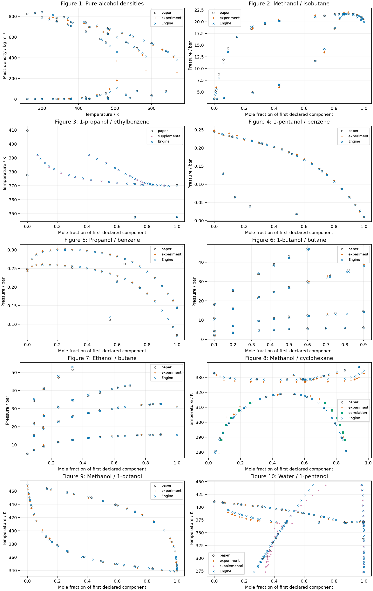

```{python}
from pathlib import Path
import json
import pandas as pd
from IPython.display import Markdown, display
case = Path.cwd()
if not (case / "results/data/calculation.json").exists():
    case = Path("analyses/reproduction/2002-gross")
data = pd.read_csv(case / "results/data/state-comparisons.csv")
summary = pd.read_csv(case / "results/data/comparison-summary.csv")
pure = pd.read_csv(case / "results/data/pure-component-summary.csv")
run = json.loads((case / "results/data/calculation.json").read_text())
initial = pd.read_csv(case / "results/data/initial-state-comparisons.csv")
default = pd.read_csv(case / "results/data/default-start-comparisons.csv")
reviewed = pd.read_csv(case / "results/data/reviewed-state-comparisons.csv")
failures = pd.read_csv(case / "results/data/default-start-failures.csv")
diagnosis = pd.read_csv(case / "results/data/model-miss-diagnosis.csv")
bounds = pd.read_csv(case / "results/data/input-coordinate-bounds.csv")
coordinate_run = json.loads((case / "results/data/coordinate-diagnosis.json").read_text())
revision = json.loads((case / "results/data/revision.json").read_text())
proxy_revision = json.loads((case / "results/data/proxy-revision.json").read_text())
proxy_corrections = pd.concat([pd.read_csv(case / f"figures/{fig}/source/curve-corrections.csv").assign(figure=fig)
                               for fig in ('figure-01', 'figure-02')], ignore_index=True)
omitted = int((proxy_corrections.disposition == 'omitted').sum())
original_count = len(reviewed) - omitted
reviewed_curves = reviewed.dataset.isin(['paper_model', 'paper_pc_saft_curve'])
reclassified = int(((reviewed.dataset == 'paper_model') & reviewed.source.str.contains('markers')).sum())
def table(frame):
    display(Markdown(frame.to_markdown(index=False, floatfmt=".6g")))
vlle = data[(data['mode'] == 'vlle') & data.success].iloc[0]
vlle_x = json.loads(vlle.compositions)
recovered_dew = data[(data.figure == 'figure-10') & (data['mode'] == 'dew') & (data.dataset == 'paper_model') & (data.x == .87)].iloc[0]
fig10_bubble = data[(data.figure == 'figure-10') & (data.dataset == 'experiment_paper') & (data['mode'] == 'bubble')]
```

## Question and evidence

Can the native Engine reproduce the associating PC-SAFT calculations in
Gross and Sadowski (2002), using their published parameters? The source is
[the paper](https://doi.org/10.1021/ie010954d), Zotero parent `2AJYEZS6`, PDF
attachment `UGT3UV2L`, and Markdown attachment `FZVTDKXU`. The PDF was read
directly; its parameter footnote and model discussion determine the site
declarations. The [source inventory](inputs/source/source-manifest.csv) and
[table inventory](results/tables/tables-manifest.csv) locate the retained inputs.

This record supplies numerical verification against digitized model curves
and physical comparisons against retained experimental data, with literature
parameters held fixed. These data were used to fit the original model or its
mixture interaction parameters; their agreement is not independent physical
validation. Predictions for compounds without pointwise reference data are
identified separately.

The default-start calculation returned `{python} int(default.success.sum())`
states from `{python} len(default)` declarations. Its original source subset
returned `{python} int(default.iloc[:original_count].success.sum())` of
`{python} original_count` retained original states, with
`{python} int((~default.iloc[:original_count].success).sum())` default-start failures.
The newly digitized source subsets add
`{python} len(default)-original_count` declarations and
`{python} int((~default.iloc[original_count:].success).sum())` default-start failures.
The final calculation returned `{python} int(data.success.sum())` qualified
states from `{python} len(data)` declarations, including
`{python} int((data.dataset == 'prediction').sum())` pure-component predictions.
For the source figures alone, it returned
`{python} int(data[(data.figure != 'table-001')].success.sum())` of
`{python} int((data.figure != 'table-001').sum())` retained rows. Both outcomes remain in the denominators and in the
[default-start comparisons](results/data/default-start-comparisons.csv) and
[recovered comparisons](results/data/state-comparisons.csv).
A qualified state is a native solution that meets the requested residual
criterion, has positive densities and distinct declared phases, and passes
the native local checks; it does not certify global equilibrium.

## Parameters, site declarations and units

Every associating compound uses the paper's two-site model, called 2B:
one A site and one B site, each with unit multiplicity. Only unlike sites
interact. Water, amines and acetic acid receive the same topology as alcohols.
There is no four-site water model, separate acid dimer reaction, dipole term,
or electrolyte contribution in this reproduction. Non-associating compounds
have no sites. Diameters are the published constants in angstrom, energies
are divided by Boltzmann's constant and given in kelvin, and association
volumes are dimensionless. Mass conversion uses the published molar masses.

The Engine's `pc-saft`, `general-site` and native `wolbach-sandler` choices
implement the paper's base model and cross-association equations. Self edges
are reciprocal A–B edges. For two associating compounds, Aᵢ–Bⱼ and Bᵢ–Aⱼ
receive the arithmetic mean association energy and the geometric mean
association volume with the diameter correction from the paper's combining
rule. In the native implementation, that diameter correction is evaluated
through the geometric mean diameter cubed in the association strength.
The single published interaction parameter corrects dispersion only.
Python declares parameters, states and phases; the native Engine performs
every density search and equilibrium solve.

The paper's Table 2 says methanol/isobutanol, whereas its Figure 2 caption,
text and cited Leu–Robinson paper identify methanol/isobutane. Figure 2 uses
isobutane, whose pure parameters come from the retained Gross–Sadowski
non-associating parameter table. The local matrix's assignment of that pair
to 2-methyl-2-butanol is not used. The associating parameter rows are unchanged.
`H2O` in the input file maps to water. Extra dielectric and solvation columns
in the historical file are unused because this is a neutral PC-SAFT study.
Figure 2's horizontal coordinate is isobutane; Figures 6 and 7 use butane;
the other mixture figures use the named alcohol or water. The retained
`x_alcohol` columns take precedence over conflicting `component_order` text.
The upper vapor–liquid curve in Figure 10 is a dew curve, as checked in the PDF.

## Method and tolerances fixed before calculation

The requested dimensionless equilibrium row tolerance is
`{python} f'{run["row_tolerance"]:.0e}'`. Model-curve differences use the
retained output-coordinate uncertainty as their absolute tolerance, specified
per row in [the declarations](results/data/declared-states.csv) before the
native calls. Input-coordinate uncertainties are retained separately. For the bounded
miss diagnosis below, native solves at the selected composition interval's
endpoints and center propagate them into a sampled output envelope; the
original output-coordinate tolerances remain unchanged. A miss at a digitized center
therefore does not establish an equation error. No physical-comparison
pass threshold is assigned, and no tolerance was relaxed after running.

Vapor–liquid calculations pin an incipient phase amount to zero and solve
pressure at fixed temperature or temperature at fixed pressure. Endpoints
use the corresponding pure fluid. Liquid–liquid calculations solve two
finite liquids at the source temperature and pressure. The two-liquid
water/pentanol feed lies inside the source tie lines; its water fraction is
`{python} run["overall_water_fraction"]`. The cyclohexane/methanol feed is equimolar. Three-phase
coexistence solves temperature at the paper pressure with both liquids
finite and vapor incipient. Source temperature and pressure values serve
only as initial guesses for free coordinates. Explicit neighbouring-state starts are declared through
`solve_equilibrium_starts` for each default-start failure. Python supplies one
specified start for each recovery; it implements no numerical solver or
adaptive retry search.

The paper describes a dimensionless absolute average deviation but prints
no explicit averaging formula or sampling grid. The implemented interpretation
for a nonzero reference property is
$\mathrm{AAD}_{q}=100\,\mathrm{mean}(|q_{\mathrm{Engine}}/q_{\mathrm{reference}}-1|)$.
Temperature deviations use absolute kelvin as the primary comparison.
Composition deviations use absolute mole fraction. Zero reference vapor
densities and zero reference compositions have no relative deviation.
Table 1 labels its second AAD column $v$ while the prose calls it liquid
density; both density and reciprocal-volume deviations are retained for
the available liquid markers. No claim of matching the original fitting
sample follows from these subset means.

## Pure-component results

The original vapor-pressure and liquid-density fitting datasets are not retained
here. Table 1's temperature ranges and published AAD values cannot reconstruct
their experimental states, weighting or sample counts. The full published AADs
for all compounds remain unreproduced. Figure 1 permits direct density
comparison for the three retained alcohols; there are no retained pure
vapor-pressure observations. The methanol marker previously assigned to liquid is on the low-density
vapor branch in the source PDF. Its corrected declaration uses the vapor
density and removes it from the liquid subset mean. Its temperature is
`{python} float(data[(data.names == 'methanol') & (data.series == 'vapor') & (data.reference == 180)].T_solved_K.iloc[0])` K
and retained density is
`{python} float(data[(data.names == 'methanol') & (data.series == 'vapor') & (data.reference == 180)].reference.iloc[0])` kg/m³.
The following table reads the published AADs
and the available liquid-marker subset deviations directly from retained values.

```{python}
table(pure[['component', 'published_pressure_aad_percent', 'published_liquid_aad_percent',
            'marker_liquid_declared', 'marker_liquid_returned', 'marker_density_aad_percent',
            'marker_volume_aad_percent']])
```

All pure parameters also yield native saturation predictions at the midpoint
of their published fitting temperature ranges. These are predictions, with
no model or experimental reference at those particular states.

```{python}
table(pure[['component', 'prediction_temperature_K', 'prediction_pressure_Pa',
            'prediction_liquid_density_kg_m3']])
```

## Model and experimental comparisons

### Final marker selection and phase statistics

The selected [state comparisons](results/data/state-comparisons.csv) include
the final Figure 1 and Figure 2 corrections listed below. Figure 2 and
Figure 4 measured markers keep their experimental role. The Figure 1
methanol vapor marker is excluded from the liquid-density mean. Obscured
model coordinates are omitted from the selected comparison, while their old
ordinates, Engine values and reasons remain in the correction files and
[the earlier comparisons](results/data/reviewed-state-comparisons.csv).
No thermodynamic calculation or marker extraction was repeated for this
curation.

```{python}
table(proxy_corrections[['figure', 'series', 'input_coordinate', 'old_reference',
                         'corrected_reference', 'disposition', 'reason']])
markers = data[data.dataset.eq('experimental_marker')]
phase_statistics = markers.groupby(['names', 'series'], sort=False).agg(
    declared=('success', 'size'), returned=('success', 'sum'),
    density_aad_percent=('absolute_relative_percent', 'mean')).reset_index()
table(phase_statistics)
```

These phase-specific marker statistics are used for the pure-density
comparison. The historical figure summary in
[comparison-summary.csv](results/data/comparison-summary.csv) groups both
methanol branches together and is retained for traceability; its combined
value must not be quoted as liquid-density error. The pure-component table
above uses the liquid subset only. Supplemental liquid-only comparisons
remain conditional on that declared branch, including above the paper's
temperature range. The final corrected selection awaits independent delivered
review and investigator promotion.

The table reports every figure, phase specification and component pair.
Absolute deviations have the unit of the named quantity: kelvin, bar,
mass density, or mole fraction. AAD is a percentage and averages only
returned nonzero-reference states. Each row reports the number declared,
returned and failed, so incomplete comparisons cannot masquerade as
complete averages. Bubble and dew observations of a single experimental
state are separate specified-property comparisons.

```{python}
table(summary[(summary.dataset != 'prediction') & (summary.dataset != 'experimental_marker')][['figure', 'dataset', 'components', 'mode', 'quantity',
              'declared', 'default_returned', 'default_failed', 'returned', 'failed', 'within_curve_tolerance', 'mean_absolute_deviation',
              'maximum_absolute_deviation', 'aad_percent']])
```



Every symbol is a retained state. Open circles denote paper model traces,
orange plus signs denote experimental references, purple points denote
supplemental compilations, green squares denote the published DECHEMA
correlation, and blue crosses denote
Engine values at those declared coordinates. No line interpolates the sparse
evaluations. Multiple isotherms and phase branches occupy their original
coordinates. Figure 1 combines the three alcohols; the mixture component
ordering follows the declarations above. The original PDF marker subsets include digitization error bars. Engine
markers use the recovered results; default failures are listed separately. The plot uses
[these retained values](results/data/plotted-states.csv); rendering never calls the Engine.

For water/pentanol at the paper pressure, three-phase coexistence is
`{python} f'{vlle.T_solved_K:.6f}'` K, compared with the digitized tie-line
temperature of `{python} f'{vlle.reference:.6f}'` K. The temperature difference
is `{python} f'{vlle.deviation:.6f}'` K. The water mole fractions in the
pentanol-rich liquid, water-rich liquid and vapor are
`{python} f'{vlle_x[0]:.8f}'`, `{python} f'{vlle_x[2]:.8f}'`, and
`{python} f'{vlle_x[4]:.8f}'`, respectively. The tie-line interior plotting
coordinates are not individual phase compositions; their shared temperature
is the comparison. The multiple retained tie-line coordinates repeat one
physical coexistence state and do not add independent information.

## Diagnostics and limits

The maximum convergence residual among returned final states is
`{python} f'{data[data.success].residual.max():.6g}'`. Native convergence,
requested row tolerance, positive densities and distinct liquid phases
are checked before a row receives a comparison value. Native local phase
stability checks remain active. This study does not claim a global stability
certificate or propagate parameter uncertainty.

The first retained run omitted a vapor-composition guess for the three-phase
start and used an overall water fraction outside some liquid tie lines.
Inspection of the native start and the literature phase compositions identified
these declaration defects. Supplying all three phase composition guesses and
placing the feed inside the tie lines recovered the liquid splits and
three-phase solve. The [initial results](results/data/initial-state-comparisons.csv)
retain the original failures; no numerical method or tolerance changed.

The default failures and the exact starts that recovered them are retained
in [the handoff CSV](results/data/default-start-failures.csv). It gives species,
interaction parameter, fixed and free quantities, overall mole amounts,
phase amounts and composition guesses, default status and message, neighbouring
row, explicit start, recovered value and residual. Recovery CSV row numbers refer to the current reduced declarations. The
`reviewed_csv_line` column in the diagnosis identifies the archived original
row; removed model rows retain their previous values in the correction CSVs.

```{python}
table(failures[['csv_line', 'figure', 'dataset', 'mode', 'T', 'P', 'x',
                'default_status', 'neighbour_csv_line', 'recovered_value', 'recovered_residual']])
```

The other failures of the reviewed record (near-critical pure saturation,
high-temperature butanol/butane and methanol/octanol states; record commit
`997bfd91`) return from the default start since #391. The explicit
[cooling onset](../../../engine/docs/science/algorithms.md#cooling-onset-dew)
selects the intended branch for the remaining water/1-pentanol dews.

The recovered water/pentanol dew point has temperature
`{python} f'{recovered_dew.T_solved_K:.6f}'` K and liquid water fraction
`{python} f'{json.loads(recovered_dew.compositions)[0]:.6f}'`.
It is above the three-phase temperature by
`{python} f'{recovered_dew.T_solved_K-vlle.T_solved_K:.6f}'` K.
The default local-instability refusal concerns its selected start; it is not
evidence that this declaration lies inside the three-phase region.
No Engine source change, parameter adjustment, tolerance relaxation or
stability-check bypass was used.

## Bounded model-curve miss diagnosis

The reviewed record contained
`{python} int((reviewed.within_curve_tolerance == False).sum())` misses among
`{python} int((reviewed.dataset.str.startswith('paper') & reviewed.success).sum())`
returned rows labelled as model references. Inspection found
`{python} reclassified`
experimental markers embedded in the source-curve files for Figures 2 and 4.
They now retain their source role as experimental comparisons. The
[reviewed record](results/data/reviewed-state-comparisons.csv) preserves the
original values and labels.

The Figure 4 legend identifies the solid curve as PC-SAFT and the dashed
curve as SAFT. The horizontal coordinate is benzene mole fraction; the
Engine's pentanol composition is its complement for the specified liquid
or vapor phase. That mapping was correct. The original output coordinates
did not lie on the solid line at those compositions. Native-raster
re-extraction corrected the source pressure coordinates while retaining the
composition coordinates, parameters and tolerance. Figure-local
[corrections](figures/figure-04/source/curve-corrections.csv),
[calibration](figures/figure-04/source/curve-digitization.json) and
[QA overlay](figures/figure-04/source/curve-qa.png) retain the evidence.

```{python}
table(summary[(summary.figure == 'figure-04') & (summary.dataset == 'paper_model')][
    ['mode', 'declared', 'returned', 'within_curve_tolerance', 'maximum_absolute_deviation']])
```

The largest earlier dew pressure miss was
`{python} f'{reviewed[(reviewed.figure == "figure-04") & (reviewed["mode"] == "dew")].deviation.abs().max():.6f}'` bar.
The corrected maximum is
`{python} f'{summary[(summary.figure == "figure-04") & (summary["mode"] == "dew") & (summary.dataset == "paper_model")].maximum_absolute_deviation.iloc[0]:.6f}'` bar,
against the unchanged tolerance of
`{python} float(data[(data.figure == 'figure-04') & (data.dataset == 'paper_model')].tolerance.iloc[0])` bar.
The input-coordinate envelope does not explain the largest original dew miss.
It is an extraction error. The two Figure 3 bubble misses also resolve after
selecting the solid bubble line in the PDF at the same liquid composition;
their [corrections](figures/figure-03/source/curve-corrections.csv) and
[overlay](figures/figure-03/source/curve-qa.png) retain this check.

Only `{python} coordinate_run['selected_rows']` rows receive composition
uncertainty propagation. The [retained bounds](results/data/input-coordinate-bounds.csv)
use native solves at the interval endpoints and center. This sampled envelope
is not a proof of extrema inside the interval. Pure endpoints keep exact
species identity. One interval endpoint required the center state's explicit
start; its original refusal is retained. No finite-difference derivative was
used and no output tolerance changed.

```{python}
table(bounds[['csv_line', 'figure', 'mode', 'x', 'input_uncertainty', 'old_reference',
              'corrected_reference', 'output_lower', 'output_upper', 'old_reference_interval_overlap']])
table(diagnosis.groupby('classification', sort=False).size().rename('rows').reset_index())
```

An input-coordinate classification means that the reference interval overlaps
the sampled output envelope, so input uncertainty can explain the miss. It
does not prove the extraction accurate. No convention difference was found.
The remaining `{python} int((diagnosis.classification == 'undiagnosed').sum())`
original misses remain undiagnosed, including Figure 2 bubble and Figure 6
pressure misses. The Figure 2 dew proxy at issue is now an extraction error. This bounded work does not establish a calculation disagreement.
Every original miss retains its classification and evidence in
[the diagnosis CSV](results/data/model-miss-diagnosis.csv).

The previous row accounting is explicit:
`{python} int((reviewed_curves & reviewed.success).sum())` −
`{python} reclassified` +
`{python} int((reviewed_curves & ~reviewed.success).sum())` =
`{python} int(reviewed_curves.sum())-reclassified` model rows after source-role
correction and recovery. The marker-overlap audit then removes
`{python} omitted` obscured model rows, leaving
`{python} int(reviewed_curves.sum())-reclassified-omitted` readable model rows.
The experimental observations remain separate.

All figure-local `source-points.csv` files were checked for marker-overlap
labels and shared model/experimental coordinates. Figure 2 contains
`{python} int((proxy_corrections.figure == 'figure-02').sum())` labelled proxies.
Two readable solid-curve points were re-extracted at the unchanged vapor
compositions; the other Figure 2 proxies are hidden by filled symbols and
were omitted. Figure 1 also contains coincident pentanol model and nonanol
experimental coordinates. Those refer to different compounds, but the pentanol
solid curve is itself hidden by filled symbols at that temperature, so its
model row was omitted. No obscured pressure or density was inferred from the
Engine. The original references, Engine values and omission reasons are in
[Figure 2 corrections](figures/figure-02/source/curve-corrections.csv) and
[Figure 1 corrections](figures/figure-01/source/curve-corrections.csv).
The calibrated native-raster overlays
[Figure 2 QA](figures/figure-02/source/curve-qa.png) and
[Figure 1 QA](figures/figure-01/source/curve-qa.png) were inspected.

```{python}
table(proxy_corrections[['figure', 'source_csv_line', 'input_coordinate', 'quantity',
                         'old_reference', 'corrected_reference', 'engine_value', 'disposition']])
```

After source-role and coordinate corrections, the numerical-verification set
contains `{python} int(data.dataset.isin(['paper_model', 'paper_pc_saft_curve']).sum())`
returned rows. Of these,
`{python} int((data.within_curve_tolerance == True).sum())` meet their original
output-coordinate tolerance and
`{python} int((data.within_curve_tolerance == False).sum())` miss it. Input-bound
explanations do not turn a nominal tolerance miss into a pass.

## Original experimental markers and supplemental data

The PDF's Figure 8 diamonds identify Jones and Amstell's liquid–liquid
observations. Its squares identify a DECHEMA correlation, which is retained
separately rather than counted as an independent experiment. Figure 10's
open circles identify Cho and colleagues' vapor–liquid observations. The
upper line uses vapor composition and the lower line liquid composition.

The new retained subset contains
`{python} int(((data.figure == 'figure-08') & (data.dataset == 'experiment_paper')).sum())`
experimental liquid compositions,
`{python} int((data.dataset == 'paper_correlation').sum())` correlation symbols, and
`{python} int(((data.figure == 'figure-10') & (data.dataset == 'experiment_paper')).sum())`
vapor–liquid coordinates. Crowded or inseparable symbols were omitted; these
are readable subsets, not a claim of exhaustive digitization. The
[Figure 8 marker CSV](figures/figure-08/source/experimental-points.csv) and
[Figure 10 marker CSV](figures/figure-10/source/experimental-points.csv) retain
pixel centers, source links and digitization uncertainty. Their calibration
records retain the source PDF hash, native embedded image, page, axes, crop,
manual-selection transform and uncertainty meaning. Both
[Figure 8 QA](figures/figure-08/source/experimental-qa.png) and
[Figure 10 QA](figures/figure-10/source/experimental-qa.png) were inspected.
No independent second digitizer was used; source-marker ambiguity remains a limit.

```{python}
table(summary[summary.dataset.isin(['experiment_paper', 'paper_correlation']) &
              summary.figure.isin(['figure-08', 'figure-10'])][
    ['figure', 'dataset', 'mode', 'quantity', 'declared', 'default_returned', 'returned',
     'mean_absolute_deviation', 'maximum_absolute_deviation', 'aad_percent']])
```

The Figure 10 bubble branch was checked beside this physical comparison.
Three-phase coexistence occurs at `{python} f'{vlle.T_solved_K:.6f}'` K,
with pentanol-rich liquid water fraction `{python} f'{vlle_x[0]:.6f}'`.
All `{python} len(fig10_bubble)` retained bubble compositions are below that
fraction: `{python} bool((fig10_bubble.x < vlle_x[0]).all())`.
Their returned temperatures span
`{python} f'{fig10_bubble.T_solved_K.min():.2f}'`–
`{python} f'{fig10_bubble.T_solved_K.max():.2f}'` K and all exceed
three-phase coexistence:
`{python} bool((fig10_bubble.T_solved_K > vlle.T_solved_K).all())`.
The `{python} f'{fig10_bubble.deviation.abs().mean():.2f}'` K mean gap is
therefore a physical model–experiment discrepancy on this bubble branch.
The composition and temperature checks rule out assigning these comparisons
to the three-phase region; they do not establish independent physical validation.

Digitization bounds describe reading marker centers and axes, not experimental
measurement uncertainty. Figure 8's composition comparisons use the source
temperature as fixed input; Figure 10's temperature comparisons use the
source liquid or vapor composition as fixed input. Experimental discrepancies
are physical comparisons with literature parameters, not numerical-verification
failures. Their agreement would not establish independent physical validation
because these data helped select the original parameters.

The propanol/ethylbenzene recommended compilation and water/pentanol recommended
liquid data remain labelled supplemental. The latter extend above the paper's
coexistence range; those liquid-only states can be metastable with respect
to vapor. The butane tables retain their declared interpolation of the cited
constant-composition measurements. Source documents for these existing
transcriptions were not re-acquired. The absent pure-component fitting datasets
remain a limit on reproducing the paper's full AAD values.

## Timing, reproduction and handoff

The final default-plus-recovery native batch used `{python} run['workers']` parallel processes and
took `{python} f'{run["calculation_wall_seconds"]:.6f}'` seconds of wall-clock
time, including process startup and reading parameter declarations, excluding
environment setup and presentation. The default-start portion took
`{python} f'{run["default_start_wall_seconds"]:.6f}'` seconds, and the separate
bounded coordinate calculation took
`{python} f'{coordinate_run["wall_seconds"]:.6f}'` seconds. The recorded revision
work, including source inspection, digitization, presentation and checks, took
`{python} f'{revision["wall_seconds"]/60:.2f}'` minutes up to its recording point.
The current native batch start time was
`{python} run['started_utc']`. The marker-overlap revision took
`{python} f'{proxy_revision["wall_seconds"]/60:.2f}'` minutes through its
recording point, starting at `{python} proxy_revision['started_utc']`;
its timing scope is `{python} proxy_revision['scope']`. The retained Engine identity is
`{python} run['engine'][0]`; its dirty-worktree marker includes analysis files.
Engine source files were unchanged. Input hashes and the source PDF identity
are retained in [the calculation record](results/data/calculation.json).

Run `.venv/bin/python analyses/reproduction/2002-gross/scripts/calculate.py`,
then `.venv/bin/python analyses/reproduction/2002-gross/scripts/compare_coordinate_bounds.py`
and `.venv/bin/python analyses/reproduction/2002-gross/scripts/present.py`.
The notebook reads retained CSV/JSON only and never reruns thermodynamics.
Independent scientific review and investigator promotion remain with the lead;
this notebook has not been independently reviewed or promoted for manuscript use.
