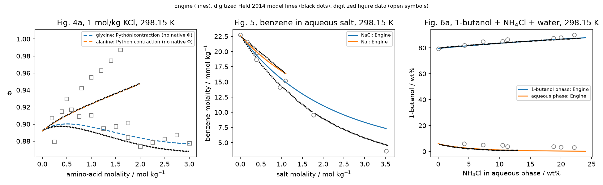

## Question and scope

Can the installed Engine regenerate the published results of Held, Reschke,
Mohammad, Luza and Sadowski (2014), *ePC-SAFT revised*, Chem. Eng. Res. Des.
92 (DOI 10.1016/j.cherd.2014.05.017; Zotero 3DIW87Q5/TD5T732H), from
the printed parameters alone? Each result is checked against the paper's own
model curves (numerical verification) and against experimental or evaluated
data (physical comparison with literature parameters).

[`analyses/2026-held-2014-chlorides`](../../2026-held-2014-chlorides/README.md)
already compares strategy 2 for LiCl, NaCl, MgCl2 and CaCl2 against
Hamer–Wu and Goldberg–Nuttall γ± and Φ with an owner row-error target. That
analysis is reused, not repeated: its Hamer–Wu LiCl/NaCl rows are read here,
and its σ-closest-approach results stand as they are. This reproduction
covers what it does not: Table 5 (every univalent-cation salt with retained
evaluated data, both strategies), Figs. 1–4a, Fig. 5 with Table 6, and Fig. 6a.

```{python}
import csv, json, math, os, statistics
from collections import defaultdict
from pathlib import Path
from IPython.display import Markdown

root = Path(os.environ.get("QUARTO_PROJECT_DIR", ".")) / "analyses/reproduction/2014-held"
if not (root / "results").is_dir():
    root = Path.cwd()
read = lambda p: list(csv.DictReader((root / p).open()))
identity = json.loads((root / "results/run-identity.json").read_text())

lines = read("results/figure-line-comparison.csv")
series = defaultdict(list)
for r in lines:
    series[(r["figure"], r["series"])].append(r)
def stats(rows, col):
    d = [float(r[col]) - float(r["osmotic_paper_line"]) for r in rows]
    a = sorted(abs(x) for x in d)
    worst = max(rows, key=lambda r: abs(float(r[col]) - float(r["osmotic_paper_line"])))
    return statistics.median(d), a[-1], a[int(0.95 * len(a)) - 1], float(worst["molality_mol_kg"])
halide = [k for k in series if k[0] in ("figure-1", "figure-2")]
acetate2 = [k for k in series if k[0] == "figure-3b"]
acetate1 = [k for k in series if k[0] == "figure-3a"]
s88 = {k: stats(series[k], "osmotic_engine") for k in series}
ssig = {k: stats(series[k], "osmotic_engine_sigma_closest_approach") for k in series}
TOL = 0.005
halide_pass = sum(s88[k][1] <= TOL for k in halide)
halide_median = max(abs(s88[k][0]) for k in halide)
sigma_min = min(ssig[k][1] for k in halide)
sigma_max = max(ssig[k][1] for k in halide)

t5 = read("results/table-5-osmotic-ard.csv")
def t5set(dh, st):
    rows = [r for r in t5 if r["dh_factor"] == dh and r["strategy"] == st]
    d = [float(r["ard_engine_percent"]) - float(r["ard_printed_percent"]) for r in rows]
    return rows, d
t5_2, d2 = t5set("0.88", "2"); t5_1, d1 = t5set("0.88", "1")
t5_2s, d2s = t5set("1.0", "2")
within = lambda d: sum(abs(x) <= 0.5 for x in d)
mean = lambda xs: sum(xs) / len(xs)
ard_e2 = mean([float(r["ard_engine_percent"]) for r in t5_2]); ard_p2 = mean([float(r["ard_printed_percent"]) for r in t5_2])
ard_e1 = mean([float(r["ard_engine_percent"]) for r in t5_1]); ard_p1 = mean([float(r["ard_printed_percent"]) for r in t5_1])
n_rows_t5 = sum(int(r["n_rows"]) for r in t5_2)

cold = read("results/figure-2-cold-markers.csv")
cold_ard = {s: 100 * mean([abs(float(r["osmotic_engine"]) / float(r["osmotic_digitized"]) - 1) for r in cold if r["salt"] == s])
            for s in ("NaCl", "KCl")}
cold_n = {s: sum(r["salt"] == s for r in cold) for s in ("NaCl", "KCl")}

f4 = read("results/figure-4a.csv")
def f4stats(s):
    line = [float(r["osmotic_python_contraction"]) - float(r["osmotic_paper_line"]) for r in f4 if r["solute"] == s and r["osmotic_paper_line"]]
    data = [abs(float(r["osmotic_python_contraction"]) / float(r["osmotic_figure_data"]) - 1) for r in f4 if r["solute"] == s and r["osmotic_figure_data"]]
    return max(map(abs, line)), 100 * mean(data), len(data)
f4s = {s: f4stats(s) for s in ("glycine", "alanine")}

f5 = read("results/figure-5.csv")
paper_lines = defaultdict(list)
for r in read("inputs/paper-lines.csv"):
    paper_lines[(r["figure"], r["series"])].append((float(r["x"]), float(r["y"])))
def interp(points, x):
    points = sorted(points)
    for (x0, y0), (x1, y1) in zip(points, points[1:]):
        if x0 <= x <= x1:
            return y0 + (y1 - y0) * (x - x0) / (x1 - x0)
    return None
def f5stats(salt):
    rel = []
    for r in f5:
        if r["salt"] != salt:
            continue
        y = interp(paper_lines[("figure-5", f"{salt} strategy 2")], float(r["m_salt_mol_kg"]))
        if y is not None:
            rel.append((float(r["m_salt_mol_kg"]), float(r["m_benzene_mmol_kg"]) / y - 1))
    data = [abs(float(r["m_benzene_mmol_kg"]) / float(r["m_benzene_figure_data_mmol_kg"]) - 1)
            for r in f5 if r["salt"] == salt and r["m_benzene_figure_data_mmol_kg"]]
    worst = max(rel, key=lambda t: abs(t[1]))
    return 100 * abs(worst[1]), worst[0], 100 * mean(data), len(data)
f5s = {s: f5stats(s) for s in ("NaCl", "NaI")}
f5_end = [r for r in f5 if r["salt"] == "NaCl" and abs(float(r["m_salt_feed_mol_kg"]) - 3.5) < 1e-9][0]
f5_end_paper = interp(paper_lines[("figure-5", "NaCl strategy 2")], float(f5_end["m_salt_mol_kg"]))

f6 = read("results/figure-6a.csv")
def f6stats(col, name):
    d = []
    for r in f6:
        y = interp(paper_lines[("figure-6a", name)], float(r["w_nh4cl_aqueous"]))
        if y is not None:
            d.append(float(r[col]) - y)
    return max(map(abs, d)), len(d)
f6_org = f6stats("w_butanol_organic", "1-butanol phase"); f6_aq = f6stats("w_butanol_aqueous", "aqueous phase")
f6_markers = [r for r in read("inputs/paper-markers.csv") if r["figure"] == "figure-6a"]
def f6data():
    w = [float(r["w_nh4cl_aqueous"]) for r in f6]
    out = {"org": [], "aq": []}
    for m in f6_markers:
        x, y = float(m["x"]), float(m["y"])
        key, col = ("org", "w_butanol_organic") if y > 40 else ("aq", "w_butanol_aqueous")
        model = interp(list(zip(w, [float(r[col]) for r in f6])), x)
        out[key].append(abs(model - y))
    return {k: (mean(v), len(v)) for k, v in out.items()}
f6d = f6data()
wall = identity["wall_clock_seconds"] + identity["ternary_wall_clock_seconds"]
fmt = lambda x, n=4: f"{x:.{n}f}"
temps = sorted({float(r["temperature_K"]) for r in read("results/figure-curves.csv")})
T0, T25 = (f"{t:.2f}" for t in temps)
butanol_eps = next(r["relative_permittivity"] for r in read("inputs/held-2014-table-1.csv") if r["component_id"] == "1-butanol")
acetate = next(r for r in read("inputs/held-2014-ions.csv") if r["ion"] == "Ac-")
kac_worst = max(series[("figure-3a", "KAc strategy 1")], key=lambda r: abs(float(r["osmotic_engine"]) - float(r["osmotic_paper_line"])))
f6_range = [x for x, _ in paper_lines[("figure-6a", "aqueous phase")]]
g3a = defaultdict(list)
for r in read("results/probe-figure-3a-gamma.csv"):
    g3a[r["salt"]].append((float(r["molality_mol_kg"]), abs(float(r["gamma_engine"]) / float(r["gamma_hamer_wu"]) - 1)))
g3a = {k: (100 * mean([d for _, d in v]), max(m for m, _ in v), len(v)) for k, v in g3a.items()}
p5 = read("results/probe-figure-5-kij.csv")
p5_end = {r["probe"]: 100 * float(r["relative_difference"]) for r in p5 if r["m_salt_feed_mol_kg"] == "3.5"}
check = identity["max_native_minus_python_contraction_osmotic"]
# Water sigma(T) at 298.15 K: implemented (Held 2008 sign) and as printed in Held 2014 Table 1 footnote a.
sigma_used = 2.7927 + 10.11 * math.exp(-0.01775 * float(T25)) - 1.417 * math.exp(-0.01146 * float(T25))
sigma_printed = 2.7927 + 10.11 * math.exp(-0.01775 * float(T25)) - 1.417 * math.exp(0.01146 * float(T25))
```

## Conventions

- **Model.** Strategy 2: Table 1 water (σ(T) footnote a, with the sign
  correction below), Table 2 ions with
  one segment, Table 2 water–ion k_ij (Na⁺ and K⁺ footnotes evaluated at T),
  Table 3 cation–anion k_ij, Table 4 ion–organic k_ij and l_ij, Eqs.
  (15)–(18) combining rules, no same-sign ionic dispersion, no Born term.
  Strategy 1: Table 2 left columns, water–ion k_ij = 0 and no cation–anion
  dispersion. The F⁻ water k_ij is blank in Table 2 and is taken as 0.
- **Water σ(T).** Held 2014 Table 1 footnote a prints a positive sign on
  the temperature coefficient of the last exponent, which gives σ_w =
  `{python} fmt(sigma_printed, 1)` Å at `{python} T25` K. The implemented
  negative sign (`{python} fmt(sigma_used, 3)` Å) is a source-backed
  correction from Held 2008 Table 1 and Eq. (7), not verbatim Held 2014
  input.
- **Debye–Hückel closest approach.** Section 2.1 states that ions approach
  to the solvated diameter σ, and the paper prints σ for this term. Under the
  declared parameters and the supplemental permittivity, the Eq. (21) diameter
  d_ion = 0.88 σ agrees substantially better with the digitized curves:
  `{python} str(halide_pass)` of `{python} str(len(halide))` halide series of
  Figs. 1–2 lie within 0.005 in Φ with 0.88 σ, while with σ the series maxima
  are `{python} fmt(sigma_min, 3)`–`{python} fmt(sigma_max, 3)`. 0.88 σ is
  therefore a convention inferred from the numbers, not proven. It is used
  here; the σ results are retained as the printed-wording sensitivity. The
  packing diameter is 0.88 σ in both. Two other #387 reproductions point the
  same way: the 2021-bulow review reproduces its ethanol transfer energies and
  advanced activity curves with 0.88 σ in every ion term, and 2020-bulow needs
  0.88 σ for its Born values.
- **Relative permittivity.** Held 2014 prints none for water. The Ascani
  2022 Table 5 water correlation (`scripts/run.py`, recorded in
  `results/run-identity.json`) is used:
  `{python} fmt(identity['water_permittivity'][T25], 2)` at `{python} T25` K and
  `{python} fmt(identity['water_permittivity'][T0], 2)` at `{python} T0` K.
  It is salt-independent. For 1-butanol + water it is the salt-free
  mass-weighted mean of Eq. (23), with 1-butanol `{python} butanol_eps`. Benzene and amino
  acids carry no permittivity record, so the dielectric is that of water.
- **Acids.** H⁺ is hydronium; Eq. (10) removes one water per proton. Φ uses
  the nominal molality m per kg of initial water in Eq. (5). The native
  osmotic coefficient (`electrolyte_activity`) is evaluated at the same
  composition expressed per kg of remaining water, m′ = m/(1 − m M_w), and
  converted to the initial-water basis by the exact factor m′/m.
- **Osmotic coefficient.** Eq. (5) with the sum of all solute molalities,
  from the Engine's native `electrolyte_activity` for every salt and acid.
  The native call admits one pure solvent and one salt, so the ternary
  Fig. 4a value (2 m_KCl + m_amino acid) has no native result (below).
- **Cross association.** Explicit Wolbach–Sandler edges, Eqs. (17)–(18), at
  T with the water σ(T), and Table 1 k_hb (1-butanol 0.026, amino acids 0).
- **Liquid–liquid equilibria.** Fig. 5: ions are confined to the aqueous
  liquid. Fig. 6a: ions may enter both liquids. Phases are labelled by
  water content.

## Tolerances

Stated before the runs, Engine against the digitized published lines:
maximum |ΔΦ| ≤ 0.005 for Figs. 1–3 and 4a; maximum |Δw| ≤ 1 wt% for
Fig. 6a. Table 5: the Engine ARD against Hamer–Wu is consistent when it
lies within 0.5 percentage point of the printed ARD. The paper's data are
Lobo–Quaresma 1989, which are not retained, so Table 5 is an indirect
Hamer–Wu comparison.

Fig. 5 is exploratory: its 5 % relative benzene-molality bound was set after
a five-point probe had already been run, so it is not a pre-stated tolerance
and the Fig. 5 differences below are observations.

Lines were traced from the 300 ppi images embedded in the PDF
(`inputs/digitization.json`; calibration, seeds and image hashes). One pixel
is 0.0005–0.0007 in Φ, so a traced value is uncertain by about ±0.002.
Where lines pass through markers the trace can be displaced; such points
remain in the maxima.

## Results

### Figures 1–3: osmotic coefficients against the published lines

```{python}
#| output: asis
rows = ["| Figure | Series | Points | Median ΔΦ | Max abs(ΔΦ), 0.88 σ | at m | Max abs(ΔΦ), σ |", "|---|---|---:|---:|---:|---:|---:|"]
for k in sorted(series):
    med, mx, p95, at = s88[k]
    rows.append(f"| {k[0]} | {k[1]} | {len(series[k])} | {med:+.4f} | {mx:.4f} | {at:.2f} | {ssig[k][1]:.4f} |")
print("\n".join(rows))
```

With d_ion closest approach, `{python} str(halide_pass)` of
`{python} str(len(halide))` halide series in Figs. 1–2 meet the 0.005
tolerance (strategies 1 and 2; `{python} T25` and `{python} T0` K). Their median signed
difference is at most `{python} fmt(halide_median)`. The exception is
Fig. 2 NaCl at `{python} T25` K: maximum
`{python} fmt(s88[('figure-2','NaCl 298.15 K')][1], 6)` at m =
`{python} fmt(s88[('figure-2','NaCl 298.15 K')][3], 2)` mol/kg, the position
of a plotted data marker; its 95th-percentile difference is
`{python} fmt(s88[('figure-2','NaCl 298.15 K')][2], 6)`. With σ the
maxima are `{python} fmt(sigma_min, 3)`–`{python} fmt(sigma_max, 3)`, more than
three times the tolerance. The `{python} T0` K curves of Fig. 2 also reproduce with
the supplemental permittivity and the footnoted water–cation k_ij(T).

For the strategy-2 acetates (Fig. 3b), NaAc meets the tolerance (maximum
`{python} fmt(s88[('figure-3b','NaAc strategy 2')][1])`). KAc and LiAc have
maxima of `{python} fmt(s88[('figure-3b','KAc strategy 2')][1])` and
`{python} fmt(s88[('figure-3b','LiAc strategy 2')][1])`, at a star marker
(3.0 mol/kg) and where lines merge (0.3 mol/kg). Their 95th percentiles are
`{python} fmt(s88[('figure-3b','KAc strategy 2')][2])` and
`{python} fmt(s88[('figure-3b','LiAc strategy 2')][2])`; the LiAc trace is
low near its minimum. Strict maximum: not met for those two series.

**Fig. 3a (strategy 1 acetates) is not reproduced.** The printed strategy 1
Ac⁻ parameters (σ `{python} acetate['sigma_strategy1_A']` Å, u/k
`{python} acetate['u_strategy1_K']` K; Held and Sadowski 2009 Table 1)
give Φ far above the published lines: maximum differences
`{python} fmt(s88[('figure-3a','KAc strategy 1')][1], 2)` (KAc),
`{python} fmt(s88[('figure-3a','NaAc strategy 1')][1], 2)` (NaAc) and
`{python} fmt(s88[('figure-3a','LiAc strategy 1')][1], 2)` (LiAc, traced only
to 0.7 mol/kg). The largest KAc difference is Φ =
`{python} fmt(float(kac_worst['osmotic_engine']), 3)` against the traced
`{python} fmt(float(kac_worst['osmotic_paper_line']), 3)` at
`{python} fmt(float(kac_worst['molality_mol_kg']), 2)` mol/kg. Held and
Sadowski 2009 Table 3 reports, for the same fully dissociated model, γ± ARDs
of 62 % (KAc), 83 % (NaAc) and 370 % (LiAc). The retained Engine probe
(`results/probe-figure-3a-gamma.csv`, strategy 1, Hamer–Wu γ± to
`{python} fmt(g3a['KAc'][1], 1)` mol/kg) gives
`{python} fmt(g3a['KAc'][0], 0)` %, `{python} fmt(g3a['NaAc'][0], 0)` % and
`{python} fmt(g3a['LiAc'][0], 0)` %, the same order. That is a γ± comparison
and does not verify a Φ curve. What is established is the discrepancy
itself: the printed strategy-1 Ac⁻ parameters do not regenerate the traced
Fig. 3a lines. Whether the parameters or the figure is in error was not
resolved; Fig. 3b is unaffected.


### Table 5: osmotic-coefficient ARD

The Engine ARD is computed against `{python} str(n_rows_t5)` Hamer–Wu 1972
rows up to 5 mol/kg, or to the last tabulated unsaturated row, for
`{python} str(len(t5_2))` salts with retained evaluated data. LiCl and NaCl
use the chloride analysis rows, which run to 4.5 mol/kg.

For strategy 2, `{python} str(within(d2))` of `{python} str(len(d2))` salts
lie within 0.5 percentage point of the printed ARD (mean Engine
`{python} fmt(ard_e2, 2)` % against printed `{python} fmt(ard_p2, 2)` %).
With σ closest approach only `{python} str(within(d2s))` of
`{python} str(len(d2s))` do. For strategy 1, `{python} str(within(d1))` of
`{python} str(len(d1))` lie within it (mean `{python} fmt(ard_e1, 2)` %
against `{python} fmt(ard_p1, 2)` %). The strategy-2 outliers are listed
below. KF and CsF depend on the unprinted F⁻–water k_ij. NaCl's printed
2.95 % stands against 0.6–1.7 % for every other alkali halide in the column,
and the Engine gives below 1 %. CsNO3's Hamer–Wu range ends at 1.5 mol/kg.

```{python}
#| output: asis
out = ["| Strategy | Salt | Rows | m max | Engine ARD % | Printed ARD % | Engine ARD %, σ |", "|---:|---|---:|---:|---:|---:|---:|"]
sig = {(r["strategy"], r["salt"]): float(r["ard_engine_percent"]) for r in t5 if r["dh_factor"] == "1.0"}
for r in t5:
    if r["dh_factor"] != "0.88":
        continue
    flag = "" if abs(float(r["ard_engine_percent"]) - float(r["ard_printed_percent"])) <= 0.5 else " †"
    s = sig.get((r["strategy"], r["salt"]))
    out.append(f"| {r['strategy']} | {r['salt']}{flag} | {r['n_rows']} | {float(r['max_molality']):.3g} | "
               f"{float(r['ard_engine_percent']):.2f} | {float(r['ard_printed_percent']):.2f} | "
               f"{'chloride analysis' if s is None else f'{s:.2f}'} |")
print("\n".join(out))
print("\n† outside 0.5 percentage point of the printed value.")
```

The density ARDs of Table 5 and its divalent-anion entries (SO4²⁻, HPO4²⁻,
plus K formate, NH4Br and NH4I) are not replayed. No solution-density or
non-Hamer–Wu osmotic data are retained.

### Figure 2 at the lower temperature against the figure data

Against the digitized `{python} T0` K data (`{python} str(cold_n['NaCl'])` NaCl and
`{python} str(cold_n['KCl'])` KCl points), the Engine's ARDs are
`{python} fmt(cold_ard['NaCl'], 2)` % and `{python} fmt(cold_ard['KCl'], 2)` %.

### Ternary systems



- **Fig. 4a has no native result (capability gap).** The Engine's native
  osmotic coefficient admits one pure solvent and one salt; amino acid +
  KCl + water with Eq. (5) over all solutes cannot be expressed. The values
  plotted (dashed) are a Python water-activity contraction of native states,
  kept only as a diagnostic, not as the reproduction: alanine within
  `{python} fmt(f4s['alanine'][0])` of the published line, glycine drifting
  to `{python} fmt(f4s['glycine'][0])`; against the figure data
  `{python} fmt(f4s['glycine'][1], 2)` % (glycine,
  `{python} str(f4s['glycine'][2])` points) and
  `{python} fmt(f4s['alanine'][1], 2)` % (alanine,
  `{python} str(f4s['alanine'][2])` points). The paper states agreement
  within 1 % with larger alanine deviations.
- **Fig. 4b (amino-acid solubility) is not reproduced.** Eq. (6) requires
  melting enthalpies and temperatures that the paper does not print, and the
  Engine has no solid–liquid equilibrium capability. Both are recorded gaps;
  nothing was built.
- **Fig. 5 / Table 6 (exploratory).** NaI lies within
  `{python} fmt(f5s['NaI'][0], 3)` % (maximum) of the published line; Engine
  ARD against the figure data is `{python} fmt(f5s['NaI'][2], 2)` %. Printed
  Table 6 ARD: 0.75 %. NaCl differs: the Engine predicts less salting-out. At
  `{python} fmt(float(f5_end['m_salt_mol_kg']), 2)` mol/kg it gives
  `{python} fmt(float(f5_end['m_benzene_mmol_kg']), 2)` mmol/kg against the
  published `{python} fmt(f5_end_paper, 2)`, a maximum relative difference of
  `{python} fmt(f5s['NaCl'][0], 0)` %. The Engine ARD against the four figure
  points is `{python} fmt(f5s['NaCl'][2], 1)` %; printed Table 6: 7.54 %.
  Retained probes (`results/probe-figure-5-kij.csv`, below) change only the
  Cl⁻–benzene k_ij from its Table 4 value 0.35 to 0.45 and 0.5. They remove
  the error at 0.5 mol/kg but leave
  `{python} fmt(p5_end['Cl- 0.45'], 0)` % and
  `{python} fmt(p5_end['Cl- 0.50'], 0)` % at 3.5 mol/kg, so neither tested
  Cl⁻–benzene value explains it; other coefficients were not tested. With
  Na⁺– and Cl⁻–benzene k_ij = 0 the Engine predicts salting-in
  (`{python} fmt(p5_end['all ion-benzene 0'], 0)` % above the line at
  3.5 mol/kg). The paper instead reports a qualitative salting-out prediction
  with ion–benzene k_ij = 0 and a weak k_ij sensitivity. The cause was not
  identified. Toluene and the NaBr and Na2SO4 entries of Table 6 have no
  retained data.

```{python}
#| output: asis
out = ["| Probe | m NaCl / mol kg⁻¹ | Engine benzene / mmol kg⁻¹ | Published line / mmol kg⁻¹ | Relative difference % |", "|---|---:|---:|---:|---:|"]
for r in p5:
    out.append(f"| {r['probe']} | {float(r['m_salt_mol_kg']):.2f} | {float(r['m_benzene_mmol_kg']):.3f} | "
               f"{float(r['m_benzene_paper_line_mmol_kg']):.3f} | {100 * float(r['relative_difference']):+.1f} |")
print("\n".join(out))
```

- **Fig. 6a.** Over the traced
  `{python} fmt(min(f6_range))`–`{python} fmt(max(f6_range))` wt% NH4Cl in
  the aqueous phase, 1-butanol + NH4Cl + water reproduces within
  `{python} fmt(f6_org[0], 2)` wt% (1-butanol-rich phase) and
  `{python} fmt(f6_aq[0], 2)` wt% (aqueous phase) of the published lines.
  Against the digitized Pirahmadi 2012 data (linear interpolation on the
  Engine sweep) the mean absolute deviations are
  `{python} fmt(f6d['org'][0], 2)` wt% (`{python} str(f6d['org'][1])` points)
  and `{python} fmt(f6d['aq'][0], 2)` wt% (`{python} str(f6d['aq'][1])`
  points). Like the published curve, the Engine underpredicts 1-butanol in the
  aqueous phase above about 5 wt% NH4Cl. Outside the traced range the
  aqueous-phase agreement is not tested.
- **Fig. 6b (ternary mass-fraction diagram) is not compared.** It shows the
  same `{python} T25` K equilibria as Fig. 6a with the binodal and tie lines; the
  Engine sweep's two phase compositions (`results/figure-6a.csv`) carry those
  points, but the ternary diagram was not digitized, so no Fig. 6b agreement
  is claimed.

## Numerical checks

Every liquid state has a positive pressure–density slope and a pressure
residual below 0.01 Pa. Every Figs. 1–3 and Table 5 Φ is the native
`electrolyte_activity` value. As an independent check only, it is compared
with a Python contraction of the native state's water fugacity coefficient
at the same composition. Their largest difference is
`{python} f"{check['salt']:.1e}"` for salts and
`{python} f"{check['acid']:.1e}"` for the acids (whose Φ was computed by that
contraction before this revision); the bound in `scripts/run.py` is set in
the log domain because Φ divides by 2 m M_w. Every LLE point is checked for solver
success and the requested tolerance. Fig. 5 uses cold starts: a warm start
from the 0.1 mol/kg solution failed at 0.2 mol/kg (recorded, not diagnosed).

## Meaning and limits

The evidence supports an inferred convention, not a refit: under the
declared parameters and the supplemental permittivity, Held 2014 strategy 2
(and strategy 1 for halides) agrees substantially better with the digitized
curves when the Debye–Hückel closest approach is d_ion = 0.88 σ, although
the paper prints σ. That changes Φ by up to about 0.02 at 4 mol/kg relative
to σ. The chloride analysis used σ; its divalent verdict should be re-run
with 0.88 σ before #209 relies on it. It is not edited here. The Fig. 3a and
Fig. 5 NaCl discrepancies remain unexplained, with the probes above as the
bounds of what was tested. Fig. 4a awaits a native osmotic coefficient for a
mixed or neutral-plus-salt solution. No Engine defect was
demonstrated and no Engine change was made. Physical
comparisons use literature parameters, evaluated (Hamer–Wu) or digitized
data, and the declared permittivity supplement. They are not new validation
of the model at other temperatures, pressures or compositions.

Calculation wall time: `{python} fmt(wall, 0)` s
(binary `{python} fmt(identity['wall_clock_seconds'], 0)` s, ternary
`{python} fmt(identity['ternary_wall_clock_seconds'], 1)` s). Investigation
time is separate. From the first worker's session timestamps, the whole
first round took 34 min (2026-10-10, 00:59–01:33 UTC), of which the
σ/0.88 σ convention investigation, from the first Engine-against-line
offset to adopting 0.88 σ for Table 5, took about 4 min (01:12:57–01:16:37
UTC). This revision round took about 8 min (2026-10-10, 03:06–03:13 UTC). Engine:
`{python} identity['engine_provenance'][0][:8]`. This notebook rereads
retained files only; it has not been independently reviewed or promoted.
