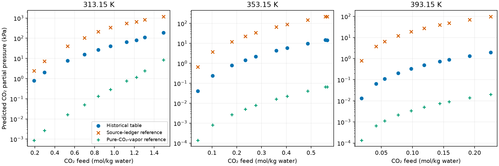

## Question, basis and method

The Uyan MDEA–CO₂ calculation distinguishes the paper's documented reference
convention from the historical generator's declaration. Uyan's text accompanying
Eqs. 22–23 and the [source ledger](inputs/source/uyan-2015-source-ledger.json)
assign pure-component water and infinite dilution to all other species. Eq. 18's
pure-component superscript for CO₂ does not specify a vapor branch. The generator
at `e12a5ff8` instead declares pure CO₂ vapor. The earlier historical table
identifies converted-molality constants and pure-water references; its wheel was
never identified. These records cannot establish historical equivalence.



The native calculation declares one finite reacting liquid with eight species
and one incipient vapor containing water, MDEA and CO₂. It retains the source
reactions, raw Table-1 constants and physical parameters. The Archer–Wang water
permittivity approximation, Hsieh pure-MDEA correlation and water–MDEAH⁺
interaction ambiguity remain fidelity limits. Application names select no
Engine physics.

`NeutralReference(solvent="water", ...)` retains the solvent's near-pure terminal
liquid reference. Adding `species_reference={"co2": SpeciesReference.PureGas}`
selects the native pure-vapor CO₂ pressure state; other species keep the declared
charge-neutral dilution path. Both declarations use
`RawMoleFractionInfiniteDilution`. The
[reference equation](../../../engine/docs/equations.md#neutral_reaction_reference_transfer)
and [native algorithm](../../../engine/docs/science/algorithms.md#alg-reference)
own the reference molality ladder, temperature and pressure dependencies,
transformation and admission criteria.

For a raw mole-fraction reference,
$\mu_i^{\circ,b}=g_i^\rho+RT L_i^b$ and
$\ln a_i^b=\ln x_i+\Lambda_i-L_i^b$.
A convention switch transforms its source constant to preserve
$\ln K_b+C_b$. Holding the raw source constants fixed while changing CO₂'s
reference changes the reaction targets and therefore defines a different
thermodynamic problem. The mixed declaration uses the same EOS and existing
reaction-to-species conversion; it adds no independent model or solver.

`solve_equilibrium_starts` owns the unchanged ordered pressure guesses and
native selection. The generator retains the verified, fixed
[t1-r08 compositions and packing fractions](inputs/starts/313-15-k-t1-r08.json)
for the previously difficult feeds. These are physical input guesses, with
unchanged equations, work limits and tolerances. `PartialPressure` evaluates
CO₂ partial pressure natively. Python declares inputs and reads returned values.

## Retained reference comparisons



The earlier source-ledger calculation recovered the same feeds as the historical
table. Its [complete comparison](results/data/native/source-ledger/reference-convention-comparison.csv)
retains the pressure, density, vapor-composition and reported-error differences.
The [pressure-only replay](results/data/native/source-ledger/pressure-only/uyan-2015-ermatchkov-2006-grepe-summary.json)
retains four initialization failures. The
[bounded fixed-input probe](results/data/native/source-ledger/failed-start-probe.json)
finds roots at those same literal feeds:



The final source-ledger replay retains the original pressure order and adds the
fixed composition and packing declarations. This isolating comparison supports
an initialization cause for the recovered roots. The pressure-only failures do
not establish physical root nonexistence. Probe total pressure is distinct from
measured CO₂ partial pressure.

Every marker is a retained prediction at a source feed; no interpolation is
implied. The logarithmic pressure axis displays the large reference-dependent
differences. The earlier
[source-ledger figure](results/rendered/source-ledger/co2-partial-pressure.png)
retains the observations and their reported pressure uncertainties. These
predictions have no propagated parameter or model-form uncertainty.



The pure-CO₂-vapor declaration returns native reacting bubble roots and meets
the original-row criterion. Every pressure, density and vapor-composition
comparison misses the unchanged historical-table criteria. This comparison is
a diagnostic; neither the paper's accuracy nor an identified historical wheel
is reproduced. The historical labels, result tables and earlier source-ledger
values remain separate. Historical Engine and reference-implementation
differences have not been isolated.

## Numerical qualification of species references



The [qualification values](results/data/native/species-reference/qualification.tsv)
retain the decreasing-pressure sequence and both centered-difference steps.
Only the terminal low-pressure values and refined differences carry the stated
acceptance criteria. Earlier values show the approach to the limit and the
finite-difference truncation. Pure-gas density-standard shifts approach
$\ln[P/(RT\rho_0)]$, with $T L_T$ approaching minus one and $P L_P$ approaching
one. Their shifts do not approach zero merely because fugacity coefficients
approach one.

At ethane saturation, liquid and vapor fugacities coincide while their volumes
differ. The native pure-gas source-pressure derivative agrees with vapor
volume divided by $RT$, which distinguishes the selected branch. Pure-liquid
and all-pure neutral declarations also agree with native pure-state identities.
The reaction checks use manufactured species sharing ethane parameters, with
a nonzero stoichiometric mole change; they describe numerical identities,
not ethane chemistry. The reference and record-anchored Gibbs derivatives retain temperature,
source-pressure and one EOS-coordinate dependencies through the existing
single-insertion Taylor owner. Fixed-source system-pressure columns are exact
zeros. The finite dilution realization and both observed terminal changes are
preserved; they do not certify bias to the infinite-dilution limit.

Nondefault mixed common-molality declarations receive a native refusal with a
basis cause. Charged pure selections retain their charge cause, and an
oversized manufactured pure species outside the native density domain retains
its species index and density cause. A pure-gas declaration for ethane at
180 K and 3 MPa, where the native isotherm has only its liquid-side root, is
refused with its species index; above the EOS critical temperature the single
root serves either declared branch. A refused thermal derivative preserves
its available value and feed direction. These are bounded numerical
verification cases, with no claim of physical nonexistence or an absolute
single-ion standard.

## Evidence and limits

The [pure-vapor diagnostic](results/data/native/species-reference/summary.json),
[qualification summary](results/data/native/species-reference/qualification-summary.json),
[native reference diagnostics](results/data/native/species-reference/references.csv),
[original rows](results/data/native/species-reference/rows.csv) and
[paired key-solve measurements](results/data/native/species-reference/key-solves/summary.json)
identify wheel hashes, source conditions, achieved residuals, availability,
refinement and work counts. The retained
[reproduction inputs and commands](scripts/species-reference/README.md)
expose the comparisons. The candidate is compared with the base at `92382dae`;
the older source-ledger record keeps its own wheel identity.

This is numerical verification of reference transformations and prediction of
declared reacting bubble states. It provides no physical validation, author-code
equivalence, absolute ionic caloric data or global phase-stability certificate.
Parameter uncertainty, source ambiguities, permittivity approximation error and
historical Engine differences are not quantified. The notebook and figure have
not been independently reviewed or promoted for manuscript use.
