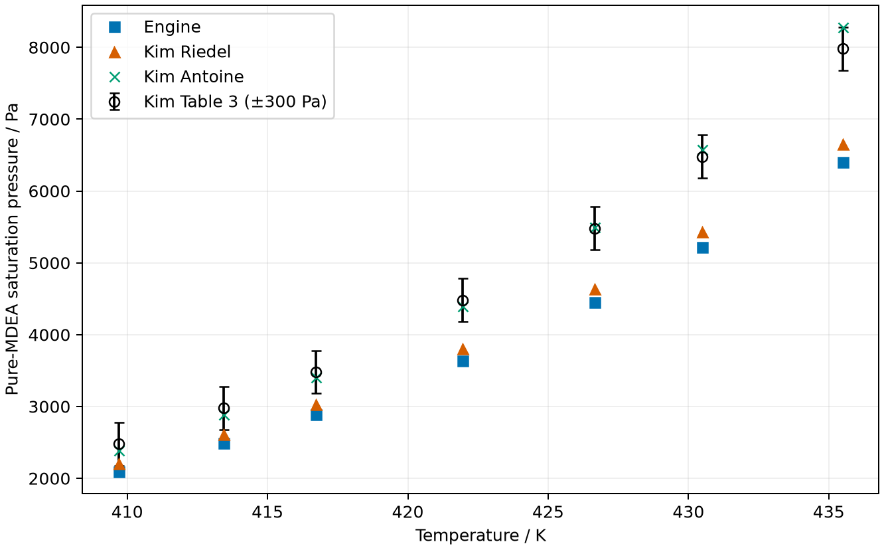
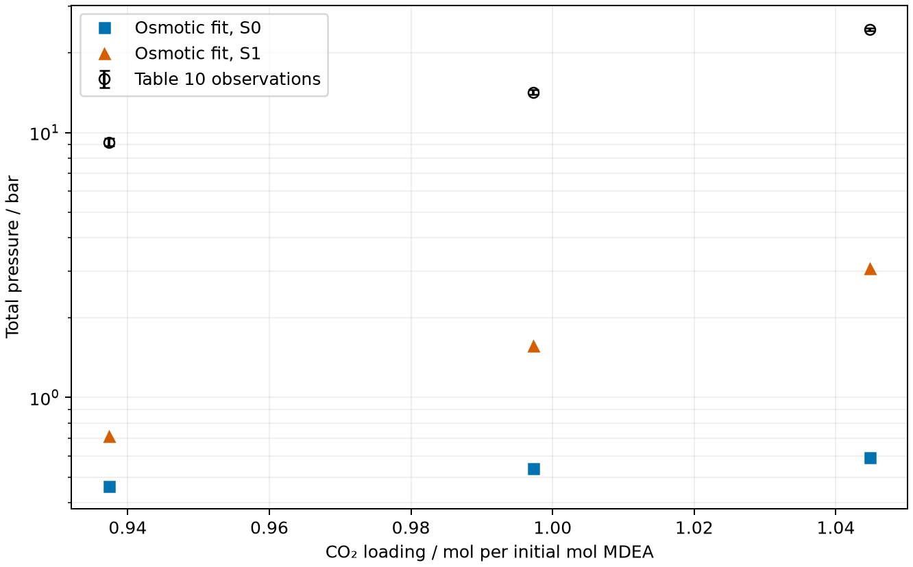

The published model, as printed, does not reproduce its own neutral
water–MDEA pressure curve. The earliest demonstrated departure occurs before
ions, reaction constants or species reference states enter the calculation.
An independent FeOs calculation verifies the Engine's evaluation of the
printed neutral declaration at the discriminating state. The remaining
source-to-declaration difference concerns the printed parameters, conventions
or curve provenance; the exact missing source record is not identified.
The large Table 10 pressure discrepancy remains after the demonstrated
same-pressure reference correction.

This study establishes bounded numerical verification and a failed source-model
reproduction. Comparisons with physical measurements remain poor; numerical
closure does not establish physical validation of loaded MDEA.

## Question and comparison basis

Can the model declared from Wangler's printed records reproduce the source's
own neutral curve and transfer its osmotic calibration to the withheld total
pressures? Water–MDEA Figure 1 is the first comparison because it contains
neither ions nor reactions. The subsequent aqueous MDEA/HCl calibration uses
ten observations at two temperatures; the three Table 10 pressure observations
are withheld from calibration. Average absolute relative deviation (AARD) is

$$
\mathrm{AARD}=\frac{100}{N}\sum_{i=1}^{N}
\left|\frac{p_i^{\mathrm{calc}}}{p_i^{\mathrm{obs}}}-1\right|.
$$

The osmotic statistic uses the same expression with osmotic coefficient in
place of pressure. Calibration accuracy, comparison with a source model curve,
and comparison with physical observations have different meanings here.

[Wangler et al. (2018)](https://doi.org/10.1016/j.fluid.2017.12.033),
printed pp. 17–20, Eqs. 8–12 and 34–35 and Tables 4, 6–7, supply the neutral
parameters. Table 4 gives one donor and one acceptor for water, two of each
for MDEA, and a temperature-dependent water segment diameter. The baseline
uses polynomial temperature dependence, arithmetic cross-association energy,
and the size-corrected Wolbach–Sandler volume named by the source:

$$
\epsilon_{wm}^{AB}=\frac{\epsilon_w^{AB}+\epsilon_m^{AB}}{2},\qquad
\kappa_{wm}^{AB}=\sqrt{\kappa_w^{AB}\kappa_m^{AB}}\,q^3(1-l),\qquad
q=\frac{\sqrt{\sigma_w\sigma_m}}{(\sigma_w+\sigma_m)/2}.
$$

Gross and Sadowski (2002), Eqs. 2–3, provide this usual size-corrected rule
(source record `2AJYEZS6`, transcription `FZVTDKXU`). Wangler's literal
Eq. 12 radical and omitted temperature powers are separately tested below.
These ambiguities remain explicit assumptions, not recovered author inputs.

## The first departure: neutral water–MDEA



The differences at 333, 353 and 373 K exceed the graphical allowance. The
313 K difference is unresolved at that allowance. The readouts compare with
the source's plotted model curve, not its original experimental database.
The original embedded raster in Wangler et al. (2018), p. 20, Figure 1 was
calibrated on both axes and inspected at two ink thresholds. The retained
[source readouts](inputs/source/wangler-2018-figure-1.csv) and
[calibration](inputs/source/diagnosis-sources.json) preserve that basis.
Failure at this single composition already excludes agreement over
the entire figure; it does not characterize every composition.

## Independent neutral verification against FeOs

At 353 K and liquid mole fractions water/MDEA = 0.8/0.2, both implementations
solve a two-species bubble problem with zero incipient vapor amount. They
receive the same printed physical inputs and constants. FeOs multiplies its
association volume by $(\sigma_w\sigma_m)^{3/2}$, while the Engine multiplies
by $\sigma_{wm}^3$. The entered dimensionless volumes therefore differ so
that the dimensional cross volume is equal. The FeOs script declares the
parameters independently and never imports the Engine calculation.







The dimensionless residual chemical potentials use an ideal-gas state at
the same temperature, density and composition. The Engine's exact total
chemical potentials and individual native term energies are compared with
FeOs's exact native term derivatives. The Engine term derivatives shown here
are five-point finite-difference verification of the returned extensive
energies at fixed volume. The retained [step comparison](results/term-derivative-steps.csv)
checks refinement and summation against the exact total.

The comparison limits are recorded in `results/neutral-provenance.json`.
Dense-liquid pressure subtracts large repulsive and attractive contributions;
the small common-density pressure difference in `results/neutral-diagnostics.json`
does not account for the much larger source-curve departure. The independent
bubble solves agree within their stated limits. A literal Eq. 12 declaration
also agrees between the codes (`results/cross-code-literal-eq12.csv`).

FeOs uses the previously diagnosed convergent stopping request. Its tighter
request failed in the investigation and is not used as a physical result.
FeOs does not expose achieved association residuals through these calls.
Evaluating the water diameter before constructing each FeOs isotherm verifies
density and composition behavior here; no temperature-derivative claim follows.
This comparison qualifies these neutral states, not Debye–Hückel, ionic
association, multi-segment ions or the full reacting mixture.

## Pure MDEA and source consistency

Wangler p. 19, Table 4 and §6.1 inherit the MDEA parameters from
[Pahlavanzadeh and Fakouri Baygi (2013)](https://doi.org/10.1016/j.jct.2012.12.021).
Wangler contains no separate pure-MDEA pressure/density figure or numerical
pure-component deviation table. The parameter source's p. 216 Table 2 reports
small fitted deviations, but does not provide the exact fit-point grid needed
to reconstruct those statistics.





The independent correlations come from
[Kim, Svendsen and Børresen (2008)](https://doi.org/10.1021/je800290k),
p.2523 Table 5. Riedel uses $B/T$: the table footnote omits the reciprocal,
but a literal $BT$ underflows and cannot represent its observations. Antoine
uses Celsius and mmHg, converted to Pa. The coefficient rows are retained in
`inputs/source/diagnosis-sources.json`. At the lowest pure saturation pressures,
reconstructing liquid log-fugacity closure loses digits through dense-liquid
pressure subtraction; no exact coefficient-level identity is claimed. The correlations have different data
bases; neither is an exact reference. Their low-temperature comparison includes
extrapolation beyond Kim's new neat-MDEA measurements.



Kim p.2526 reports temperature and pressure-controller uncertainties of
±0.05 K and ±0.3 kPa. Relative resolving power is limited at the lower
pressures. This comparison does not reproduce the parameter source's fit
statistic and cannot establish an Engine defect.

Pahlavanzadeh's p. 216 Table 1 coefficients labeled MDEA repeat Kim's p.2523
Table 5 MEA vapor-pressure coefficients exactly. The inspected source PDFs
are identified by their Zotero locations and hashes in
`inputs/source/diagnosis-sources.json`, which also retains the coefficients.
The printed density correlation is also inconsistent with the source's
own density axis when assigned MDEA's molar mass; correct MDEA density
coefficients have not been established here. This is a demonstrated source
inconsistency, but that pure correlation is not an operand of the current
PC-SAFT calculation and does not itself explain Wangler's binary discrepancy.

## Bounded convention comparisons



Every choice changes one identified rule or component declaration with no
pressure fit. No tested single convention recovers the four Figure 1
readouts within their graphical allowance. The literal Eq. 12 radical lowers
the 353 K pressure further; the printed radical (Wangler p. 17, Eq. 12)
conflicts with the usual rule named in Wangler's prose. Neither literal
missing temperature powers nor the parameter source's additional digits
recovers the graph. The origin's $d_{ij}^3$ association prefactor is another
isolated reading of Pahlavanzadeh p. 215 Eq. 4, not an adopted Wangler correction.

The remaining rows are excluded controls. Geometric association volume omits
the size factor; geometric Mayer cross energy replaces Wangler's arithmetic
energy. Alternate water/MDEA site sets come from the parameter source's
Table 2 or Gross–Sadowski; they are not the sets Wangler selected. Site-count
changes with unchanged fitted parameters are sensitivities only. Suppressing
neutral MDEA self-association contradicts its printed nonzero self energy;
Wangler's induced-association statement concerns MDEAH⁺. Other controls change
the temperature origin, truncate the polynomial or reverse its cubic sign.
The raw-temperature control at 313 K fails local phase stability; its failure
is retained and no pressure is substituted. None of these controls authorizes
a parameter adoption or excludes every conceivable combination of conventions.

## Same-pressure standards and the remaining Table 10 discrepancy

Wangler p. 18, Eqs. 20–21 evaluate both pure-water and infinite-dilution
standards at the system pressure. The declaration now uses
`reference_pressure_pa=None`; Table 2 constants and the species standards
are unchanged. This is the single demonstrated declaration correction.
It leaves Figure 1 unchanged because that neutral problem has no reactions.



S0 excludes like-ion dispersion including self; S1 retains self-dispersion
while excluding same-sign cross dispersion. Both fit the osmotic observations
per isotherm with the existing relative objective and exact native Jacobians.
The printed association correction is held fixed. The source's two isotherms
do not uniquely identify a temperature law; linear transfer to 303 K remains
an explicit reproduction assumption.







All fitted prediction and interaction-allowance states converge and their
references are admitted. The allowance is propagated from osmotic measurement
uncertainty and does not cover model-reading uncertainty. The small residuals
verify numerical closure of the declaration; the pressure disagreement remains
far larger than the allowance probes. No parameter was fitted to Table 10
for these predictions. Existing per-row pressure-matching fits remain separate
diagnostics in the native CSV and do not enter the predictions.

The historical printed-interaction high-pressure diagnostic no longer solves
from its declared seed. The prior investigation also tried an alternative
initial composition without recovery. Its old high-pressure values are not
current predictions, and its numerical failure is separate from the converged
fitted-lane pressure deficit.



## Ranked remaining explanations and claim limits

1. **Different source parameters or curve/table provenance.** This has highest
   priority because the first failure is neutral and two independent native
   implementations agree. The author's evaluated neutral interaction,
   association correction, dimensional cross volume, site counts and one
   liquid/vapor state at the discriminating condition would distinguish a
   printed-record problem from a curve-provenance problem.
2. **An association convention not uniquely specified by the article.** The
   named rule and Eq. 12 differ, and the parameter source prints another
   prefactor. No individual tested reading fixes the graph. Selecting or
   fitting an unprinted combination would create a new model.
3. **A separate ionic parameter or convention transfer.** Table 6 duplicates
   water–MDEA and water–MDEAH⁺ rows; the fitted osmotic curve has the wrong
   concentration trend, and two temperatures underdetermine its transfer.
   Multi-segment ions, ionic association and the approximate pure-solvent
   permittivities remain unqualified by the neutral comparison. Correcting
   Figure 1 cannot be assumed to correct Table 10.
4. **An Engine neutral evaluation defect.** Agreement of pressure, density,
   fugacity and all three chemical-potential terms strongly disfavors this
   explanation at the tested states. Finite comparisons do not prove
   correctness at every temperature, composition or ionic state.

The printed model's neutral source-curve failure is established. The complete
cause of the loaded-MDEA pressure discrepancy remains unresolved. These
results do not establish a physical limit of the author's actual calculation,
global stability, loaded-density accuracy, general process performance or MEA
accuracy. No neutral parameter retuning or Engine runtime correction follows.

## Reproduction and review boundary

The [README](README.md) gives the ordered commands and result owners.
`neutral_engine.py` reuses the Wangler declaration; `neutral_feos.py` is the
independent comparator; `compare_neutral.py` writes and verifies CSV comparisons.
`present.py` reads only retained results to prepare tables and figures.
The notebook and its render never run the thermodynamic model.
Source PDF hashes and graphical calibration are retained with the inputs;
installed-code identities and raw state diagnostics are retained with the build
evidence. Earlier batch-5 and `grepe` files are frozen historical calculations.
