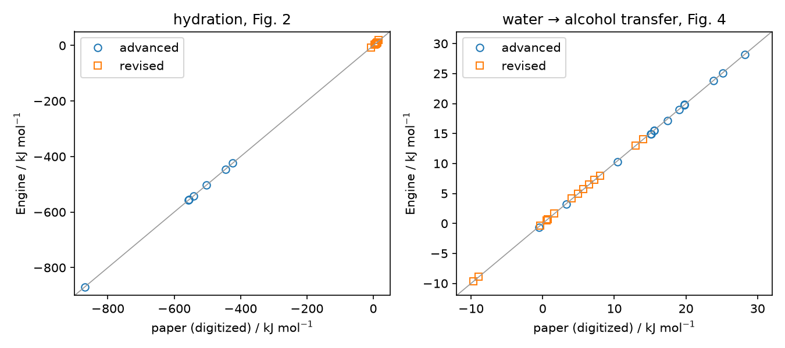
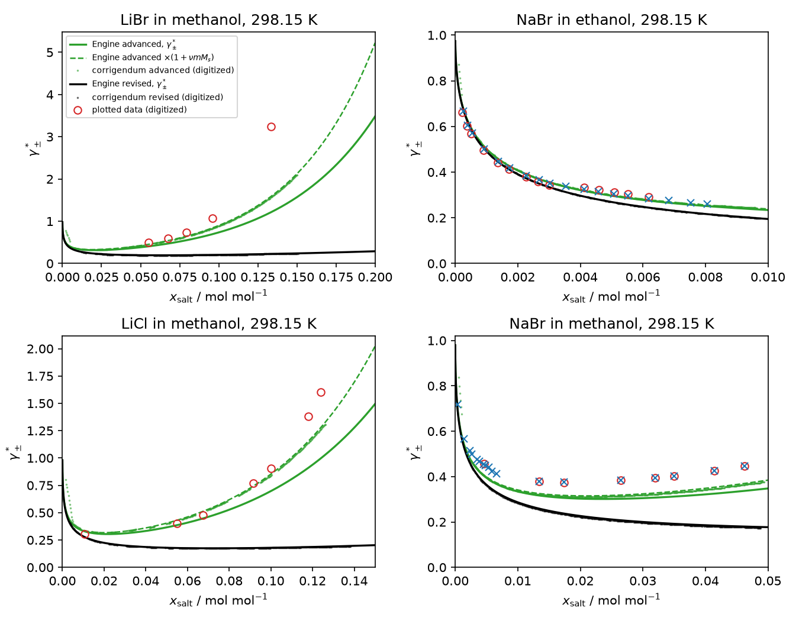

```{python}
import csv
import json
import math
import sys
from pathlib import Path

from IPython.display import Markdown

sys.path.insert(0, "scripts")
import parameters as P

results, figures = Path("results"), Path("figures")
def rows(path):
    with Path(path).open(newline="") as stream:
        return list(csv.DictReader(stream))
def u(v, d):
    return f"{v:.{d}f}".replace("-", "−")
def e(v, d=1):
    m, x = f"{v:.{d}e}".split("e")
    return f"{m}e{int(x)}".replace("-", "−")
def table(header, body):
    lines = ["| " + " | ".join(header) + " |", "|" + "---|" * len(header)]
    return Markdown("\n".join(lines + ["| " + " | ".join(r) + " |" for r in body]))

ident = json.loads((results / "run-identity.json").read_text())
TOL = ident["tolerances"]
T_K, P_BAR = ident["temperature_K"], ident["pressure_Pa"] / 1e5
hyd, tr = rows(results / "hydration.csv"), rows(results / "transfer.csv")
contrib5 = rows(results / "transfer-born-contributions.csv")
checks = rows(results / "checks.csv")
ver = rows(results / "miac-curve-verification.csv")
han, osm, pts = rows(results / "miac-han-pan.csv"), rows(results / "osmotic-zafarani-moattar.csv"), rows(results / "miac-digitized-points.csv")
inf = rows(results / "infinite-dilution.csv")
d = lambda r, a, b: float(r[a]) - float(r[b])
hyd_adv = max(abs(d(r, "engine_advanced", "paper_advanced")) for r in hyd)
hyd_rev = max(abs(d(r, "engine_revised", "paper_revised")) for r in hyd)
born_hyd = max(abs(d(r, "engine_born", "paper_born")) for r in hyd)
tr_adv = max(abs(d(r, "engine_advanced", "paper_advanced")) for r in tr)
tr_rev = max(abs(d(r, "engine_revised", "paper_revised")) for r in tr)
in_bar = lambda r, k: float(r["marcus_low"]) <= float(r[k]) <= float(r["marcus_high"])
aard = lambda R, a, b: 100 * sum(abs(float(r[a]) / float(r[b]) - 1) for r in R) / len(R)
born_closed = max(float(r["relative_error"]) for r in checks if r["check"] == "Born closed form")
partner = max(float(r["relative_error"]) for r in checks if r["check"] != "Born closed form")
terminal = max(float(r["reference_terminal_change"]) for r in inf)
PK = P.PACKING
EPS = {k: P.COMPONENTS[k][5] for k in ("water", "methanol", "ethanol", "sodium-cation")}
M = {s: P.COMPONENTS[s][1] / 1000 for s in ("methanol", "ethanol")}
def v(panel, series, variant, basis):
    return next(r for r in ver if r["panel"] == panel and r["series"] == series and r["engine_variant"] == variant and r["engine_basis"] == basis)
```

## Question and answer

**Question.** Can the Engine reproduce Bülow, Ascani & Held (2020) natively? The paper is *ePC-SAFT advanced I* (Fluid Phase Equilib., doi 10.1016/j.fluid.2021.112967), read together with its corrigendum (doi 10.1016/j.fluid.2021.113184). It adds a Born term, and a salt-concentration-dependent relative permittivity in both the Born and Debye–Hückel terms, to ePC-SAFT revised. The test uses the published parameters at `{python} T_K` K and `{python} f'{P_BAR:g}'` bar.

**Answer.** Yes, once the paper's conventions are mapped onto the Engine's records.

- **Infinite dilution (Figs. 2–5).** The Engine reproduces every hydration and transfer Gibbs energy.
  - Hydration: largest difference `{python} u(hyd_adv, 2)` kJ/mol for the advanced model and `{python} u(hyd_rev, 2)` kJ/mol for revised.
  - Transfer from water to methanol or ethanol: largest difference `{python} u(tr_adv, 2)` and `{python} u(tr_rev, 2)` kJ/mol.
  - Born part of the hydration energy: within `{python} u(born_hyd, 2)` kJ/mol of Fig. 3.
- **Revised activity-coefficient curves.** The corrected Fig. 7 curves match the Engine directly.
- **Advanced activity-coefficient curves.** The corrected Fig. 6 left panel and Fig. 7 curves match the Engine's mole-fraction-scale γ±\* multiplied by (1 + ν m M_s). The corrigendum's own Fig. 6 right panel (ln γ±\* and its Born and Debye–Hückel contributions) matches the Engine *without* that factor. The two panels of the same figure therefore disagree by ln(1 + ν m M_s) within digitization precision; see "The advanced-curve factor".
- **Against experiment, on a basis consistent with the plotted data.** The advanced model predicts Han & Pan's NaBr γ± in ethanol to `{python} u(aard([r for r in han if r['solvent']=='ethanol'], 'engine_advanced', 'gamma_pm_m_han_pan'), 1)` % AARD, but in methanol only to `{python} u(aard([r for r in han if r['solvent']=='methanol'], 'engine_advanced', 'gamma_pm_m_han_pan'), 1)` %. For Zafarani-Moattar's measured osmotic coefficients in methanol it reaches `{python} u(aard([r for r in osm if r['salt']=='LiCl'], 'engine_advanced', 'osmotic_measured'), 1)` % (LiCl) and `{python} u(aard([r for r in osm if r['salt']=='LiBr'], 'engine_advanced', 'osmotic_measured'), 1)` % (LiBr). Revised gives `{python} u(aard([r for r in osm if r['salt']=='LiCl'], 'engine_revised', 'osmotic_measured'), 0)` % and `{python} u(aard([r for r in osm if r['salt']=='LiBr'], 'engine_revised', 'osmotic_measured'), 0)` %.

This is **numerical verification** of the Engine against the paper's model values (digitized bars and curves) and **physical comparison** with literature data using published parameters. Nothing was fitted. No Engine source changed.

## Conventions mapped onto Engine terms

The three ion diameters are where the printed equations and the Engine mapping differ. Only the hard-chain diameter is printed as `{python} PK` σ_i; the Born and Debye–Hückel values below are an **inferred convention**, fixed by the numbers they reproduce.

```{python}
DH_SIGMA = [float(v(p, "revised", "revised-dh-sigma", "gamma_pm_x")["median_px"]) for p in ("figure-07/libr-methanol", "figure-07/nabr-ethanol", "figure-07/licl-methanol", "figure-07/nabr-methanol")]
DH_088 = [float(v(p, "revised", "revised", "gamma_pm_x")["median_px"]) for p in ("figure-07/libr-methanol", "figure-07/nabr-ethanol", "figure-07/licl-methanol", "figure-07/nabr-methanol")]
li = hyd[0]
table(["Ion diameter", "Printed in the sources", "Engine record, value used", "Status and evidence"], [
    ["Hard chain", f"d_i = {PK} σ_i for ions (Held 2014 Eq. 21, the parameter source)", f"`packing_diameter` = {PK} σ_i", "printed"],
    ["Born radius a_i, Eq. (2) (charging energy written with the diameter)",
     f"Born radii \"set to the respective diameters of the ions estimated within the original ePC-SAFT parametrization\"; \"replace the Born radii with the ePC-SAFT ion diameters σ_i\" (Bülow 2020 Secs. 2.1, 3.2). No {PK} factor printed",
     f"`born_diameter` = {PK} σ_i; Born `c_shell = c_dielectric = 0`",
     f"inferred. With d = σ_i, Li⁺ hydration moves from {u(float(li['engine_advanced']), 1)} to {u(float(li['engine_born_diameter_sigma']), 1)} kJ/mol (paper {u(float(li['paper_advanced']), 1)}; tolerance {TOL['figure-2 hydration']:g}). {PK} σ_i reproduces the Fig. 2–3 bars"],
    ["Debye–Hückel closest approach", f"σ_i (Held 2014 Sec. 2.1); \"unified ion diameters\" for Debye–Hückel and Born (Bülow 2020 Sec. 3.4). No {PK} factor printed",
     f"`debye_huckel_diameter` = {PK} σ_i",
     f"inferred. With d = σ_i the revised curves sit {u(min(DH_SIGMA), 2)}–{u(max(DH_SIGMA), 2)} px (median) from the corrigendum; with {PK} σ_i, {u(min(DH_088), 2)}–{u(max(DH_088), 2)} px"],
])
```

Other conventions:

```{python}
table(["Paper term", "Engine record", "Value used", "Basis"], [
    ["ε_r(x̄), linear in mole fraction", "`component-permittivity-mixing`",
     f"water {EPS['water']}, methanol {EPS['methanol']}, ethanol {EPS['ethanol']}, every ion {EPS['sodium-cation']}",
     "Table 4. With a single solvent the Engine rule (salt-free solvent value times solvent fraction, plus Σ x_ion ε_ion) is exactly the paper's ε = Σ x_i ε_r,i on ion mole fractions"],
    ["ePC-SAFT revised", "`fully-dissociated-debye-huckel`, `solvent-only` permittivity", "same diameters, no Born", "Fig. 2/4/6/7 comparison model"],
    ["ion–solvent k_ij in alcohols", "pair `k_ij`", "0", "Sec. 3.1 (predictions)"],
    ["Same-sign ions", "`exclude-same-sign-ion-pairs`", "no dispersion", "Held 2014 rule"],
])
```

The Table 1 water σ(T) correlation is evaluated by the Engine at `{python} T_K` K. All Table 2–3 values are used verbatim, including Na⁺–water k_ij = `{python} P.K_WATER['sodium-cation']`. Held 2014's temperature expression gives `{python} u(P.SODIUM_WATER_HELD2014, 5)` at that temperature. That alternative moves the Na⁺ hydration energy by `{python} u(abs(float(next(r for r in hyd if r['ion']=='Na+')['engine_sodium_water_held2014']) - float(next(r for r in hyd if r['ion']=='Na+')['engine_advanced'])), 2)` kJ/mol and nothing else.

Not used, and wrong for this paper:

- `inputs/parameters/pure/any-solvent.csv` lists methanol and ethanol `dielc = 1` and molar mass 0.1 kg/mol. Its `d_born` column holds Figiel 2025 fitted diameters, not this paper's.
- `user-options.json` is a template.

`scripts/parameters.py` builds the strict parameter document from the tables. `inputs/parameters/bulow-2020-advanced.json` is its advanced variant.

## Tolerances (fixed before the first comparison)

```{python}
table(["Comparison", "Tolerance"], [[k, f"{v:g}" + (" px" if "pixel" in k else "" if "relative" in k else " kJ/mol")] for k, v in TOL.items()])
```

The bar tolerances follow from the read precision of the digitized bars that ship in the source packet (`figures/figure-0[2-5]/source/`); Fig. 3's low/high read spread is about ±4.5 kJ/mol. Curves were digitized from the corrigendum's 300-ppi images (`scripts/digitize.py`, calibration and QA overlays in `figures/`). The paper gives no numeric deviation metric for MIACs, so experimental comparisons use AARD (average absolute relative deviation), the metric of the cited ePC-SAFT revised work.

## Infinite dilution: Figs. 2–5

ΔG_hyd = RT ln φ∞ (Eq. 7) and ΔG_tr = RT ln(φ∞_S2/φ∞_S1) (Eq. 8), in kJ/mol. The Engine's φ∞ is its terminal infinite-dilution reference: largest terminal change `{python} e(terminal)` in ln φ.

```{python}
table(["Ion", "Engine advanced", "Paper advanced", "Engine revised", "Paper revised", "Engine Born", "Paper Born (Fig. 3)", "Fawcett data"],
      [[r["ion"]] + [u(float(r[k]), 1) for k in ("engine_advanced", "paper_advanced", "engine_revised", "paper_revised", "engine_born", "paper_born", "fawcett")] for r in hyd])
```

```{python}
table(["Solvent", "Ion", "Engine advanced", "Paper advanced", "Engine revised", "Paper revised", "Marcus (low–high)"],
      [[r["solvent"], r["ion"]] + [u(float(r[k]), 2) for k in ("engine_advanced", "paper_advanced", "engine_revised", "paper_revised")]
       + [f"{u(float(r['marcus']), 1)} ({u(float(r['marcus_low']), 1)}–{u(float(r['marcus_high']), 1)})"] for r in tr])
```



The Born term dominates hydration as the paper says.

- **Born part.** The Engine Born part is the difference between the advanced model and the same model without Born. It equals the Eq. (2) insertion limit with d_i = `{python} PK` σ_i to `{python} e(born_closed)` relative.
- **Born diameter.** With d_Born = σ_i instead, Li⁺ hydration would move from `{python} u(float(hyd[0]['engine_advanced']), 1)` to `{python} u(float(hyd[0]['engine_born_diameter_sigma']), 1)` kJ/mol, far outside the 10 kJ/mol tolerance. This selects the inferred Born diameter (convention table).
- **Non-Born remainder.** It equals the revised value exactly, because Debye–Hückel vanishes at infinite dilution.
- **The paper's own split.** Fig. 3's hard-chain, dispersion and association bars do not sum with its Born bar to the Fig. 2 total. For Li⁺ they sum to `{python} u(float(hyd[0]['paper_hc_disp_assoc']) + float(hyd[0]['paper_born']), 1)` kJ/mol against `{python} u(float(hyd[0]['paper_advanced']), 1)` kJ/mol. The Engine reproduces the totals.
- **Per-term split not reproducible.** The Engine reports per-term Helmholtz energies but not per-term ln φ. Fig. 3's hard-chain/dispersion/association split is therefore not reproduced; that is a reporting gap, not a calculation gap.

**Fig. 5 panel labels.** In the transfer Born contribution, the Born transfer term depends only on 1/ε_S2 − 1/ε_water and d_i. The bars the caption assigns to ethanol (top panels) equal the Engine's methanol values, and vice versa. The source-packet files inherit the caption's labels.

```{python}
table(["Packet file label", "Ion", "Paper Born bar", "Engine Born, methanol", "Engine Born, ethanol"],
      [[r["packet_file_label"], r["ion"]] + [u(float(r[k]), 2) for k in ("paper_born", "engine_born_methanol", "engine_born_ethanol")] for r in contrib5])
```

With the labels swapped, `{python} sum(abs(float(r['paper_born']) - float(r['engine_born_ethanol' if r['packet_file_label']=='methanol' else 'engine_born_methanol'])) <= TOL['figure-5 Born transfer'] for r in contrib5)` of `{python} len(contrib5)` Born bars are within tolerance. The exception is I⁻ in the panel labeled methanol, where the packet read gives `{python} u(float(contrib5[2]['paper_born']), 1)` against the Engine's `{python} u(float(contrib5[2]['engine_born_ethanol']), 1)`. On the rendered page that bar reaches the Engine value, so this is a packet digitization error and is not reproduced as a model difference.

**Against data.** The advanced transfer energies fall inside Marcus's ranges for `{python} sum(in_bar(r, 'engine_advanced') for r in tr)` of `{python} len(tr)` ion–solvent pairs, against `{python} sum(in_bar(r, 'engine_revised') for r in tr)` for revised. The mean absolute deviation from the Marcus value is `{python} u(sum(abs(d(r,'engine_advanced','marcus')) for r in tr)/len(tr), 1)` against `{python} u(sum(abs(d(r,'engine_revised','marcus')) for r in tr)/len(tr), 1)` kJ/mol. The cations Li⁺ and K⁺ stay far off, as the paper notes. Hydration energies are all more negative than Fawcett's correlated values (mean absolute deviation `{python} u(sum(abs(d(r,'engine_advanced','fawcett')) for r in hyd)/len(hyd), 0)` kJ/mol, F⁻ worst), as in the paper.

## Activity coefficients: Figs. 6–7 (corrigendum)

The corrigendum relabels Fig. 6 and Fig. 7 top-left as **LiBr in methanol**; the source-packet file `figures/figure-06/source/ethanol-libr.csv` keeps the original label. The figures plot the unsymmetric mole-fraction-scale mean ionic activity coefficient γ±\* (Eq. 10, ions counted separately) against salt mole fraction x_salt. The plotted Han & Pan data equal their tabulated molality-scale γ± times (1 + ν m M_s), which confirms that basis.

### The advanced-curve factor

```{python}
import numpy as np
left = rows(figures / "figure-06/libr-methanol-left.csv")
right = rows(figures / "figure-06/libr-methanol-right.csv")
def curve(R, s):
    c = sorted((float(r["x"]), float(r["y"])) for r in R if r["series"] == s)
    return [p[0] for p in c], [p[1] for p in c]
fac = []
for x in (0.05, 0.10, 0.15):
    m = x / ((1 - x) * M["methanol"])
    fac.append([f"{x:.2f}", u(math.log(np.interp(x, *curve(left, "advanced"))) - np.interp(x, *curve(right, "advanced")), 3),
                u(math.log(1 + 2 * m * M["methanol"]), 3)])
table(["x_LiBr", "ln γ (left panel) − ln γ (right panel), corrigendum Fig. 6", "ln(1 + ν m M_s)"], fac)
```

Both panels show the same advanced model, yet their difference equals ln(1 + ν m M_s) within digitization precision. The Engine agrees with the right panel directly. Its total, Born contribution (advanced minus the same model without Born) and Debye–Hückel contribution (the latter against a very-large-permittivity diagnostic) all fall within the 3 px tolerance; see `results/figure-06-contributions.csv`.

The left panel's other curve (Born with constant permittivity, orange) matches the Engine directly. Only the advanced (green) curves carry the factor. The cause is **inferred, not reproduced**: a basis conversion applied once too often to the authors' plotted advanced curves. No model term in the paper produces an advanced-only ln(1 + ν m M_s).

### Curve verification

Distance is the orthogonal pixel distance from each digitized corrigendum curve pixel to the Engine curve.

- **Data-disc rule (digitizer, every curve).** Curves are 2–4 px wide; the filled data discs are 12–16 px. The coloured curves are drawn over the discs, which can split a disc's dark pixels into pieces the disc detector misses. Ink of any colour that survives opening with a 7 px disc is therefore disc or curve-on-disc overlap. Every curve column with a series pixel within 2 px of such ink is excluded. The excluded columns stay in the panel CSVs as series "⟨name⟩ inside data disc" (grey in the QA overlays).
- **Screened.** It further excludes the steep dilute drop (the first 5% of the x axis) and pixels within 10 px of a detected data disc.

```{python}
sel = [("figure-07/libr-methanol", "advanced", "gamma_pm_x_times_factor"), ("figure-07/libr-methanol", "revised", "gamma_pm_x"),
       ("figure-07/nabr-ethanol", "advanced", "gamma_pm_x_times_factor"), ("figure-07/nabr-ethanol", "revised", "gamma_pm_x"),
       ("figure-07/licl-methanol", "advanced", "gamma_pm_x_times_factor"), ("figure-07/licl-methanol", "revised", "gamma_pm_x"),
       ("figure-07/nabr-methanol", "advanced", "gamma_pm_x_times_factor"), ("figure-07/nabr-methanol", "revised", "gamma_pm_x"),
       ("figure-06/libr-methanol-left", "born-constant-permittivity", "gamma_pm_x")]
body = []
for panel, series, basis in sel:
    r, direct = v(panel, series, series, basis), v(panel, series, series, "gamma_pm_x")
    body.append([panel, series, "γ±* × (1+νmM_s)" if "factor" in basis else "γ±*", u(float(r["median_px"]), 2),
                 u(float(r["max_px_screened"]), 2), f"{100*float(r['within_tolerance_fraction']):.0f} %", u(float(direct["median_px"]), 1)])
for r in (x for x in ver if "right" in x["panel"]):
    body.append([r["panel"], r["series"], "ln γ±*", u(float(r["median_px"]), 2), u(float(r["max_px_screened"]), 2),
                 f"{100*float(r['within_tolerance_fraction']):.0f} %", "—"])
table(["Panel", "Series", "Engine basis", "Median px", "Max px, screened", "Pixels ≤ 3 px", "Median px, γ±* direct"], body)
```

Every screened curve lies within the 3 px tolerance; the largest screened distance of any listed curve is `{python} u(max(float(r[4]) for r in body), 2)` px.

The data-disc rule decided two revised curves. Before it, LiBr in methanol reached 9.23 px at x = 0.0103 and NaBr in ethanol 3.73 px at x = 0.0041. In both, the dark trace had picked up the lower half of a data disc split by the green advanced curve: the LiBr disc was not detected at all, and only the upper half of the NaBr disc was. With the rule, these curves reach `{python} u(float(v('figure-07/libr-methanol','revised','revised','gamma_pm_x')['max_px_screened']), 2)` and `{python} u(float(v('figure-07/nabr-ethanol','revised','revised','gamma_pm_x')['max_px_screened']), 2)` px. The rule removes `{python} sum(c for p in json.loads((figures / 'digitized-calibration.json').read_text())['panels'].values() for k, c in p['counts'].items() if 'inside' in k)` of `{python} sum(c for p in json.loads((figures / 'digitized-calibration.json').read_text())['panels'].values() for k, c in p['counts'].items() if k != 'points')` curve columns across all panels, mostly green columns that cross discs.

**Debye–Hückel diameter sensitivity.** With the Held 2014 printed closest approach σ_i, the revised curves sit `{python} u(min(float(v(p,'revised','revised-dh-sigma','gamma_pm_x')['median_px']) for p in ('figure-07/libr-methanol','figure-07/nabr-ethanol','figure-07/licl-methanol','figure-07/nabr-methanol')), 2)`–`{python} u(max(float(v(p,'revised','revised-dh-sigma','gamma_pm_x')['median_px']) for p in ('figure-07/libr-methanol','figure-07/nabr-ethanol','figure-07/licl-methanol','figure-07/nabr-methanol')), 2)` px (median) from the corrigendum. This selects the inferred d_DH = `{python} PK` σ_i.



### Against experiment (physical comparison, published parameters)

```{python}
body = []
for salt, solvent in (("NaBr", "ethanol"), ("NaBr", "methanol")):
    R = [r for r in han if r["solvent"] == solvent]
    body.append([f"{salt} in {solvent}, γ± (Han & Pan 1993, EMF)", str(len(R))] + [u(aard(R, f"engine_{k}", "gamma_pm_m_han_pan"), 1) for k in ("advanced", "revised", "advanced-dh-sigma")])
for salt in ("LiCl", "LiBr"):
    R = [r for r in osm if r["salt"] == salt]
    body.append([f"{salt} in methanol, Φ (Zafarani-Moattar 1998, isopiestic)", str(len(R))] + [u(aard(R, f"engine_{k}", "osmotic_measured"), 1) for k in ("advanced", "revised", "advanced-dh-sigma")])
table(["Data", "Rows", "AARD % advanced", "AARD % revised", "AARD % advanced, d_DH = σ (sensitivity)"], body)
```

```{python}
body = []
for panel in sorted({r["panel"] for r in pts}):
    R = [r for r in pts if r["panel"] == panel]
    body.append([panel, str(len(R))] + [u(aard(R, k, "gamma_pm_x_digitized"), 1) for k in ("engine_advanced", "engine_advanced_times_factor", "paper_advanced_gamma_x", "engine_revised")])
XS = 0.05
under = [1 - float(r['engine_advanced']) / float(r['gamma_pm_x_digitized']) for r in pts if r['solvent'] == 'methanol' and float(r['x_salt']) >= XS]
table(["Panel (plotted data, digitized)", "Points", "Engine advanced γ±*", "Engine advanced × (1+νmM_s)", "Corrigendum advanced curve", "Engine revised"], body)
```

The advanced model's Born term with ε_r(x̄) is what turns γ±\* upward at high salt content. That is the qualitative effect the paper reports, and revised misses it entirely: its Φ AARD is at least `{python} u(min(aard([r for r in osm if r['salt']==k], 'engine_revised', 'osmotic_measured') for k in ('LiCl','LiBr')), 0)` %.

The paper's visual agreement with the LiBr and LiCl data in methanol, however, relies on the advanced-curve factor. On the basis consistent with the plotted data, advanced underpredicts the plotted γ±\* in methanol for x_salt ≥ `{python} u(XS, 2)` by `{python} u(100*min(under), 0)`–`{python} u(100*max(under), 0)` %, increasing with concentration. NaBr in ethanol, the most dilute system, agrees within a few percent either way.

The d_DH = σ sensitivity fits methanol better but contradicts the corrigendum's revised curves. It is reported, not adopted.

Data limits:

- The digitized data discs are the ones the image detector could separate from the curves. Discs lying on a curve at low x_salt are missing (QA overlays).
- Above the tabulated Zafarani-Moattar range, the plotted LiBr disc at x ≈ `{python} u(max(float(r['x_salt']) for r in pts if r['salt']=='LiBr'), 3)` has no tabulated source row (largest tabulated LiBr molality `{python} u(max(float(r['molality_mol_kg']) for r in osm if r['salt']=='LiBr'), 2)` mol/kg).
- The source packet's `ethanol-libr.csv` and `methanol-licl.csv` mix digitized and tabulated rows of unclear origin and were not used.

## Numerical checks

- **Born closed form.** Infinite-dilution Born ln φ from the Engine against Eq. (2): `{python} e(born_closed)` relative (tolerance `{python} e(TOL['Born closed form relative'], 0)`). The reference uses the Engine's CODATA 2018 ε₀. SciPy's CODATA 2022 value alone differs by `{python} e(abs(8.8541878128 / 8.8541878188 - 1))` relative.
- **Counter-ion independence of single-ion φ∞.** Largest difference `{python} e(partner)` kJ/mol across four pairs in three solvents (tolerance `{python} e(TOL['partner independence'], 0)`).
- **Completeness.** All `{python} len(rows(results / 'miac-curves.csv'))` curve states and all osmotic rows returned finite values; no state was unavailable.

## Limits

- **Conditions.** `{python} T_K` K and `{python} f'{P_BAR:g}'` bar, as in the paper; nothing broader is claimed.
- **Precision of the paper's values.** They are digitized; agreement is bounded by the stated read tolerances, not by Engine precision.
- **Hydration and transfer data.** The Fawcett and Marcus values are correlations or derived single-ion quantities (as the paper stresses), not direct measurements.
- **Per-term split.** The Fig. 3 and Fig. 5 hard-chain/dispersion/association bars are not reproduced: the Engine does not report per-term ln φ.
- **The advanced-curve factor.** Its attribution is inferred from internal inconsistency in the corrigendum, not confirmed with the authors.

## Provenance

- Engine commit `{python} ident['engine'][0]` (editable install; `engine/` free of uncommitted changes at run: `{python} ident['engine'][1]`).
- Engine calculation wall time `{python} u(ident['calculation_wall_seconds'], 1)` s on one process.
- Script and input hashes are in `results/run-identity.json`.
- Sources:
  - Bülow 2020 (Zotero `L79J5R52`; PDF `S4WEK4G3`).
  - Corrigendum (parent `9XTQJ9P7`). The digitized PDF is `YHZIPCDI`, filed under the paper's parent `L79J5R52`; it is byte-identical to `CZQJCDPD` under `9XTQJ9P7` (SHA-256 in `figures/digitized-calibration.json`).
  - Zafarani-Moattar & Nasirzade 1998 (`HW6Q7Y4K`/`5PLRM3L5`; Tables 2–3 transcribed to `inputs/source/zafarani-moattar-1998-osmotic.csv`).
  - Han & Pan 1993 (`Z6JXVZJ5`/`KVVE7NKB`; the packet's NaBr rows equal its Tables 1–2, 100% solvent blocks).

Replay from the repository root:

```bash
.venv/bin/python analyses/reproduction/2020-bulow/scripts/digitize.py <dir with pdfimages -j output of YHZIPCDI>
.venv/bin/python analyses/reproduction/2020-bulow/scripts/parameters.py
.venv/bin/python analyses/reproduction/2020-bulow/scripts/run.py
.venv/bin/python analyses/reproduction/2020-bulow/scripts/plot.py
```

This notebook has not been independently reviewed or promoted for manuscript use.
