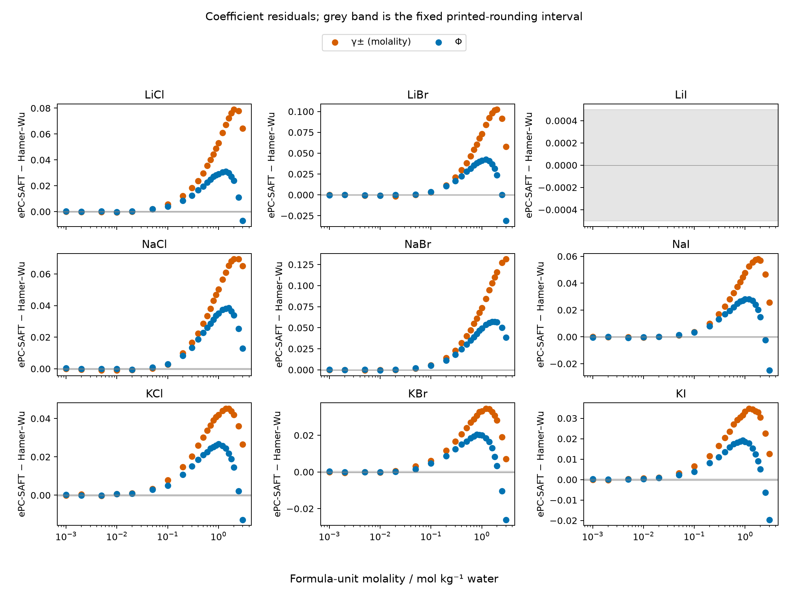

```{python}
import csv
import json
import yaml
from pathlib import Path

def read(name):
    with Path(name).open() as stream:
        return list(csv.DictReader(stream))

ledger = yaml.safe_load(Path('inputs/source/haslam-2020-table8-source-ledger.yaml').read_text())
points = read('results/data/haslam-2020-table8.csv')
summary = read('results/data/haslam-2020-table8-aad-comparison.csv')
nabr_gamma_aad = float(next(
    r['epcsaft_aad_percent'] for r in summary
    if r['salt'] == 'NaBr' and r['observable'] == 'gamma_pm_m'
))
printed = read('inputs/source/haslam-2020-table8.csv')
run = json.loads(Path('results/data/haslam-2020-table8.json').read_text())
valid = [r for r in points if r['status'] == 'evaluated']
references = {s: r for s, r in run['salts'].items() if not r['cause']}
names = {'osmotic_coefficient': 'Osmotic coefficient Φ', 'gamma_pm_m': 'Mean ionic coefficient γ±, molality scale'}
```

## Result and physical meaning

Current native ePC-SAFT returned `{python} str(len(valid))` coefficient values
across `{python} str(len(references))` salts, with both properties at each
supported molality. The retained accounting includes `{python} str(len(points))`
property records; `{python} str(len(points) - len(valid))` LiI records remain
unevaluated because the accepted Figiel packets lack a source-backed Li⁺/I⁻ pair.
These are **physical comparisons** with Hamer–Wu's evaluated reference values.
Haslam's printed deviations are a separate source series. His SAFT-γ Mie/mean
spherical approximation predictions are **not recomputed: model absent from the
Engine**. Exact Table 8 deviations remain undetermined because the model differs
and the exact source-row selections are unresolved.

All supported reference constructions satisfy the fixed native reference-limit
convergence diagnostic. The finite discrepancies are consistent in magnitude
with Figiel's own aqueous NaBr comparison: supporting Table S2 reports
`{python} str(ledger['sources']['figiel_2025']['aqueous_nabr_miac_aard_percent'])`%
average absolute relative deviation for its selected approach, compared with
`{python} f"{nabr_gamma_aad:.4f}"`% on this retained grid. The source statistic
uses an unspecified row selection and is not a matching-grid reproduction target.
The [current Figiel chloride calculation](../../2026-figiel-divalent-chlorides/results/current-main/figiel-1to1-comparison.csv),
the current retained calculation at 1 bar, independently returns the same
coefficients at its pressure. The diagnosed outcome is limited agreement with
Hamer–Wu under the adopted source parameterization; no molality-scale,
stoichiometry or reference declaration error was found. Aqueous Figure 5 extends
beyond this comparison's upper molality, so concentration extrapolation has not
been established as the cause. Allocation of the remaining differences among
model terms, parameter fitting and source selections remains undetermined. No
parameters were fitted here.

## Conditions, sources and parameter choice

The states use `{python} str(run['temperature_K'])` K and
`{python} str(run['pressure_Pa'])` Pa with fully dissociated monovalent ions and
water as the only solvent. The comparison spans
`{python} str(min(float(r['molality_mol_kg']) for r in points))`–`{python} str(max(float(r['molality_mol_kg']) for r in points))`
mol/kg water. Molality is formula units per kg water; both coefficients are
dimensionless. Mean ionic coefficients use the molality scale
and tend to unity at infinite dilution. The osmotic coefficient uses pure liquid
water at the same temperature and pressure as the solvent reference. Native
Engine calls own the reference construction, density closure and both property
transformations; Python declares inputs and reads results.

Haslam's `{python} ledger['sources']['haslam_2020']['condition']` owns the chosen pressure;
Table 8 itself does not state a separate pressure. The calculation is a declared
`{python} str(run['pressure_extrapolation_percent'])`% pressure extrapolation
from the packets' `{python} str(run['packet_pressure_Pa'])` Pa domain. No
pressure-error bound or negligible-pressure claim is made.

The accepted design selected `figiel-2025-reference-electrolytes/2` and
`figiel-2025-aqueous-iodides/2`. Round 1 stopped at parameter admission because
these superseded declarations lacked `ionic_dispersion`. By the owner's round-2
instruction, this run uses the current accepted versions
`figiel-2025-reference-electrolytes/4` and `figiel-2025-aqueous-iodides/3`.
Both supply the ionic-dispersion declaration; reference /4 also supplies the
Wolbach–Sandler cross-association size factor, with no other value changes from
/3. No packet was edited or refitted. Water/NaI and water/KI each use their
complete ternary selection from the iodide document. Neither current packet
contains a Li⁺/I⁻ pair, confirmed by inspecting its component and pair records.

Figiel, Yu and Held ([2025](https://doi.org/10.1021/acs.iecr.5c00475), Tables 1–5,
Eq. 11) own the adopted parameters and electrolyte declarations through these
canonical packets. Haslam et al. ([2020](https://doi.org/10.1021/acs.jced.0c00746),
Table 8, PDF page `{python} printed[0]['source_pdf_page']` / printed `{python} printed[0]['source_printed_page']`) own the printed deviations shown here;
their Tables 2–4 Mie parameters are retained as source records, never translated
into ePC-SAFT inputs. Hamer and Wu
([1972](https://doi.org/10.1063/1.3253108), Tables 9–11, 16–18 and 28–30;
osmotic definition `{python} ledger['sources']['hamer_wu_1972']['definition']`) own the reference values. Each retained
source row has its table, page and molality locator. The corrected NaBr page
locators and visually checked KBr value are retained in the source ledger.

Hamer–Wu is a critically evaluated, thermodynamically consistent composite,
including values calculated from fitted expressions. It does not provide
independent raw observations of both properties at every point. Figiel's
parameters may share data with this comparison. This is descriptive model
assessment, with no held-out-data or physical-validation claim.

## Coefficients and residuals




The pointwise rounding diagnostic uses absolute residual at most
`{python} str(run['printed_rounding_absolute_tolerance'])` for each coefficient,
half of the last printed unit in the Hamer–Wu values. This is not a requirement
that this different model agree at every point, and it is not a confidence
interval. Signed residuals, absolute residuals and relative absolute errors
remain in the [point table](results/data/haslam-2020-table8.csv).

The declared average absolute deviation is
$100n^{-1}\sum_i |(y_i^{\mathrm{ePC-SAFT}}-y_i^{\mathrm{Hamer-Wu}})/y_i^{\mathrm{Hamer-Wu}}|$.
Only complete grids receive this statistic. Haslam's pointwise percent formula
was not established in the inspected source, and its exact selected rows remain
unresolved. The two deviation columns below are descriptive, with no tolerance
on their difference. Matching counts alone do not establish equal membership;
several Haslam osmotic entries cite sources other than Hamer–Wu.

```{python}
#| output: asis
print('| Salt | Quantity | Evaluated / selected | Within rounding interval | Max absolute residual | ePC-SAFT deviation / % | Haslam printed deviation / % | Haslam printed points |')
print('|---|---|---:|---:|---:|---:|---:|---:|')
for r in summary:
    g = [p for p in valid if (p['salt'], p['observable']) == (r['salt'], r['observable'])]
    rounding = sum(p['printed_rounding_agreement'] == 'True' for p in g)
    maximum = f"{max(float(p['absolute_residual']) for p in g):.6f}" if g else 'unavailable'
    aad = f"{float(r['epcsaft_aad_percent']):.4f}" if r['epcsaft_aad_percent'] else 'unavailable: missing pair'
    print(f"| {r['salt']} | {names[r['observable']]} | {r['evaluated_points']} / {r['source_points']} | {rounding} | {maximum} | {aad} | {r['haslam_printed_aad_percent']} | {r['haslam_printed_points']} |")
```

## Native reference diagnostics and numerical limits

Reference-limit convergence must be at most
`{python} f"{run['reference_convergence_tolerance']:.0e}"`. Its maximum across
the supported salts is
`{python} f"{max(r['convergence_error'] for r in references.values()):.4e}"`.
This diagnostic measures a change in extrapolated natural-log fugacity limits;
it is numerical verification of reference convergence, not uncertainty in the
final coefficients. Terminal molalities are native reference-construction
diagnostics, outside the finite-molality comparison grid.

```{python}
#| output: asis
print('| Salt | Terminal molality / mol kg⁻¹ | Reference convergence diagnostic |')
print('|---|---:|---:|')
for salt, r in references.items():
    print(f"| {salt} | {r['terminal_molality_mol_kg']:.2e} | {r['convergence_error']:.6e} |")
```

The [retained run JSON](results/data/haslam-2020-table8.json) includes effective
native tolerances, activity solver settings, reference fugacities, component
order, packet hashes and resolved-model identities. The bound activity result
does not expose its per-point density residual or stopping reason. No second
density solve was added; no per-point convergence certificate or global
stability claim follows from these returned coefficients. A precise exposure
falsifier is water/NaCl at the retained temperature and pressure and unit
molality: the same activity result would need to expose solved density, achieved
reduced density residual, effective criterion and stopping reason. Those fields
are absent. This optional exposure gap does not block the bounded comparison.

## Haslam's printed averages

The printed averages remain source values. Their arithmetic is checked below
from the [Table 8 transcription](inputs/source/haslam-2020-table8.csv).

```{python}
#| output: asis
print('| Quantity | Printed average / % | Mean of all printed salt deviations / % | Mean of Na/K printed deviations / % |')
print('|---|---:|---:|---:|')
for prop, name in names.items():
    entries = [r for r in printed if r['observable'] == prop and r['salt'] != 'average']
    nk = [r for r in entries if r['salt'].startswith(('Na', 'K'))]
    average = next(r['reported_aad_percent'] for r in printed if r['observable'] == prop and r['salt'] == 'average')
    print(f"| {name} | {average} | {sum(float(r['reported_aad_percent']) for r in entries) / len(entries):.6f} | {sum(float(r['reported_aad_percent']) for r in nk) / len(nk):.6f} |")
```

The ionic average agrees after rounding with the mean of all printed saltwise
entries. The osmotic average does not. It agrees after rounding with the Na/K
mean, a possible explanation only: the located text establishes no exclusion
rule. Nothing here replaces or corrects the printed average.

## Provenance and scope of delivery

Calculation wall time was `{python} f"{run['run_wall_seconds']:.4f}"` s,
excluding environment setup, gates, rendering and file writing. Loaded Engine
provenance is `{python} str(run['engine_provenance'])`; its changed-tree marker
includes the leaf's packet-selection edit. The Engine source is unchanged from
the base. Historical values and figures remain under `results/historical/` and
establish no present capability or exact Haslam source membership.

This notebook reads retained CSV/JSON only and never imports the Engine.
The current producer completes the stated ePC-SAFT/Hamer–Wu physical comparison.
LiI, Haslam's model, exact Table 8 deviations and the osmotic-average aggregation
remain unreproduced or unresolved for the causes above. Delivered independent
scientific review and investigator promotion remain open.
