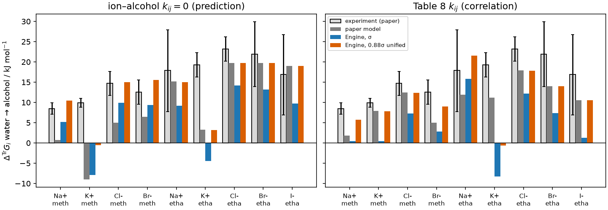

```{python}
import csv
import json
import math
import statistics
from pathlib import Path

results = Path("results")
def rows(path):
    with path.open(newline="") as stream:
        return list(csv.DictReader(stream))
def u(v, d):
    return f"{v:.{d}f}".replace("-", "−")
def s(v, d):
    return f"{v:+.{d}f}".replace("-", "−")
def e(v, d=1):
    m, x = f"{v:.{d}e}".split("e")
    return f"{m}×10" + str(int(x)).translate(str.maketrans("-0123456789", "⁻⁰¹²³⁴⁵⁶⁷⁸⁹"))

identity = json.loads((results / "run-identity.json").read_text())
R, T = 8.314462618, 298.15
RT = R * T / 1000
SIG, UNI = "sigma", "unified-0.88"
NAME = {SIG: "σ", UNI: "0.88σ unified", "hard-sphere-0.88": "0.88σ hard sphere only"}

# Fig. 8b, water sigma(T) correlation
f8_all = rows(results / "fig8b-transfer-gibbs.csv")
f8 = {(r["diameter"], r["kij_set"], r["solvent"], r["ion"]): r for r in f8_all if r["water_sigma"] == "correlation"}
keys = [(r["solvent"], r["ion"]) for r in f8_all if r["water_sigma"] == "correlation" and r["diameter"] == SIG and r["kij_set"] == "prediction"]
g = lambda d, kij, k, col: float(f8[(d, kij, *k)][col])
passes = lambda d, kij=None, solvent=None: sum(r["within_tolerance"] == "True" for (dd, kk, sol, _), r in f8.items()
                                              if dd == d and (kij is None or kk == kij) and (solvent is None or sol == solvent))
total = lambda kij=None, solvent=None: sum(1 for (dd, kk, sol, _) in f8 if dd == SIG and (kij is None or kk == kij) and (solvent is None or sol == solvent))
in_bar = lambda d, kij, col: sum(r[col] == "True" for (dd, kk, _, _), r in f8.items() if dd == d and kk == kij)
born_check = max(abs(float(r["born_engine_minus_analytic_kJ_mol"])) for r in f8_all)
# paper minus Engine, ethanol predictions
gap = {d: [g(d, "prediction", k, "paper_model_kJ_mol") - g(d, "prediction", k, "engine_kJ_mol") for k in keys if k[0] == "ethanol"] for d in (SIG, UNI)}
gap_nb = [g(SIG, "prediction", k, "paper_model_kJ_mol") - g(SIG, "prediction", k, "engine_no_born_kJ_mol") for k in keys if k[0] == "ethanol"]
best_constant_worst = (max(gap[SIG]) - min(gap[SIG])) / 2
units = rows(results / "fig8b-unit-candidates.csv")
convention_max = {}
for r in f8_all:
    if r["kij_set"] == "prediction":
        key = (r["diameter"], r["water_sigma"])
        convention_max[key] = max(convention_max.get(key, 0), abs(float(r["engine_minus_paper_kJ_mol"])))
slope = rows(results / "printed-slope-probe.csv")

# Fig. 4 / S1
f4 = rows(results / "fig4-solvent-activity.csv")
TOL = {"fig4-licl": 0.005, "fig4-libr": 0.010, "figS1-licl-ethanol": 0.010}
PANELS = {"fig4-licl": "LiCl–methanol", "fig4-libr": "LiBr–methanol", "figS1-licl-ethanol": "LiCl–ethanol (Fig. S1)"}
def f4sel(panel, model, kind, diameter=SIG, basis="formula", kij="prediction", column="gamma_species_basis"):
    return sorted((float(r["x_salt"]), float(r[column]), float(r["digitized_gamma"])) for r in f4
                  if r["panel"] == panel and r["model"] == model and r["kind"] == kind and r["basis"] == basis
                  and r["diameter"] == diameter and r["kij_set"] == kij)
def rms(points):
    return math.sqrt(sum((a - b) ** 2 for _, a, b in points) / len(points))
def worst(points):
    return max(abs(a - b) for _, a, b in points)
def held_to(points, tol):  # largest x up to which every point is within tolerance
    good = 0.0
    for x, a, b in points:
        if abs(a - b) > tol:
            break
        good = x
    return good
def aard(points):
    return 100 * statistics.mean(abs(a / b - 1) for _, a, b in points)
def basis_rms(diameter):
    combos = {}
    for panel in PANELS:
        for basis in ("formula", "species"):
            for column in ("gamma_species_basis", "gamma_formula_basis"):
                pts = sum((f4sel(panel, m, "paper-model", diameter, basis, column=column) for m in ("advanced", "revised-2014")), [])
                combos[(panel, basis, column)] = rms(pts)
    chosen = max(v for k, v in combos.items() if k[1] == "formula" and k[2] == "gamma_species_basis")
    others = min(v for k, v in combos.items() if not (k[1] == "formula" and k[2] == "gamma_species_basis"))
    return chosen, others
xmax = {panel: max(x for x, _, _ in f4sel(panel, "advanced", "paper-model")) for panel in PANELS}

# Fig. 7
f7 = {(r["diameter"], r["salt"], r["series"]): r for r in rows(results / "fig7-cross-solvent.csv")}
c7 = lambda d, salt, series, key: float(f7[(d, salt, series)][key])
ions = {"KCl": ("K+", "Cl-"), "KBr": ("K+", "Br-")}
def implied(d, salt):  # methanol - ethanol if the Fig. 8b bars replaced the Engine's infinite-dilution values
    shift = sum(-g(d, "prediction", ("methanol", i), "engine_minus_paper_kJ_mol") + g(d, "prediction", ("ethanol", i), "engine_minus_paper_kJ_mol")
                for i in ions[salt])
    return c7(d, salt, "advanced", "methanol_minus_ethanol") + shift / RT
bars7 = {(r["solvent"], r["salt"], r["series"]): r for r in rows(Path("inputs/digitized/fig7-solubility.csv"))}

# Fig. 9
f9 = rows(results / "fig9-cross-solvent.csv")
def f9sel(d, variant, series="advanced"):
    return [r for r in f9 if r["diameter"] == d and r["variant"] == variant and r["series"] == series]
def f9d(d, variant, series="advanced"):
    return [float(r["il_minus_alcohol"]) for r in f9sel(d, variant, series)]
def f9zero(d, variant, series="advanced"):
    return sum(r["interval_contains_zero"] == "True" for r in f9sel(d, variant, series))
def f9span(values, d=2):
    return f"{s(min(values), d)} to {s(max(values), d)}"
def f9between(d, a, b, series="advanced"):  # per pair, variant a minus variant b
    return [x - y for x, y in zip(f9d(d, a, series), f9d(d, b, series))]
half9 = [(float(r["interval_high"]) - float(r["interval_low"])) / 2 for r in f9sel(SIG, "R1")]
f9s = {(r["diameter"], r["variant"], r["solvent"], r["salt"], r["series"], float(r["offset_px"])): r
       for r in rows(results / "fig9-sum-log-x-phi.csv")}
self_pair = [float(r["sum_log_x_phi"]) - float(f9s[(k[0], "pair-rule-exclude-same-sign", *k[2:])]["sum_log_x_phi"])
             for k, r in f9s.items() if k[1] == "R1" and k[2] != "C4mim-TfO" and k[4] == "advanced" and k[5] == 0.0]
bars9 = {(r["salt"], r["series"]): r for r in rows(Path("inputs/digitized/fig9-solubility-ionic-liquid.csv"))}
pixel9 = 1.5 * float(bars9[("NaCl", "advanced")]["x_salt"]) / float(bars9[("NaCl", "advanced")]["height_px"])
pixel7 = 1.5 * float(bars7[("methanol", "NaCl", "advanced")]["x_salt"]) / float(bars7[("methanol", "NaCl", "advanced")]["height_px"])
VARIANT = {"R1": "R1 (declared formulation)", "a-il-ions-out-of-born": "(a) IL ions out of Born (10⁶σ)",
           "b-inorganic-il-like-charged-off": "(b) inorganic–IL like-charged dispersion off",
           "c-il-ion-diameter-0.88": "(c) IL-ion Debye–Hückel and Born diameter 0.88σ",
           "d-species-basis": "(d) species basis", "pair-rule-exclude-same-sign": "pair rule: exclude all same-sign pairs, both sides"}
```

## Outcome

The Engine evaluates ePC-SAFT advanced *without ion pairing* at the paper's
conditions (`{python} u(T, 2)` K, `{python} u(1, 0)` bar). The result turns on an
unresolved inorganic-ion diameter convention, so both variants are retained and
neither is adopted:

* **σ** — the convention Part II states: Section 2.4 sets the Born distance to σ,
  and Section 3.1 says the hard-sphere temperature dependence is neglected.
* **0.88σ unified** — Held 2014 Eq. 21 (cited in Section 3.1), d = 0.88σ, used for
  the hard-sphere packing, Debye–Hückel and Born diameters together. Dispersion keeps σ.

Only the second reproduces the paper's own model values:

* **Solvent activity coefficients (corrected Fig. 4, SI Fig. S1).** With 0.88σ
  unified, the advanced curves stay within tolerance over the full digitized
  ranges. The worst deviations are
  `{python} u(worst(f4sel("fig4-licl", "advanced", "paper-model", UNI)), 4)` (LiCl–methanol),
  `{python} u(worst(f4sel("fig4-libr", "advanced", "paper-model", UNI)), 4)` (LiBr–methanol) and
  `{python} u(worst(f4sel("figS1-licl-ethanol", "advanced", "paper-model", UNI)), 4)` (LiCl–ethanol).
  With σ they hold only to $x_\mathrm{salt}$ =
  `{python} u(held_to(f4sel("fig4-licl", "advanced", "paper-model"), TOL["fig4-licl"]), 3)`,
  `{python} u(held_to(f4sel("fig4-libr", "advanced", "paper-model"), TOL["fig4-libr"]), 3)` and
  `{python} u(held_to(f4sel("figS1-licl-ethanol", "advanced", "paper-model"), TOL["figS1-licl-ethanol"]), 3)`,
  with worst deviations of
  `{python} u(worst(f4sel("fig4-licl", "advanced", "paper-model")), 3)`,
  `{python} u(worst(f4sel("fig4-libr", "advanced", "paper-model")), 3)` and
  `{python} u(worst(f4sel("figS1-licl-ethanol", "advanced", "paper-model")), 3)`.
* **Gibbs energy of transfer (Fig. 8b).** `{python} passes(UNI)` of
  `{python} total()` model bars fall within ±`{python} u(0.5, 1)` kJ mol⁻¹ with 0.88σ
  unified, against `{python} passes(SIG)` with σ. All
  `{python} passes(UNI, "prediction", "ethanol")` ethanol predictions pass with
  0.88σ unified. Methanol still fails (`{python} passes(UNI, None, "methanol")` of
  `{python} total(None, "methanol")` bars pass): Na⁺ is
  `{python} u(g(UNI, "prediction", ("methanol", "Na+"), "engine_kJ_mol"), 2)` kJ mol⁻¹ against the paper's
  `{python} u(g(UNI, "prediction", ("methanol", "Na+"), "paper_model_kJ_mol"), 2)`. The cause of the
  methanol discrepancy is undetermined.
* **Salt solubility in alcohols (Fig. 7).** The Engine cannot solve the
  solid–liquid equilibrium. A single solubility product per salt requires
  $\sum_i\nu_i\ln x_i\varphi_i$ to be equal at the paper's predicted solubilities
  in methanol and ethanol. The native methanol−ethanol intervals include zero for
  KCl and KBr under both conventions.
* **Salt solubility in [C4mim][TfO] (Fig. 9).** The same consistency test
  across the alcohol (Fig. 7) and ionic-liquid (Fig. 9) predictions fails: the
  ionic-liquid side is higher by `{python} f9span(f9d(SIG, "R1"))` (σ) and
  `{python} f9span(f9d(UNI, "R1"))` (0.88σ unified) for all six pairs, against reading
  half-widths of `{python} u(min(half9), 2)` to `{python} u(max(half9), 2)`. The declared formulation does not
  reproduce the paired Fig. 7 and Fig. 9 model bars within the stated reading bounds.

The sibling reproductions point the same way, each as an inferred convention:
[2014-held](../2014-held/README.md) agrees substantially better with 0.88σ for
Debye–Hückel, and [2020-bulow](../2020-bulow/README.md) uses 0.88σ for Born and
Debye–Hückel to reach its printed Born values. The record therefore states a
discrepancy between the convention Part II states (σ) and the one that
reproduces its values (0.88σ unified).

Ion pairing (Bjerrum) and the solubility values themselves need Engine
capabilities that do not exist; see
[Capability gaps](#capability-gaps). Evidence type: numerical verification against
digitized model values, plus physical comparison with the experimental values
the paper plots. No parameter was fitted.

## Basis and conventions

Parameters are the paper's Tables 1, 3, 4, 5 and 8
([components](inputs/parameters/components.csv), [pairs](inputs/parameters/pairs.csv)),
mapped onto Engine terms as follows:

* **Model.** "Advanced" = hard chain + dispersion + association (2B, water and
  alcohols) + Debye–Hückel + plain Born term (`born`, shell and dielectric-ring
  coefficients zero). Relative permittivity is linear in species mole fraction
  (`component-permittivity-mixing`), with salt ions at 8.
  "Revised 2014" = the same without Born, with salt-free solvent permittivity
  (`solvent-only`). Dispersion between like-charged inorganic ions is excluded
  (Held 2014); the ionic-liquid states use a different pair rule, stated in the
  Fig. 9 section.
* **Diameters.** Two conventions are evaluated throughout (see Outcome). The
  earlier probe that applied 0.88σ to the hard-sphere packing only is kept in
  the retained tables; it does not reproduce either figure. Water σ follows
  the Fuchs 2006 correlation whose constant is Table 1's value.
* **Temperature forms (inferred correction).** Table 5 permittivities are
  declared as constants at `{python} u(T, 2)` K. The Table 3 Na⁺– and K⁺–water $k_{ij}$
  slopes are printed ten times smaller than Held 2014's, and the corrigendum
  does not touch Table 3. The evaluated values combine Held 2014's slopes
  (`{python} u(-0.007981, 6)` and `{python} u(-0.004012, 6)` K⁻¹) with Part II's intercepts; this is
  an inferred correction, not a stated one. The printed slopes, read literally, give $k_{ij}$ of
  `{python} " and ".join(u(float(r['k_ij_printed']), 2) for r in slope[::2])` (Na⁺, K⁺) and shift the transfer energies by
  `{python} " and ".join(u(float(r['printed_minus_evaluated_kJ_mol']), 0) for r in slope[::2])` kJ mol⁻¹
  ([probe](results/printed-slope-probe.csv)).
* **Ion–alcohol $k_{ij}$.** Zero for predictions (Section 2.2); Table 8 for
  "correlations". Solvent–solvent $k_{ij}$ are declared zero and are inert, since
  every evaluated state contains a single solvent.
* **Composition axis (selected post hoc).** The salt axis of Figs. 4 and 7 is
  taken as $x_\mathrm{salt}=n_\mathrm{salt}/(n_\mathrm{salt}+n_\mathrm{solvent})$, with ions as
  separate species in the Engine, and $\gamma_\mathrm{solvent}$ refers to the
  solvent's species mole fraction. This pairing was selected post hoc using the
  same Fig. 4 curves subsequently assessed. With σ its RMS deviation is at most
  `{python} u(basis_rms(SIG)[0], 3)` per panel against at least `{python} u(basis_rms(SIG)[1], 3)` for the
  other three pairings. With 0.88σ unified the values are `{python} u(basis_rms(UNI)[0], 4)` and
  `{python} u(basis_rms(UNI)[1], 3)`.
* **Native quantities.** Transfer energies are the Engine's
  `TransferGibbsEnergy` observation, Eq. (26),
  $\Delta^\mathrm{Tr}G_i=RT\ln(\varphi_i^{\infty,S}/\varphi_i^{\infty,\mathrm{water}})$, on the
  mole-fraction basis. Ion values are independent of the counter-ion to
  `{python} e(identity["counter_ion_invariance_max_abs_kJ_mol"])` kJ mol⁻¹. Solvent activity
  coefficients come from the native osmotic coefficient of `electrolyte_activity`,
  $\ln a_\mathrm{solvent}=-\nu m M\phi$. They agree with the fugacity-coefficient ratio
  to `{python} e(identity["solvent_activity_osmotic_minus_fugacity_ratio_max_abs"])` in $\ln a$.
  $\sum_i\nu_i\ln x_i\varphi_i$ has no native observable. It is evaluated by
  [`scripts/bulow2021_states.cpp`](scripts/bulow2021_states.cpp), a driver linked to the
  Engine library and built by `tools/native-driver` from `run.py`.

**Tolerances (fixed before the first run).** They are set by digitization of the
paper's figures (QA overlays in `inputs/digitized/qa/`): ±`{python} u(0.5, 1)` kJ mol⁻¹
per Fig. 8b bar; $|\Delta\gamma|$ ≤ `{python} u(TOL["fig4-licl"], 3)` (LiCl–methanol) and
`{python} u(TOL["fig4-libr"], 3)` (LiBr–methanol, LiCl–ethanol) per Fig. 4 point. For Fig. 7 the
Engine evaluates each bar at its reading ±`{python} u(1.5, 1)` px. The methanol−ethanol
interval runs from (methanol low − ethanol high) to (methanol high − ethanol low).
The paper reports no numerical deviation metric. Experiment comparisons
therefore use average absolute relative deviation (AARD) for $\gamma_\mathrm{solvent}$
and the paper's error bars for $\Delta^\mathrm{Tr}G$.

## Solvent activity coefficients (Fig. 4, corrigendum; Fig. S1)


```{python}
#| output: asis
print("| System | Model | Diameters | RMS Engine − paper | max abs | Within tolerance to x_salt | AARD vs experiment, % |")
print("|---|---|---|---:|---:|---:|---:|")
for panel, label in PANELS.items():
    for model in ("advanced", "revised-2014"):
        for d in (SIG, UNI):
            pts = f4sel(panel, model, "paper-model", d)
            exp = f4sel(panel, model, "experiment", d)
            print(f"| {label} | {model} | {NAME[d]} | {u(rms(pts), 4)} | {u(worst(pts), 4)} | {u(held_to(pts, TOL[panel]), 3)} | {u(aard(exp), 1)} |")
```

The paper's curves end at $x_\mathrm{salt}$ = `{python} u(xmax["fig4-licl"], 3)`,
`{python} u(xmax["fig4-libr"], 3)` and `{python} u(xmax["figS1-licl-ethanol"], 3)`. With 0.88σ unified the
advanced model stays within tolerance to the end of each curve. With σ the
Engine drifts above the paper's curves as salt increases. The drift is smooth
and monotonic, so it is a model difference, not digitization scatter. The
revised-2014 curves also follow the paper with 0.88σ unified, except at the
high-salt end of LiCl–ethanol. Applying 0.88σ to the hard-sphere packing alone,
or using the Table 8 ion–methanol $k_{ij}$ with σ, does not remove the drift; both
probes are in the [retained table](results/fig4-solvent-activity.csv).

Physically, ePC-SAFT advanced follows the experimental decrease of
$\gamma_\mathrm{solvent}$ far better than revised 2014 under either convention
(AARD column). The remaining under-prediction at high LiBr content belongs to
the model without ion pairing. The paper's orange Bjerrum curves address it,
and the Engine cannot evaluate them.

## Salt solubility in alcohols (Fig. 7)

```{python}
#| output: asis
print("| Salt | Bars | Diameters | x methanol | x ethanol | ΔΣν ln xφ (MeOH − EtOH) | reading interval | contains 0 |")
print("|---|---|---|---:|---:|---:|---|---|")
for (d, salt, series), r in f7.items():
    print(f"| {salt} | {'paper model' if series == 'advanced' else 'experiment'} | {NAME[d]} | {u(float(r['x_methanol']), 5)} | {u(float(r['x_ethanol']), 5)} | "
          f"{s(float(r['methanol_minus_ethanol']), 3)} | [{s(float(r['interval_low']), 3)}, {s(float(r['interval_high']), 3)}] | {r['interval_contains_zero']} |")
```

At the paper's predicted (green) solubilities, the native
$\sum_i\nu_i\ln x_i\varphi_i$ of KCl and KBr agrees between methanol and ethanol
within the bar-reading interval under both diameter conventions. This needs no
water solubility data, because the pure-ion reference state and $K_{SP}$ cancel.
It is a weak check: the intervals are wide enough to admit both conventions. The
NaCl and NaBr ethanol predictions are thinner than the bar outline (below
`{python} u(float(bars7[("ethanol", "NaCl", "advanced")]["x_salt_upper_bound"]), 5)`) and cannot be read.

The experimental NaBr pair is a physical test of the same relation. A single
$K_{SP}$ requires the difference to vanish; the Engine's interval excludes zero
under both conventions (σ
[`{python} s(c7(SIG, "NaBr", "experiment", "interval_low"), 3)`, `{python} s(c7(SIG, "NaBr", "experiment", "interval_high"), 3)`],
0.88σ unified
[`{python} s(c7(UNI, "NaBr", "experiment", "interval_low"), 3)`, `{python} s(c7(UNI, "NaBr", "experiment", "interval_high"), 3)`]).
This is a model–experiment discrepancy in the methanol→ethanol transfer of NaBr,
consistent with the paper's statement that the model under-predicts NaBr.

## Salt solubility in [C4mim][TfO] (Fig. 9)

**Question and claim scope.** Fig. 9 plots salt solubility $x_\mathrm{salt}$ in pure
[C4mim][TfO] at `{python} u(T, 2)` K and 1 bar, from one solubility product per salt fitted
in water (Eqs. 27–30). Because the same $K_{SP}$ and the same pure-ion reference
$\varphi_{0i}(T,p)$ (Eq. 5) serve every solvent, Eqs. 5 and 28 require

$$D_p=\sum_i\nu_i\ln x_i\varphi_i\Big|_\text{IL, Fig. 9 green}-\sum_i\nu_i\ln x_i\varphi_i\Big|_\text{alcohol, Fig. 7 green}=0 .$$

This is a **necessary cross-solvent consistency test** (R1). Passing would not
establish absolute reproduction of Fig. 9: the water anchors and the
solid–liquid solve stay deferred (owner choice C). Failing shows that the paired
bars are incompatible with the declared formulation; it cannot say which figure
is responsible. NaBr is a hydrate-forming salt whose $K_{SP}$ the paper
extrapolates from anhydrate temperatures with van 't Hoff (Eq. 30, Table 6
"treated"); the test assumes that one extrapolated $K_{SP}$ serves both solvents.
The six pairs are the salts with a readable green bar in both figures: NaCl,
NaBr, KCl and KBr against methanol, and KCl and KBr against ethanol.

**Fluoride.** The paper gives F⁻ parameters (Table 3) and Na⁺–F⁻ and K⁺–F⁻ $k_{ij}$
(Table 4); they are not in this record's parameter tables. NaF and KF are still
not testable here: Fig. 7 has no fluoride bars, so neither salt has an alcohol
partner, and both NaF bars in Fig. 9 are below the readability limit. NaI also
has no alcohol bar, and KI is not plotted in Fig. 9.

**Declared formulation.**

* **Ionic-liquid ions.** Table 2: [C4mim]⁺ and [TfO]⁻ with constant σ, packing
  diameter $\sigma(1-0.12e^{-3u/kT})$ declared at `{python} u(T, 2)` K, Debye–Hückel and Born
  diameters σ, relative permittivity 13.2 (Table 5). Both inorganic-ion diameter
  conventions (σ and 0.88σ unified) apply to the inorganic ions only (owner
  choice D). All ion–ionic-liquid-ion and [C4mim]⁺–[TfO]⁻ $k_{ij}$ are zero (Section 2.2).
* **Composition basis.** Formula basis, $x_\mathrm{salt}=n_\mathrm{salt}/(n_\mathrm{salt}+n_\mathrm{IL})$,
  so each salt ion has $s/2$ and $\varepsilon=13.2(1-s)+8s$. The permittivity rule is
  not basis independent: on the species basis each salt ion has $s$ and
  $\varepsilon=13.2(1-2s)+16s$. Variant (d) uses the species expression. Its shift from
  R1 is `{python} f9span(f9between(SIG, "d-species-basis", "R1"), 3)` (σ), not exactly
  $2\ln2$ = `{python} u(2 * math.log(2), 3)`, because φ changes too.
* **Dispersion pair rule (approximation).** Owner choice A includes like-charged
  inorganic–ionic-liquid pairs (Na⁺–[C4mim]⁺, Cl⁻–[TfO]⁻) and the ionic-liquid self
  pairs (Ji & Held 2016), and excludes the inorganic like-charged pairs (Held 2014),
  including the inorganic self pairs Na⁺–Na⁺ and Cl⁻–Cl⁻. **The Engine cannot express
  this combination**: `exclude-same-sign-ion-pairs` also removes the
  ionic-liquid self pairs and the inorganic–ionic-liquid like-charged pairs, and a
  $k_{ij}$ cannot address a self pair (the Engine refuses `pair/sodium-cation/sodium-cation`).
  R1 therefore uses the nearest expressible declaration, `all-ion-pairs`, **on both
  solvent sides**; it adds the inorganic self pairs. One parameter document serves
  both sides of every variant. Its alcohol-side effect is computed below; its
  ionic-liquid-side effect is not.

**Reading intervals.** Each bar is evaluated natively at its bar-end reading and
at ±0.75 and ±1.5 px; ±1.5 px is ±`{python} e(pixel9, 2)` in $x_\mathrm{salt}$ for Fig. 9 and
±`{python} e(pixel7, 2)` for Fig. 7. $\sum_i\nu_i\ln x_i\varphi_i$ rises strictly across all five points
for every bar, side and variant (asserted in `run.py`), so the interval runs from
(IL low − alcohol high) to (IL high − alcohol low). The factor $e^{-D_p/2}$ is a
first-order estimate, neglecting the composition dependence of φ, of the ratio
by which the Fig. 9 green bar would have to change for the pair to be consistent.

```{python}
#| output: asis
print("| Diameters | Salt | Alcohol | x IL (Fig. 9) | x alcohol (Fig. 7) | D_p | reading interval | contains 0 | e^(−D_p/2) |")
print("|---|---|---|---:|---:|---:|---|---|---:|")
for d in (SIG, UNI):
    for r in f9sel(d, "R1"):
        print(f"| {NAME[d]} | {r['salt']} | {r['alcohol']} | {u(float(r['x_ionic_liquid']), 6)} | {u(float(r['x_alcohol']), 5)} | "
              f"{s(float(r['il_minus_alcohol']), 3)} | [{s(float(r['interval_low']), 3)}, {s(float(r['interval_high']), 3)}] | "
              f"{r['interval_contains_zero']} | {u(float(r['first_order_solubility_factor']), 4)} |")
```

**R1 fails under both diameter conventions:** no interval contains zero
(`{python} f9zero(SIG, "R1")` of 6 with σ, `{python} f9zero(UNI, "R1")` of 6 with 0.88σ unified). To first
order, consistency with the paper's alcohol bars would need ionic-liquid
solubilities about `{python} u(1 / max(float(r["first_order_solubility_factor"]) for r in f9sel(SIG, "R1")), 0)` to
`{python} u(1 / min(float(r["first_order_solubility_factor"]) for r in f9sel(SIG, "R1")), 0)` times smaller than the Fig. 9 green bars (σ).

**Diagnostic set R2, closed before the run.** A variant would close only if all six
intervals contained zero, and a closing variant would be a candidate convention,
not an adopted one.

```{python}
#| output: asis
print("| Variant | Diameters | D_p over the six pairs | intervals containing 0 |")
print("|---|---|---|---:|")
for v in VARIANT:
    for d in (SIG, UNI):
        print(f"| {VARIANT[v]} | {NAME[d]} | {f9span(f9d(d, v))} | {f9zero(d, v)} of 6 |")
```

No variant closes. Removing the ionic-liquid ions from the Born sum (a) removes
`{python} f9span(f9between(SIG, "R1", "a-il-ions-out-of-born"))` (σ) of the gap. In R1, adding salt lowers ε from 13.2
toward 8, and that destabilizes the Born solvation of every ionic-liquid ion; the
ε-derivative term of Eq. (24) passes this to each salt ion. A residual of
`{python} f9span(f9d(SIG, "a-il-ions-out-of-born"))` (σ) and `{python} f9span(f9d(UNI, "a-il-ions-out-of-born"))` (0.88σ unified)
remains, with no interval containing zero. Its cause is undetermined. The other
variants widen the gap. Printed Eq. (25) omits the $\sum_jx_jz_j^2/a_j$ factor in its
ε-derivative term and is dimensionally incomplete, so it cannot settle whether
the paper's Born sum includes the ionic-liquid ions.

**Effect of the pair-rule approximation.** With `exclude-same-sign-ion-pairs` on
both sides, $D_p$ is `{python} f9span(f9d(SIG, "pair-rule-exclude-same-sign"))` (σ) and
`{python} f9span(f9d(UNI, "pair-rule-exclude-same-sign"))` (0.88σ unified); that rule also removes the ionic-liquid
self and inorganic–ionic-liquid like-charged pairs. It is a sensitivity
comparison, not a bound on choice A. The approximation itself is the inorganic
self pairs. On the alcohol side, where they are the only difference between the
two rules, they change $\sum_i\nu_i\ln x_i\varphi_i$ by `{python} f9span(self_pair, 3)` at the green bars. The same
pairs on the ionic-liquid side cannot be removed in the Engine, so their effect
there, and the resulting correction to $D_p$, are not quantified. Both computed
pair rules fail R1; the selective rule of choice A was not evaluated. The inputs
are the paper's inputs except for this pair rule; they are not literal.

**Identities.**

* **I1 (isolated Born contribution).** Born is density independent, so at fixed
  T, p and x the change of each salt ion's ln φ between R1 and (a) must equal
  $-L_0\,(\varepsilon_i-\varepsilon)/\varepsilon^2\sum_{j\in\mathrm{IL}}x_jz_j^2(1/a_j-1/a_j')$, with
  $L_0=e^2/(4\pi\varepsilon_0k_BT)$ (not the paper's Eq. 10 Bjerrum length), $\varepsilon_i=8$, $a_j=\sigma_j$ and
  $a_j'=10^6\sigma_j$, a finite approximation of removal kept exactly in the identity. Over both
  salt ions, every R1 ionic-liquid state (the four salts' Fig. 9 bars, both series, five readings) and
  both diameter conventions, the largest difference is
  `{python} e(identity["fig9_born_identity_max_abs"])` (tolerance `{python} e(identity["fig9_born_identity_tolerance_abs"], 0)`), with molar densities equal to
  `{python} u(identity["fig9_born_identity_density_max_relative"], 1)` relative ([retained](results/fig9-born-identity.csv)).
* **I2 (permittivity mapping and pressure closure).** The Engine's bulk ε equals
  $\sum_ix_i\varepsilon_i$ to `{python} e(identity["fig9_permittivity_mapping_max_relative"])` relative at every evaluated state
  (tolerance `{python} e(identity["fig9_permittivity_tolerance_relative"], 0)`), and every liquid state closes on 1 bar to
  `{python} e(identity["fig9_pressure_residual_max_relative"])` relative with a positive pressure–density slope (the driver
  refuses otherwise).
* **I3 (pure ionic-liquid density), dropped.** None of the [C4mim][TfO] density
  sources Ji & Held 2016 Table 1 lists (its refs. 32, 46 and 52–59) is in the Zotero
  library. The readiness review rejected the Fig. 1 fallback, which it found shows
  [C8mim][TfO] and pyridinium salts. Per owner choice B, I3 is not run.

**P1: experimental bars (model versus experiment).** The same $D$ at the
experimental (gray) bars of both figures tests the model's predicted alcohol →
ionic-liquid transfer against data, assuming the same anhydrous solid in both
solvents. It compares one model quantity with experiment; it is not a
validation of the full model.

```{python}
#| output: asis
print("| Diameters | Salt | Alcohol | x IL (exp.) | x alcohol (exp.) | D | reading interval | contains 0 |")
print("|---|---|---|---:|---:|---:|---|---|")
for d in (SIG, UNI):
    for r in f9sel(d, "R1", "experiment"):
        print(f"| {NAME[d]} | {r['salt']} | {r['alcohol']} | {u(float(r['x_ionic_liquid']), 6)} | {u(float(r['x_alcohol']), 5)} | "
              f"{s(float(r['il_minus_alcohol']), 3)} | [{s(float(r['interval_low']), 3)}, {s(float(r['interval_high']), 3)}] | {r['interval_contains_zero']} |")
```

Under R1 the model's experimental-bar differences are `{python} f9span(f9d(SIG, "R1", "experiment"))` (σ)
and `{python} f9span(f9d(UNI, "R1", "experiment"))` (0.88σ unified): the model makes the ionic liquid a
much poorer solvent for these salts, relative to the alcohols, than the data
show. The paper calls its own Fig. 9 agreement qualitative (Section 3.6).

**Disposition.** The declared formulation does not reproduce the paired Fig. 7
and Fig. 9 model bars within the stated reading bounds. I1 verifies the isolated
Born contribution; I2 verifies the permittivity mapping and pressure closure;
the remaining discrepancy and other possible implementation or source-convention
differences remain unresolved. Evidence type: numerical consistency test against
digitized model values (R1, R2), numerical verification (I1, I2) and a
model–experiment comparison (P1).

## Gibbs energy of transfer (Fig. 8b)



```{python}
#| output: asis
print("| Solvent | Ion | k_ij | Engine σ | Engine 0.88σ unified | paper | experiment [lower, upper] |")
print("|---|---|---|---:|---:|---:|---|")
for kij in ("prediction", "correlation"):
    for k in keys:
        print(f"| {k[0]} | {k[1]} | {'0' if kij == 'prediction' else 'Table 8'} | {u(g(SIG, kij, k, 'engine_kJ_mol'), 3)} | "
              f"{u(g(UNI, kij, k, 'engine_kJ_mol'), 3)} | {u(g(SIG, kij, k, 'paper_model_kJ_mol'), 2)} | "
              f"{u(g(SIG, kij, k, 'experiment_kJ_mol'), 1)} [{u(g(SIG, kij, k, 'experiment_lower_kJ_mol'), 1)}, {u(g(SIG, kij, k, 'experiment_upper_kJ_mol'), 1)}] |")
```

Values are in kJ mol⁻¹. Diagnostics of the remaining mismatch:

1. **Born term.** Removing Born from the Engine and subtracting gives the Born
   part. It equals Eq. (24), with the Born diameter of each convention, to
   `{python} e(born_check)` kJ mol⁻¹ for every ion and solvent. This verifies only
   the Born term, and only at infinite dilution.
2. **Not a common offset.** With σ, the paper's ethanol predictions exceed the
   Engine's by `{python} u(min(gap[SIG]), 2)` to `{python} u(max(gap[SIG]), 2)` kJ mol⁻¹ across the five ions.
   The best single constant still leaves `{python} u(best_constant_worst, 2)` kJ mol⁻¹. Against the Engine
   *without* Born, the difference is nearer constant
   (`{python} u(min(gap_nb), 1)` to `{python} u(max(gap_nb), 1)`), but that comparison drops a term the
   paper's model contains. With 0.88σ unified the ethanol differences are
   `{python} u(min(gap[UNI]), 2)` to `{python} u(max(gap[UNI]), 2)`.
3. **Unit and standard-state candidates.** None explains the σ discrepancy
   (water→ethanol, kJ mol⁻¹):
   `{python} "; ".join(f"{r['candidate']} {s(float(r['value_kJ_mol']), 2)}" for r in units if r['solvent'] == 'ethanol')`
   ([retained](results/fig8b-unit-candidates.csv)).
   The densities are the Engine's pure-liquid values.
4. **Conditional Fig. 7 diagnostic.** Suppose the paper's Fig. 8b bars replaced
   the Engine's infinite-dilution values in the Fig. 7 states. The
   methanol−ethanol differences would then become `{python} s(implied(SIG, "KCl"), 2)` (KCl) and
   `{python} s(implied(SIG, "KBr"), 2)` (KBr) with σ, and `{python} s(implied(UNI, "KCl"), 2)` and
   `{python} s(implied(UNI, "KBr"), 2)` with 0.88σ unified, far outside the reading intervals.
   This rests on one assumption: the finite-concentration corrections
   ($\ln\gamma_i$ at the Fig. 7 compositions relative to infinite dilution) stay
   unchanged when the infinite-dilution values change. Under 0.88σ unified the
   shift comes almost entirely from the methanol bars. The diagnostic does not establish
   which of the paper's values carry the inconsistency.
5. **Other conventions.** Water σ constant or temperature-dependent, and 0.88σ
   applied to the hard sphere only, pass `{python} sum(r["within_tolerance"] == "True" for r in f8_all if r["diameter"] != UNI)` of
   `{python} sum(1 for r in f8_all if r["diameter"] != UNI)` bars, with largest prediction deviations of
   `{python} u(min(v for k, v in convention_max.items() if k[0] != UNI), 1)` to `{python} u(max(v for k, v in convention_max.items() if k[0] != UNI), 1)` kJ mol⁻¹.

The remaining cause, now mainly in methanol, is undetermined.

Physically, the experimental error bars are re-read from both caps (Na⁺ and I⁻ in
ethanol reach `{python} u(g(SIG, "prediction", ("ethanol", "Na+"), "experiment_upper_kJ_mol"), 1)` and
`{python} u(g(SIG, "prediction", ("ethanol", "I-"), "experiment_upper_kJ_mol"), 1)` kJ mol⁻¹) and are asymmetric. Of the
`{python} len(keys)` predictions, `{python} in_bar(SIG, "prediction", "engine_within_experimental_bar")` (σ) and
`{python} in_bar(UNI, "prediction", "engine_within_experimental_bar")` (0.88σ unified) Engine values lie within them;
the paper's bars: `{python} in_bar(SIG, "prediction", "paper_within_experimental_bar")`. With Table 8 $k_{ij}$:
`{python} in_bar(SIG, "correlation", "engine_within_experimental_bar")`, `{python} in_bar(UNI, "correlation", "engine_within_experimental_bar")`
and `{python} in_bar(SIG, "correlation", "paper_within_experimental_bar")`. The paper does not state the experimental scale (mole
fraction, molarity or molality) behind the plotted values. That limits the
physical comparison by up to the density and molar-mass terms in item 3.

## Capability gaps

* **Bjerrum ion pairing (Eqs. 9–23).** No Engine term evaluates a dissociation
  degree α from $K_{ip}$ (Eq. 11), applies Debye–Hückel to free ions only, or
  replaces the closest-approach distance by the Bjerrum length (Eq. 16). This
  blocks Fig. 3 (α, SI Table S1), the orange curves of Fig. 4 and S1, the orange
  bars of Fig. 7 and all of Fig. 8a. Needed: a native ion-pair association term
  with its own α solve and exact derivatives. The Engine's association framework
  (sites with energies and volumes) is the closest existing structure, but the
  Bjerrum constant depends on ε(x) and density.
* **Solid–liquid equilibrium.** No native solve finds $x$ such that
  $\sum_i\nu_i\ln x_i\gamma_i=\ln K_{SP}$ (Eqs. 28–29), and no solid phase
  exists in the equilibrium driver. A van 't Hoff fit of $\ln K_{SP}$ (Eq. 30,
  Figs. 5–6) is a parameter regression with no native route. This blocks the
  solubility values of Figs. 6, 7, 8a, 9 and 10; the Fig. 9 test above uses
  only the cross-solvent relation. Water solubilities, the input
  for $K_{SP}$, are in the paper's references [49–53], which are not retained.
  Needed: a native one-dimensional solubility solve on salt amount at fixed T
  and p, with $K_{SP}$ as an input or as a native parameter fit.
* **Ionic-liquid solvent.** All-ion `ComponentMixing` sets ([C4mim][TfO] + salt)
  are admitted since #409; the Fig. 9 section evaluates them. Two limits remain:
  the ionic-liquid ion hard-sphere diameter is declared as a constant, exact only
  isothermally, and the paper's dispersion pair rule (inorganic like-charged
  pairs excluded, ionic-liquid pairs included) has no Engine declaration
  (`all-ion-pairs` is used, see the Fig. 9 section). Fig. 10 ($k_{ij}$ between Na⁺ and
  [TfO]⁻ of 0.17) is not evaluated.
* **Pure-ion reference.** Absolute $\ln K_{SP}$ values (Fig. 5) use the
  hypothetical pure-ion state of Eq. (5). The solubility consistency test above
  does not need it, because it cancels.

## Limits and provenance

Paper values come from digitized figures; uncertainties are the stated pixel
readings. Only `{python} u(T, 2)` K is evaluated. Experimental values are the paper's
plotted ones, not the primary sources. The diameter convention is unresolved:
the record shows which convention reproduces the paper, not which one the
authors used.

Engine commit `{python} identity["engine_commit"]` (engine tree clean:
`{python} identity["engine_tree_clean"]`). The native run
took `{python} u(identity["wall_seconds"], 1)` s of wall time. This notebook has not been
independently reviewed or promoted.
