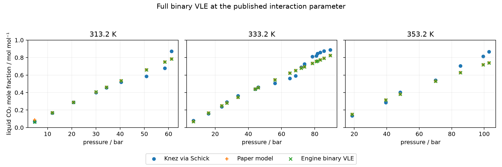

## Question and evidence

Does full binary vapor–liquid equilibrium at the published parameter tuple reproduce Schick's Table S10 liquid CO₂ mole fractions?
The retained comparison below answers this at every printed temperature and pressure.
Comparison with the paper model is numerical verification; comparison with the experimental column is physical comparison.
The published interaction parameter was fitted to literature measurements, so this is not independent predictive validation.
The delivered-review corrections are applied here; the notebook has not been promoted for manuscript use.

Schick et al., *Fluid Phase Equilibria* **567** (2023), [article and DOI](https://doi.org/10.1016/j.fluid.2022.113714), supply pure coefficients in main Table 1 (PDF p. 4), the constant binary parameter in Table 6 (p. 6) and SI S3 (p. 3), and the target rows in SI S10 (p. 11).
The experimental column is Schick's transcription of Knez et al., [DOI](https://doi.org/10.1016/j.supflu.2007.07.020).
The original experimental article and measurement uncertainties were not inspected.
[Source locators and hashes](inputs/source/source-locator.md) and the [packet materialization](inputs/source/materialization.json) identify the consumed inputs.

## Model and numerical method

The dry neutral binary uses hard-chain and dispersion contributions and the Lorentz diameter and Berthelot energy combining rules from main section 2.4.1.
There are no charges, association edges, dipole or quadrupole terms.
CO₂'s published induced-association volume is inactive without an associating partner.
The constant unlike energy parameter is $k_{ij}=0.04$.
Main Table 6 prints a fit range of 313–353 K; Table S10 retains the actual evaluation temperatures shown below.
The unit-bearing packet retains the exact published coefficients; inherited molar masses are auxiliary inputs and do not enter the molar comparisons.

Both components appear in both phases, satisfying the source's iso-fugacity condition:

$$x_i^L\phi_i^L P=y_i^V\phi_i^V P.$$

Every row declares a one-mol inventory with $z_{\mathrm{CO_2}}=(x_{\mathrm{paper}}+1)/2$.
The paper composition seeds the liquid and a CO₂-rich guess seeds the vapor; neither composition is constrained to its initial guess.
The native Engine owns all equilibrium, density, bubble-point and exact sensitivity calculations.
Returned positive phase amounts, distinct densities and compositions, full defining-Jacobian rank, material balance, pressure closure, positive fixed-composition pressure-density slopes and both fugacity equalities are retained in [native diagnostics](results/data/native-diagnostics.json).
Declared phases and local curvature do not establish global stability.
Pressure converts exactly by $1\ \mathrm{bar}=10^5\ \mathrm{Pa}$.

Tolerances were fixed before execution and appear in the generated table below.
Every regular solution has a native refinement seeded from that result.
Numerical qualification requires closure at both settings and a same-branch composition change within the frozen limit; that change is an error estimate, not a bound.
Independent state reevaluation also uses the respective row tolerance for relative pressure, log-fugacity difference, normalization and molar inventory error.
Row 1's initial refinement passes the native classified residual but fails independent direct-state pressure and fugacity closure.
Its initial regular and failed refinement results remain in the diagnostics and the correction table below.
A bounded native correction requests a tighter row tolerance, followed by a new regular solve and the prescribed refinement seeded from that new regular result.
The correction is inspected against the unchanged refinement closure criteria before it is consumed; the correction table separates its native request from its closure tolerance.
The corrected regular/refined pair passes those criteria and the frozen composition-change limit, with full rank and no topology event.
All rows are now numerically qualified; this changes solution verification, while row 1's paper discrepancy remains.

The paper comparison uses the model-column half-unit plus the retained per-row refinement estimate.
The experimental precision check uses the experimental-column half-unit only; it is not a statistical rejection test.
SI Eq. (3) defines $\mathrm{AARD}=100N^{-1}\sum_i|1-x_{\mathrm{model},i}/x_{\mathrm{exp},i}|$.
Printed row deviations are checked by propagating both composition rounding intervals through this expression and requiring overlap with the printed deviation interval.
Every aggregate below names its row denominator.

## Interpretation and limits

Most calculated liquid compositions fail literal reproduction at the printed inputs.
Each failed paper comparison has a forward bubble calculation at the paper composition; its pressure discrepancy and closure remain in the row record.
A closed bubble point with a discrepant pressure establishes model/source disagreement at those inputs, without identifying its underlying cause.
The lowest-pressure row has the largest discrepancy.
The signs table below reads the retained comparison CSV: the 29 paper mismatches have mixed signs, 16 positive and 13 negative for Engine minus paper.
The small discrepancies elsewhere can be compared with exact first-order temperature and pressure rounding actions below; these are diagnostic estimates, not finite-interval bounds, and do not convert a failure into a pass.
The [delivered review](/home/tnnrpolley21/Workspaces/Engineering/ePC-SAFT/build/issue-727/delivered-r1.md), section “Why the paper values differ: source checks and bounded probes,” reports native rounding-endpoint calculations at the printed temperature and pressure half-widths.
Those sampled calculations encompass the paper composition-resolution intervals for rows 2–34; row 1 remains outside and is a distinct outlier.
The probe outputs are not retained alongside the review, so these endpoint results are attributed to that review rather than presented as a rerun here.
They support rounding of printed inputs as a plausible explanation for rows 2–34 without proving the authors' hidden inputs or providing rigorous interval bounds.
The source-side cause remains undetermined, including for row 1; no parameter or contribution change is justified.
No parameter refit was performed.

Both formerly missing high-pressure rows now have closed binary splits and forward bubble results.
Their old absence under a pure-CO₂ reservoir boundary is not evidence of absent physical VLE.
All regular values contribute to the explicitly labelled physical AARD; per-row numerical qualification is a separate column.
No measured value passes the printed-resolution comparison, and the Engine aggregate does not reproduce the paper's reported agreement level.
Without experimental uncertainties, these results cannot establish statistical model rejection or physical validation.



## Reproducibility and historical evidence

[README](README.md) gives the native rerun and presentation commands.
[Run metadata](results/data/run.json) binds the current calculation to the Engine identity, exact input hashes, frozen tolerances and measured wall time.
[Comparison CSV](results/data/comparison.csv) preserves every source row, signed and absolute measurement errors, relative deviations, qualification and non-reproduction diagnoses.

The unchanged [historical summary](results/historical/schick-2023-table-s10-co2-thf-summary.json), parameter file, prediction table and figures are retained under `results/historical/`, from pre-D-042 commit `e12a5ff84626a2b4bef49e746f155e1df1f9bd73`.
That calculation used finite liquid CO₂ uptake against a pure-CO₂ vapor reservoir and a diagnostic fit.
It is narrower than full binary VLE and is not replayed by this producer.
Its two high-pressure no-root records describe that limited boundary search only.
