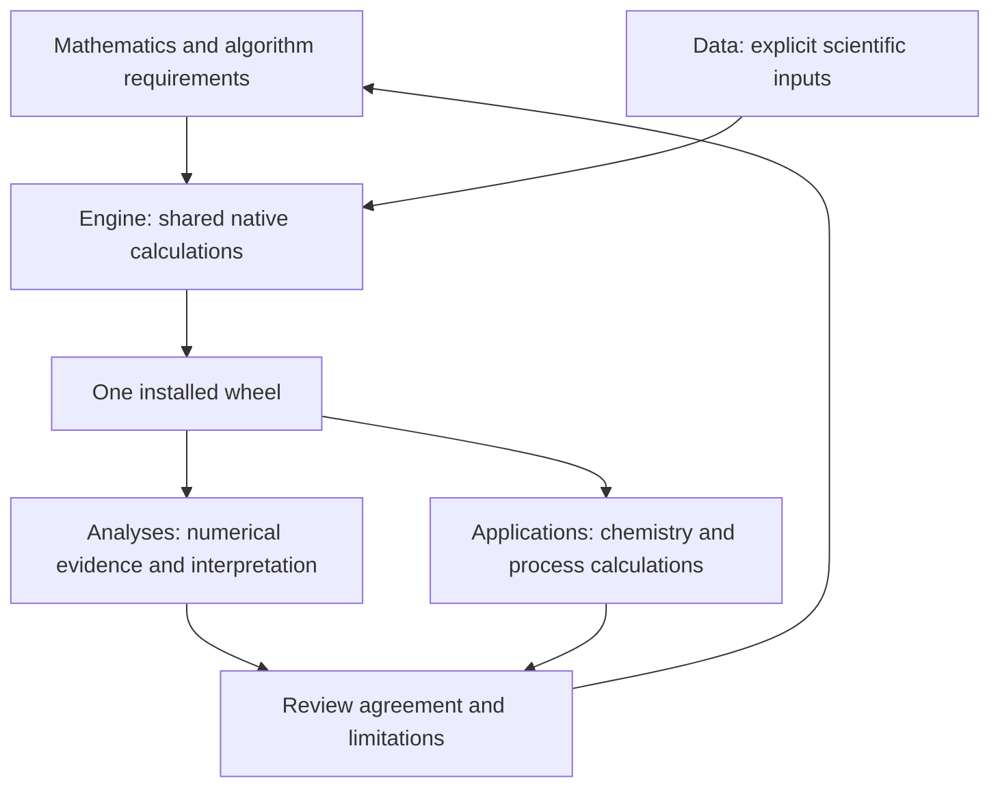

# Scientific context

default deliverable: capability

## Purpose and first acceptance

Build a general ePC-SAFT fluid thermodynamics platform: single-state properties,
phase and reaction equilibrium, exact derivative actions, and parameter fitting.
The three official applications are its first required acceptance uses, not
special cases encoded into the Engine. Generality means admitting physical
specifications and source-backed models within documented domains; it does not
promise every fluid, specification or derivative order before evidence exists.

MEA-Thermodynamics first requires reactive properties and fitting;
MEA-Absorption-Column requires consistent total caloric properties and the
solved-state actions its process equations consume; Lithium_Extraction requires
reactive liquid-liquid equilibrium and extraction observations. Their chemistry,
parameter adoption, transport and process models belong to the applications.
Solids remain a separately justified extension; kinetics and process simulation
are not current Engine responsibilities.

## The project map

The review arrow means a discrepancy prompts diagnosis or a justified proposed
scientific revision. Code behavior never silently changes the mathematics.
The implementation plan records missing and unqualified capability separately
from this intended architecture.

| Owner | Responsibility |
|---|---|
| `docs/scientific/` | This map, current implementation plan, accepted decisions, review evidence and writing guidance |
| `engine/docs/` | Canonical equations, conventions, formulation and algorithms |
| `data/` | Reusable scientific inputs, provenance and explicit materialization |
| `engine/native/` | Shared scientific calculations and numerical solves |
| `engine/src/epcsaft/` | Python input/output mapping to the native implementation |
| `engine/tests/` | Compact numerical falsifiers of Engine claims |
| `analyses/` | One-question calculations, retained results and interpretation using the installed wheel |
| Official application repositories | Application chemistry, parameter adoption, process equations and application acceptance |

## Engine responsibilities

Native dependencies run downward in `engine/ARCHITECTURE.yaml`; Python exposes
capabilities rather than reproducing the native directory tree.

| Layer | Owns | Boundary |
|---|---|---|
| core | Common constants, parameter coordinates, numerical policy and diagnostics | Small shared foundations; no phase or application selection |
| physics | Mathematical contributions and association equations | No competing thermodynamic implementation |
| model | State properties, EOS differentiation, density closure and reference thermochemistry | Single-state calculations and consistent derivative chains |
| equilibrium | Specification compilation, shared rows, one equilibrium driver, continuation, stability/discovery and solved-state actions | All equilibrium specifications use the same driver; no independent bubble, dew, reactive or paper-specific solvers |
| regression | Observation composition, weighted fitting and fit diagnostics | Consumes model/equilibrium values and actions; does not implement them again |
| surface | Physical input resolution and admission | Explicit parameters, units, choices and applicability |
| bindings | The Python/native boundary | One extension; native iterative work has no Python callbacks |

**One equilibrium driver is an owner requirement.** It owns the solve lifecycle
for all admitted equilibrium specifications and uses one row assembly and one
thermodynamic implementation. This is stronger than a facade dispatching to
independent equilibrium solvers. Density and association remain lower-level
numerical kernels. Continuation and phase discovery control sequences of
problems and reuse the same equilibrium driver where equilibrium is solved;
their search operations do not duplicate it.

The requirement does not certify the current Ipopt implementation or its
Hessian. The common driver's numerical method, any mathematically necessary
internal steps, and their scope must be qualified explicitly. If the requirement
cannot meet a demanded case within accuracy and cost limits, present that
specific evidence for an owner decision; do not quietly add a second driver.

## How the setup evolves

1. Identify the physical question, requested observable, domain and existing owner.
2. Settle missing mathematics or method choices through the applicable CSE route.
3. Change the smallest complete scientific slice, including required documentation
   and numerical evidence; preserve the one-driver and ownership requirements.
4. Review agreement and limitations, then update the implementation plan against
   the actual code and installed wheel. Application acceptance remains distinct.

New capability must earn its equations, inputs, ownership, evidence and budget.
The code floor is an aspirational engineering target; soft and hard ceilings
constrain the current scope. General-platform ambition does not authorize
speculative frameworks or automatic budget growth.

Superseded setup documents, stage briefs and agent execution instructions live
only in Git history. Keep current decisions and scientifically useful evidence
with their owners. Consult old records only for an identified provenance or
recovery question. Historical stage completion is never current acceptance.

## Authority

| Subject | Sole owner |
|---|---|
| Equation definitions, stable equation IDs and source locators | [equations.md](../../engine/docs/equations.md); generated `equations_registry.yaml` is an index |
| EOS symbols, units, conventions and source validity | [full-eos.md](../../engine/docs/science/full-eos.md) |
| Equilibrium formulation and specification admission | [formulation.md](../../engine/docs/equilibrium/formulation.md) |
| Algorithms, derivative orders, initialization, termination and failures | [algorithms.md](../../engine/docs/science/algorithms.md) |
| Regression observation and fit meaning | [regression formulation](../../engine/docs/regression/science/pure-saturation-regression.md) and [reproduction classes](../../engine/docs/regression/science/literature-reproduction-contract.md) |
| Current code owners, missing implementation and required evidence | [implementation plan](implementation-plan.md) |
| Runtime implementation and executable topology | `engine/native/`, `engine/src/epcsaft/`, `engine/ARCHITECTURE.yaml` |
| Accepted decisions | [adr/](adr/README.md), sole sequence |
| Reusable source packets and source applicability | `data/packets/`, `data/docs/packet-contract.md` |
| Numerical claims and retained evidence | `engine/tests/`, one-question sets under `analyses/`, dated reviews |
| Numerical policy values | `engine/native/core/numerical_policy.hpp`; algorithm requirements explain their meaning |
| Runtime source-size budgets | `engine/ARCHITECTURE.yaml:code_budgets`; [meaning and review](code-budgets.md) |
| Execution and check selection | root `AGENTS.md`, `tools/check-affected.sh`, `tools/check-all.sh` |

Mathematics defines required behavior. Code records actual behavior. Evidence
supports bounded claims about their agreement and physical adequacy. Neither
an architecture scan nor a successful solve proves model validity.

## Vocabulary and conventions

| Term | Meaning and source |
|---|---|
| independent reference case | Analytic identity, measurement, evaluated reference, or source model calculation; source class and uncertainty remain distinct (CSE terminology and transfer audit §7) |
| support | Species with coordinates in a phase; omitted species have structural zero amount (equilibrium formulation) |
| admission | Checking declared physical inputs and the requested mathematical domain before evaluation (full EOS §12) |
| derivative action | A requested directional derivative of a named observable on a stated branch and coordinate chart (algorithms) |
| convergence record | Achieved residual, comparison criterion, termination reason and available conditioning/error diagnostics (algorithms) |
| numerical floor | An estimate of attainable accuracy propagated from input/inner-solve error; not automatically a rigorous bound (algorithms) |
| fingerprint | A recorded identity of parameter, topology or installed wheel contents; not scientific evidence of accuracy (packet contract and root AGENTS) |
| typed failure | An unavailable result with a specific reason; not an invented physical value (algorithms) |
| claim boundary | Observable, domain, evidence and uncertainty to which a scientific conclusion applies (CSE scientific method) |
| stability certificate | A justified bound or theorem for the stated domain; finite search without a witness is insufficient (equilibrium formulation) |

Use bubble, dew, saturation and flash as mathematical specifications or data
constructors. Shared solvers must not select physics by an application or paper
name. All equilibrium specifications use the one driver described above; lower-level
kernels and search controllers retain their distinct mathematical roles. Residual polar
terms remain retired by ADR 0006; dipolar relative permittivity is distinct.
